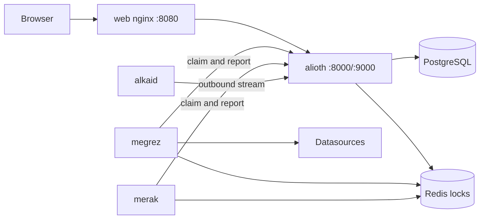

# Alioth 开发者指南

面向开发者；产品介绍见 [README.md](README.md)。

## 文档导航

- [docs/design.md](docs/design.md)：项目设计。服务边界、数据对象、端口与部署形态以它为准。
- [docs/roadmap.md](docs/roadmap.md)：里程碑顺序与验收。每步细则在同目录 `m*.md`，例如 [M11 VictoriaLogs LogsQL 告警闭环](docs/iterations/m11-vlogs-alerts.md)。
- [docs/iterations/conventions.md](docs/iterations/conventions.md)：各步通用的开发规范（分层、命名、import 分组、测试）。
- [deploy/k8s/README.md](deploy/k8s/README.md)：控制面多副本部署顺序、迁移 Job、PDB 与网络策略。
- [deploy/alkaid/README.md](deploy/alkaid/README.md)：摇光一键部署包、systemd 安装与配置。

## 仓库结构

单仓。四个后端应用各自一个 `go.mod`，用 `replace` 指向仓库根的 `pkg/`。

| 目录 | 内容 |
| --- | --- |
| `api/` | proto 与生成代码：`alioth/v1`（控制面对外 HTTP/gRPC 与 Agent 流）、`megrez/v1`、`merak/v1`。`make api` 用 buf 重新生成 |
| `app/` | 四个 Kratos 应用 `alioth` / `megrez` / `merak` / `alkaid`，各自含 `cmd`、`internal`、`configs`、`go.mod` |
| `pkg/` | 全仓库共用包：配置装载（`bootstrap`）、健康检查、Redis 分布式锁、错误码、通知与数据源客户端 |
| `web/` | React + TypeScript 管理台（Vite）。`web/nginx.conf` 定义 `/v1` 到玉衡的反代 |
| `deploy/` | 各服务 Dockerfile、Prometheus / Loki 配置、`k8s/` 集群清单、`alkaid/` 的 systemd 部署包与 `alkaid.yaml` |
| `docs/` | 设计文档、路线图、迭代细则与专题设计 |
| `scripts/` | 依赖镜像拉取、演示日志、摇光打包、命名检查 |

## 常用命令

Go 1.26，以各 `go.mod` 的 `go` 指令为准。

| 命令 | 作用 |
| --- | --- |
| `make build` | 构建 `bin/` 下的 alioth / megrez / merak / alkaid，并构建 web |
| `make vet` | 对各模块执行 `go vet` |
| `make lint` | gofmt、`scripts/check-naming.sh`、`buf lint`，与 CI 同一条命令 |
| `make test` / `make test-race` | 全部模块单测 / 带竞态检测 |
| `make migrate` | 建表 + seed + 分区（连 `app/alioth/configs/config.yaml` 指向的库） |
| `make run-alioth` | 前台运行单个进程，另有 `run-megrez`、`run-merak`、`run-alkaid`、`run-web` |
| `make dev-up` / `make dev-down` | compose 起 / 停完整本地栈 |
| `make images VERSION=v0.1.0` | 构建五个镜像 |
| `make package-alkaid` | 打摇光部署包 |

Web 用 npm（仓库锁文件是 `package-lock.json`）：

```bash
cd web
npm ci                # 安装依赖
npm run dev           # Vite 开发服务器
npm run typecheck     # tsc -b
npm run lint
npm run build
```

`make build-web` 与 CI 都走 `npm ci`；`package.json` 的脚本命令与包管理器无关（pnpm 下同名可用），装依赖仍以 `npm ci` 为准。

## 本地依赖

Docker Hub 不可达时，`make compose-up` 会先执行 [scripts/pull-compose-images.sh](scripts/pull-compose-images.sh)：按顺序尝试 `dockerproxy.net`、`docker.m.daocloud.io` 拉取 PostgreSQL、Redis、Mailpit、Prometheus、Loki、VictoriaLogs 和演示用的 curl，并重新 tag 成 compose 使用的官方名字。也可以指定自己的镜像代理：

```bash
MIRROR=dockerproxy.net make compose-images
make compose-up
```

## 本地全栈

`docker-compose.yaml` 包含完整链路：PostgreSQL（`pgdata` 持久卷）、Redis、Mailpit、Prometheus（`prometheusdata` 持久卷）、Loki（`lokidata` 持久卷）、VictoriaLogs（`vlogsdata` 持久卷）、一次性迁移，以及 `alioth` / `megrez` / `merak` / `web` 四个服务。Loki 对宿主机开放 3100 端口，容器内可用 `http://loki:3100` 配置数据源；VictoriaLogs 开放 9428 端口，容器内地址是 `http://victorialogs:9428`。干净 clone 后一条命令即可：

```bash
make dev-up          # 构建镜像、跑迁移、起全部服务
open http://127.0.0.1:8080
# Prometheus UI: http://127.0.0.1:9090；容器内数据源地址：http://prometheus:9090
# Loki readiness: http://127.0.0.1:3100/ready；宿主机数据源地址：http://127.0.0.1:3100
# 在 Alioth 内添加 LOGS_LOKI 数据源时，地址用 http://loki:3100（本地 Loki 未启用认证）
curl http://127.0.0.1:3100/ready
# VictoriaLogs health: http://127.0.0.1:9428/health；容器内数据源地址：http://victorialogs:9428
# 在 Alioth 内添加 LOGS_VLOGS 数据源时，地址用 http://victorialogs:9428（本地未启用认证）
curl http://127.0.0.1:9428/health
make loki-demo       # 可选：每 5 秒持续写入 api/error 和 web/info 示例日志
# 普通日志查询：{source="alioth-demo", app="api", level="error"}
# 告警数值表达式：sum by (app) (count_over_time({source="alioth-demo", app="api", level="error"} |= "request timeout" [1m]))
make loki-demo-stop  # 停止生成；Loki 和已写入日志保留
make vlogs-demo      # 可选：每 5 秒向 VictoriaLogs 写入 api/error 和 web/info 示例日志
# 普通日志查询：app:api level:error source:alioth-demo "request timeout"
# 告警数值表达式：app:api level:error source:alioth-demo "request timeout" | stats by (app, level) count() as value
make vlogs-demo-stop # 停止生成；VictoriaLogs 和已写入日志保留
make dev-down        # 停止服务，数据留在命名卷里
```

邮件沙箱在 <http://127.0.0.1:8025>，注册验证码、登录验证码和邀请邮件都会落到这里。

## 宿主机跑 Go 进程

只想在宿主机跑 Go 进程时，仍然可以用依赖 + 手工启动：

```bash
make compose-images  # 准备本地依赖镜像
# 只启动基础设施，不启动 compose 中的应用服务
docker compose up -d postgres redis mailpit prometheus loki victorialogs
make migrate         # 建表 + seed + 分区
make run-alioth      # 另开终端跑其余服务
```

## 环境变量

根目录的 `.env` 是唯一一份本地/部署变量表（已被 `.gitignore` 忽略，不会提交）：

- `docker compose` 自动读取它；`make` 目标也会加载并导出（命令行参数仍然优先，例如 `make images VERSION=v0.1.0`）。
- 原生运行（`make run-*`、`go run`）由 `pkg/bootstrap` 自动加载：从配置文件所在目录向上找最近的 `.env`，进程环境变量优先。
- 文件里已按用途分好段：安全密钥、服务间 key、站点地址、OAuth2、SMTP、数据库/Redis、历史库前缀、镜像版本、边缘 Agent。凡是留空会破坏默认值的项都写成注释，需要你补充的项直接填在等号右边。
- `ALIOTH_SMTP_FROM` 写裸地址（`aidedevops@163.com`）或 `显示名 <地址>`（`Alioth 瑶光 <aidedevops@163.com>`）。163 等邮箱要求信封发件人就是登录账号本身，只写显示名会让 `MAIL FROM` 带空格/中文，被服务端以 500/550 拒绝。

## 账号与登录

账号没有密码，登录只有两条路径：

- **邮箱验证码**：先答对数学计算图形验证码，再点「发送验证码」；验证码发到邮箱，10 分钟内有效、只能用一次。发码和最终登录都会校验图形验证码，同一邮箱 60 秒内只能发一次码。
- **第三方登录**：GitHub、Gitee、飞书和钉钉。配置客户端后登录页才显示入口，未配置时不影响邮箱验证码登录。第三方没有返回可用邮箱时，登录不会直接完成，需要在回调页二次填写邮箱并通过邮箱验证码验证，详见下文。

| 平台 | 环境变量 | 回调地址 |
| --- | --- | --- |
| GitHub | `GITHUB_CLIENT_ID`、`GITHUB_CLIENT_SECRET` | `http://127.0.0.1:8080/auth/callback` |
| Gitee | `GITEE_CLIENT_ID`、`GITEE_CLIENT_SECRET` | `http://127.0.0.1:8080/auth/callback` |
| 飞书 | `FEISHU_CLIENT_ID`、`FEISHU_CLIENT_SECRET` | `http://127.0.0.1:8080/auth/callback` |
| 钉钉 | `DINGTALK_CLIENT_ID`、`DINGTALK_CLIENT_SECRET` | `http://127.0.0.1:8080/auth/callback` |

注册同样只用邮箱验证码：填邮箱、图形验证码，发送验证码后提交。第一个注册用户成为超级管理员。

第三方登录只在第三方返回**平台已验证的邮箱**时直接完成：邮箱与本地账号相同时并入该账号，否则创建新账号。GitHub 看 `/user/emails` 的 verified 标记；Gitee 申请 `user_info emails`，用 `/api/v5/emails` 里 state=confirmed 的主邮箱判断；飞书邮箱由企业管理员在租户通讯录里维护、终端用户不能自行修改，且只有本企业安装的应用能完成授权，因此按企业已验证身份处理（飞书官方说明该邮箱不经用户本人实时验证，残余风险由企业通讯录的编辑权限兜底）。钉钉返回的邮箱只是用户自己填写的资料，平台不确认归属，按没有可用邮箱处理。

第三方没有可用邮箱（平台没有返回，或返回的邮箱未经平台确认）时，登录不会直接完成：回调页要求再填一次邮箱，先答对图形验证码再发送邮箱验证码，验证码验证通过后才签发会话，并把这个第三方身份绑定到该邮箱账号。同一个邮箱可以绑定多个第三方账号（例如飞书和钉钉各绑一次），之后用任一平台登录都会进入同一个账号。第三方返回的邮箱未经平台确认、而该邮箱已经属于本地账号时，也走这条二次验证流程，不再提示用户去第三方平台确认邮箱；平台确认过的邮箱仍然直接并入已有账号。

平台侧要求：GitHub 应用填授权回调地址即可（申请 `read:user user:email`）；Gitee 应用除了回调地址，还要在应用设置的权限里勾选 `emails`——授权会申请 `user_info emails`，应用没开该权限时 Gitee 授权页会报「请求范围无效、未知或格式不正确」，此时按没有可用邮箱处理，登录走二次邮箱验证。飞书应用在开放平台「安全设置」里添加同一个回调地址，在「权限管理」申请 `contact:user.email:readonly`（不申请也能登录，但 `user_info` 不返回邮箱，会走二次邮箱验证），发布应用并确保登录用户有应用使用权限。钉钉应用在开发者后台「开发配置 > 安全设置」添加同一个回调地址，在「权限管理」申请「通讯录个人信息读权限」，发布并给登录用户开通应用使用权限；钉钉用 `openId`（按应用唯一）绑定账号，`/v1.0/contact/users/me` 不返回可信邮箱，所以一律走二次邮箱验证。

历史版本在第三方没有邮箱时会创建占位邮箱账号（`feishu-<open_id>@users.alioth.local`、`dingtalk-<openId>@users.alioth.local`）。这些账号下次第三方登录也会要求补真实邮箱：邮箱还没有被占用时，直接把占位账号的邮箱改成它，成员、角色和个人资料都保留；邮箱已经属于另一个本地账号时，把占位账号的租户成员和角色迁移到邮箱账号（同一租户的角色取并集），第三方绑定也改绑过去。个人偏好（列表列、告警页选择）和系统消息不迁移；占位账号本身保留为空账号，不再有租户成员身份和第三方绑定，平台管理员可以在用户列表里看到。

注册 OAuth 应用时需要的图标可以直接用 [web/public/alioth.png](web/public/alioth.png)（512×512 PNG，透明圆角）；站点图标另有 SVG 版本 [web/public/alioth.svg](web/public/alioth.svg) 和 iOS 主屏用的 `apple-touch-icon.png`。

## 镜像与发布

四个 Go 服务与 web 都有多阶段 Dockerfile，构建上下文固定为仓库根目录：

```bash
make images VERSION=v0.1.0 IMAGE_PREFIX=alioth
```

镜像内注入 `main.version`，可用 `docker run --rm alioth/alioth:v0.1.0 version` 核对；Kubernetes
部署顺序、迁移 Job、PDB 与网络策略见 [deploy/k8s/README.md](deploy/k8s/README.md)。

`.github/workflows/release.yml` 在 `main` 和 `v*` tag 上构建并推送镜像，tag 上同时发布摇光部署包：

| 服务 | GHCR 镜像 |
| --- | --- |
| 玉衡 | `ghcr.io/aide-family/moon/alioth` |
| 天权 | `ghcr.io/aide-family/moon/megrez` |
| 天璇 | `ghcr.io/aide-family/moon/merak` |
| 摇光 | `ghcr.io/aide-family/moon/alkaid` |
| Web | `ghcr.io/aide-family/moon/web` |

- `v0.1.0` 这类 tag 产出 `v0.1.0`、`0.1.0`、`0.1`、`0`、`latest` 标签（`-rc1` 这类预发布 tag 不覆盖 `latest`），镜像为 amd64 + arm64 多架构；`main` 只出 amd64，标签是 `main` 与 `sha-<12 位>`。
- 镜像带 `org.opencontainers.image.source` 等 OCI 标签，GHCR 包因此关联本仓库；构建来源证明（provenance）与 SBOM 随镜像推送。
- tag 的 Release 附带摇光 `alkaid` 的 linux/amd64、linux/arm64 裸二进制，以及含 systemd 单元、配置模板和 `install.sh` 的部署包，外加 `SHA256SUMS`，并用 GitHub Artifact Attestation 记录产物来源。安装见 [deploy/alkaid/README.md](deploy/alkaid/README.md)。
- 本地可以先跑同一条打包命令验证产物：`make package-alkaid VERSION=v0.1.0`（`ARCHES=amd64` 只打一个架构），输出在 `dist/`。

## 健康检查

| 服务 | liveness | readiness |
| --- | --- | --- |
| alioth | `/livez` | `/readyz`（PostgreSQL + Redis） |
| megrez / merak | `/livez` | `/readyz`（Redis 锁） |
| web | `/health` | `/health` |

`/health` 作为旧契约保留。readiness 失败只摘流量，不会触发重启。

## 服务

| 中文 | 编码名 | 职责 | 监听 |
| --- | --- | --- | --- |
| 玉衡 | `alioth` | 控制面。身份与租户、告警/通知配置与事件落库；唯一写入 PostgreSQL；对外提供 HTTP/gRPC | HTTP 8000，gRPC 9000 |
| 天权 | `megrez` | 领取到期规则、向数据源评测、回写结果；不写业务库 | HTTP 8001（仅健康检查） |
| 天璇 | `merak` | 领取待发送任务、邮件/Webhook 投递、回写结果；不写业务库 | HTTP 8002（仅健康检查） |
| 摇光 | `alkaid` | 边缘 Agent。出站连接控制面，执行 SSH 与 Web Shell | HTTP 8022，gRPC 9022（不对集群外发布） |
| Web | `web` | 管理台静态资源与 nginx；集群外唯一入口，`/v1` 反代到玉衡 | HTTP 8080 |

Redis 只做分布式锁（`alioth` / `megrez` / `merak`），不当缓存或队列。业务状态在 PostgreSQL。

## 服务关系


