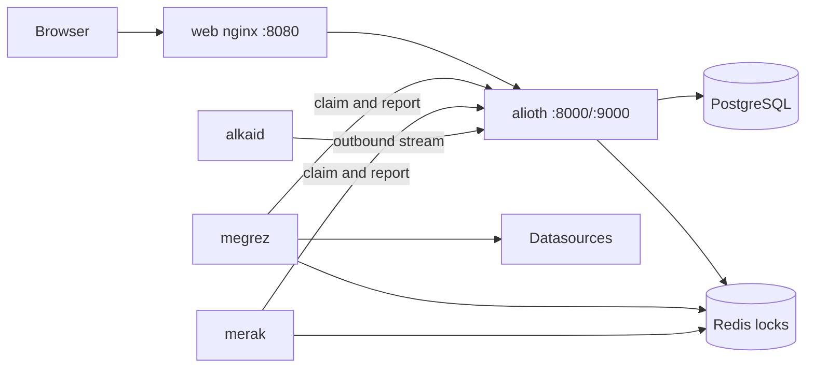

# Alioth

Alioth 是运维平台。玉衡（`alioth`）保存业务数据，天权（`megrez`）执行告警规则，天璇（`merak`）发送通知，摇光（`alkaid`）作为边缘 Agent 提供 SSH、SFTP 和 Kubernetes API 代理。浏览器只访问 Web，由 nginx 把 API 转到玉衡。

设计说明见 [docs/design.md](docs/design.md)。迭代步骤与验收见 [docs/roadmap.md](docs/roadmap.md)。各步开发细则见 [docs/iterations/conventions.md](docs/iterations/conventions.md)。

## 本地依赖

Docker Hub 不可达时，`make compose-up` 会先执行 [scripts/pull-compose-images.sh](scripts/pull-compose-images.sh)：按顺序尝试 `dockerproxy.net`、`docker.m.daocloud.io` 拉取 PostgreSQL/Redis/Mailpit，并重新 tag 成 compose 使用的官方名字。也可以指定自己的镜像代理：

```bash
MIRROR=dockerproxy.net make compose-images
make compose-up
```

## 服务

| 中文 | 编码名 | 职责 | 监听 |
| --- | --- | --- | --- |
| 玉衡 | `alioth` | 控制面。身份与租户、告警/通知配置与事件落库；唯一写入 PostgreSQL；对外提供 HTTP/gRPC | HTTP 8000，gRPC 9000 |
| 天权 | `megrez` | 领取到期规则、向数据源评测、回写结果；不写业务库 | HTTP 8001（仅 `/health`） |
| 天璇 | `merak` | 领取待发送任务、邮件/Webhook 投递、回写结果；不写业务库 | HTTP 8002（仅 `/health`） |
| 摇光 | `alkaid` | 边缘 Agent。出站连接控制面，执行 SSH、SFTP、Kubernetes 代理 | HTTP 8022，gRPC 9022（不对集群外发布） |
| Web | `web` | 管理台静态资源与 nginx；集群外唯一入口，`/v1` 反代到玉衡 | HTTP 8080 |

Redis 只做分布式锁（`alioth` / `megrez` / `merak`），不当缓存或队列。业务状态在 PostgreSQL。

## 服务关系


