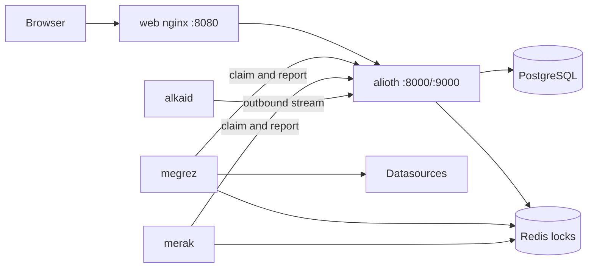

<p align="center"></p>

# Alioth

Alioth 是运维平台。玉衡（`alioth`）保存业务数据，天权（`megrez`）执行告警规则，天璇（`merak`）发送通知，摇光（`alkaid`）作为边缘 Agent 提供 SSH 执行与 Web Shell。浏览器只访问 Web，由 nginx 把 API 转到玉衡。

设计说明见 [docs/design.md](docs/design.md)。迭代步骤与验收见 [docs/roadmap.md](docs/roadmap.md)。各步开发细则见 [docs/iterations/conventions.md](docs/iterations/conventions.md)。

## 本地依赖

Docker Hub 不可达时，`make compose-up` 会先执行 [scripts/pull-compose-images.sh](scripts/pull-compose-images.sh)：按顺序尝试 `dockerproxy.net`、`docker.m.daocloud.io` 拉取 PostgreSQL、Redis、Mailpit、Prometheus 和 Loki，并重新 tag 成 compose 使用的官方名字。也可以指定自己的镜像代理：

```bash
MIRROR=dockerproxy.net make compose-images
make compose-up
```

## 本地全栈

`docker-compose.yaml` 现在包含完整链路：PostgreSQL（`pgdata` 持久卷）、Redis、Mailpit、Prometheus（`prometheusdata` 持久卷）、Loki（`lokidata` 持久卷）、一次性迁移，
以及 `alioth` / `megrez` / `merak` / `web` 四个服务。Loki 对宿主机开放 3100 端口，容器内可用 `http://loki:3100` 配置数据源。干净 clone 后一条命令即可：

```bash
make dev-up          # 构建镜像、跑迁移、起全部服务
open http://127.0.0.1:8080
# Prometheus UI: http://127.0.0.1:9090；容器内数据源地址：http://prometheus:9090
# Loki readiness: http://127.0.0.1:3100/ready；宿主机数据源地址：http://127.0.0.1:3100
# 在 Alioth 内添加 LOGS_LOKI 数据源时，地址用 http://loki:3100（本地 Loki 未启用认证）
curl http://127.0.0.1:3100/ready
make loki-demo       # 可选：每 5 秒持续写入 api/error 和 web/info 示例日志
# 普通日志查询：{source="alioth-demo", app="api", level="error"}
# 告警数值表达式：sum by (app) (count_over_time({source="alioth-demo", app="api", level="error"} |= "request timeout" [1m]))
make loki-demo-stop  # 停止生成；Loki 和已写入日志保留
make dev-down        # 停止服务，数据留在命名卷里
```

只想在宿主机跑 Go 进程时，仍然可以用依赖 + 手工启动：

```bash
make compose-images  # 准备本地依赖镜像
# 只启动基础设施，不启动 compose 中的应用服务
docker compose up -d postgres redis mailpit prometheus loki
make migrate         # 建表 + seed + 分区
make run-alioth      # 另开终端跑其余服务
```

邮件沙箱在 <http://127.0.0.1:8025>，登录验证码和邀请邮件都会落到这里。

## 镜像与发布

四个 Go 服务与 web 都有多阶段 Dockerfile，构建上下文固定为仓库根目录：

```bash
make images VERSION=v0.1.0 IMAGE_PREFIX=alioth
```

镜像内注入 `main.version`，可用 `docker run --rm alioth/alioth:v0.1.0 version` 核对；Kubernetes
部署顺序、迁移 Job、PDB 与网络策略见 [deploy/k8s/README.md](deploy/k8s/README.md)。

## 健康检查

| 服务 | liveness | readiness |
| --- | --- | --- |
| alioth | `/livez` | `/readyz`（PostgreSQL + Redis） |
| megrez / merak | `/livez` | `/readyz`（Redis 锁） |
| web | `/health` | `/health` |

`/health` 作为旧契约保留。readiness 失败只摘流量，不会触发重启。

## 服务

| 中文 | 编码名 | 职责 | 监听 |
| --- | --- | --- | --- |
| 玉衡 | `alioth` | 控制面。身份与租户、告警/通知配置与事件落库；唯一写入 PostgreSQL；对外提供 HTTP/gRPC | HTTP 8000，gRPC 9000 |
| 天权 | `megrez` | 领取到期规则、向数据源评测、回写结果；不写业务库 | HTTP 8001（仅健康检查） |
| 天璇 | `merak` | 领取待发送任务、邮件/Webhook 投递、回写结果；不写业务库 | HTTP 8002（仅健康检查） |
| 摇光 | `alkaid` | 边缘 Agent。出站连接控制面，执行 SSH 与 Web Shell | HTTP 8022，gRPC 9022（不对集群外发布） |
| Web | `web` | 管理台静态资源与 nginx；集群外唯一入口，`/v1` 反代到玉衡 | HTTP 8080 |

Redis 只做分布式锁（`alioth` / `megrez` / `merak`），不当缓存或队列。业务状态在 PostgreSQL。

## 服务关系


