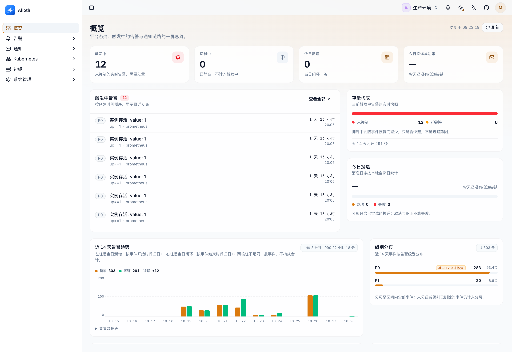
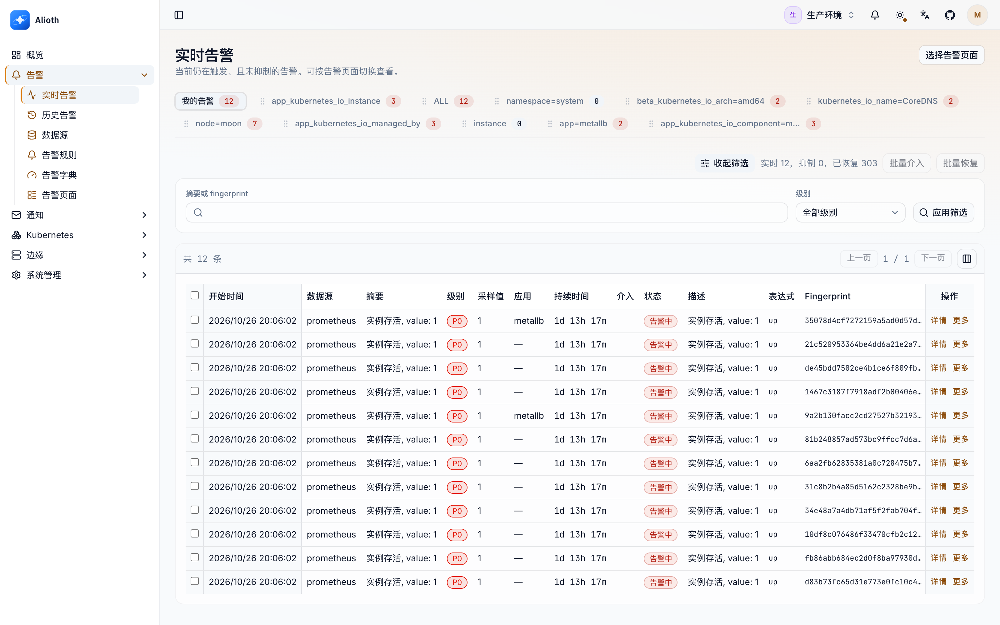
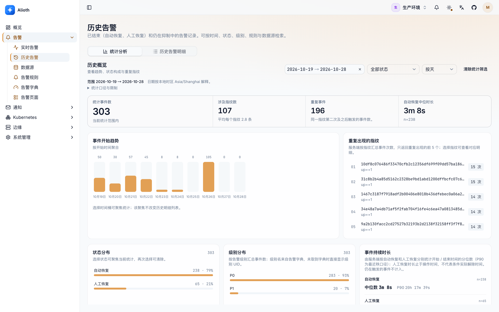
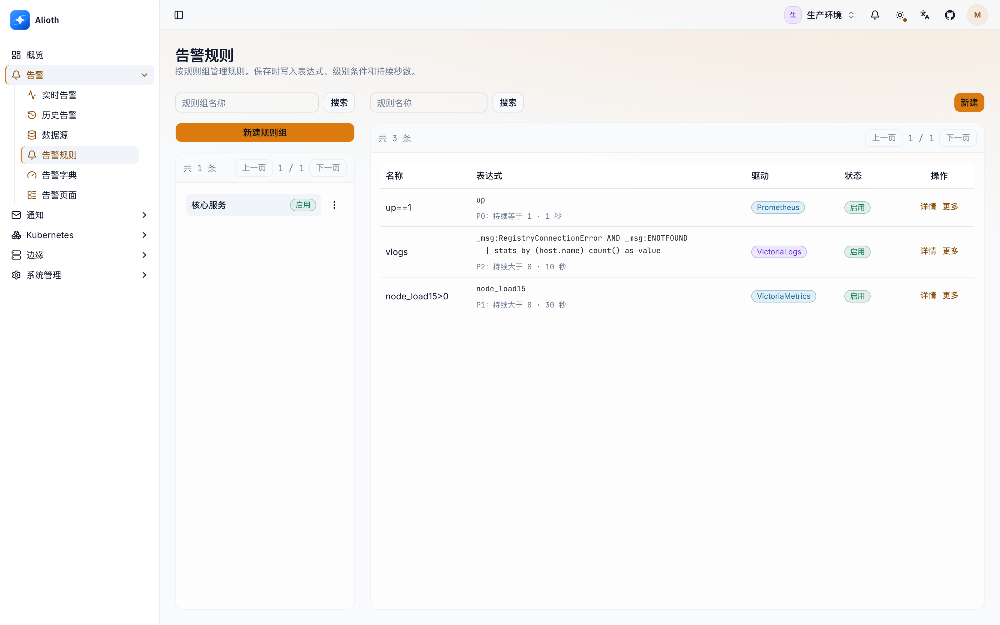
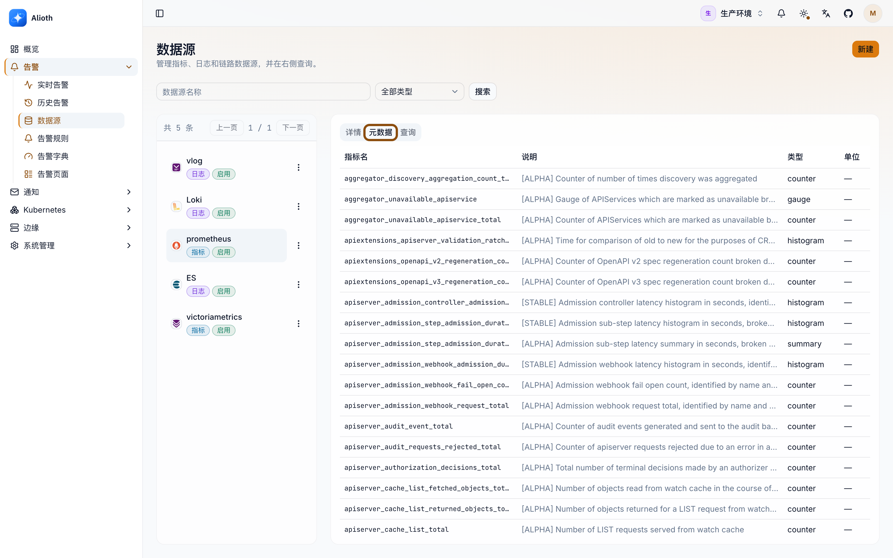
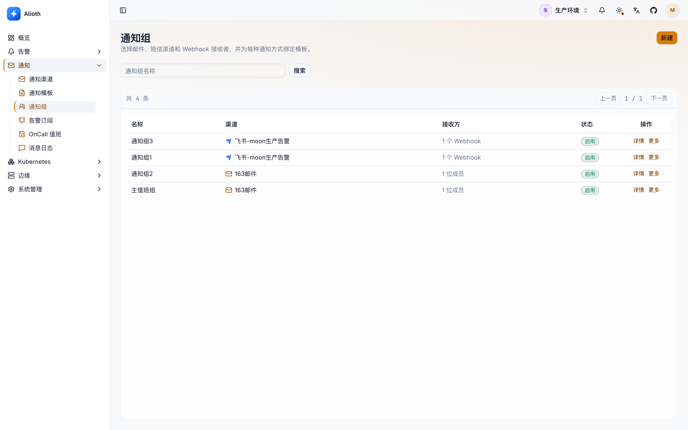
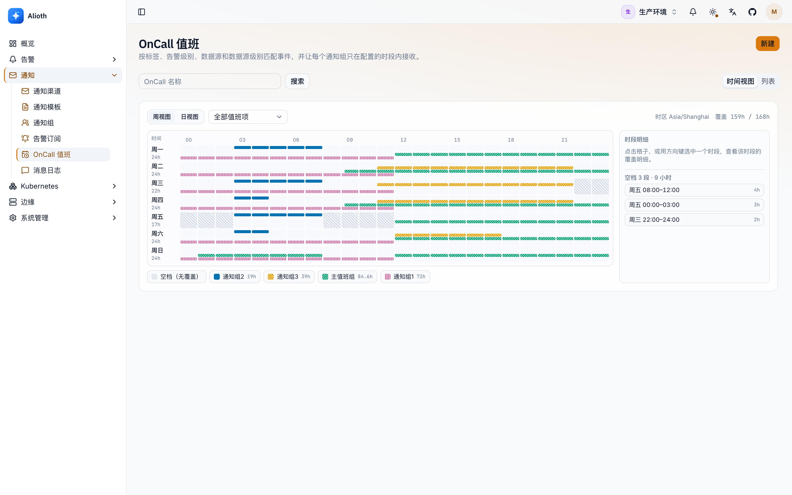
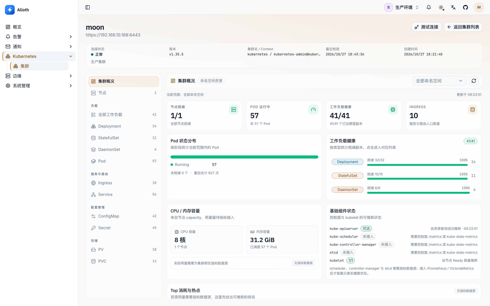
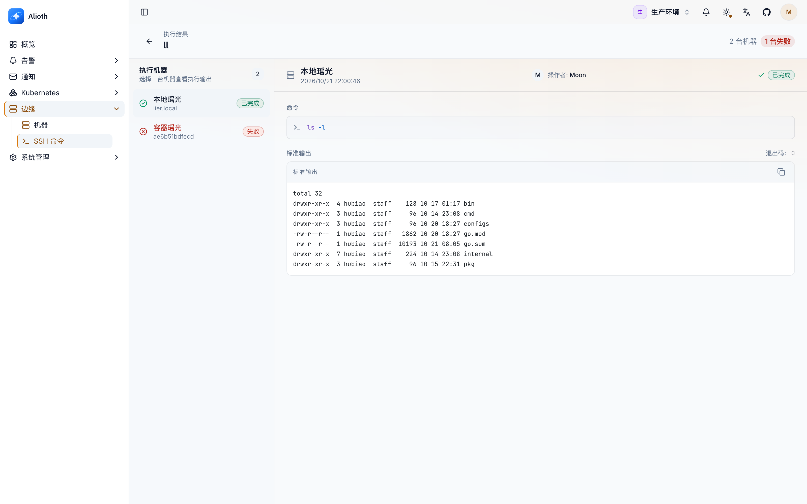

<p align="center"></p>

# Alioth

<p align="center">自建、多租户的运维平台：数据源评测、告警、通知与值班处置在同一条链路上完成。</p>

<p align="center">
  <a href="https://github.com/aide-family/Alioth/actions/workflows/ci.yml"></a>
  <a href="https://github.com/aide-family/Alioth/releases"></a>
  <a href="https://github.com/aide-family/Alioth/stargazers"></a>
  <a href="https://github.com/aide-family/Alioth/forks"></a>
  <a href="https://github.com/aide-family/Alioth/issues"></a>
  <a href="https://github.com/aide-family/Alioth/pulls"></a>
  <a href="https://github.com/aide-family/Alioth/commits/main"></a>
  <a href="https://github.com/aide-family/Alioth/graphs/contributors"></a>
  
  
</p>

<p align="center"></p>

Alioth 是 aide-family 自建的运维平台，面向需要在自有环境里运行告警与值班流程的团队。它把数据源查询、告警规则评测、通知投递和 OnCall 值班放在同一条链路上，配置、事件与投递结果都保存在自己控制的 PostgreSQL 里。四个进程按北斗星名分工：玉衡 `alioth` 是控制面，统一保存身份、租户、告警与通知配置，业务数据由它写入 PostgreSQL；天权 `megrez` 领取到期规则并查询数据源完成评测；天璇 `merak` 领取待发送任务，投递邮件与 Webhook；摇光 `alkaid` 是边缘 Agent，主动出站连接控制面，执行 SSH 与 Web Shell。管理台是浏览器里的 React 单页应用，页面和接口走同一个 Web 入口。

## 核心能力

- 多租户与 RBAC：平台角色和租户角色分开，邀请确认后加入租户。
- 实时告警与历史分析：触发、抑制、恢复、介入与历史统计。
- 规则评测：面向 Prometheus、VictoriaMetrics、Loki、VictoriaLogs、Elasticsearch 的告警规则。
- 通知与订阅：邮件、Webhook 渠道、模板、通知组与告警订阅。
- OnCall 值班：按通知组接收时段路由，支持跨午夜。
- Kubernetes 多集群：接入集群，管理节点、工作负载、Pod 与 Ingress。
- 边缘 Agent：SSH 命令审核执行与 Web Shell。
- 登录与身份：邮箱验证码登录，以及 GitHub、Gitee、飞书、钉钉第三方登录。

## 概览与多租户

概览页是值班入口，把当前在触发与抑制中的告警、今日新增、通知投递成功率、最近 7 天的投递趋势、14 天的告警趋势与级别分布、数据源与规则数量，以及后台工作进程的在线与忙碌情况集中在一屏，卡片按当前账号的权限显示。用户是平台级身份，租户（Namespace）承载成员与业务资源，业务资源都归属某个租户，同一实例上的租户互相看不到对方的数据。平台角色 SUPER_ADMIN、SYSTEM_ADMIN、USER 决定系统级能力，系统级权限只授予前两者，租户角色拿不到；租户预置 owner、admin、member、viewer 四种角色，持有 `resource:action` 形式的租户权限。成员通过邀请加入：租户管理员发出邀请，被邀请人在平台上确认后才创建成员并授予角色，邀请和结果都写入系统消息。登录没有密码，支持邮箱验证码，以及 GitHub、Gitee、飞书、钉钉第三方登录；第三方没有返回可用邮箱时，需要补填邮箱并通过验证码验证。

## 实时告警与告警历史分析

实时告警只列出仍在触发且未被抑制的事件，可以按摘要或告警指纹与告警级别筛选；每条事件可以介入、抑制或手工恢复，也支持批量介入和批量恢复，抑制时长从 1 分钟到 30 天。事件详情展示规则表达式、样本值、事件标签和按事件区间取的数值曲线，恢复事件截止到恢复时刻。表格列可以自定义，内置字段列和事件标签列都能作为列，配置按用户与视图保存。

<p align="center"></p>

### 告警历史分析

历史告警把统计分析和事件明细分成两个视图：分析页按趋势、终态和重复告警指纹聚合，终态分为自动恢复、人工恢复和仍在抑制中三种。明细页按摘要、级别、规则名、数据源、事件状态、抑制状态和开始时间范围过滤，单次查询的时间跨度最多 30 天。事件恢复后归档到历史存储并从实时列表移走，归档失败时历史列表仍会回退显示，不会丢事件；明细页复用实时告警的自定义列机制。

<p align="center"></p>

## 告警规则（含自定义变量）

告警规则按规则组管理，每条规则通过驱动选择查询方式，用数据源标签匹配启用中的数据源：数据源级别匹配数据源等级名称，数据源匹配数据源名称，值为完整匹配正则，留空表示该驱动下的全部启用数据源。每个级别条件设置比较条件（EQ、NE、GT、GTE、LT、LTE、IN、NOT_IN）、采样方式（FOR、MAX、MIN）、阈值和持续秒数，并指向告警字典里的名称与展示色。

指标规则查询 Prometheus 或 VictoriaMetrics 的区间数据；Loki 规则使用返回数值序列的 LogQL，VictoriaLogs 规则使用带 stats 的 LogsQL，Elasticsearch 规则把时间桶内的命中文档数作为采样值。原始日志结果不会被当成采样值，因此不会把日志查询误判成告警恢复。

摘要和描述可以声明自定义查询变量：变量名、查询语句和说明随规则保存，触发时用主查询命中的标签展开变量查询，再把结果填进文案，例如磁盘使用率规则可以声明 `disk_free` 变量，在摘要里补出剩余容量。变量只影响告警文案，不参与告警指纹、级别判定和恢复，变量查询语言跟随规则使用的数据源驱动。

<p align="center"></p>

## 数据源

数据源按指标、日志、链路三类保存，归属当前租户，可以启停、绑定数据源级别并携带 labels 供规则匹配，密钥加密保存。

指标数据源支持 Prometheus 与 VictoriaMetrics：状态、指标列表、指标详情、即时查询、区间查询和代理查询。VictoriaMetrics 使用 MetricsQL（兼容 PromQL），地址可以带路径前缀，适配集群版部署。日志数据源支持 Loki、VictoriaLogs 与 Elasticsearch：Loki 使用 LogQL，VictoriaLogs 使用 LogsQL，Elasticsearch 使用 Query DSL 或普通检索语句，索引模式与时间字段随数据源保存。元数据页展示上游状态：Prometheus 与 VictoriaMetrics 的指标元数据、Loki 的构建信息、VictoriaLogs 的健康状态、Elasticsearch 的集群健康与节点分配。链路数据源（Jaeger）可以保存并做查询代理，暂不参与规则评测。

<p align="center"></p>

## 通知

通知渠道支持 SMTP 邮件与 Webhook，Webhook 应用类型为 OTHER、DINGTALK、WECHAT、FEISHU，配置签名时按各自规则附加签名头或参数；短信类型只保留渠道与模板配置，暂未接入发送。

模板按消息类型与应用区分，告警摘要、描述和通知模板共用同一套模板函数，`$labels`、`$value`、`.Labels`、`.Value`、`humanize` 等写法可以直接使用，系统预置模板只读、可以预览并另存为当前租户的副本；通知组把渠道、模板与接收方组合在一起：邮件与短信渠道各最多一个，Webhook 可以多选，邮件接收方由手填邮箱与成员邮箱合并去重。

告警订阅按标签、告警级别、数据源和数据源级别匹配事件，条件之间是 AND，空条件表示不限制，命中后把事件发送给订阅下的通知组；订阅与 OnCall 各自配置重复通知间隔，同一告警在间隔内不会重复通知，恢复通知单独判断，投递失败的任务按剩余次数重试，消息日志分租户归档并支持查看、重试和取消。

<p align="center"></p>

### OnCall 值班路由

OnCall 是通知下的第二套路由，匹配条件与告警订阅相同，另外为每个绑定的通知组保存接收时段；时段按星期与 HH:mm 起止时间组成，边界左闭右开，支持跨午夜（例如 FRIDAY 22:00-06:00 覆盖周五晚到周六凌晨），空时段表示全天候接收，时区按 IANA 名称保存。同一事件同时命中订阅和 OnCall 时，接收方会合并去重：同一邮箱或手机号只收到一次通知，同一个 Webhook 渠道只收到一次；重复通知间隔取命中来源中的最大值，恢复通知不受间隔限制，但只在同一告警仍有投递链路上的通知时发送。页面支持 OnCall 的增删改查、启停和时段编辑，通知组、数据源与数据源级别使用可搜索、可全选的下拉框。

<p align="center"></p>

## Kubernetes 多集群

租户可以粘贴 kubeconfig 接入多个 Kubernetes 集群，名称在同一租户内唯一；接入时解析当前 context 并探测 API Server 版本，探测失败不入库。kubeconfig 加密后保存，任何接口都不回传原文，只接受内嵌证书或 Token 的配置，需要执行本机命令或读取本地文件的凭据会被拒绝。

集群列表展示 API Server、版本、最近检测时间与最近错误，支持改名与备注、替换 kubeconfig、手动测试连通性和删除。

进入单个集群后可以查看节点状态与容量、cordon 与 uncordon 节点，调整 Deployment 与 StatefulSet 副本数、滚动重启三种工作负载，查看 Pod 状态、容器与所属控制器，删除 Pod、读取容器日志尾部，以及查看 Ingress 的 IngressClass、主机、路径、后端服务与 TLS。Service、ConfigMap、Secret、PV、PVC 提供只读列表与详情，Secret 与 ConfigMap 只显示键名，值在页面上以脱敏形式展示。权限用 `cluster:read`、`cluster:write`、`cluster:delete` 控制，owner 与 admin 默认拥有全部，member 与 viewer 默认只读。

<p align="center"></p>

## 边缘 Agent（SSH 与 Web Shell）

摇光 Agent 部署在目标机器或 Kubernetes 集群里，主动出站连接玉衡的 gRPC，使用独立的 Agent 令牌，不在公网监听管理端口，控制面也不需要回拨 Agent。连接建立后上报租户、令牌、主机名与机器标识，随后周期心跳并上报机器信息；连接断开即标记离线，对离线 Agent 执行命令会立即失败，不在控制面排队。

SSH 命令走审核流：提交新建或更新生成待审核审计，通过后才可执行。执行时控制面校验 `ssh:exec` 权限，把命令发送给选定的在线 Agent，由 Agent 在自身所在机器执行本地 shell 命令并回传退出码与输出，每次执行都写入审计，审计只追加。Web Shell 使用一次性票据在同一条双向流上打开终端，输入输出实时回传。控制面多副本部署时，Agent 会自动连接可用副本，扩缩容后补齐或释放连接。

<p align="center"></p>

## 快速开始

```bash
git clone https://github.com/aide-family/Alioth.git && cd Alioth
make dev-up
open http://127.0.0.1:8080
```

需要 Docker 与 Docker Compose；依赖服务、环境变量、镜像构建与部署说明见 [DEVELOP.md](DEVELOP.md)。

## 文档

- [DEVELOP.md](DEVELOP.md)：本地开发、环境变量、依赖服务、镜像构建与部署。
- [docs/design.md](docs/design.md)：服务边界、数据模型、接口与安全设计。
- [docs/roadmap.md](docs/roadmap.md)：迭代里程碑与可重复的验收标准。
- [docs/iterations/conventions.md](docs/iterations/conventions.md)：各步迭代开发细则的通用规范。

## Star 趋势

<p align="center">
  <a href="https://star-history.com/#aide-family/Alioth&Date"></a>
</p>
