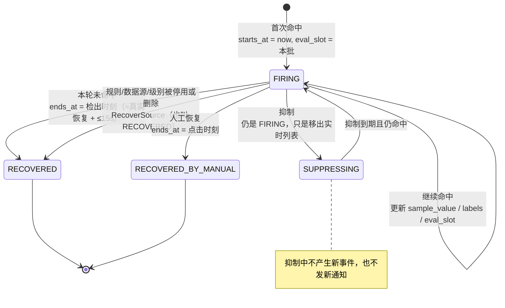

# Dashboard 指标口径与规范

本文定义 Alioth 管理台 Dashboard 页（下称「大盘」）的统计口径、指标体系、图表映射、展示规范与验证方法。只定义口径，不含实现；接口缺口在 [第 10 节](#10-数据缺口与建议接口) 单列，前端可先按 [第 10.3 节](#103-建议接口契约待实现) 的 mock 契约开发。

口径基线版本：**v1（2026-10-25）**。指标定义一经冻结即作为前后端与验收的共同契约，任何改动按 [第 13 节](#13-版本与变更控制) 升版本，不允许在页面里就地改口径。

> **实现状态（2026-10-25 更新）**：第 3.2 节的「并集」地基已经在服务端落地——
> `GET /v1/alert-insight` 合并实时表与归档周表（主库 uid 去重）、按本地自然日分桶、
> `percentile_disc(0.9)` 对齐 P90 最近秩口径。新增按 `starts_at` 归日、闭环按 `ends_at` 归日，
> 两条时间轴分开算（同一天的两根柱不是同一批事件），相减得到区间内存量净增；
> 归档表按创建周分片，闭环序列按创建周回溯 30 天。
> 仍未实现：按 `ends_at` 的独立恢复趋势、评测可信度（`eval_slot` 陈旧度）、
> 投递任务阶段拆分、标签维度分解——这几项仍需要新的后端能力，页面按「未知」处理而不是估算。

| 关联文档 | 用途 |
| --- | --- |
| [design.md](design.md) | 业务模型：告警事件、订阅、任务、投递日志、Agent |
| [web/AGENTS.md](../web/AGENTS.md) | 布局、滚动归属、表格列宽、Tabs 约束 |
| [.cursor/skills/alioth-web-design/SKILL.md](../.cursor/skills/alioth-web-design/SKILL.md) | 间距、卡片、页头、色板 |
| `web/src/pages/alert/history-insights.tsx` | 现有唯一统计实现，口径必须与之一致 |

---

## 1. 结论摘要

1. **大盘不是业务 KPI 看板，而是「告警信噪比 + 链路可信度」看板。** Alioth 没有营收、用户、转化，唯一可度量的结果是「告警是否被及时闭环」和「告警是否值得打扰人」。
2. **北极星是「闭环时长 P90」，但它单独读一定会被读坏。** 噪声告警闭环快，人工恢复也能把时长截断。所以北极星必须与三个护栏（噪声重复率、通知送达率、未处置存量）同时呈现，见 [4.1](#41-北极星)。
3. **现有接口只支持 `starts_at` 过滤，不支持 `ends_at`。** 因此所有「按日恢复数」类指标无法直接查询，必须读明细在浏览器侧分桶（上限 5000 条）或走新聚合接口。
4. **历史列表视图排除「正在触发且未抑制」的事件。** 直接用历史接口算「近 24h 新增事件」会**系统性少算**，且越靠近当前越严重。必须与实时列表求并集，见 [3.2](#32-事件集合的定义这个并集是全部口径的地基)。
5. **`RECOVERED` 不等于「故障消除」。** 停用规则、停用/删除数据源、删除级别都会把事件标成 `RECOVERED` 并发恢复通知。指标里必须叫「系统恢复」，不能叫「自愈」。
6. **沉默 ≠ 健康。** 评测失败不落库、无查询接口，`0 告警` 既可能是没事，也可能是压根没评。大盘必须显式给出可信度证据（陈旧触发、规则可评测率），否则不给结论。
7. **不做等级加权评分。** `AlertDictionary` 只有 `name`/`color`，没有排序或权重字段，任何加权都是凭空造序数。

---

## 2. 业务本质与决策问题

### 2.1 业务本质

Alioth 是自建运维平台：玉衡存配置与事件，天权每 15 秒评测规则，天璇按订阅投递，摇光在边缘执行。大盘的读者不是「看趋势的高管」，而是**值班的人、租户管理员、平台管理员**，他们在读完一屏后要决定一件事：**现在要不要动手，动哪里**。

因此大盘的三个性质：

- **状态优先于趋势。** 「现在有多少条在响、最老多久」比「本周同比」重要一个数量级。
- **可信度必须前置。** 数字失真时，越精确越误导；大盘要能自证「这些数是怎么来的、有没有缺口」。
- **噪声是主要成本。** 平台的价值不是「发出更多告警」，而是「少发无用告警且不漏关键告警」。漏报无 ground truth，所以度量重心在噪声与链路可靠性。

### 2.2 读者要回答的 5 个问题

| # | 问题（读者的原话） | 本质 | 决策 | 失败代价 |
| --- | --- | --- | --- | --- |
| **Q1** | 现在有什么在响？响了多久？谁该管？ | 当前未恢复告警的**存量与年龄** | 要不要叫人、要不要升级 | 漏看一条烧了 8 小时的告警 |
| **Q2** | 这一周我被打扰了几次？多少是重复噪声？ | 事件量、**唯一指纹 vs 事件**、集中度 | 要不要改阈值/FOR/抑制/分组 | 团队被噪声训练成「不看告警」 |
| **Q3** | 告警能自己结束吗？人工兜底占多少？ | **闭环时长分布**与终止方式构成 | 要不要加自动化、要不要查为什么关不掉 | 长期挂着的告警变成背景墙 |
| **Q4** | 该响的时候，通知真的送到了吗？ | 任务级**终态成功率**、积压、渠道差异 | 要不要修渠道/模板/订阅 | 告警触发了但没人收到 |
| **Q5** | 这些数字本身可信吗？ | 评测是否在跑、配置能否匹配、采集是否在线、数据是否自洽 | 先修数据，再谈结论 | 在假数据上做真决策 |

Q5 是元问题，也是本文与其他「大盘模板」最大的区别：**没有 Q5 的看板，等于把假设当结论卖。**

### 2.3 从问题倒推指标

| 问题 | 北极星/结果 | 过程 | 质量与健康度 |
| --- | --- | --- | --- |
| Q1 | — | P-1 未处置存量、P-2 存量年龄 P50/P90、P-4 抑制存量 | Q-1 陈旧触发 |
| Q2 | R-1 事件量、R-2 噪声重复率 | P-3 新增速率 | Q-5 集中度 |
| Q3 | NS-1 闭环时长 P90、R-3 系统恢复占比、R-5 介入覆盖率 | — | Q-1、Q-2 |
| Q4 | R-4 通知送达率 | P-5 积压、P-6 试发成功率、P-7 扇出 | Q-4 失败原因、Q-9 通知时延 |
| Q5 | — | — | Q-2 可评测率、Q-3 数据源可达、Q-4 失败原因、Q-5 集中度、Q-6 数据自洽、Q-7 Agent 在线、Q-8 评测覆盖 |

---

## 3. 口径原语与数据边界

所有指标只能由下列原语组合，避免每个指标各写一套时间语义。

### 3.1 时间与窗口

| 符号 | 定义 | 落地方式 |
| --- | --- | --- |
| `D` | 今天本地时区的 00:00 | `dayStartISO` / `dayStartSeconds` |
| `W7` | 最近 7 个**完整**本地自然日 `[D−7d, D)`，下含上不含 | 7 个日桶，或一次 7 天区间 |
| `W1` | 昨日 `[D−1d, D)` | — |
| `W30` | 服务端硬上限：告警与消息类查询单次 ≤ 30 天 | `MaxHistoryRangeDays`、`MaxMessageQueryDays` |
| `t` | 加载时刻（快照锚点），页面明确展示 | 页头「更新于 HH:mm:ss」 |
| `#X` | 集合 `X` 的元素个数（基数）。全文用它代替竖线，避免与表格分隔符冲突 | — |
| `dur(W)` | 窗口 `W` 的时长（秒） | 评测覆盖率的分母 |
| 结算观察窗 | 通知类 cohort 截止 `min(D, t−10min)`，避开右删失 | 见 R-4 |

规则：

1. **一律用本地自然日分桶**，页面标注 `Intl.DateTimeFormat().resolvedOptions().timeZone`（沿用历史告警页做法）。
2. 区间语义固定为**下含上不含**；日期选择器给的是整日，换算成 `[当日00:00, 次日00:00)`。
3. **当前日/当前小时是不完整桶**，必须用斜纹或虚线标记，不参与移动平均、不参与环比分母。
4. 一个事件只归入一个桶：一律按 `starts_at` 归属（cohort 口径）。理由见 3.3。

### 3.2 事件集合的定义（这个并集是全部口径的地基）

```text
#X     = 集合 X 的元素个数（下同）
H(W)   = 历史列表在 W 内返回的事件（含已恢复、人工恢复、以及「仍在触发但被抑制」）
O(t)   = 实时列表当前返回的事件：status=FIRING 且未被抑制
E(W)   = H(W) ∪ { e ∈ O(t) : e.starts_at ∈ W }     ← 全部事件
T(W)   = { e ∈ E(W) : e.status ∈ {RECOVERED, RECOVERED_BY_MANUAL} 且 e.ends_at 非空 }
S(W)   = { e ∈ E(W) : e.status=FIRING 且 e 当前处于抑制中 }
Term(W)= T(W)                                      ← 可用于时长统计的集合
```

**为什么必须求并集**（最容易踩的坑）：`listAlertEvents(view=HISTORY)` 的 where 条件是「已终止 **或** 仍在抑制中」，**排除正在触发且未抑制的事件**（`alert_event_repo.go:eventWhere`）。只用历史视图算「近 24h 事件数」，会把当前所有在响的告警从分子里删掉，得到一个随时间推移越来越低的假趋势。

去重：所有集合按 `uid` 去重（归档合并路径可能出现同一 `uid` 两次：归档失败时主库行保留）。客户端再做一次 `Map<uid>` 兜底。

### 3.3 事件生命周期与时间戳语义



| 字段 | 真实语义 | 统计含义与陷阱 |
| --- | --- | --- |
| `starts_at` | 首次命中的评测时刻 | 比阈值真正被突破晚 `for_seconds ~ for_seconds + 15s`（FOR 要求窗口内采样点连续满足，再加一个评测周期） |
| `ends_at` | **检出**恢复的时刻 | 分辨率 15 秒（评测周期），禁止展示毫秒/1 秒精度 |
| `suppressed` / `suppressed_until` | 抑制标记与到期 | 恢复流程**不清除**标记；已恢复事件可能 `suppressed=true`。任何「抑制中」统计必须同时约束 `status=FIRING` |
| `intervened_at` | **最后一次**介入时间 | 每次介入都覆盖写，没有「首次确认」字段 → 介入时延是末次近似 |
| `eval_slot` | 最近一次命中的评测批次 | 唯一可用的「评测还在跑吗」信号，见 Q-1 |
| `sample_value` | 原始字符串 | 可能非数值，**禁止聚合** |
| `level_uid` | 告警级别字典 | 字典无排序/权重字段 → 只做分类，不做加权 |

### 3.4 终止态的唯一定义

| 终态 | 判定 | 是否计入「闭环」 |
| --- | --- | --- |
| 系统恢复 `RECOVERED` | 未命中被检出 **或** 配置收口（停用规则/数据源/级别） | 是（但必须叫「系统恢复」） |
| 人工恢复 `RECOVERED_BY_MANUAL` | 有人点了「恢复」 | 是 |
| 抑制中 | `status=FIRING` 且抑制未到期 | **否**（未闭环，也不在实时列表） |
| 触发中 | `status=FIRING` 且未被抑制 | **否** |

### 3.5 通知与投递的原语

```text
Task(W)     = phase ≠ TEST 的通知任务，created_at ∈ W
Settled(W)  = { task ∈ Task(W) : status ∈ {SENT, FAILED} }        ← CANCELLED 单列，不进分母
Attempt(W)  = 消息日志行（每次投递尝试一行），created_at ∈ W
```

| 事实 | 影响 |
| --- | --- |
| 一次投递尝试写一行日志；单任务最多 3 次自动尝试（`retries_left` 初值 3，失败一次减 1，减到 0 即终态 FAILED） | 「尝试级成功率」通常低于「任务级成功率」（重试会拉低它），二者不可混用 |
| 失败退避：第 1 次失败后等 10s，第 2 次失败后等 30s，第 3 次失败即 FAILED（全过程约 1 分钟内结束）；控制面把 SENDING 超 2 分钟的任务标记 FAILED 并写日志 | 任务级结算用 10 分钟观察窗足够宽 |
| TEST 任务（试发）`event_uid` 为空 | 不能进告警送达率的分母 |
| SMS 渠道**从未实现**，任务必定 FAILED（`sms delivery is not implemented`） | 渠道质量表中单列并标注「设计未实现」，否则看起来像坏渠道 |
| 手工重试把 FAILED 重置为 PENDING、`retries_left=3` | 同一任务的状态会随时间变化，cohort 必须在查询时刻固定 |
| 人工恢复后会删除 firing 占位，下一个评测周期若条件仍成立会**新建事件** | 事件量与闭环时长双失真，见 5.3 第 4 条 |

---

## 4. 指标体系

数据可得性标记：

| 标记 | 含义 |
| --- | --- |
| **A** | 现有接口直接可算，稳定 |
| **B** | 现有接口可算，但需分页读全量（≤5000 条）或多次按桶查询，有截断与性能风险 |
| **C** | 需新增接口/字段，当前只能显示「未知」 |
| **D** | 平台级数据（需 `system:user:read`），不进租户大盘 |

### 4.1 北极星

#### NS-1 闭环时长 P90 `alert.closure.p90`

| 项 | 内容 |
| --- | --- |
| 层 | 北极星（配两个护栏一起读） |
| 回答 | Q3 |
| 公式 | `P90({ e.ends_at − e.starts_at : e ∈ Term(W7) })`，同时报 `P50`、`n = #Term(W7)` |
| 分母 | 不适用（分位数统计），但必须显示 `n`；`n < 20` 时只报 P50 + n，P90 近似等于最大值，无信息量 |
| 聚合维度 | 全租户；可下钻 `levelName`（图表叠加或筛选），Top 规则单独看 |
| 时间窗 | `W7`；页头可切 `W1` |
| 去重 | 按 `uid`；同一指纹的多次事件各自计入（它们代表多次打扰） |
| 排除 | `status=FIRING`（未闭环，删失）、`ends_at` 为空、`ends_at < starts_at`（数据缺陷，计入 Q-6 并从分母剔除） |
| 分位算法 | **nearest-rank**，与 `history-insights.tsx` 完全一致：升序后 `idx = max(0, ceil(0.9n)−1)`；中位数为偶数个时取中间两值均值。禁止换用其他插值法，否则同一份数据两个页面两个数 |
| 可得性 | **B**（历史列表分页读取），建议接口后转 **A** |
| 读数 | 典型值落在分钟到小时级；P90 超过 P50 的 3 倍说明存在长尾事件，见 5.2 |
| 图表 | 见 6.3 |

**为什么它单独读会坏**：噪声告警抖动一下就恢复，P90 立刻变漂亮；人工恢复能立刻截断任何长事件。所以必须同时看：

- **护栏 1：R-2 噪声重复率**（防「靠噪声把时长做短」）
- **护栏 2：R-4 通知送达率**（防「没人收到所以没人处理，事件被配置收口关掉」）
- **护栏 3：P-1 未处置存量**（防「关得快、开得也快」，同一指纹反复重开）

三个护栏任一恶化，NS-1 的改善都不算数。这是本大盘最重要的解读规则。

### 4.2 结果指标

#### R-1 事件量与唯一指纹 `alert.event.count` / `alert.series.count`

| 项 | 内容 |
| --- | --- |
| 回答 | Q2 |
| 公式 | `event_count(W) = #E(W)`；`series_count(W) = #{e.fingerprint : e ∈ E(W), fingerprint ≠ ""}` |
| 聚合维度 | 全租户；按 `levelName`、按 `ruleUid` 下钻 |
| 时间窗 | `W7`（主）+ 14 日趋势（首屏 S3） |
| 去重 | 事件按 `uid`；指纹按 `fingerprint` 字符串精确匹配 |
| 陷阱 | 规则标签变更会重建 fingerprint：旧指纹恢复、新指纹新建 → `series_count` 虚高、重复率虚低。发生规则改标签的当天，该指标不可与前后日直接比较 |
| 可得性 | **B**（并集口径，需历史分页 + 实时列表） |
| 读数 | 两个数必须成对出现：只有事件数会把「一个序列抖 500 次」和「500 个不同异常」看成一样 |

#### R-2 噪声重复率 `alert.noise.repeat_rate`

| 项 | 内容 |
| --- | --- |
| 层 | 结果 + NS-1 护栏 1 |
| 回答 | Q2 |
| 公式 | `repeat_rate = 1 − series_count / event_count`，`W7`；`event_count = 0` → 未知（不是 0） |
| 等价读法 | `episodes_per_series = event_count / series_count`（平均每个指纹被打扰几次） |
| 聚合维度 | 全租户；按规则（找噪声源） |
| 去重 | 同上 |
| 陷阱 | 高频抖动（同指纹 15 秒内恢复又触发）会把此值推到接近 1，这是**真实噪声**，不要当异常剔除；人工恢复后的重触发也被计入，属正确行为 |
| 可得性 | **B** |
| 读数 | 参考分档（非阈值，仅作语言）：< 0.2 低噪声；0.2–0.5 值得看 Top 规则；> 0.5 说明多数事件是重复打扰，先调规则再谈别的 |

#### R-3 系统恢复占比 `alert.closure.system_ratio`

| 项 | 内容 |
| --- | --- |
| 回答 | Q3 |
| 公式 | `= #{e ∈ Term(W7) : status=RECOVERED} / #Term(W7)` |
| 聚合维度 | 全租户 |
| 时间窗 | `W7` |
| 陷阱 | **`RECOVERED` 包含配置收口**（停用规则、停用/删除数据源、删除级别都会走 `RecoverSource` 并补发恢复通知）。当天做过配置变更，此值不可与平时比较。文案禁止写「自愈率」 |
| 可得性 | **B** |
| 读数 | 该值的正确用法是「有多少事件不是人关掉的」；它不度量「故障是否真的消失了」 |

#### R-4 通知送达率（任务级）`notify.task.success_rate`

| 项 | 内容 |
| --- | --- |
| 层 | 结果 + NS-1 护栏 2 |
| 回答 | Q4 |
| 公式 | `= #{task : status=SENT} / (#{status=SENT} + #{status=FAILED})`，cohort = `Task(W7) ∩ created_at < min(D, t−10min)` |
| 排除 | `phase=TEST`（试发单独看 P-6）；`status=CANCELLED`（不进分母，单列计数）；SMS 渠道（单列，标注未实现） |
| 聚合维度 | 全租户 + 按渠道（见 9.2 渠道可靠性表） |
| 时间窗 | `W7`；同时给「未结算 N 条」= `#Task(W7) − #Settled`，让删失可见 |
| 去重 | 按 `task_uid`（一次任务只结算一次，重试不改变任务数） |
| 置信区间 | 必须给 **Wilson 95% 区间**；`n < 10` 不显示百分比，只显示 `SENT/总数` |
| 可得性 | **A**：`listNotificationTasks(pageSize=1, status=…, startTime, endTime)` 取 `total`，5 次调用即可拿到状态分布（任务项没有 `createdAt` 字段，但 `total` 足以算比例） |
| 读数 | 例：`92.0%（n=250，95% CI 88.0%–94.8%）`；`10/10 = 100%` 的区间是 72.2%–100%，不能说「零故障」 |

**尝试级指标另设**：`notify.attempt.failure_rate = FAILED / (SENT+FAILED)`，来自消息日志。它度量「单次投递成功率」，**不是**「警报是否送达」——重试会抬高失败率。两者不可互相替代，图表不可同轴。

#### R-5 介入覆盖率 `alert.ack.coverage`

| 项 | 内容 |
| --- | --- |
| 回答 | Q3 |
| 公式 | `= #{e ∈ E(W7) : intervened_at ≠ ""} / #E(W7)`；伴生 `alert.ack.latency.p50 = P50({intervened_at − starts_at})`（仅对已介入事件） |
| 聚合维度 | 全租户；按等级 |
| 时间窗 | `W7` |
| 陷阱 | ① `intervened_at` 是**末次**介入覆盖写，不是首次确认；② 只有 `FIRING` 状态可介入，已恢复事件无法补介入 → 覆盖率天然偏低；③ 介入 ≠ 处置完成，系统里没有 resolved 字段。所以文案用「介入」，不用「确认」或「MTTA」 |
| 可得性 | **B** |
| 读数 | 覆盖率 < 30% 且存量高，通常说明团队用「抑制」代替「介入」，应查看 P-4 |

#### R-6 累计恢复（全时段）`alert.recovered.cumulative`

| 项 | 内容 |
| --- | --- |
| 层 | 结果（供设计稿 KPI 第 3 格使用） |
| 公式 | `= alertEventStats().recovered` = 主库非 FIRING 计数 + 归档库计数 − 两处重叠 |
| 时间窗 | **全时段**（建库以来，含归档），不是窗口 |
| 陷阱 | ① 单调不减，永不下降，不能反映近期健康；② 归档库不可用时服务端降级为「主库恢复数」（偏小）且日志以外无提示；③ 与触发中/抑制中不可相加、不可堆叠 |
| 展示规则 | 必须写「累计（含归档）」；不显示 delta、不显示占比、不进入分割条；tooltip 写明「不可与触发中相加」与「仅作历史沉淀量」 |
| 建议 | 用 NS-1 替换该格（见 12.3）；若保留，仅作背景信息 |
| 可得性 | **A** |

#### R-7 近 24 小时投递尝试 `notify.attempt.count_24h`

| 项 | 内容 |
| --- | --- |
| 层 | 结果（供设计稿通知卡使用） |
| 公式 | `SENT 数 = listMessageLogs({status:"SENT", startTime, endTime, pageSize:1}).total`；FAILED 同理；窗口 `[t−24h, t)` |
| 语义 | **尝试级**：每次投递尝试一行。同一任务重试会产生多行，`FAILED` 计数包含「最终成功任务的历史失败尝试」 |
| 展示规则 | 标题写「投递尝试（近 24 小时 · 滚动）」；**不得**写「送达率」；失败为 0 时才允许绿色，否则仅用计数色 |
| 陷阱 | 与 R-4 分母不同，二者不可同轴、不可互相替代；`FAILED` 含控制面超时回收与「短信未实现」；接口有 30 天上限，滚动 24 小时不受影响 |
| 可得性 | **A** |

### 4.3 过程指标

#### P-1 未处置存量 `alert.open.count`

| 项 | 内容 |
| --- | --- |
| 回答 | Q1 |
| 公式 | `open_count(t) = #O(t)`，即 `status=FIRING` 且（`suppressed=false` 或 `suppressed_until ≤ t`） |
| 聚合维度 | 全租户；按 `levelName`、按规则 |
| 时间窗 | 快照 `t` |
| 去重 | 按 `uid`；DB 层已由 `(namespace_uid, fingerprint)` 唯一约束保证同一指纹只有一条当前 FIRING |
| 一致性校验 | 必须等于 `alertEventStats().firing`（见 I-1） |
| 可得性 | **A**（列表 + 统计接口双通道） |
| 读数 | 快照指标**不做环比 delta**（除非两个时点同小时对齐）；要做趋势只能画「每小时快照」，当前接口不支持历史快照 → 不做 |

#### P-2 存量年龄 `alert.open.age.p50` / `.p90` / `.oldest`

| 项 | 内容 |
| --- | --- |
| 回答 | Q1（「最老那条烧了多久」是最有行动力的一格） |
| 公式 | `age(e,t) = t − e.starts_at`，对 `O(t)` 取 P50 / P90 / max，分桶：`<15m`、`15m–1h`、`1–6h`、`6–24h`、`>24h` |
| 聚合维度 | 全租户；分桶图按等级堆叠 |
| 时间窗 | 快照 |
| 陷阱 | 年龄随 `t` 增长，同一事件两次加载读数不同 → 页面必须显示快照时刻；不要按「平均值」展示（长尾一定拉偏） |
| 可得性 | **B**（需读全量实时列表；>`5000` 条时截断并提示） |
| 读数 | 分桶图比单个数字有用：`>6h` 的桶里若出现高频等级，说明有人在「忍」 |

#### P-3 新增事件速率 `alert.event.rate`

| 项 | 内容 |
| --- | --- |
| 回答 | Q2 |
| 公式 | 每个本地自然日的 `#E(day)`，14 日；叠加 `MA7` 与 `series_count` |
| 聚合维度 | 全租户；可切等级 |
| 时间窗 | 14 日（接口上限 30 日） |
| 陷阱 | ① 当前日不完整，不参与 MA7；② 周内效应明显（周末低），日环比无意义，用 MA7 或同 weekday 对比；③ 单位是「条/日」，不是「次/秒」 |
| 可得性 | **B**（每日一次区间查询取 `total`，7–14 次请求；历史合并路径每次都会读全量匹配行，代价高，建议聚合接口后转 A） |
| 读数 | 看 MA7 的**方向**，不看单日尖峰；尖峰要与「配置变更/发布」时间对照 |

#### P-4 抑制存量 `alert.suppressed.count` 与到期

| 项 | 内容 |
| --- | --- |
| 回答 | Q1、Q2 |
| 公式 | `sup_count(t) = #S(t)`；`expiring_24h = #{e ∈ S(t) : suppressed_until ≠ null 且 ≤ t+24h}`；`permanent = #{suppressed_until = null}` |
| 聚合维度 | 全租户；按规则 |
| 时间窗 | 快照 |
| 一致性校验 | 等于 `alertEventStats().suppressed`（I-2） |
| 陷阱 | ① 永久抑制只能靠人工恢复退出，会无限累积，必须单独显示；② 抑制 ≠ 已解决；③ 已恢复事件可能带 `suppressed` 标记，必须用 `status=FIRING` 排除 |
| 可得性 | **A**（统计接口）+ **B**（明细算到期分布） |
| 读数 | 「永久抑制」数量增长是最容易被忽视的告警债 |

#### P-5 通知积压 `notify.task.backlog`

| 项 | 内容 |
| --- | --- |
| 回答 | Q4 |
| 公式 | `backlog = #{status=PENDING} + #{status=SENDING}`（全时段，不限窗）；`failed_total = #{status=FAILED}`；`stale_sending = SENDING 且 updated_at < t−2min` |
| 聚合维度 | 全租户 |
| 时间窗 | 快照 |
| 陷阱 | PENDING 含「退避等待中」的正常任务，不能一律当积压；但列表项没有 `next_attempt_at`/`createdAt`，无法区分 → 当前只能给数量，**不能算「最老积压时长」**（需 C） |
| 可得性 | 数量 **A**；时长 **C** |
| 读数 | `backlog` 上升 + `SENT/日` 下降 = 天璇没在消费；`stale_sending > 0` 说明有副本崩溃后被兜底回收 |

#### P-6 试发成功率 `notify.test.success_rate`

| 项 | 内容 |
| --- | --- |
| 回答 | Q4（在告警之前先验证渠道） |
| 公式 | `phase=TEST` 任务的任务级成功率，口径同 R-4 |
| 时间窗 | `W7` |
| 陷阱 | 试发是人工触发，样本极少且集中在配置当天 → 只显示 `成功/总数`，不给百分比 |
| 可得性 | **C**（任务列表无 `phase` 过滤，需逐页读全量才能筛 TEST） |

#### P-7 通知扇出 `notify.fanout.p50`

| 项 | 内容 |
| --- | --- |
| 回答 | Q2、Q4（一条告警会打到几个人/几个渠道） |
| 公式 | 对每个事件，`phase=FIRING ∧ 非 TEST` 的任务数（已按 `(event_uid, phase, group_uid, channel_uid)` 唯一去重）取 P50 / P90 |
| 时间窗 | `W7` |
| 陷阱 | 扇出 = 订阅命中数 × 组内渠道数；订阅写成空标签会把所有事件打到所有人，扇出会突然跳变 |
| 可得性 | **C**（任务列表无 `eventUid` 过滤，无法与事件 join；粗口径 `Task(W)/E(W)` 混淆 TEST 与恢复通知，不采用） |

#### P-8 我的告警 `alert.mine.open`

| 项 | 内容 |
| --- | --- |
| 回答 | Q1（个人值班视角） |
| 公式 | `mine(t) = #{e ∈ O(t) : ∃ 通知任务(task.event_uid = e.uid) ∧（receivers 含当前用户 uid / 邮箱 / 手机号，或任务所属通知组包含当前用户）}`；取 `alertEventRealtimeStats().tabs[id="mine"].count` |
| 时间窗 | 快照 `t` |
| 陷阱 | ① **不是「我关注的告警页」**：匹配依据是通知任务的实际接收方或通知组成员，不是规则归属；② 接收方按**完整项**比较（`alice@example.com` 不会命中 `alice@example.com.cn`），但库里没有「首次送达给我」的标记；③ 当前用户没有命中任何订阅时恒为 0，不代表「我没有规则」；④ 只含未抑制的触发中事件；⑤ `mine` 与告警页面过滤 `pageUid` 互斥，后端直接拒绝同时传 |
| 可得性 | **A** |

### 4.4 质量与健康度指标

#### Q-1 陈旧触发 `alert.firing.stale`

| 项 | 内容 |
| --- | --- |
| 回答 | Q5（**评测是不是停了**——这是全套指标里唯一能证伪「0 告警=健康」的实时信号） |
| 公式 | `stale = #{e ∈ O(t) : t − e.eval_slot > 60s}`；`stale_ratio = stale / open_count`；另报 `stale_5m = #{… > 5min}` |
| 阈值依据 | 调度与评测周期 `EvalInterval = 15s`，命中事件每轮都会刷新 `eval_slot`；4 个周期（60s）仍无刷新即为异常，5 分钟即「评测停摆」 |
| 时间窗 | 快照 |
| 陷阱 | ① 只覆盖 `O(t)`：抑制中的事件不出现在实时列表，人工恢复的事件已消失 → 这是**下界**，不是全量；② 若规则/数据源被停用，系统会主动 `RecoverSource`，此时实时列表里**不应该**还有该事件，出现即说明收口路径失败 |
| 可得性 | **B**（实时列表全量，字段 `evalSlot` 已有） |
| 读数 | 非 0 时大盘顶部必须出现黄色横幅：「N 条告警超过 5 分钟未被评测，当前数字可能不代表现状」 |

#### Q-2 规则可评测率 `config.rule.evaluable.rate`

| 项 | 内容 |
| --- | --- |
| 回答 | Q5 |
| 公式 | 对每条 `status=ACTIVE` 的规则：`evaluable = 组 status=ACTIVE ∧ driver ∈ {METRICS_PROMETHEUS, METRICS_VICTORIA_METRICS, LOGS_LOKI, LOGS_VLOGS} ∧ ∃ 匹配的 ACTIVE 数据源`；`rate = #evaluable / #active` |
| 匹配定义 | 与后端完全一致：同 `driver`、`status=ACTIVE`、未删除，且 `datasource_labels` 里的键值对为**完整匹配正则**（`datasource` = 名称、`datasource_level` = 数据源等级名、其余键 = 数据源 `labels` 的键）；空对象 = 该驱动下全部 ACTIVE 数据源 |
| 聚合维度 | 全租户；另给「无匹配数据源规则数」「未实现驱动规则数」 |
| 时间窗 | 快照 |
| 陷阱 | ① 一条规则可匹配多个数据源，**期望评测次数 = Σ 匹配数**，不是规则数；② 停用规则组会静默停掉组内全部规则（`ScheduleDue` 只看 ACTIVE 组）；③ 正则写 `api` 不匹配 `api-prod`（完整匹配不是包含） |
| 可得性 | **A**（规则列表 + 组列表 + 数据源列表，客户端 join） |
| 读数 | 可评测率 < 100% 时，页面必须能列出「为什么不可评测」，否则用户只会看到「没告警」 |

#### Q-3 数据源可达率 `config.datasource.reachable`

| 项 | 内容 |
| --- | --- |
| 回答 | Q5 |
| 公式 | 对每个 `status=ACTIVE` 的数据源调用一次连通检查（`GET /v1/datasource/{uid}/status`），`reachable / active`；失败项列表 |
| 时间窗 | 快照，结果缓存 60 秒，并发 ≤ 4 |
| 陷阱 | ① 上游抖动会造成假阴性，只做「当前是否可达」，不做趋势、不做延迟比较（Prometheus `/api/v1/status`、Loki `/ready`、VLogs `/health`、ES 根路径语义不同）；② 数据源多时是 N 次请求，超过 10 个改为「按需检测」按钮 |
| 可得性 | **B** |
| 读数 | 只显示「可达 N/M」+ 失败名称，不显示耗时排名 |

#### Q-4 投递失败原因 Top `notify.failure.reason`

| 项 | 内容 |
| --- | --- |
| 回答 | Q4 |
| 公式 | 对 `Attempt(W7) 且 status=FAILED` 按 `detail` 归一化前缀分组，Top 5 + 其他；分母是失败尝试数 |
| 归一化表 | `smtp:`（域名/连接/认证）→「SMTP 连接」；`webhook:` →「Webhook 返回错误」；`delivery timed out` →「超时被回收」；`sms delivery is not implemented` →「短信未实现（设计）」；其余 →「其他」 |
| 时间窗 | `W7` |
| 陷阱 | ① 分母是**尝试**不是任务，重试会让同一故障重复计入；② `detail` 是自由文本，映射表必须显式且带「其他」兜底计数；③ 「超时被回收」是控制面行为，不是渠道故障 |
| 可得性 | **A**（消息日志按状态筛选后分页读，B 级成本） |
| 读数 | 与 9.2 的渠道可靠性表联读：某渠道失败率高 + 原因集中，才是可行动的结论 |

#### Q-5 告警集中度 `alert.concentration.top5`

| 项 | 内容 |
| --- | --- |
| 回答 | Q2 |
| 公式 | `Top5 规则事件数 / event_count(W7)`，同时给「Top5 指纹事件数占比」 |
| 时间窗 | `W7` |
| 陷阱 | 一条规则下可能有几百个指纹（按标签展开）→「规则集中」不等于「指纹集中」，两个占比都要看；`event_count < 30` 时不显示占比，只显示计数（基期太小） |
| 可得性 | **B** |
| 读数 | 单一规则占比 > 40% 时，调整该规则是投入产出最高的动作 |

#### Q-6 数据自洽缺陷 `data.defect.*`

| 项 | 内容 |
| --- | --- |
| 回答 | Q5 |
| 公式 | 逐项计数，期望**全部为 0**：`recovered_without_ends`（终态但 `ends_at` 空）、`negative_duration`（`ends_at < starts_at`）、`duplicate_uid`（合并后重复）、`dup_open_fingerprint`（实时集合内指纹重复） |
| 时间窗 | 当前加载的数据集 |
| 陷阱 | 归档库不可用时服务端会降级为主库记录（日志里有 `count alert history` 错误），客户端无法感知完整性 → 只能通过 I-3 交叉校验间接发现 |
| 可得性 | **A** |
| 读数 | 任一非 0：顶部红色横幅「数据自洽检查失败，统计仅供参考」，并给出计数。**不允许静默** |

#### Q-7 Agent 可见在线率 `edge.agent.online`（D 级口径，谨慎展示）

| 项 | 内容 |
| --- | --- |
| 回答 | Q5 |
| 公式 | `online / total`，`online` 取自 `listAgents` 的 `online` 字段 |
| 关键限制 | `online` 来自**当前 alioth 副本进程内的会话表**（`hub.Online`），多副本部署下 Agent 对每个副本各建一条流，因此单个副本看到的在线数**系统性偏低**。它不是租户级真值 |
| 处理 | 租户大盘只显示「本副本可见 N/M 台」，tooltip 明说；平台健康请走 `/workers` 与机器页。**不要**用它做 SLA。与控制面进程（megrez/merak）不是一回事，后者见 Q-10 |
| 可得性 | **A**（但语义受限） |

#### Q-8 评测覆盖率 `config.eval.coverage`（依赖新接口）

| 项 | 内容 |
| --- | --- |
| 回答 | Q5（唯一能真正回答「评测有没有在跑」的指标） |
| 公式 | `eval_batches(rule, ds, W) / ((Σ 匹配数据源数) × dur(W) / 15s)` |
| 现状 | `alert_eval_batches` 无查询接口，评测失败只写 megrez 进程日志，**不落库**。因此当前只能显示「未知」，并明确写出「沉默不代表健康」 |
| 可得性 | **C** |

#### Q-9 通知时延 `notify.latency.p90`（依赖新接口）

| 项 | 内容 |
| --- | --- |
| 回答 | Q4 |
| 公式 | `P90({ first_task.created_at − event.starts_at })`，按事件首个 FIRING 任务计 |
| 现状 | 任务项没有 `createdAt`，任务列表无 `eventUid` 过滤，消息日志只有 `taskUid` → 三方无法 join |
| 可得性 | **C** |

#### Q-10 平台进程在线 `platform.worker.online`（D 级）

| 项 | 内容 |
| --- | --- |
| 层 | 质量（供设计稿后台进程卡使用） |
| 公式 | `online = #{w : t − w.last_seen_at ≤ 15s}`；`busy = #{w : online ∧ w.busy}`；`idle = online − busy`；数据来自 `listWorkerInstances()`（只含近 1 分钟有心跳的记录，记录保留 24 小时） |
| 范围 | **平台级**，不按租户划分；需 `system:user:read`，租户成员看不到 |
| 陷阱 | ① 与 Q-7 的 Agent 不是一回事（这条是 megrez/merak 进程）；② 15 秒窗口意味着短暂 GC 或网络抖动就会闪离线，不做秒级趋势；③ 列表里 24 小时内断开的旧实例 `online=false`，不能当作「副本数」；④ 在线数不等于 Deployment 期望副本数，缩容/滚动发布期间会暂时偏低 |
| 读数 | `onlineCount = 0` 是最高优先级故障信号：评测与投递链路中断，此时所有告警类指标都会「看起来正常」。必须在卡片上直接说出这句 |
| 可得性 | **A**（仅平台管理员） |

---

## 5. 统计陷阱与规避

### 5.1 通用陷阱与处理规则

| 陷阱 | 本项目的具体形态 | 规避规则 |
| --- | --- | --- |
| **小样本** | 渠道成功 9/10 被算成 90% | 比例一律附 Wilson 95% CI；`n < 10` 不显示百分比，只显示 `x/y`；`n < 30` 加「样本不足」标签 |
| **幸存者偏差 / 右删失** | 时长只用已终止事件，未终止的长事件被系统性排除，P90 偏低 | ① 必须同时显示「未闭环存量」；② 未闭环占比 > 20% 时在 NS-1 卡片加提示「时长被低估」；③ 通知任务 cohort 去掉最近 10 分钟 |
| **均值掩盖长尾** | 恢复时长跨度从秒到天，均值无意义 | 只报 P50/P90，`n < 20` 不报 P90；直方图用对数桶（1s/10s/1m/10m/1h/6h/1d/1d+） |
| **同环比乱用** | 无跨年基线，日环比受周内效应影响 | 禁用同比（YoY）；日环比改为 WoW 或 MA7；上一窗口基期 < 30 时只显示绝对差值，不显示百分比 |
| **基期效应 / 不完整桶** | 今天、本小时还没过完 | 当前桶斜纹/虚线，不进 MA、不进环比；`W7` 只用完整自然日 |
| **缺失值三态混淆** | 无权限、接口失败、数据源全停都被渲染成 `0` → 故障伪装成健康 | 严格三态：`未知`（—，附原因）／`零`（0）／`无样本`（n=0，比例显示 —）。**禁止**把未知渲染成 0 |
| **异常值检测** | 计数序列是重尾、过离散；时长是右偏 | 计数：EWMA（λ=0.3）± `3√μ`（Poisson 近似），不用原始 3σ（会大量假阳）；时长：IQR 上栅栏 `Q3+1.5·IQR` 仅用于**标记**「最长时间事件」供人工核对，**不删数据**；禁用 3σ 于时长（分布非正态） |
| **多重比较 / 分叉路径** | 十几个规则、几个渠道一起排名，总能挑出「最差」 | Top-N 是探索性展示：必须显示 `n`，不下「显著更差」结论；比较渠道时按 CI 是否重叠判断，不按点估计排序；本文即预注册口径，改口径升版本 |
| **口径漂移** | 同一指标两个页面两个算法（如分位数插值不同） | 分位数、Wilson、日桶函数集中在一处并复用；验收按 [第 8 节](#8-验证方式) 交叉校验 |

### 5.2 长尾读法（写进图表注释）

- `P90 > 3 × P50` → 存在长尾事件，看「最长事件 Top 5」而不是继续看均值。
- `P50` 变化小而 `P90` 变大 → 少量事件卡住（通常是无人介入或规则 FOR 太长）。
- 分桶图里 `>24h` 桶非空且等级高 → 优先处理存量，而不是优化新增。

### 5.3 本项目特有的 12 个陷阱（每条都有代码依据）

| # | 陷阱 | 后果 | 规避 |
| --- | --- | --- | --- |
| 1 | 历史视图排除「触发中未抑制」事件 | 近 24h 事件数被系统性低估，越近越严重 | 用 `E(W) = H(W) ∪ O(t)` 并集口径（3.2） |
| 2 | `alertEventStats().recovered` 是**全时段累计**（含归档库，且做过去重补偿） | 当作窗口指标会得到只增不减的怪物曲线 | 永不用于窗口；恢复数一律从 `Term(W)` 计算 |
| 3 | `RECOVERED` 含配置收口（停用规则/数据源、删级别） | 「系统恢复占比」被高估，且配置变更当天补发恢复通知 | 文案写「系统恢复」，不当「自愈」；配置变更日不与该指标比较 |
| 4 | 人工恢复删除 firing 占位，下一轮若仍命中会新建事件 | 事件量与时长双失真，可能每 15 秒一条新事件 + 新通知 | 增加风暴探测：同指纹 10 分钟内 ≥ 3 条事件即标记「疑似人工恢复后重触发」（P1 榜） |
| 5 | 恢复检测延迟 ≤15s + FOR 延迟 | 时长分辨率 15s；`starts_at` 晚于真实越限 | 时长只显示到秒，不显示毫秒；事件开头的时间差用 `for_seconds` 解释 |
| 6 | 抑制标记在恢复后保留 | 「抑制」统计虚高 | 一切抑制判断加 `status=FIRING` |
| 7 | 归档合并可能有同 `uid` 两行 | 计数重复、P90 偏移 | 客户端按 `uid` 去重兜底 |
| 8 | 明细接口只支持 `starts_at` 过滤 | 「按日恢复数」「今日恢复」无法直接查询 | 读明细按 `ends_at` 分桶（≤5000 条），或等聚合接口；禁止用 `starts_at` 冒充 |
| 9 | 5000 条 / 30 天上限 | 宽范围统计静默少算 | 触达上限必须显式横幅（沿用历史页 `analysisTruncated` 约定），并禁用「占比」类结论 |
| 10 | TEST 任务、SMS 渠道、控制面超时回收混入投递质量 | 送达率被无关样本拉低 | 三段排除 + 单列展示 |
| 11 | 任务项缺 `createdAt`、列表无 `phase`/`eventUid` 过滤 | 扇出、时延、试发率不可算 | 标 **C**，先显示「未知」，不猜 |
| 12 | `AlertDictionary` 无 severity rank | 任何「加权告警分」都是凭空造序数 | 不做加权；等级只作分类维度，颜色取字典 `color` |

---

## 6. 图表与读数

### 6.1 通用图表规则

| 规则 | 说明 |
| --- | --- |
| 技术约束 | 项目**未引入图表库**（无 recharts/echarts）。趋势与分布用内联 SVG / CSS，参考 `components/metric-graph.tsx` 与 `pages/alert/history-insights.tsx` 的柱状实现 |
| 颜色 | 系列色用 `lib/chart-colors.ts` 的 `chartColor(i)`（8 色）；告警等级优先用字典 `color`，空值时回退 `chartColor`；状态语义色固定：触发=destructive、抑制=amber、系统恢复=green、人工恢复=indigo、失败=destructive |
| 轴 | 计数柱状图 y 轴**从 0 开始**，不截断；不用双 y 轴（比率与分母用上下双图/small multiples）；不用对数轴，除非在轴上明确标注 |
| 时间轴 | 本地时区；首屏 14 根日柱，接口上限 30 天；空桶补 0 并注明「0 = 无事件」，缺数据（加载失败）画断点而不是 0 |
| 空桶 vs 缺数据 | 这是两件事：前者是 0，后者是未知。图中必须可区分（0 高为 0、缺数据虚线/留白 + 图例说明） |
| 每图必带 | 标题（含窗口）、单位、`n`、数据来源口径脚注、截断提示（如适用） |
| 交互 | 点击柱/条目下钻到已有页面并带 URL 参数（见 11.4），不新开弹窗 |
| 无障碍 | 每个图形给 `aria-label`，包含「指标名 + 值 + 窗口 + n」；表格视图作为等价替代（可折叠 `<table>`） |

### 6.2 指标 → 图表映射

| 指标 | 图型 | 读数方式 | CI / 样本量展示 | 反模式 |
| --- | --- | --- | --- | --- |
| NS-1 闭环 P90 | 横向「分位条」：P50 点 + P90 点 + 最长 3 条事件刻度 | 看 P90 相对 P50 的倍数；看最右端离群点 | 卡片角标 `n=…`；`n<20` 只画 P50 | 画均值；画箱线图但不标 n；同一图混等级不标色 |
| R-1 事件量 / 指纹 | KPI 双数 + 14 日双系列柱/线（事件=柱，指纹=线） | 柱高看打扰量，线看真实异常面；两线差距 = 噪声 | 柱下不标 n（本身是计数）；KPI 卡标窗口 | 只画事件数；把指纹数画成第二 y 轴比例 |
| R-2 噪声率 | 单折线 + 目标参考带（可选） | 看方向与台阶；台阶通常对应规则/订阅变更 | 若按规则拆分，每点标 n，`n<30` 灰显 | 用饼图表示「重复/非重复」 |
| R-3 系统恢复占比 | 100% 堆叠柱（按日）：系统恢复 / 人工恢复 / 未闭环 | 未闭环段变厚 = 债务在积累 | 柱下总数 | 用环形图；把「未闭环」漏掉只画两种终态 |
| R-4 送达率 | 折线 + Wilson CI 带 + 下方尝试量小柱 | 先看 CI 宽度再看点：窄带才有意义 | **必须**画 CI 带；`n<10` 只显示 `x/y` | 单点大数字无 n；与尝试级失败率同轴 |
| R-5 介入覆盖率 | 折线或 KPI + 时延 P50 小字 | 覆盖率低 + 抑制存量高 = 用抑制代替介入 | `n` = 事件数 | 把介入时延叫 MTTA |
| P-1 存量 | KPI 大数 + 等级堆叠横条 | 看高等级段的绝对量 | 附快照时刻 | 画趋势线（无历史快照数据） |
| P-2 存量年龄 | 5 段分桶横条（按等级堆叠）+ 「最老一条」标注 | 看最右桶厚度与等级 | 显示总数 | 只给平均值；把年龄当环比指标 |
| P-3 日新增 | 日柱 + MA7 折线；当前日斜纹 | 只看 MA7 方向 | 柱不标 n；右上角给 7 日合计 | 用 3 日 MA 追尖峰；无双轴 |
| P-4 抑制 | KPI（总数 / 24h 到期 / 永久）+ 规则 Top5 条 | 「永久」增长 = 告警债 | 显示总数 | 把抑制算成已解决 |
| P-5 积压 | 瀑布/堆叠柱（PENDING/SENDING/FAILED）+ 单值徽标 | 积压涨而 SENT 跌 = 消费者停 | 显示数量；时长显示「未知（需接口）」 | 把 FAILED 算作积压 |
| Q-1 陈旧触发 | 顶部健康条 chip（红/黄/绿）+ 数值 | 非 0 先看它，再看别的 | 显示 stale/total | 隐藏在二级 tab |
| Q-2 可评测率 | 明细表（规则 / 状态 / 原因）+ 顶部比率 chip | 直接看「为什么不可评测」 | 分母 = ACTIVE 规则数 | 只给比率列表；用进度环 |
| Q-3 可达率 | chip「可达 N/M」+ 失败清单 | 只看失败项，不看排名 | 分母 = ACTIVE 数据源数 | 画「数据源响应延迟」折线（各产品语义不同，不可比） |
| Q-4 失败原因 | 横向条形 Top5 + 其他 | 看最大原因是否可修 | 分母为失败尝试数 | 用饼图 |
| Q-5 集中度 | Top5 横向条 + 占比 | 找投入产出最高的规则 | `event<30` 不显示占比 | 排名宣称「最差规则」 |
| Q-6 数据缺陷 | 状态 chip + 折叠明细 | 非 0 即降级全部结论 | 显示各项计数 | 静默过滤坏数据 |
| Q-7 Agent | chip「本副本可见 N/M」 | 只作提示，不作 SLA | 分母 = 全部 Agent | 画趋势/在线率曲线 |

### 6.3 NS-1 的具体画法（最容易画错）

```text
[近 7 天闭环时长]  n=143   未闭环 27 条（不计入，见提示）
P50  8m12s        P90  41m30s        P90/P50 = 5.1×  ← 长尾提示
├──────●──────────────●───────────────────────────────┤
0     8m            41m                        6h 最长
     P50           P90
```

读数顺序：先 `n` 是否够（<20 只看 P50）→ 再看 P90/P50 倍数 → 再看最长事件清单 → 最后才看周对比。**永远不从 P90 数字直接下「变好/变坏」结论**，因为人工恢复和配置收口都能让它变好。

---

## 7. 命名、单位、精度与展示格式

### 7.1 指标命名

| 规则 | 示例 |
| --- | --- |
| `domain.metric[.stat]`，全小写、点分层、稳定不改 | `alert.closure.p90`、`notify.task.success_rate` |
| 域：`alert` / `notify` / `config` / `edge` / `data` | `config.rule.evaluable.rate` |
| 统计后缀：`count` `rate` `ratio` `p50` `p90` `p99` `oldest` `backlog` | `alert.open.age.p90` |
| 指标 ID = i18n key 路径 | `dashboard.alert.closure.p90.title` / `.hint` / `.unit` |
| 指标 ID = `data-testid` 与埋点事件名 | `data-testid="metric-alert.closure.p90"` |
| 中文标题结构：`[限定词]对象 + 度量`，窗口放副标题 | 「近 7 天闭环时长 P90」；「未处置告警」 |

禁止：`totalAlerts`、`successRate2`、`qps`、`健康度分`、`综合分` 之类不可复核的名字。

### 7.2 单位

| 场景 | 单位 | 说明 |
| --- | --- | --- |
| 事件 | 条 | 翻译英文用 `events`，不写「个」 |
| 投递尝试 | 次 | 与「条（任务）」严格区分 |
| 指纹 | 个 | `series` |
| 渠道 / 机器 / 规则 / 数据源 | 个 / 台 / 条 / 个 | 机器用「台」 |
| 比例 | % | 内部存 0–1，渲染乘 100，1 位小数 |
| 时长 | s / m / h / d | 用 `formatSpan`（历史页已有），组合形如 `8m 12s`、`2d 3h 4m` |
| 速率 | 条/日 | 不写 `/s`，避免与 15s 评测周期混淆 |

### 7.3 精度与四舍五入

| 类型 | 精度 | 规则 |
| --- | --- | --- |
| 计数 | 0 位小数 | 千分位按语言 `toLocaleString(i18n.language)`；> 1e6 也不缩写（避免精度误解） |
| 百分比 | 1 位小数 | `Intl.NumberFormat(language, {minimumFractionDigits:1, maximumFractionDigits:1})`；`0 < x < 0.1%` 显示 `<0.1%` |
| 比例内部值 | 4 位小数 | 仅在调试/导出时可见 |
| 时长 | 秒级，整数 | `formatSpan` 不输出小数；< 1s 显示 `0s` |
| n | 整数 | 始终带 `n=` 前缀 |
| CI | 与点估计同精度 | `92.0%（88.0–94.8%，n=250）` |

**舍入模式**：统一用 `Intl.NumberFormat` 的 `roundingMode: "halfExpand"`（ES2023 起的默认值，四舍五入）；**禁止 `toFixed`**（二进制浮点会在 `.5` 边界给出意外结果，例如 `1.005.toFixed(2) = "1.00"`）。

### 7.4 三态渲染（强制）

| 状态 | 渲染 | 条件 |
| --- | --- | --- |
| 有值 | 数值 + 单位 | 数据完整 |
| 零 | `0` | 明确测得为 0（例：窗口内确实 0 条事件） |
| 未知 | `—` + tooltip 原因 | 无权限 / 请求失败 / 需新接口 / 数据源全停 |
| 无样本 | `—` + 「样本不足」 | 分母为 0 或 `n<10` 的比例 |

颜色：`未知` 用 `text-muted-foreground`，**不要**用红色或绿色（会被读成结论）。

### 7.5 其它展示规范

- **数字对齐**：所有数值 `tabular-nums`；KPI 左对齐，表格数值右对齐。
- **卡片必带**：标题、窗口（如「近 7 个完整日」）、值、`n` 或分母、口径脚注图标（`CircleHelp` + tooltip）。
- **delta 规则**：只对窗口型计数/比率显示；上一期基期 < 30 时只显示绝对差（`+3 条`），不显示 `+120%`；快照指标（P-1/P-4/P-5/Q-1）不显示 delta。
- **时区**：页头显示「日期按本地时区 {timeZone} 解释」，沿用历史页 `localTimeZone` 文案。
- **新鲜度**：页头显示「更新于 HH:mm:ss」。30 秒 tick 只刷新「快照 + 实时清单」两个请求（对齐设计稿 §2.5）；窗口型指标（NS-1、R-1、R-2、P-3）不进 tick，进页或手动刷新时计算并缓存 ≥5 分钟，卡片标注「截至 HH:mm」。
- **文案禁止**：`自愈率`、`健康度`、`综合评分`、`准确率`（无 ground truth）、`MTTA/MTTR`（与业界定义不符，改用「闭环时长」「介入时延」）。

---

## 8. 验证方式

### 8.1 不变量（必须全部成立，可做成开发期断言）

| # | 不变量 | 期望 | 说明 |
| --- | --- | --- | --- |
| I-1 | `listAlertEvents(REALTIME).total == alertEventStats().firing` | 相等 | 两者 where 条件完全相同（`FIRING` 且未被抑制） |
| I-2 | `listAlertEvents(HISTORY, eventStatus=FIRING, suppression=SUPPRESSED).total == alertEventStats().suppressed` | 相等 | 抑制口径一致；归档中不存在 FIRING |
| I-3 | `listAlertEvents(HISTORY).total == firing 之外的全部 + 抑制中` | 与 `stats.recovered + stats.suppressed` 相等 | 贵（历史合并会读全量），只在自检模式跑 |
| I-4 | 任务状态分布求和 == 同一窗口无状态过滤的 `total` | 相等 | `PENDING+SENDING+SENT+FAILED+CANCELLED` |
| I-5 | `Term(W)` 中 `ends_at` 空的行数 == 0 | 0 | 非 0 即数据缺陷 |
| I-6 | `ends_at >= starts_at` 全部成立 | 0 例外 | 缺陷计数 |
| I-7 | 实时集合内 `fingerprint` 无重复 | 0 重复 | DB 唯一约束兜底 |
| I-8 | 合并列表 `uid` 无重复 | 0 重复 | 归档失败会保留主库行 |
| I-9 | `#E(W7) >= #Term(W7)` | 恒真 | 并集口径自检 |
| I-10 | 每个任务的尝试日志数 ≤ 3（不含手工重试） | 成立 | 超 3 次说明有重试或重复回写 |
| I-11 | 渠道级 `SENT+FAILED` 之和 == 全局尝试数 | 相等 | 检查渠道归属缺失 |
| I-12 | `series_count(0 事件窗)` 不产生比例 | 显示 `—` | 防除零显示 `0%` 或 `100%` |

### 8.2 抽样核对（每次改口径必做，写进 PR 说明）

1. **单事件时长**：从 P90 卡片点开「最长事件 Top 3」，取一条，用详情页 `startsAt`/`endsAt` 手算，与卡片显示的 `formatSpan` 一致（允许 1 秒取整差）。
2. **单日事件数**：取 `W1` 某日的柱子，用历史明细页设同一天（`from`/`to`）+ 状态「全部」，把「自动恢复 / 人工恢复 / 抑制中」三类的 `total` 相加（这三类就是 `H(day)`），再**加上**当天新建且仍在触发的事件数（用实时列表按 `startsAt` 手数，即 `O(t) ∩ day`），应等于柱子高度。注意方向是加不是减：历史视图本身不含未抑制的触发中事件。
3. **单任务投递链**：取一条 `FAILED` 任务，在消息日志按 `taskUid` 过滤，确认尝试行数与 `retriesLeft` 递减关系一致，且最终状态与 Q-4 归因一致。
4. **单渠道**：取某渠道 `SENT` 计数，与「消息日志按渠道分组」之和一致（I-11 的人工版）。

### 8.3 边界值清单

| 边界 | 构造方式 | 期望 |
| --- | --- | --- |
| 日界 | 事件 `starts_at = 00:00:00` / `23:59:59.999999999` | 只落入一个日桶；日期下含上不含 |
| 月界 / 年末 | 手工改 URL 到 `D−1` 与 `D` 跨月 | 日桶连续，无 31 号跳跃 |
| 30 天上限 | URL 传 31 天 | 服务端 400，页面提示「最多 30 天」（`MaxHistoryRangeDays`） |
| 5000 截断 | 造 >5000 条历史 | 顶部截断横幅出现，且占比类指标隐藏 |
| 空租户 | 新建 Namespace | 计数类显示 `0`；比例类因分母为 0 显示「—（无样本）」，这是正确表现，不是缺陷 |
| 单条事件 | 只造 1 条 | `n=1`，比例不显示百分比，P90 不显示 |
| 永久抑制 | 抑制不设时长 | 进入「永久」计数，不出现在实时列表 |
| 抑制到期 | 设 1 分钟后到期 | 到期后自动回到实时列表，`suppressed_until` 仍留在历史行 |
| 人工恢复后仍命中 | 恢复后不改条件 | 下个评测周期出现**新 uid** 事件；风暴探测命中 |
| 停用规则 | 停用含 FIRING 的规则 | 事件变 `RECOVERED` 并发恢复通知；「系统恢复占比」上升 |
| DST 边界 | 切到 `America/New_York` 的 3 月/11 月 | 日桶不丢/不重（用 `dayNumber` 做日算术，不用毫秒加减） |

### 8.4 交叉验证

- **双接口互证**：I-1、I-2 就是交叉验证；页面加载时静默比对，不一致时打 `console.warn` 并展示 Q-6 缺陷 chip（不一致说明后端归档或降级路径出现问题）。
- **分位数自证**：用固定 30 条已知时长（1..30 分钟）的夹具，`P50=15.5m`、`P90=27m`（nearest-rank），单元测试锁死算法。
- **Wilson 自证**：`90/100 → [82.6%, 94.5%]`，`10/10 → [72.2%, 100%]`，`0/10 → [0%, 27.8%]`，写成单测。
- **日桶自证**：`2026-10-25 00:00:00.000` 与 `2026-10-25 23:59:59.999999999` 归同一桶；`2026-10-26 00:00:00` 归下一桶。
- **与历史页一致**：同一时间范围、同一状态筛选下，大盘的「自动恢复中位时长」必须等于历史概览卡片的 `autoRecoveryMedian`（同一份 `Term` 集合、同一个分位实现）。

### 8.5 上线后的持续校验

- 每次加载计算 Q-6 缺陷四项；任一非 0 时降级展示并给出计数。
- 每周抽样一次 I-1/I-2；差异 > 0 时先查归档库可用性与 `count alert history` 日志。
- 评测覆盖率接口落地前，页面常驻一句口径说明：**「本页不包含评测健康度，0 告警不等于系统健康」**。

---

## 9. 优先级与首屏布局

### 9.1 首屏（P0，一屏内读完即可决策）

| 槽位 | 内容 | 指标 | 权限 | 为什么必须在首屏 |
| --- | --- | --- | --- | --- |
| S1 健康条 | 5 个 chip：数据自洽 / 陈旧触发 / 规则可评测 / 数据源可达 / 通知积压 | Q-6、Q-1、Q-2、Q-3、P-5 | 分别按资源读权限 | Q5 前置：先证明数字可信 |
| S2 KPI 行 | 未处置存量（+等级堆叠）/ 最老未处置 / 近 7 天闭环 P90 / 送达率（带 CI） | P-1、P-2、NS-1、R-4 | `alert:read`、`notification:read` | 四个数对应四个「现在要不要动手」 |
| S3 趋势卡 | 近 7 天事件柱 + MA7 + 唯一指纹线 | P-3、R-1 | `alert:read` | 判断是尖峰还是趋势 |
| S4 年龄卡 | 存量年龄 5 段分桶（按等级堆叠）+ 最老事件链接 | P-2 | `alert:read` | 唯一能看出「有人在忍」的图 |
| S5 噪声卡 | 近 7 天重复率 + Top5 规则占比 | R-2、Q-5 | `alert:read` | 直接指向「改哪条规则」 |

上表是统计侧的推荐排法。若沿用已定稿设计稿的 4 格 KPI（[dashboard-design.md](dashboard-design.md) §4.2），槽位改为 P-1 / P-4 / P-8 / R-6，替换第 3 格的方案与代价见 [12.3](#123-kpi-第-3-格的取舍建议改)。

### 9.2 次要（P1，第二屏）

| 槽位 | 内容 | 指标 | 权限 |
| --- | --- | --- | --- |
| S6 可靠性 | 渠道可靠性表（每渠道 `n` + Wilson CI + 失败率）+ 失败原因 Top5 | R-4、Q-4 | `notification:read` |
| S7 配置体检 | 可评测率、无匹配数据源规则清单、数据源可达、Agent 可见在线（标「本副本」） | Q-2、Q-3、Q-7 | `alert_rule:read`、`datasource:read`、`agent:read` |
| S8 噪声热力图 | 星期 × 小时事件数，叠加配置变更/发布标记 | P-3 | `alert:read` |
| S9 事件榜单 | 最长事件 Top5、重复指纹 Top5、风暴探测（同指纹 10 分钟 ≥ 3 条） | NS-1、R-2 | `alert:read` |
| S10 告警债 | 抑制存量（总数 / 24h 到期 / 永久）、系统恢复占比、介入覆盖率与时延、试发结果 | P-4、R-3、R-5、P-6 | `alert:read`、`notification:read` |

### 9.3 暂缓（P2，依赖接口或价值不足）

| 项 | 原因 |
| --- | --- |
| P-7 扇出、Q-9 通知时延、Q-8 评测覆盖率 | 需新增接口（第 10 节） |
| 等级加权评分 / 综合健康分 | 字典无排序权重，属造序数 |
| 同比（YoY） | 无跨年基线 |
| 每事件处理时长（真正 MTTR） | 无「处置完成」字段 |
| SSH 执行成功率 | 审计列表无时间过滤，无法定义窗口 |
| 平台进程健康（megrez/merak 忙闲） | 平台级、需 `system:user:read`，已在 `/workers` |

### 9.4 布局与交互约束（与 UI 规范对齐）

- 页头：标题「运行概览」+ 说明「告警信噪比与链路可信度」；右侧窗口选择（近 1 日 / 近 7 日）与刷新按钮。
- 内容：`flex min-h-0 flex-1 flex-col gap-6 overflow-hidden p-4 md:p-6`；**只有主面板滚动**（`overflow-y-auto`），页头与健康条固定（依据 `web/AGENTS.md`「dashboards scroll the active panel」）。
- 栅格：S2 `grid gap-px sm:grid-cols-2 xl:grid-cols-4`（沿用历史概览的 `gap-px` 网格 + `bg-border` 描边风格）；S3/S4 `xl:grid-cols-[1.7fr_1fr]`；S5–S10 `lg:grid-cols-2`。
- 卡片：`.glass-card` 或 `Card` 默认内边距；区块间距 `gap-6`；不临时改像素。
- 骨架屏：每个卡片有独立 skeleton，加载进度显示「已读取 x / y 条」。
- 失败：卡片级错误态 + 单卡重试，绝不整页白屏；权限不足显示「无权限查看该区块」而不是隐藏槽位（避免布局跳动）。

---

## 10. 数据缺口与建议接口

### 10.1 现有接口能算 / 不能算

| 能力 | 结论 | 依据 |
| --- | --- | --- |
| 当前未处置/抑制数量 | ✅ | `alertEventStats` / `alertEventRealtimeStats` |
| 实时明细（含 `evalSlot`、`intervenedAt`、`suppressedUntil`） | ✅ | `listAlertEvents(REALTIME)`，分页上限 100/页 |
| 历史明细按 `starts_at`/状态/抑制/级别/规则/数据源过滤 | ✅ | `listAlertEvents(HISTORY)`，≤30 天 |
| 按 `ends_at` 过滤或分桶 | ❌ | 无该参数 |
| 服务端聚合（趋势/分位/分渠道） | ❌ | 无聚合接口，需浏览器侧算（≤5000） |
| 通知任务状态计数（窗口内） | ✅ | `listNotificationTasks` 的 `total`，5 次调用 |
| 任务 `createdAt` / 按 `phase`、`eventUid` 过滤 | ❌ | proto 无字段/参数 |
| 消息日志按状态/任务/时间 | ✅ | `listMessageLogs` |
| 规则/数据源/Agent 清单与状态 | ✅ | 各自 list 接口 |
| 规则「是否被评测」 | ❌ | `alert_eval_batches` 无接口，评测失败不落库 |
| 数据源连通性 | ✅（逐条） | `getDatasourceStatus` |
| SSH 审计时间过滤 | ❌ | 仅 `commandUid`/`agentUid` |

### 10.2 请求预算（现有接口下的 MVP）

首屏加载约需：统计 1 + 实时分页 `ceil(open/100)` + 历史 7 桶 × 页数 + 任务 7 + 日志 2 + 规则/数据源/渠道 3–6 ≈ **15–25 次请求**。因此：

- 只在进入页面与手动刷新时拉取全量；30 秒 tick **只**刷新 `alertEventRealtimeStats` 与实时清单第一页（设计稿 §2.5 的既定节奏）。
- 历史桶查询串行 + 进度文案，必要时降级为 7 日→1 日。
- 这一切都说明**需要聚合接口**（10.3）。

### 10.3 建议接口契约（待实现）

一个聚合接口即可覆盖首屏；字段全部可选（`null` 表示「未知」，与三态渲染对齐）。接口名与设计稿 [dashboard-design.md](dashboard-design.md) §5 的 B 方案（`GET /v1/overview`）一致，两边不要再起第二个名字。

```http
GET /v1/overview?window=7d&tz=Asia%2FShanghai
Authorization: Bearer <jwt>
X-Namespace: <ns>
```

```jsonc
{
  "generatedAt": "2026-10-25T05:49:40Z",
  "timezone": "Asia/Shanghai",
  "window": { "from": "2026-10-18T00:00:00+08:00", "to": "2026-10-25T00:00:00+08:00", "complete": true },
  "alerts": {
    // 快照
    "open": 17,
    "openByLevel": [{ "levelUid": "lv1", "levelName": "P1", "color": "#f5222d", "count": 3 }],
    "openAge": { "p50Ms": 492000, "p90Ms": 2490000, "oldestMs": 21600000, "buckets": [
      { "key": "lt15m", "count": 4 }, { "key": "15m_1h", "count": 6 },
      { "key": "1h_6h", "count": 5 }, { "key": "6h_24h", "count": 2 },
      { "key": "gt24h", "count": 0 } ] },
    "stale": { "over60s": 0, "over5m": 0 },
    "suppressed": { "total": 3, "expiring24h": 1, "permanent": 1 },
    // 窗口
    "started": 143,
    "series": 61,
    "repeatRate": 0.5734,          // 1 - series/started
    "duration": { "n": 116, "p50Ms": 492000, "p90Ms": 2490000 },
    "terminal": { "system": 96, "manual": 20, "systemRatio": 0.8276 },
    "ack": { "intervened": 41, "coverage": 0.2867, "latencyP50Ms": 660000 },
    "byDay": [{ "date": "2026-10-18", "started": 21, "series": 14, "complete": true }],
    "topRules": [{ "ruleUid": "r1", "ruleName": "API 5xx", "events": 38, "series": 6 }],
    "fanout": null                 // 需新字段：任务数/事件数
  },
  "notify": {
    "tasks": { "pending": 2, "sending": 0, "sent": 230, "failed": 20, "cancelled": 1 },
    "settled": { "n": 250, "successRate": 0.92, "ci95": [0.880, 0.948] },
    "attempts": { "n": 281, "failed": 41, "failureRate": 0.1459 },
    "test": null,                  // 需 phase 过滤
    "latency": null,               // 需 event_uid 关联
    "byChannel": [{ "channelUid": "c1", "channelName": "运维群", "type": "WEBHOOK",
                    "n": 180, "successRate": 0.9611, "ci95": [0.922, 0.981] }],
    "failureReasons": [{ "reason": "SMTP 连接", "count": 22 }, { "reason": "其他", "count": 4 }]
  },
  "config": {
    "rules": { "active": 24, "evaluable": 21, "noDatasource": 2, "unimplementedDriver": 1 },
    "datasources": { "active": 6, "reachable": 6 },
    "agents": { "total": 9, "online": 4, "scope": "REPLICA" },
    "evalCoverage": null           // 需 alert_eval_batches 接口
  },
  "quality": {
    "defects": { "recoveredWithoutEnds": 0, "negativeDuration": 0, "duplicateUid": 0, "dupOpenFingerprint": 0 },
    "truncated": false,
    "historyDegraded": false       // 需服务端新增标记：归档库不可用、降级为主库
  }
}
```

补充的最小改动（按性价比排序）：

1. `NotificationTaskItem.created_at` + `ListNotificationTasksRequest.phase` + `event_uid` 过滤 → 解锁 P-6、P-7、Q-9。
2. `alert_eval_batches` 聚合查询（按规则/数据源/时间桶计数）→ 解锁 Q-8，这是唯一能回答「评测是否在跑」的指标。
3. `ListAlertEventsRequest.ends_at_from/to` → 解锁「按日恢复」而无需读明细。
4. `AlertDictionary.rank`（可选）→ 解锁真正有序的等级维度；在此之前不做加权。
5. `AlertEvent.first_intervened_at`（可选）→ 真正的介入时延。
6. `ListSSHCommandAuditsRequest.start_time/end_time`（可选）→ 边缘执行质量。

---

## 11. 与 UI 设计师 / 数据可视化工程师的契约

### 11.1 数据形状

- 一个指标 = 一个 `MetricValue`：`{ id, value: number|null, n: number|null, ci?: [number,number]|null, window: {from,to}|null, state: "ok"|"empty"|"unknown"|"insufficient" }`。
- 一个时间序列 = `{ id, points: [{bucketStart, value: number|null}], completeLastBucket: boolean, unit }`；`null` 表示缺数据（断线），`0` 表示无事件。
- 组件**不得**自己再做口径计算（除纯格式化）；百分比、分位数、CI 全部来自数据层。

### 11.2 槽位与响应式

| 槽位 | 桌面（≥1280） | 平板（≥640） | 手机 | 最小高度 |
| --- | --- | --- | --- | --- |
| S1 健康条 | 一行 5 chip | 换行 | 2 列网格 | 32px |
| S2 KPI | 4 列 | 2 列 | 1 列 | 96px |
| S3 趋势 | 2/3 宽 | 全宽 | 全宽 | 200px |
| S4 年龄 | 1/3 宽 | 全宽 | 全宽 | 200px |
| S5–S10 | 2 列 | 1 列 | 1 列 | 180px |

### 11.3 状态

每个槽位独立四种状态，互不影响：`loading`（骨架）/ `error`（卡片内错误 + 重试）/ `forbidden`（「无权限查看」）/ `ready`（含 `empty` 空态文案）。

### 11.4 下钻链接（复用现有路由与 URL 参数）

| 图表元素 | 目标 | 参数 |
| --- | --- | --- |
| 某等级存量 | `/alerts` | `levelUid=…` |
| 某日柱 | `/alert-history` | 切到明细 tab，`from=…&to=…` |
| 抑制存量 | `/alert-history` | `status=SUPPRESSING` |
| Top 规则 | `/alert-history` | `ruleName=…`（明细 tab） |
| 某指纹 | `/alert-history` | `name=<fingerprint>` |
| 送达失败 | `/message-logs` | `status=FAILED&startTime=…&endTime=…` |
| 积压任务 | `/message-logs` | 切到「通知任务」tab，`status=PENDING` |
| 数据源不可达 | `/datasources` | 定位到该数据源 |
| 不可评测规则 | `/alert-rules` | 定位到该规则 |

下钻必须保持「大盘窗口 = 目标页筛选」的一致性，不允许跳到无筛选的列表让用户自己再筛一遍。

### 11.5 可复用件

- 指标卡网格：沿用 `history-insights.tsx` 的 `grid gap-px bg-border` + `bg-card` 分隔风格。
- 趋势柱：沿用其「柱 + 值 + 标签」的按钮式实现（可聚焦、可点击、`aria-pressed`）。
- 分布条：沿用 `Distribution` 组件的「名称 + 计数 + 百分比 + 内条」结构。
- 图形底座：可用 `components/metric-graph.tsx` 的 SVG 交互（tooltip 跟随、最近点吸附），但需支持「无数据断点」。
- 色板：`lib/chart-colors.ts`；等级色优先字典 `color`。
- 时长：`pages/alert/format.ts` 的 `formatSpan`。
- 日期：`lib/date-range.ts`（`dayNumber`/`addDays`/`dayStartISO`/`nextDayStartSeconds`），禁止用毫秒加减做日算术。

---

## 12. 与已定稿设计稿的对接

设计稿 [dashboard-design.md](dashboard-design.md) 已经把版面、栅格、组件、刷新节奏定死，并在多处把口径问题留给本文件。原则：**版面不动，口径以本文件为准**；只有下列三处必须改读数或在下一版换格子。设计稿 §5 的 B 方案（`GET /v1/overview`）需要「统计学家签字」，签字即本文件 v1，字段以 [10.3](#103-建议接口契约待实现) 的契约为准。

### 12.1 槽位 ↔ 指标映射

| 设计稿组件 | 显示的值 | 对应指标 | 口径要求 |
| --- | --- | --- | --- |
| KPI 1「正在触发」 | `.firing` | P-1 | 未被抑制的 FIRING；等于实时列表 total（I-1） |
| KPI 2「已抑制」 | `.suppressed` | P-4 | 仍在触发且抑制未到期；等于历史列表 `status=FIRING&suppression=SUPPRESSED` total（I-2） |
| KPI 3「累计已恢复」 | `.recovered` | R-6 | 必须写「累计（含归档）」；无 delta、无占比；建议换 NS-1（12.3） |
| KPI 4「我的告警」 | `.tabs[id=mine].count` | P-8 | 辅助行必须改文案（12.2） |
| TriageCard 5 行 | 实时列表第一页（`created_at DESC`） | 非统计样本 | 禁止称「最严重」；这 5 行的时长**不可**当作存量年龄的均值/中位数 |
| CompositionCard | firing / suppressed 二分 | P-1、P-4 | 二者互斥且穷尽 `status=FIRING`；`recovered` 不进分割条 |
| NotificationCard | 近 24h 成功/失败 | R-7 | **尝试级**；不叫「送达率」；要率请用 R-4（任务级） |
| PlatformCard | 在线/忙碌/空闲 | Q-10 | 平台级、15 秒心跳；`onlineCount=0` 要直说链路中断 |
| TodoCard | 未读数、待处理邀请 | 非统计计数 | 直接计数即可，无窗口/无去重争议；不进指标字典 |

### 12.2 三处必须修正的读数

1. **「我的告警」辅助行**：设计稿写「我关注的告警页」，语义错误。实现是 `eventUIDsForCurrentUser`：按**通知任务的实际接收方**（用户 uid / 邮箱 / 手机号的完整项匹配）或**通知组包含当前成员**来筛事件，且只含未抑制的触发中事件。正确文案：「通知接收方包含我的告警」。它和告警页面过滤（`pageUid`，按标签匹配）是两条互斥的链路，不能互称。
2. **「失败 M」**：`listMessageLogs` 是**尝试级**日志，`M` 包含「最终成功任务的历史失败尝试」与控制面超时回收（`delivery timed out`）。所以 M 不能读成「M 条通知没送到」；若要说「没送到」，必须用 R-4 的任务级口径。
3. **「累计已恢复」**：允许显示，但必须同时表达三件事——全时段累计、含归档、单调不减。归档库异常时该数会静默偏小（服务端仅记日志），所以它不能承担任何「最近是否健康」的判断。

### 12.3 KPI 第 3 格的取舍（建议改）

| 方案 | 值 | 成本 | 信息量 | 结论 |
| --- | --- | --- | --- | --- |
| A 保留现状 | R-6 累计恢复 | 1 个已发的 `realtime-stats` 字段，零额外请求 | 极低（单调计数器） | 可接受，但要点明是三无指标：无窗口、无分母、无方向 |
| B **推荐** | NS-1 近 7 天闭环 P90 | 首屏多一次历史分页读取（≤5000 条），**不进 30 秒 tick**，缓存 5 分钟 | 高：唯一的结果指标，配未闭环存量可判断债务 | 建议采纳 |
| C 折中 | P-2 最老未处置时长 | 需读全量实时列表（`ceil(open/100)` 次请求） | 中高，值班最直观 | 若 open 长期 >300 条则改 B |

选 B 时的固定文案与实现约束：

- 标题「近 7 天闭环 P90」；副标题「已终止事件 · n=143 · 每次进页重算」；右上口径 tooltip 指向本文 4.1。
- 值为空（`n<20`）时显示 P50 + `n`，不显示 P90。
- 卡片必须同时显示「未闭环 27 条」这一行；否则 P90 会被读成「全部告警都这么快」。
- 链接走 `/alert-history` 的分析 tab，不新开页面。

### 12.4 滚动窗口与「完整日」的映射

设计稿的 `window` 有 `1h / 6h / 24h / 7d`，本文件区分两类窗口，不可混用：

| UI 取值 | 口径符号 | 允许用于 | 限制 |
| --- | --- | --- | --- |
| `1h` `6h` `24h` | 滚动窗口 `Wr = [t−Δ, t)` | 计数类（P-1/P-3/R-1/R-7）与列表 | 卡片副标题必须写「滚动」；删失敏感指标（NS-1 时长、R-4 通知结算）与按日构成（R-3）**不适用**；R-5 可用但需标注「滚动」 |
| `7d` | 优先 `W7`（7 个完整本地日） | 全部窗口型指标 | 若产品坚持滚动 7 天，记为 `W7r`，R-4 的结算窗改为 `[t−7d, t−10min)` 并标注「未完整日」 |
| 无（快照） | `t` | P-1/P-2/P-4/P-5/Q-1/Q-3/Q-10 | 不显示 delta；显示快照时刻 |

理由：滚动窗口的末端永远包含「尚未结算」的样本（事件未闭环、任务未投递完），把它当完整窗口算比率就会系统性偏低。完整日是唯一能让分子分母同时结算的切法。

### 12.5 概览与历史分析的边界

- 概览只做「现状 + 一跳」：KPI、清单、构成、链路健康。趋势、复现指纹、时长分布已经在 `/alert-history` 的分析 tab 实现（`history-insights.tsx`），概览给入口，不重做。
- 若下一版要在概览加趋势，必须复用本文件的指标 ID 与同一套分位/CI 实现（第 8 节自证项），禁止另写一套，否则同一份数据会出现两个数。
- 设计稿的「不做 MTTR」成立，但请把它替换成「不做未定义的 MTTR」：本文件用「闭环时长」与「介入时延」两个有明确分子分母的替代量，均已标注不确定性。

---

## 13. 版本与变更控制

| 版本 | 日期 | 变更 |
| --- | --- | --- |
| v1 | 2026-10-25 | 首版：27 个指标项、并集口径、三态渲染、图表映射、验证清单、与设计稿对接 |

规则：

1. 口径变更必须同时更新本文件、指标 ID 与第 8 节验收项；只改代码不改口径视为缺陷。
2. 新增指标先在本文件登记（层级、公式、窗口、可得性），再实现。
3. 任何「加权/综合评分」在 `AlertDictionary.rank` 落地前不予受理。
4. 指标下线保留 ID 与废弃说明，不复用旧 ID 表示新含义。

---

## 附录 A 指标字典一览

| ID | 名称 | 层 | 窗口 | 单位 | 关键公式 | 首屏 | 可得性 |
| --- | --- | --- | --- | --- | --- | --- | --- |
| `alert.closure.p90` | 闭环时长 P90 | 北极星 | W7 | 时长 | `P90(ends−starts)` over `Term` | ✅ | B |
| `alert.event.count` | 事件数 | 结果 | W7 | 条 | `#E(W)` | ✅ | B |
| `alert.series.count` | 唯一指纹数 | 结果 | W7 | 个 | `#distinct fingerprint` | ✅ | B |
| `alert.noise.repeat_rate` | 噪声重复率 | 结果/护栏 | W7 | % | `1−series/events` | ✅ | B |
| `alert.closure.system_ratio` | 系统恢复占比 | 结果 | W7 | % | `RECOVERED/Term` | P1 | B |
| `notify.task.success_rate` | 通知送达率 | 结果/护栏 | W7 | % | `SENT/(SENT+FAILED)` + Wilson | ✅ | A |
| `alert.ack.coverage` | 介入覆盖率 | 结果 | W7 | % | `intervened/E` | P1 | B |
| `alert.recovered.cumulative` | 累计恢复（全时段） | 结果 | 全时段 | 条 | `stats.recovered` | ✅(KPI3) | A |
| `notify.attempt.count_24h` | 近 24h 投递尝试 | 结果 | 滚动 24h | 次 | 日志 SENT/FAILED | ✅(卡) | A |
| `alert.open.count` | 未处置存量 | 过程 | 快照 | 条 | `#O(t)` | ✅ | A |
| `alert.open.age.p50/p90` | 存量年龄 | 过程 | 快照 | 时长 | `P(t−starts)` | ✅ | B |
| `alert.event.rate` | 日新增事件 | 过程 | 14 日 | 条/日 | 按日 `#E(day)` | ✅ | B |
| `alert.suppressed.count` | 抑制存量 | 过程 | 快照 | 条 | `#S(t)` + 到期/永久 | P1 | A/B |
| `notify.task.backlog` | 通知积压 | 过程 | 快照 | 条 | `PENDING+SENDING` | ✅(chip) | A |
| `notify.test.success_rate` | 试发成功率 | 过程 | W7 | x/y | TEST 任务 | P1 | C |
| `notify.fanout.p50` | 通知扇出 | 过程 | W7 | 条/事件 | 每事件任务数 | P2 | C |
| `alert.mine.open` | 我的告警 | 过程 | 快照 | 条 | 接收方含我 | ✅(KPI4) | A |
| `alert.firing.stale` | 陈旧触发 | 质量 | 快照 | 条/% | `eval_slot>60s` | ✅(chip) | B |
| `config.rule.evaluable.rate` | 规则可评测率 | 质量 | 快照 | % | 组+驱动+匹配 | ✅(chip) | A |
| `config.datasource.reachable` | 数据源可达率 | 质量 | 快照 | % | 逐条探测 | ✅(chip) | B |
| `notify.failure.reason` | 失败原因 Top | 质量 | W7 | 次 | `detail` 归一 | P1 | A/B |
| `alert.concentration.top5` | 告警集中度 | 质量 | W7 | % | Top5/events | ✅ | B |
| `data.defect.*` | 数据自洽缺陷 | 质量 | 当次 | 条 | 4 项计数 | ✅(chip) | A |
| `edge.agent.online` | Agent 可见在线 | 质量 | 快照 | 台 | 本副本 | P1 | A(受限) |
| `config.eval.coverage` | 评测覆盖率 | 质量 | W7 | % | batches/expected | P2 | C |
| `notify.latency.p90` | 通知时延 | 质量 | W7 | 时长 | 首任务−事件 | P2 | C |
| `platform.worker.online` | 平台进程在线 | 质量 | 快照 | 台 | 15s 心跳 | P1(D) | A |

## 附录 B 口径速查：三句话

1. **事件数**：窗口内开始的全部事件 = 历史视图（含抑制中）+ 实时视图（未抑制触发中），按 `uid` 去重。
2. **闭环时长**：只算已终止事件，`ends_at − starts_at`，P50/P90，必带 `n`，必带未闭环存量。
3. **送达率**：只算任务终态（`SENT`/`FAILED`），排除试发、取消、短信，去掉最近 10 分钟，必带 Wilson 区间。
