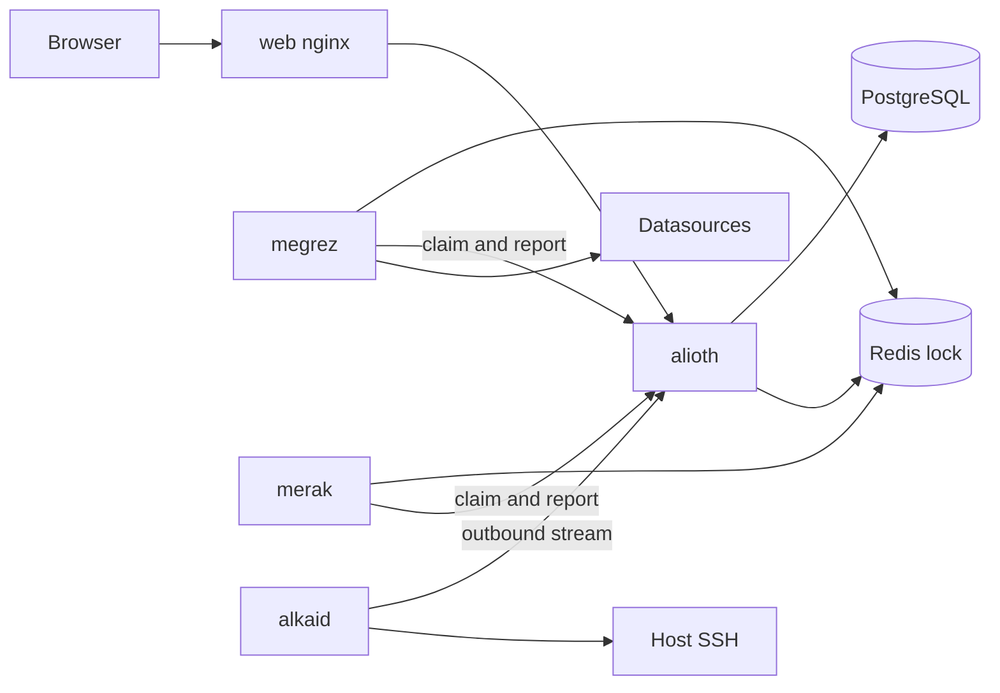
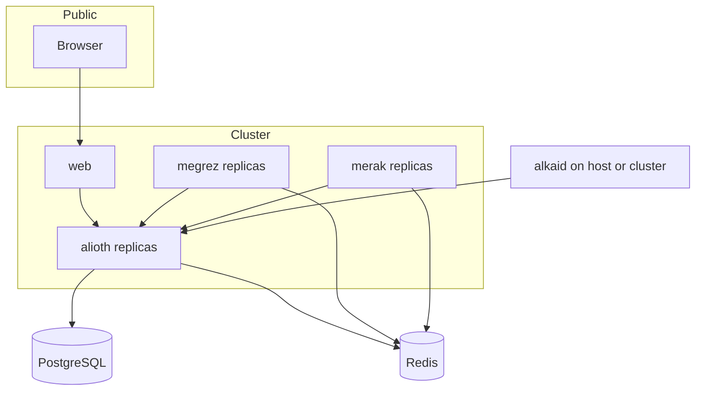

# Alioth 项目设计

Alioth 是 aide-family 的运维平台。浏览器只访问 Web；Web 里的 nginx 把 `/v1` 转到玉衡。业务数据在玉衡的 PostgreSQL。天权负责告警评测，天璇负责通知投递，摇光跑在边缘。多副本之间的互斥用 Redis 分布式锁。

本文对照 [Moon](https://github.com/aide-family/moon) 与 [Moon Web](https://github.com/aide-family/moon-web) 已落地的能力。Moon 没有的能力标明为 Alioth 新增。对外 HTTP 的字段与路径在 `api/alioth/v1` 的 proto 中定稿，本文不预先编造 Moon 中不存在的路径。

## 1. 背景与范围

Moon 是 Kratos 单仓，四个服务各自持有存储（默认 SQLite，可换 MySQL / PostgreSQL，ORM 为 GORM）。Moon Web 是 React 微前端，UI 为 Ant Design。


| Moon          | 职责                                 | Alioth                                                |
| ------------- | ---------------------------------- | ----------------------------------------------------- |
| goddess（嫦娥）   | 邮箱验证码登录、OAuth2、用户、Namespace、成员角色枚举 | `alioth` 的身份与租户，并增加注册、邮箱验证码与 OAuth2 登录、RBAC            |
| marksman（后羿）  | 数据源、策略组、策略、级别、实时/历史告警；进程内评测指标规则    | 配置与事件在 `alioth`；评测在 `megrez`                          |
| rabbit（玉兔）    | 邮件、Webhook、模板、收件人组、发送与消息日志         | 配置与任务在 `alioth`；投递在 `merak`                           |
| jade_tree（玉树） | 机器信息上报、SSH 命令审核与执行                 | `alkaid`；连接方向改为 Agent 出站 |
| moon-web      | 微前端壳和四个子应用                         | 一个 `web` 应用                                           |


本期范围：

- 后台：注册、登录、用户、角色、权限、多租户
- 告警：多数据源、多类型数据源、规则、规则组、通知组、通知方式、实时告警与历史告警
- 边缘：主机 SSH 与 Web Shell
- Web 管理台

本期不做：

- 玉树的探测任务（`probe_task`：tcp / ping / http）
- Moon Web 的微前端拆包
- 每个服务一块业务库
- 把 Redis 当作缓存、会话或消息队列
- 短信的完整发送链路。Moon 有 `MessageType_SMS_ALICLOUD` 和 `pkg/message/sms/alicloud`，告警主路径是邮件和 Webhook。Alioth 保留该枚举，不设计阿里云短信参数
- 除 Loki LogQL 与 VictoriaLogs LogsQL 数值型告警外的日志与链路规则评测。数据源可以创建，查询可以代理；评测器按类型扩展，Elasticsearch 与 Jaeger 仍未实现

Moon 里已有、Alioth 改变边界的事实：

- goddess 没有密码注册和密码登录，成员只有 `MemberRole`（MEMBER / OWNER / ADMIN / VIEW），没有权限表，业务接口也没有按角色拦截
- marksman 的数据源类型含 METRICS、LOGS、TRACE，评测实现只有指标。LOGS 驱动为 Elasticsearch，TRACE 驱动为 Jaeger
- marksman 与 rabbit 用进程内 channel 传递评测结果和发送任务，服务间没有消息队列
- jade_tree 没有独立心跳 RPC。机器在线靠 `POST /v1/machine-info/report`。控制面按 Agent 的 endpoint 回拨 HTTP


## 2. 服务与仓库

产品名是 Alioth。进程用北斗的国际名：


| 中文  | 编码名      | 进程             | 部署                            |
| --- | -------- | -------------- | ----------------------------- |
| 玉衡  | `alioth` | 控制面。唯一写入业务库的服务 | 无状态，多副本                       |
| 天权  | `megrez` | 告警规则评测         | 无状态，多副本                       |
| 天璇  | `merak`  | 通知投递           | 无状态，多副本                       |
| 摇光  | `alkaid` | 边缘 Agent       | 单机 systemd，或 Kubernetes 内一个实例 |
| Web | `web`    | 管理台静态资源与 nginx | 无状态，多副本。集群外只暴露这个入口            |


无状态指进程内不保存登录会话、评测进度和发送队列。任意副本都可以接请求。JWT 自己携带身份。任务状态在 PostgreSQL。互斥在 Redis。




### 2.1 仓库

单仓。每个后端应用独立 `go.mod`，共享库用 `replace` 指向 `pkg/`，与 Moon 中 `magicbox` 的用法相同。分层沿用 Kratos：`cmd`、`internal/server`、`internal/service`、`internal/biz`、`internal/data`、`internal/conf`。`alioth` 的 `data` 使用 ent，不再使用 GORM。

```
Alioth/
├── docs/design.md
├── Makefile
├── api/
│   ├── alioth/v1/          # 控制面对外 HTTP/gRPC，以及 Agent 流
│   ├── megrez/v1/          # 评测领取与回写，由 alioth 实现，megrez 调用
│   └── merak/v1/           # 通知领取与回写，由 alioth 实现，merak 调用
├── pkg/                    # 鉴权、错误码、Redis 锁、加密字段
├── app/
│   ├── alioth/
│   ├── megrez/
│   ├── merak/
│   └── alkaid/
└── web/
```

`megrez` 与 `merak` 不对外提供业务 HTTP。它们只保留给探针用的 `/health`。业务调用方向是工作进程到 `alioth` 的内部 gRPC。这些 gRPC 不挂到 Web nginx。

建议端口（集群内）：


| 进程       | HTTP             | gRPC                       |
| -------- | ---------------- | -------------------------- |
| `web`    | 8080，集群外入口       | —                          |
| `alioth` | 8000，仅 nginx 可访问 | 9000，供 megrez、merak、alkaid |
| `megrez` | 8001，仅 `/health` | —                          |
| `merak`  | 8002，仅 `/health` | —                          |
| `alkaid` | 8022             | 9022                       |


开发时 Web 的 Vite 把 `/v1` 代理到 `alioth` 的 8000，对应 Moon Web 把 `/v1` 分发到多个后端的方式。Alioth 只有一个上游。

技术基线与 Moon 对齐的部分：Go 1.25+、Kratos v3、Cobra、Wire、protobuf、`buf.validate`、`google.api.http`。存储改为 ent + PostgreSQL。前端为 React、TypeScript、Vite、Tailwind CSS、[shadcn/ui](https://ui.shadcn.com/)。日志为标准库 `log/slog`；HTTP JSON 迁移期使用 contrib `encoding/json/v3` 保持契约。

### 2.2 Redis 分布式锁

Redis 只保存锁。业务数据、任务状态、告警去重都在 PostgreSQL。Moon 的 `magicbox/plugin/cache` 把 Redis 当作可选缓存；Alioth 不沿用这个用途。

持锁的是正在干活的进程：


| 键                               | 持有者      | 用途                     |
| ------------------------------- | -------- | ---------------------- |
| `alioth:lock:schedule:{name}`   | `alioth` | 短临界区。例如扫描到期规则并写下一次评测时间 |
| `alioth:lock:eval:{rule_uid}:{datasource_uid}`   | `megrez` | 持有到该（规则, 数据源）本次评测和回写结束        |
| `alioth:lock:notify:{task_uid}` | `merak`  | 持有到该通知投递和回写结束          |


协议：

1. 加锁：`SET key token NX PX ttl`。`token` 为 `{instance_id}:{random}`。只有返回成功的进程继续执行。
2. 续期：Lua 比较 value 与 token，一致则 `PEXPIRE`。评测默认 TTL 30 秒，每 10 秒续期。投递默认 TTL 60 秒，每 20 秒续期。调度锁默认 TTL 15 秒，不续期。
3. 释放：Lua 比较 value 与 token，一致则 `DEL`。进程崩溃后不再续期，TTL 到期后其他副本可以接手。
4. 续期失败时，持锁进程放弃本次执行，不把任务报成成功。
5. Redis 不可用时拒绝评测和投递，避免两副本同时做同一条规则或同一条通知。

PostgreSQL 用唯一约束托住锁失效窗口内的重复写入，例如评测批次 `(rule_uid, datasource_uid, eval_slot)`、告警 `(namespace_uid, fingerprint)` 的当前 FIRING 记录、通知任务在同一事件上的一次投递。这是数据约束。互斥本身在 Redis。

`alkaid` 和浏览器不连接 Redis。

## 3. 身份与多租户

租户沿用 Moon 的 Namespace。请求头 `X-Namespace` 由 `alioth` 写入上下文。业务行带 `namespace_uid`。同一租户内名称唯一，规则与 Moon 相同：`(namespace_uid, name)` 在未删除记录上唯一。

用户是平台级身份，独立于租户；成员才是用户在某个 Namespace 中的身份。系统权限和租户权限是两套目录：`system:*` 由平台角色持有，租户角色永远拿不到；`resource:action` 由租户角色持有，平台角色也不会自动获得。第一个注册用户成为超级管理员，后续用户的平台角色由超级管理员授权。

平台用户管理不读取 `X-Namespace`。用户列表、详情、封禁、解封和平台角色授权都只要求系统权限。用户列表仅系统管理员及以上可见；租户管理员不能枚举或封禁平台用户，只能管理本租户成员。

成员关系不再由租户管理员直接创建。租户内邀请会生成一条平台邀请消息，被邀请人在平台确认后才会创建 `Member` 并授予租户角色。邀请邮件携带快捷链接；未注册邮箱打开链接后先注册，注册完成自动登录并回到邀请函。


| 实体               | 说明                                                                                     |
| ---------------- | -------------------------------------------------------------------------------------- |
| `User`           | 平台用户，不隶属于任何租户。Moon 已有 UID、名称、昵称、邮箱、头像、备注、状态（ACTIVE / BANNED）。Alioth 增加 `password_hash`、`system_role`（SUPER_ADMIN / SYSTEM_ADMIN / USER）和 `authorized_by`。数据库用部分唯一索引保证最多一个超级管理员 |
| `UserOAuth`      | 对应 Moon 的 `user_oauth2s`：OpenID、来源应用、原始资料。来源为 GitHub、Gitee、飞书、钉钉                         |
| `Namespace`      | 租户。Moon 已有 UID、名称、Secret、状态、负责人、Metadata、Logo、Banners                                  |
| `Member`         | 用户与 Namespace 的关系。新流程只在用户确认邀请后创建 JOINED 成员；INVITED / EXPIRED 仅用于兼容历史数据                              |
| `MemberInvite`   | 平台邀请消息。记录租户、邮箱、平台用户、角色、邀请人、令牌摘要、状态和有效期。用户确认前不创建成员                              |
| `SystemMessage`  | 平台系统消息。记录收件人（用户标识或邮箱）、类型、触发人、租户、角色和已读时间。邀请收到、接受、拒绝和成员被移除都会写一条                              |
| `Role`           | Namespace 内角色，也可是租户预置角色                                                                |
| `Permission`     | 租户权限 `resource:action`。系统权限不写入这张表，由代码中的 `system:*` 目录单独维护                                |
| `RolePermission` | 租户角色与租户权限                                                                                  |
| `MemberRole`     | 成员与租户角色，一个成员可以有多个角色                                                                      |


预置角色：


| 角色       | 能力                                       |
| -------- | ---------------------------------------- |
| `owner`  | 该 Namespace 的全部权限，含删除 Namespace、移交 owner |
| `admin`  | 管理资源。不含删除 Namespace、移交 owner             |
| `member` | 查看配置；处理告警；使用已授权的 SSH 与 Web Shell  |
| `viewer` | 只读                                       |


平台角色：


| 角色             | 能力                                                              |
| -------------- | --------------------------------------------------------------- |
| `SUPER_ADMIN`  | 第一个注册用户。持有全部系统权限，可把其他用户授权为系统管理员，也可撤销该授权                          |
| `SYSTEM_ADMIN` | 可查看平台用户、封禁或解封普通用户，但不能授权或撤销系统管理员，也不能操作超级管理员                      |
| `USER`         | 没有系统权限。仍然可以通过租户邀请成为成员，并按租户角色使用管理台                                  |


系统权限目录：`system:user:read`、`system:user:write`、`system:role:read`、`system:role:write`、`system:invite:read`。其中 `system:user:read` 决定用户列表可见性；`system:role:write` 只授予超级管理员。


租户权限按资源划分：`member`、`role`、`namespace`、`datasource`、`alert_rule`、`alert`、`notification`、`agent`、`ssh`。动作至少包含 `read` 与 `write`；告警另有 `intervene`；执行动作为 `ssh:exec`。`user` 是平台资源，不进入租户权限目录。具体权限名在 proto 枚举中定稿。Web 菜单分别按系统权限和当前用户在当前 Namespace 的租户权限生成。Moon Web 的菜单是前端写死的，没有路由级权限。

认证：

- 账号没有密码。注册只用邮箱验证码：`POST /v1/auth/register/code` 发注册码，`POST /v1/auth/register` 提交邮箱验证码和图形验证码。邮箱已注册不能重复注册
- 密码登录已移除，登录只有邮箱验证码和 OAuth2 两条路径
- 邮箱验证码登录保留 Moon 的两步：`POST /v1/auth/email/login/code`、`POST /v1/auth/email/login`
- 图形验证码是数学计算题（一位数加/减，结果非负），题目画在 `GET /v1/captcha` 返回的图片里，答案不回传。发码和登录/注册提交都要先通过图形验证码：发码用非消费校验，提交成功后再消费，所以一次解题就能走完整个流程，而没解验证码既拿不到邮箱验证码也登录不了。同一邮箱 60 秒内只发一次码
- OAuth2 保留 Moon 的 `POST /v1/auth/oauth2/login`，应用为 GitHub、Gitee、飞书、钉钉。`POST /v1/auth/oauth2/providers` 返回已配置客户端的来源和完整授权地址，管理台展示 GitHub、Gitee、飞书、钉钉。只有可信任的第三方邮箱才能并入已有本地账号，避免用未验证邮箱接管账号：GitHub 看 `/user/emails` 的 verified 标记；Gitee 申请 `user_info emails`（应用需勾选 emails 权限，否则授权页报“请求范围无效”），再用 `/api/v5/emails` 里 state=confirmed 的主邮箱判断，接口不可用时按未验证处理；飞书邮箱由企业管理员在租户通讯录维护、终端用户不能自行修改，且只有本企业安装的应用能完成授权，按企业已验证身份处理（授权 scope 为 `contact:user.email:readonly`，取不到邮箱时退回占位邮箱、不并入）。钉钉的邮箱是用户自行添加到个人资料里的，钉钉不确认归属，按未验证处理（授权 scope 为 `openid`，`prompt` 固定 `consent`）；用户信息来自 `GET /v1.0/contact/users/me`，凭证走 `x-acs-dingtalk-access-token` 头，绑定账号用按应用唯一的 `openId`，授权码在回调里叫 `authCode` 而不是 `code`。GitHub / Gitee 邮箱未验证且该邮箱已被本地账号占用时，管理台给出该平台邮箱设置页的入口，引导用户确认后重新登录，并提示可改用邮箱验证码登录
- 访问令牌是 JWT。刷新对应 Moon 的 `GET /v1/self/refresh-token`
- 服务间调用使用 Moon 已有的 service key，形态为 `Authorization: Bearer sk-...`，与用户 JWT 互斥
- `alkaid` 使用独立的 Agent 令牌，只用于出站流，不能当用户令牌调用管理接口

个人资料沿用 Moon 的 `Self`：信息、所属 Namespace、修改邮箱、头像、备注。用户封禁与解封沿用 `BanUser` / `PermitUser`，但改为平台权限校验。成员邀请改为邀请消息，移除、角色分配仍由 Member 服务处理。

邀请流程：

1. 租户管理员提交邮箱和角色。服务端生成 256 位随机令牌，数据库只保存 SHA-256 摘要；同一租户同一邮箱只保留一条待确认邀请，重复邀请刷新令牌和有效期。
2. 邀请出现在被邀请人的平台邀请列表。邮箱已注册时立即按邮箱匹配；未注册时，注册完成后按邮箱匹配。
3. 服务端尝试发送邀请邮件，正文包含 `{web_url}/invite/{token}`。邮件发送失败不回滚邀请，用户仍可在平台确认。
4. 打开链接先读取公开邀请函。未登录时引导登录或注册；未注册用户注册成功后自动登录并回到邀请函。登录用户点击同意后，服务端校验邮箱或平台用户一致、邀请未过期、角色仍有效，然后才创建 `Member`、写入 `MemberRole`，并把邀请标为 ACCEPTED。
5. 拒绝只把邀请标为 DECLINED，不创建成员。超过 7 天标为 EXPIRED。租户管理员可以撤销待确认邀请。

系统消息：

- 邀请创建时给被邀请人写一条 `INVITE_RECEIVED` 消息。邮箱未注册时按 email 投递，注册后即可看到。
- 被邀请人同意时给邀请人写一条 `INVITE_ACCEPTED`，拒绝时写 `INVITE_DECLINED`。
- 成员被移出租户时给被移除用户写一条 `MEMBER_REMOVED`。
- 同意或拒绝后把对应的 `INVITE_RECEIVED` 标为已读，避免未读角标残留。
- 消息页支持分页、只看未读、单条已读和全部已读；未读数通过轮询刷新到顶栏提醒。

## 4. 告警

配置、级别、事件和查询 API 在 `alioth`。`megrez` 只评测。

### 4.1 数据源

类型与驱动使用 Moon `magicbox.enum` 中已经定义的值：


| DatasourceType | DatasourceDriver                            | 首期行为                |
| -------------- | ------------------------------------------- | ------------------- |
| METRICS        | METRICS_PROMETHEUS、METRICS_VICTORIA_METRICS | 管理、即时查询、区间查询、指标规则评测 |
| LOGS           | LOGS_ELASTICSEARCH、LOGS_LOKI、LOGS_VLOGS     | 管理与查询代理。Loki、VictoriaLogs、Elasticsearch 各有日志区间查询和状态检查；Loki LogQL 与 VictoriaLogs LogsQL 支持数值型规则评测，Elasticsearch 留接口 |
| TRACE          | TRACE_JAEGER                                | 管理与查询代理。评测器留接口      |


数据源归属 Namespace，可启停，可绑定数据源级别（Moon 的 `LevelType_DATASOURCE`），并带 `labels` JSON 供规则按标签匹配。密钥字段加密后入库，沿用 Moon `EncryptString` 的做法。指标数据源保留 Moon 已有的能力：状态、指标列表、指标详情、`query`、`query_range`、代理查询。Prometheus 的指标列表取 `/api/v1/metadata`；VictoriaMetrics 的 `/api/v1/metadata` 只是空的兼容占位，指标名改取最近 24 小时的 `/api/v1/label/__name__/values`，指标详情取 `/api/v1/series`。两者共用 `/api/v1/query`、`/api/v1/query_range`，VictoriaMetrics 查询语句为 MetricsQL（兼容 PromQL）。数据源地址可以带路径前缀，例如 VictoriaMetrics 集群的 `/select/<accountID>/prometheus`，管理端查询和 `megrez` 评测都保留该前缀。Loki 日志数据源的连通检查走 `/ready`，日志查询走 `/loki/api/v1/query_range`，查询语句为 LogQL。VictoriaLogs 的连通检查走 `/health`，日志查询走 `/select/logsql/query`，查询语句为 LogsQL。Elasticsearch 日志数据源的连通检查走根路径，日志查询走 `/_search`，查询语句为 Query DSL 或普通检索语句，索引模式和时间字段随数据源保存。数据源列表和详情展示驱动对应的产品图标；元数据页对 Prometheus 和 VictoriaMetrics 展示指标元数据，对 Loki 展示构建信息，对 VictoriaLogs 展示健康状态，对 Elasticsearch 展示 `_cluster/health` 集群状态和 `_cat/allocation` 节点分配。

### 4.2 规则

Moon 的策略组与策略在 Alioth 中改名为规则组与规则。条件语义保持不变。


| Moon                     | Alioth           | 内容                        |
| ------------------------ | ---------------- | ------------------------- |
| `strategy_groups`        | `AlertRuleGroup` | Namespace 内唯一名称，可启停       |
| `strategies`             | `AlertRule`      | 属于一个组，只带驱动，可启停            |
| `strategy_metrics`       | 规则上的指标定义         | 表达式、标签、`datasource_labels` 匹配范围、摘要、描述 |
| `strategy_metric_levels` | `AlertRuleLevel` | 比较条件、采样方式、阈值、持续秒数，并指向告警字典 |
| `levels`（ALERT）          | `AlertDictionary` | 名称与展示色                    |


比较条件沿用 Moon：EQ、NE、GT、GTE、LT、LTE、IN、NOT_IN。采样方式沿用 FOR、MAX、MIN。

规则不再直接绑定通知组。告警事件统一由 `NotificationSubscription` 按标签、告警级别和数据源匹配，再路由到订阅下的通知组。

日志和链路规则可以保存。`megrez` 对尚未实现的驱动跳过，并在回写里标明未评测，不产生 FIRING。Loki 和 VictoriaLogs 是例外：它们使用独立的数值型规则评测路径，不能走 Prometheus API；原始日志结果不是可比较的采样值，不会被当成空结果或恢复信号。

#### Loki LogQL 告警扩展

- Web 的 Loki 查询面板和告警规则表单使用独立 `logql` 编辑语言、Loki 标签/标签值补全和 Loki endpoint；不复用 PromQL 语言定义或 Prometheus 查询路径。VictoriaLogs 的 LogsQL 与 Elasticsearch 的 Query DSL 保持各自入口。
- 可评测表达式必须是返回数值序列的 LogQL 指标查询，例如 `sum by (app) (count_over_time({app="api"} |= "error" [5m]))`。Loki 原始日志 selector 返回 `streams`，不是采样值；Megrez 严格要求数值 matrix，收到 stream 或无效响应时评测失败且不回写，从而不会误恢复仍在触发的告警。
- Megrez 严格按 `LOGS_LOKI` driver 调用 `/loki/api/v1/query_range`，传递 Unix 纳秒范围与 duration 步长；模板 `query` 使用 `/loki/api/v1/query`。LogQL 数值结果沿用现有告警级别、FOR / MAX / MIN 条件、指纹去重和事件回写。
- Loki FIRING 与恢复进入共用 `AlertEvent` 与 `NotificationSubscription` 路由，之后由 `merak` 投递；实时/历史列表、通知收件、介入、抑制、手工恢复均使用现有公共流程。事件详情图表读取 Loki 数值矩阵并按事件标签收敛序列。
- Loki 告警只匹配 ACTIVE 的 `LOGS_LOKI` 数据源。Elasticsearch 与 Jaeger 仍标记为未实现并跳过；Prometheus / VictoriaMetrics 查询路径保持不变。

#### VictoriaLogs LogsQL 告警扩展

- Web 的 VictoriaLogs 查询面板和告警规则表单使用独立 `logsql` 编辑语言；字段名和字段值分别从 `/select/logsql/field_names` 与 `/select/logsql/field_values` 补全，不复用 PromQL / LogQL 语言定义或 Prometheus / Loki 查询路径。
- 可评测表达式必须是带 `| stats ...` 的 LogsQL 查询，例如 `level:error | stats by (app, level) count() as value`。`stats by (...)` 的分组字段成为序列标签，stats 输出字段成为 `__name__`。时间桶由引擎的 `step` 参数决定，表达式里不写 `_time:<步长>`，也不要加相对的 `_time` 过滤。
- Megrez 严格按 `LOGS_VLOGS` driver 调用 `/select/logsql/stats_query_range`，传入 `query`、Unix 秒 `start` / `end` 和 `<step>s`，返回 Prometheus matrix。模板 `query` 使用 `/select/logsql/stats_query`，范围取查询时刻之前的一个步长。
- 原始日志查询、非 matrix / vector 响应、非数值 stats 点、无效 JSON 和上游错误都会使评测失败且不回写；有效的空 matrix 才是“本次没有采样”，用于恢复旧事件。这样不会把原始日志或上游故障误当成恢复信号。
- `stats_query_range` 的桶按 step 对齐，结束时间落在桶中间时最后一个桶只统计部分日志。Megrez 把结束时间向下对齐到桶边界；默认步长 15 秒，持续秒数短于 15 秒时改用与 FOR 相同的桶宽（例如 10 秒），避免 10 秒规则实际要求 30 秒连续日志。FOR 再多查一个桶并要求采样点连续，缺失桶不会被首末跨度掩盖。
- FIRING 与恢复进入共用 `AlertEvent` 与 `NotificationSubscription` 路由，之后由 `merak` 投递；实时/历史列表、通知收件、介入、抑制、手工恢复均使用现有公共流程。事件详情图表调用同一个 `stats_query_range` 并按事件标签收敛 matrix 序列。
- VictoriaLogs 告警只匹配 ACTIVE 的 `LOGS_VLOGS` 数据源。Elasticsearch 与 Jaeger 仍未实现；Prometheus / VictoriaMetrics / Loki 查询路径保持不变。

### 4.3 评测

`alioth` 在 `alioth:lock:schedule:eval` 下扫描 `next_eval_at <= now` 的已启用指标、Loki LogQL 与 VictoriaLogs LogsQL 数值规则，写下一次评测时间，然后释放调度锁。`megrez` 向 `alioth` 领取这批规则的快照。

规则只保存驱动，不再保存类型。规则用驱动 + `datasource_labels` 匹配 ACTIVE 数据源：匹配器优先读数据源 labels，`datasource_level` 匹配数据源等级名称、`datasource` 匹配数据源名称，值按完整匹配正则命中；空匹配器 = 该驱动下全部 ACTIVE 数据源。这样 Loki、VictoriaLogs 和 Elasticsearch 不会再被同一条日志规则混在一起评测。Claim 对每个匹配数据源各发一条快照；无匹配则不发。fingerprint 为 `Of(rule_uid, datasource_uid, rule_labels + labels)`，规则标签修改后旧事件恢复、新指纹建立新事件。

单条（规则, 数据源）的步骤：

1. `megrez` 对 `alioth:lock:eval:{rule_uid}:{datasource_uid}` 加锁。没拿到锁就跳过。
2. 按该数据源驱动查询。指标规则使用 Prometheus-compatible PromQL/MetricsQL `query_range`；Loki 规则使用 `/loki/api/v1/query_range` 和数值型 LogQL matrix；VictoriaLogs 规则使用 `/select/logsql/stats_query_range` 和 LogsQL stats matrix。三者复用条件、采样与 fingerprint 语义，不共用查询 endpoint。
3. 把 FIRING 或恢复结果回写 `alioth`（带 `datasource_uid`）。回写按 fingerprint 幂等。
4. 释放锁。续期失败则不回写成功。

`alioth` 把 FIRING、恢复写入 `AlertEvent`，并在同一事务内按命中的订阅生成 `NotificationTask`。恢复检测是评测的一部分：原先 FIRING、本次未命中，则记为恢复并生成恢复通知。事件标签在采样标签之外附加数据源名称（`datasource=<名称>`）和数据源自身的 `labels`，指标标签优先、同名键不覆盖；告警页面和通知订阅的标签匹配使用附加后的标签集合。

事件状态沿用 Moon：`FIRING`、`RECOVERED`、`RECOVERED_BY_MANUAL`。人工操作沿用实时告警上的介入、批量介入、抑制、恢复、批量恢复。实时列表是状态为 FIRING 且未被抑制的事件。历史列表是已恢复和已抑制的事件。

历史告警按「租户库 + 周表」分库分表：库名为 `ALIOTH_HISTORY_DATABASE_PREFIX` + 租户标识（Namespace UID），表名为 `ALIOTH_HISTORY_TABLE_PREFIX` + 事件所在周的周一日期 `YYYYMMDD`（UTC）。事件恢复时在事务提交后写入租户历史库并删除主库行，`alert_history_events` 只保存事件 UID 与分片位置用于详情定位。归档失败时保留主库行，历史列表会合并主库兜底；调度器每小时把升级前遗留的已恢复事件迁移到分片。主库 `alert_events` 继续承载实时告警。列表和详情按 UID 补出规则名称、规则组标识和级别名称，规则或字典软删除后历史事件仍显示名称。

历史告警页将统计分析与事件明细分为独立视图：分析页提供趋势、状态和重复指纹聚合；明细页只提供事件记录查询与单条检查，不重复展示统计卡片。明细查询可按摘要/fingerprint、级别、规则名、数据源名、事件状态、抑制状态与 `starts_at` RFC3339 时间范围过滤；历史过滤在服务端合并归档记录后、分页前执行，时间下界包含、上界排除。明细页把所选开始日补成当日 00:00:00、结束日补成当日 23:59:59.999999999（作为排除上界），因此覆盖完整自然日、也不会漏掉带小数秒的事件；日期选择器不允许选择今天之后的日期。分析和明细使用独立 URL 查询参数，统计范围不会意外改变明细列表。

历史事件只有三种终态：自动恢复（`RECOVERED`）、人工恢复（`RECOVERED_BY_MANUAL`）和抑制中（仍为 `FIRING` 且抑制未到期）。抑制是触发阶段的属性而非终态：恢复流程不清除抑制标记，因此已恢复事件可能带 `suppressed=true`，但它不属于「抑制中」。分析页的状态维度按这三种终态划分，抑制不再作为与状态并列的选项；明细页保留独立的抑制状态过滤，并在状态列对仍被抑制的记录加标注。分析页的日期与状态条件同样下推到历史列表接口（服务端合并归档后过滤），不再依赖浏览器侧对全量结果的二次筛选。

明细页的筛选面板默认收起，已应用的筛选以可移除标签呈现；面板收起不改变查询条件，筛选仍以 URL 为唯一状态来源。分页页码随结果集收敛：条件变化回到第 1 页，总数收缩后越界的页码回到最后一页。

明细页与分析页的日期条件共用同一个双月日历范围选择器：按本地自然日选择，不产生时分秒，不能选未来日期，单次最多 30 天（含首尾），选定起点后超出 30 天的日期直接禁用，避免一次请求扫过长的归档区间。选择器只提交完整区间，所以不会留下只有起点或只有终点的条件；URL 里继承来的超长区间仍会渲染，并在日历底部提示重新选择，不会静默改写查询。30 天上限同时在服务端生效：`ListAlertEvents` 在两端都给定时校验区间跨度，超过 30 天直接返回参数错误，手工改 URL 或第三方调用同样绕不过去。

事件详情图表按事件自身的区间取数：已恢复事件截止到恢复时刻（`ends_at`），仍在触发的事件才截止到当前时间。右端跟随事件而不是跟随今天，既让曲线落在事件发生的那段时间里，也避免查看旧事件时向数据源请求一段巨大的区间。

实时告警的筛选只保留摘要/fingerprint 与级别两项，并与历史明细共用同一种卡片式布局和「已应用条件」标签。实时列表本身只包含仍在触发的事件，状态、抑制和时间范围在这里与列表语义重叠，因此有意不提供。

消息日志的筛选按日志自身的能力确定：投递日志按状态（`SENT`/`FAILED`）、任务标识和创建时间范围过滤，通知任务按状态和创建时间范围过滤。两个视图的筛选条件互不通用，切换视图时清空；时间范围同样用双月日历按天选择，不能选未来日期，单次最多 30 天，服务端对两端都给定且跨度超过 30 天的请求返回参数错误。

明细页的列与实时告警用同一套自定义列机制：按「命名空间 + 用户 + scope」保存在 `alert_event_columns`，实时告警用 `mine` 或告警页面 UID 作为 scope，历史明细用 `history`，因此两边互不影响。默认列是摘要、状态、级别、数据源、样本值、开始时间、结束时间和持续时长；`ends_at` 只提供给历史明细的列选择器，实时列表不提供（实时事件没有结束时间）。

统计沿用 Moon 的告警统计能力，由 `alioth` 对 `AlertEvent` 聚合。在专用统计接口落地前，分析页通过历史列表接口分页读取受控范围（服务端过滤后）并在浏览器侧聚合，单次分析最多读取 5000 条；触达上限时页面必须显式提示统计被截断，不得静默少算。

## 5. 通知

渠道、模板、通知组、任务和日志都在 `alioth`。`merak` 只负责把任务发出去。


| 实体                     | 来源                                  | 说明                                                                          |
| ---------------------- | ----------------------------------- | --------------------------------------------------------------------------- |
| `NotificationChannel`  | Moon 的 `email_configs` 与 `webhooks` | 一种投递配置。类型为 SMTP、WEBHOOK 或 SMS；SMTP 应用固定 OTHER，Webhook 应用为 OTHER、DINGTALK、WECHAT、FEISHU，SMS 应用固定 SMS_ALICLOUD。密码和签名加密存储 |
| `NotificationTemplate` | Moon 的 `templates`                  | 按消息类型和应用存模板。类型为 EMAIL、WEBHOOK、SMS_ALICLOUD；WEBHOOK 模板的 app 区分 OTHER、DINGTALK、WECHAT、FEISHU，OTHER 是通用模板。EMAIL 和 SMS_ALICLOUD 固定 OTHER |
| `NotificationPreset`   | Alioth 新增                           | 系统预置模板，只读、不属于租户。预设页支持预览，编辑后保存为当前 Namespace 的副本                                          |
| `NotificationGroup`    | Moon 的通知组与收件人组                      | Namespace 内的接收方集合。邮件渠道和短信渠道各最多一个，Webhook 作为接收者可多选；每个选中渠道都绑定一个能覆盖它的模板，至少有一个接收方或 Webhook |
| `NotificationSubscription` | Alioth 新增                       | 按标签、告警级别和数据源订阅事件，命中后发送给订阅下的通知组                                              |
| `NotificationTask`     | Moon 发送任务的持久化形态                     | 待发送、发送中、已发送、失败、取消。状态名沿用 MessageStatus：PENDING、SENDING、SENT、FAILED、CANCELLED |
| `MessageLog`           | Moon 的 `message_logs`               | 一次投递的结果。按租户库 + 周表分库分表。支持查看、重试、取消                                                    |


消息日志按与历史告警一致的分片原则存储：库名为 `ALIOTH_HISTORY_DATABASE_PREFIX` + 租户标识（Namespace UID），与历史告警共用租户库；表名为 `ALIOTH_HISTORY_MESSAGE_TABLE_PREFIX` + 投递时间所在周的周一日期 `YYYYMMDD`（UTC）。投递结果先在主库 `message_logs` 的事务内落一行，提交后写入租户库周表、在主库 `message_log_shards` 记录分片索引并删除主库行。归档失败时保留主库行，列表合并主库兜底并按 UID 去重；调度器每小时把升级前遗留的日志迁移到分片。列表按状态、任务和创建时间范围查询，时间范围会裁剪需要读取的周表；详情按索引直接定位周表。


告警摘要、描述和通知模板共用 `pkg/alerttmpl`：数据字段和展开语义在评测与投递两处保持一致，Prometheus 的 `$labels`、`$value`、`.Labels`、`.Value`、`humanize` 等写法可直接使用。`{{ . }}` 在两层都表示采样值，和 `{{ $value }}` 同值；`query` 模板函数依赖数据源，只在评测阶段可用。`$externalURL` 取数据源地址。保存模板时用同一套实现做语法校验。

人工试发也生成 `NotificationTask`，仍由 `merak` 投递。对应 Moon 发送台的直发和按模板发送，不在 `merak` 进程里同步等待 SMTP。投递失败按剩余次数退避后回到 PENDING，避免失败任务在轮询周期内反复重试。

渠道、模板和通知组必须满足类型矩阵：SMTP 渠道只能绑定 EMAIL 模板；SMS 渠道只能绑定 SMS_ALICLOUD 模板；WEBHOOK 渠道只能绑定 WEBHOOK 模板，且模板 app 必须等于渠道 app 或为 OTHER。通知组保存 `channel_uids` 与 `template_uids` 两个一一对应的数组：邮件渠道、短信渠道和每个 Webhook 接收者各占一项，邮件和短信同类型最多一个。邮件接收方由手填邮箱和成员邮箱合并，短信接收方由手填手机号和成员手机号合并；选择邮件/短信渠道后必须至少有一个接收方，选择 Webhook 时 Webhook 本身算接收方。通知组没有任何渠道、或邮件/短信渠道没有接收方时拒绝保存。保存、试发和建立通知组时都在服务端校验。成员手机号来自用户资料，短信发送实现尚未接入，短信任务会以明确原因失败。

`merak` 按渠道应用选择发送器：

- SMTP：纯文本邮件，支持 465 隐式 TLS、587 STARTTLS，主题和地址做头注入清洗。
- OTHER：JSON 投递，配置签名时附带 `X-Alioth-Timestamp` 与 HMAC-SHA256 签名。
- DINGTALK：文本消息，配置签名时按钉钉规则追加 `timestamp` 与 `sign` 查询参数。
- FEISHU：文本消息，配置签名时在请求体带 `timestamp` 与 `sign`。
- WECHAT：企业微信群机器人文本消息，检查 `errcode`。

短信仍然只保存渠道和模板配置，不实现发送；`merak` 对短信任务回写 FAILED（`sms delivery is not implemented`），不会误报 SENT。预设页提供 mock 事件预览，渲染和真实投递共用 `pkg/alerttmpl`。

投递步骤：

1. `merak` 向 `alioth` 读取 PENDING 任务。
2. 对 `alioth:lock:notify:{task_uid}` 加锁。没拿到锁则跳过。
3. 请 `alioth` 把该任务改为 SENDING，然后用对应渠道的发送器渲染模板并投递。
4. 向 `alioth` 回写 SENT 或 FAILED，并写入 `MessageLog`。失败的任务按剩余重试次数退避后回到 PENDING。
5. 释放锁。续期失败时不回写成功。
6. `alioth` 的调度器在锁内回收超时仍停留在 SENDING 的任务，标记 FAILED 并写日志，处理 `merak` 崩溃后无法回写的情况。阈值默认 2 分钟，由 `ALIOTH_NOTIFY_STALE_SECONDS` 调整。

同一事件不要生成多条等效任务。去重记录在 PostgreSQL，不放进 Redis。

## 6. 边缘 Agent

`alkaid` 部署在目标机器上，或者部署在目标 Kubernetes 集群里。它主动连接 `alioth:9000`，用 Agent 令牌建立双向流。SSH 与 Web Shell 都走这条流。

`alioth` 多副本时，Agent 对每个副本各建一条流。Kubernetes 内把地址指向无头 Service，集群外把多个控制面地址用逗号分隔。这样任意副本都能直接执行该 Agent 的请求，不依赖负载均衡把请求恰好送到持有那条流的副本。副本扩缩容时 Agent 每 30 秒重新解析一次地址，自动补建或释放流。

Moon 的玉树由控制面根据上报的 endpoint 回拨 Agent。边缘网络里控制面经常访问不到 Agent，所以 Alioth 改成出站连接。Agent 不在公网监听管理端口。

### 6.1 注册与心跳

流建立后 Agent 发送注册：Namespace、Agent 令牌、主机名、机器标识。`alioth` 写入 `Agent`。之后按间隔发送心跳和机器信息。机器信息字段对应 Moon 的 `machine_infos`：机器标识、主机名、本机 IP、Agent 版本、采集 JSON。Moon 用上报接口顺便表示在线。Alioth 把心跳分开，连接断开则标记离线。

一个 Namespace 可以有多台 Agent。管理操作指定 `agent_uid`。目标 Agent 没有存活的流时，`alioth` 直接返回离线，不把请求堆在进程内存里。

### 6.2 SSH

能力对应玉树已有的审核流，执行地点改到持有该主机的 `alkaid`：

- 提交新建或更新，生成审计，种类为 CREATE / UPDATE，状态为 PENDING
- 通过或拒绝。通过后写入可执行的 `SSHCommand`（名称、命令、工作目录、环境变量）
- 执行单条或批量执行。`alioth` 鉴权 `ssh:exec`，把命令帧送到 Agent
- Agent 在自身所在机器上执行本地 shell 命令，回传退出码与输出；`alioth` 不通过 SSH 回连目标
- 每次执行写入审计

Moon 的下发计数和按 endpoint 派发（`/v1/ssh-command-actions/dispatch`）由「选择在线 Agent」替代。

### 6.3 安装形态

- 单机：systemd 单元，类似玉树的 RPM / systemd 安装方式。配置里只有 `alioth` 的 gRPC 地址和 Agent 令牌
- Kubernetes：Deployment，或需要访问节点文件能力时的 DaemonSet


## 7. Web

`web` 是一个 Vite 应用，一套构建产物。布局、登录、菜单、主题、中英文在同一个壳里完成。Moon Web 用 `@micro-zoe/micro-app` 嵌子应用，Alioth 不拆子应用。

组件使用 shadcn/ui。页面保持 Moon Web 已经验证过的交互：筛选区、分页列表、URL 上的查询条件、行内启停、表格与卡片两种列表、Modal 完成新建和编辑、策略页那种左侧分组右侧明细、数据源页那种左侧列表右侧查询。历史类的长任务如果后续出现，再用抽屉。页面通过 `web/src/api` 访问 HTTP，组件里不直接使用 axios。请求带 `Authorization: Bearer <token>` 和 `X-Namespace`。401 时清除令牌并回到登录页。

列表页的筛选区统一成同一种形态：卡片式面板、已应用条件标签、可收起，收起按钮放在页面右侧操作（统计、批量操作、视图切换）的同一行；表单控件（输入框、选择框、日期范围选择器）统一使用组件默认高度 32px，页面不再各自覆写高度。表格统一采用「主列弹性 + 短列定宽」：主内容列吃掉剩余宽度并允许换行，状态/级别/时间/身份列固定宽度且不换行，操作列固定 7rem 并保证两个内联操作不折行，表格最小宽度按列数取档位，横向滚动发生在表格自身视口内而表头吸附。

Web 页面还必须遵守 `web/AGENTS.md` 的交互与布局回归约束：尤其是 Radix 状态属性、固定视口下的 `min-h-0` / 滚动容器，以及标签页切换和长页面滚动的实际验证。

页面：


| 区域    | 页面                              |
| ----- | ------------------------------- |
| 账号    | 登录、注册、个人资料                      |
| 租户与权限 | Namespace、用户、成员、角色与权限           |
| 告警    | 数据源、规则组与规则、告警字典、告警页面、实时告警、历史告警 |
| 通知    | 通知渠道、模板、通知组、告警订阅、消息日志            |
| 边缘    | 机器、SSH 命令与审计、Web Shell |


数据源的指标查询区需要表达式编辑器，交互对应 Moon Web 数据源页上的 PromQL 快查。规则编辑保存指标表达式和级别条件。实时告警支持筛选、详情、介入、抑制和恢复；页内用 Tab 切换「我的告警」与用户选定的告警页面。表格列可自定义：内置字段列和事件标签列都可以作为列，列名支持别名，标签列没有别名时显示标签键并渲染该标签的值；`AlertEventColumn` 按用户和视图（`mine` 或告警页面 UID）固化列配置。抑制需要选择时长，提供 5 分钟到 24 小时的常用梯度和自定义输入，限制在 1 分钟到 30 天，到期后事件自动回到实时列表。告警页面按标签匹配过滤实时事件，标签值按完整匹配正则命中；可设公开供同租户他人选用。事件标签附带数据源名称、告警等级名称和数据源等级名称，规则列表与实时告警详情用同一种表达式展示块。

壳上保留 Moon Web 已有的 Namespace 切换、主题（light / dark / system）和中英文。切换 Namespace 后后续请求使用新的 `X-Namespace`。没有 Namespace 时引导创建。

nginx 只做两件事：托管静态文件，把 `/v1` 反代到 `alioth:8000`。不按路径把 API 分到天权、天璇或摇光。

## 8. 接口约定

对外 HTTP 与对外 gRPC 只由 `alioth` 提供，前缀 `/v1`，健康检查为 `/health`。错误码沿用 Moon `merr` 的划分：客户端错误、未认证、无权限、服务端错误。列表用 `page` 与 `pageSize`。下拉选择用 `limit` 与 `lastUid`。写接口用 `buf.validate`。

下表是功能来源。Moon 列是 Moon proto 里已经声明的 HTTP。Alioth 列是落在 `alioth` 上的资源。Alioth 的最终 URL 以 `api/alioth/v1` 为准。

### 8.1 沿用 Moon 的资源


| 资源         | Moon 中的 HTTP                                                                            |
| ---------- | --------------------------------------------------------------------------------------- |
| 图形验证码      | `GET /v1/captcha`                                                                       |
| OAuth2 登录  | `POST /v1/auth/oauth2/login`                                                            |
| 邮箱验证码登录    | `POST /v1/auth/email/login/code`、`POST /v1/auth/email/login`                            |
| 当前用户       | `GET /v1/self/info`、`GET /v1/self/namespaces`、`GET /v1/self/refresh-token`，以及修改邮箱、头像、备注 |
| Namespace  | `/v1/namespace`、`/v1/namespaces`                                                        |
| 用户         | `/v1/users`、`/v1/user/{uid}`、封禁与解封、`PUT /v1/user/{uid}/system-role`。平台权限校验，不需要 `X-Namespace`                                                                       |
| 成员         | `/v1/members`、`POST /v1/member/invite`、`GET /v1/member-invites`、`DELETE /v1/member/invite/{uid}`                                                  |
| 邀请消息       | `GET /v1/self/invitations`、`GET /v1/invitation/{token}`、`POST /v1/invitation/accept`、`POST /v1/invitation/decline`                                |
| 系统消息       | `GET /v1/self/messages`、`GET /v1/self/messages/unread-count`、`PUT /v1/self/messages/{uid}/read`、`PUT /v1/self/messages/read-all`                |
| 数据源        | `/v1/datasource`、`/v1/datasources`、状态、元数据、指标列表与详情                                           |
| 指标查询       | `POST /v1/metric-query/query`、`query-range`、`proxy`                                     |
| 日志查询       | `POST /v1/logs-query/query`。Loki、VictoriaLogs 与 Elasticsearch 的日志区间查询，返回驱动原始 JSON                |
| 规则组 / 规则   | Moon 的 `/v1/strategy-group` 与 `/v1/strategy`。Alioth 资源名为 AlertRuleGroup、AlertRule       |
| 指标条件与级别阈值  | Moon 的 `/v1/metric/strategy/{strategyUID}`                                              |
| 告警字典       | `/v1/alert-dictionary`、`/v1/alert-dictionaries`                                         |
| 实时与历史告警    | `/v1/alert/realtime-alerts`、`/v1/alert/history-alerts`、介入、抑制、恢复、统计                      |
| 通知组        | `/v1/notification-groups`                                                               |
| 告警订阅       | `/v1/notification-subscription`、`/v1/notification-subscriptions`                          |
| 邮件渠道       | `/v1/email/config`、`/v1/email/configs`                                                  |
| Webhook 渠道 | `/v1/webhook/config`、`/v1/webhook/configs`                                              |
| 模板         | `/v1/template`、`/v1/templates`                                                          |
| 消息日志       | `/v1/message-logs`、重试与取消                                                                |
| SSH 命令与审计  | `/v1/ssh-commands`、`/v1/ssh-command-audits`、提交、通过、拒绝、执行                                 |
| 机器信息       | `GET /v1/machine-infos`、上报                                                              |


这些接口在 Alioth 中都要求 Namespace 上下文和对应权限。Moon 的 goddess 代理被 marksman、rabbit 各复制一份；Alioth 只在 `alioth` 实现一次。

### 8.2 新增资源

下列资源 Moon 没有对应 RPC。操作级别在这里说明，路径与字段在 proto 中定义：


| 资源            | 操作                                       |
| ------------- | ---------------------------------------- |
| 注册与邮箱验证码      | 发送注册验证码、注册（邮箱验证码 + 图形验证码）；发码 60 秒节流。不再有密码登录     |
| OAuth2 来源     | 列出已配置客户端的第三方和完整授权地址，供管理台渲染 GitHub、Gitee、飞书登录入口          |
| 角色与权限         | 角色的增删改查与启停；为角色分配权限；为成员分配角色；读取当前用户权限供菜单使用 |
| Agent         | 签发与吊销令牌；列表与详情（含在线状态）。注册和心跳不走浏览器 HTTP     |
| 告警页面          | CRUD；公开/私有；个人实时 Tab 订阅。按标签匹配过滤实时告警，标签值支持完整匹配正则。与 Moon 通知订阅无关 |
| 我的告警          | 实时列表筛选：按实际生成的 `NotificationTask` 事件标识过滤。通知组包含当前成员，或任务 `receivers` 含当前用户邮箱/手机号/UID 时，该事件才算当前用户的告警；不能按规则放行整条规则下的事件 |


明确不迁入的 Moon HTTP：`/v1/probe-tasks`、`/v1/ssh-command-actions/dispatch`（由在线 Agent 替代）、rabbit 的 `POST /v1/alerts/prometheus/webhook`（评测结果改走内部回写）。告警订阅由 Alioth 的 `NotificationSubscription` 提供，不复用 Moon 的 `/v1/alert-subscriptions`。

### 8.3 内部接口

内部 gRPC 不经过 Web nginx。名称是设计名，字段在对应 proto 中定义。

`api/megrez/v1`，实现者 `alioth`，调用者 `megrez`：

- 领取到期规则快照
- 回写评测结果（FIRING、恢复、未实现的驱动）

`api/merak/v1`，实现者 `alioth`，调用者 `merak`：

- 领取 PENDING 通知任务及渲染所需的渠道、模板、接收方
- 回写 SENT、FAILED、CANCELLED

`api/alioth/v1` 中的 Agent 双向流，调用者 `alkaid`：

- 注册与心跳
- 接收 SSH 命令与终端帧并回传结果

调用方使用 service key 或 Agent 令牌。用户 JWT 不能调用领取类内部方法。

## 9. 部署与安全




- `web`、`alioth`、`megrez`、`merak` 以 Deployment 运行，副本数至少为 2。只有 `web` 的 Service 对集群外开放
- PostgreSQL 与 Redis 独立于四个无状态进程部署。Redis 不做业务持久化。锁客户端只编译进 `alioth`、`megrez`、`merak`
- `alkaid` 出站访问 `alioth` 的 gRPC。不要求控制面回拨 Agent
- 配置沿用 Moon 的 Bootstrap YAML，敏感项使用环境变量占位
- 数据库迁移由 `alioth` 的 ent schema 执行。另外三个进程不建业务表
- SMTP 密码、Webhook 密钥、数据源凭据、SSH 凭据以加密字段入库
- 控制面与 `megrez`、`merak`、`alkaid` 的 gRPC 支持可选 TLS/mTLS；边缘 SSH 支持 known_hosts 校验。默认保持明文/不校验以兼容现有部署，生产按部署文档开启
- 账号没有密码。`users.password_hash` 是历史列：不再写入，也不再参与任何校验；登录只用邮箱验证码或 OAuth2
- SSH 命令与终端操作写入审计，审计记录不可由普通成员删除
- Agent 令牌可吊销。吊销后已建立的流在下一次心跳被 `alioth` 关闭
- 服务间 service key 按调用方分开，可轮换


## 10. 数据对象一览

身份：`User`、`UserOAuth`、`Namespace`、`Member`、`Role`、`Permission`、`RolePermission`、`MemberRole`。

告警：`Datasource`、`AlertRuleGroup`、`AlertRule`、`AlertRuleLevel`、`AlertDictionary`、`AlertEvent`、`AlertHistoryEvent`（历史分片索引）、`AlertEventColumn`（实时告警自定义列）。

通知：`NotificationChannel`、`NotificationTemplate`、`NotificationGroup`、`NotificationTask`、`MessageLog`。

边缘：`Agent`、`SSHCommand`、`SSHCommandAudit`。

以上业务表都在 `alioth` 的 ent schema 中。除平台级的 `User`、`UserOAuth` 和全局维护的租户权限定义 `Permission` 外，业务表带 `namespace_uid`。系统权限不建表，由代码目录维护。