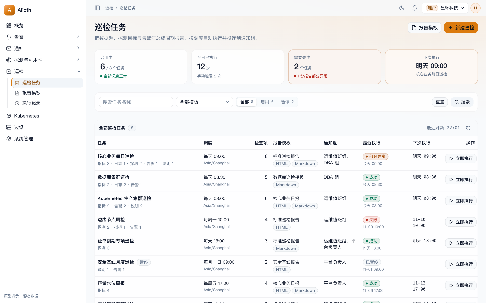
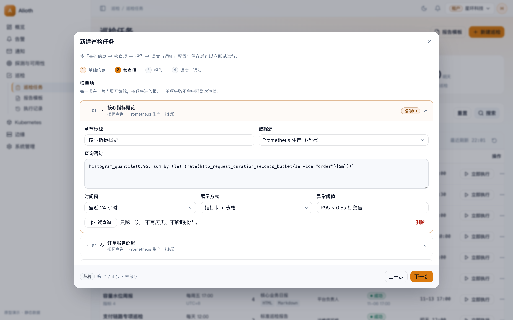
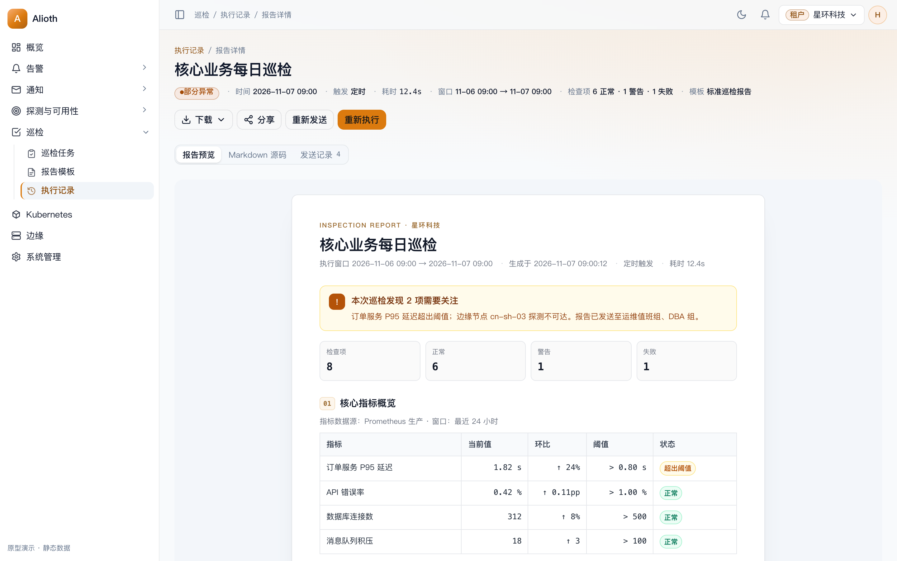

# 巡检与定时巡检设计（方案确认稿 v1）

本文说明「巡检」**做什么、数据怎么来、报告怎么生成、怎么定时与通知**，并给出页面结构与验收口径。

- 可交互原型：[inspection-prototype.html](inspection-prototype.html)（浅色 / 深色）
- 截图：[images/inspection/](images/inspection/)

| 巡检任务 | 新建向导 · 检查项 | 报告详情 |
| --- | --- | --- |
|  |  |  |
- 基线：`main` @ `47d74fe3`，分支 `docs/inspection-plan-prototype`
- 前置阅读：[probe-rule-design.md](probe-rule-design.md)（探测链路）、[design.md](design.md)、[iterations/conventions.md](iterations/conventions.md)

> 本文是**待确认稿**：第 12 节列出 7 个需要拍板的决策，确认后再拆里程碑实现。

---

## 0. 一页结论

**可行。巡检是「多源数据 + 报告模板 + 调度 + 通知组」的编排层，不新建一套判定链路：数据项直接复用现有数据源查询、探测目标组、告警事件；报告用 `html/template` / `text/template` 渲染；调度复用玉衡已有的 cron Scheduler；投递复用通知任务表与天璇 worker。**

| 结论 | 依据 |
| --- | --- |
| 巡检独立成模块，不塞进告警规则 | 告警是「逐条事件判定 + 实时通知」，巡检是「周期汇总 + 整份报告」，状态机、通知语义、页面都不同；共用规则表会让 `driver`、判定窗口、通知模板互相污染 |
| 检查项独立建表，随计划整体保存 | 一次巡检由 N 个异构数据项组成，每项有类型/查询/展示方式；整体 PUT 保存避免「半个计划」被定时器跑到 |
| 执行器放在玉衡（alioth）进程内 | 巡检是低频任务（小时/天级），玉衡已具备全部数据源查询客户端、探测结果与告警事件读取、渲染与通知入队；不必新增 megrez 领取协议。后续报告量上来再抽到独立 worker |
| 模板单格式、全部自定义 | 一份模板只存一种格式（HTML 或 Markdown）的一段正文；计划绑定模板后报告格式跟随模板，不再勾选输出格式，也不再有系统内置模板 |
| 投递是摘要 + 链接，不是附件 | 现有渠道只有纯文本邮件、Webhook（钉钉/企微/飞书/自定义）与短信；附件需要改 merak 发送实现。一期发摘要与报告链接，PDF/HTML 附件列为后续 |
| 投递任务必须跳过二次渲染 | merak 用 `alerttmpl` 渲染 `Subject`/`Body`；报告正文可能含 `{{`。新增 `pre_rendered` 标记，报告任务按原文发送 |
| 多副本安全靠数据库租约 | cron tick 在副本间竞争：用 `UPDATE ... RETURNING` 认领到期计划并推进 `next_run_at`；执行器用 `status + lease_until` 认领 run，唯一索引 `(plan_uid, scheduled_at)` 兜底 |

范围提醒：这是新模块，`docs/design.md`、`docs/roadmap.md`、`docs/iterations/conventions.md` 与权限目录（`app/alioth/pkg/perm`）都要同步登记。

---

## 1. 场景与范围

| 需求 | 落地方式 |
| --- | --- |
| 选择不同类型的数据源作为数据 | 检查项类型 `METRICS_QUERY` / `LOGS_QUERY`，选择数据源 + 查询语句，时间窗相对执行时刻 |
| 指定探测任务作为数据 | 检查项类型 `PROBE_TARGET`，按探测目标组（可多选）取窗口内可用率、延迟、失败明细 |
| 自定义报告模板与输出类型 | 每份模板 = 单一格式 + 一段代码正文；计划绑定模板，输出格式由模板决定 |
| 绑定通知组发送报告 | 计划绑定 0..N 个通知组；报告生成后按「始终 / 仅异常」入队投递，记录在消息日志 |
| 定时 + 手动触发 | cron（带时区）+ 立即执行；同一计划串行，运行中再次触发返回冲突提示 |

### 1.1 与现有能力的关系

| 能力 | 关系 |
| --- | --- |
| 数据源 | 巡检**只读查询**，不改数据源、不写探测结果、不产生告警事件 |
| 探测目标 / 探测 SLA | 巡检引用目标组与已有结果；不新增探测执行 |
| 告警事件 | 检查项可统计窗口内事件与当前未恢复事件；巡检不发告警、不参与升级 |
| 通知 | 只做「报告投递」这一种新来源，复用渠道、通知组、消息日志；不进订阅/OnCall 匹配 |
| 状态页 | 无关。巡检报告是内部运维材料，不公开展示 |

### 1.2 一期 / 后续

| 维度 | 一期 | 后续 |
| --- | --- | --- |
| 检查项 | 指标、日志、探测目标组、告警事件、静态说明 | Kubernetes 集群概况、SSH 批量执行、自定义 HTTP 数据项 |
| 调度 | cron（5 段 + 时区）+ 立即执行 | 依赖链（A 成功再跑 B）、维护窗口跳过 |
| 报告 | HTML / Markdown，站内查看 + 下载 | PDF、HTML 附件、报告对比（环比/同比） |
| 投递 | 摘要 + 报告链接 | 邮件 HTML 正文、附件、多语言报告 |
| 模板 | Go template 单正文（HTML/Markdown），全部租户自定义，代码编辑器编辑 | 可视化模板市场、模板版本管理 |
| 保留 | 90 天 / 每计划最近 100 份 | 对象存储归档、按套餐限制份数 |

---

## 2. 概念

```
巡检计划 Plan
  ├─ 检查项 Item × N     数据怎么取（类型 + 数据源 + 查询 + 时间窗 + 展示）
  ├─ 报告模板 Template    报告长什么样（HTML 正文 / Markdown 正文）
  ├─ 输出格式 Formats     HTML / MARKDOWN（可多选）
  ├─ 调度 Schedule        cron + 时区
  └─ 通知组 Groups × N    发给谁

一次执行 Run（PENDING → RUNNING → SUCCEEDED / PARTIAL / FAILED）
  └─ 报告 Report × 格式    渲染后的快照，不可变
       └─ 投递 Delivery    复用 notification_task，记录发送结果
```

- **计划**是配置；**执行**是不可变记录；**报告**是执行产物的快照，模板后续修改不回写历史。
- **PARTIAL**：至少一个检查项失败，但报告仍生成并投递。**FAILED**：模板渲染失败、报告无法生成、或全部检查项失败。
- 巡检**不重试**：单项查询失败即记为该项失败，避免报告里混入迟到的旧数据；需要重来就手动重新执行。

---

## 3. 领域模型

所有表在 `app/alioth` 的 ent schema，迁移只由 alioth 执行。通用字段（`uid`、`namespace_uid`、`created_at`、`updated_at`、`deleted_at`）沿用现有审计 mixin。

### 3.1 `inspection_plans` 巡检计划

| 字段 | 类型 | 说明 |
| --- | --- | --- |
| `name` | string | 租户内唯一，≤64 字符 |
| `description` | string | 说明，≤255 |
| `status` | enum | `ACTIVE` / `PAUSED` |
| `cron` | string | 5 段 cron（分 时 日 月 周），校验后保存 |
| `timezone` | string | IANA 时区，默认 `Asia/Shanghai` |
| `timeout_seconds` | int | 整次执行超时，默认 300，范围 30–1800 |
| `template_uid` | string | 报告模板 |
| `output_formats` | json | 由绑定模板格式推导，保存时覆盖为单元素，不再由用户勾选 |
| `title_template` | string | 报告标题模板，默认 `{{.Plan.Name}} · {{.Run.FinishedAt | date "2006-01-02 15:04"}}` |
| `notification_group_uids` | json | 通知组，可为空（只生成报告不发送） |
| `notify_policy` | enum | `ALWAYS` / `ON_ABNORMAL`（`PARTIAL`/`FAILED` 或有警告项） |
| `labels` | json | 标签，供列表筛选与后续分组 |
| `remark` | string | 备注 |
| `next_run_at` | time | 下次执行；保存/启停/执行完成后重算 |
| `last_run_at` | time | 最近一次开始时间（冗余字段，列表用） |
| `created_by` | string | 成员 UID |

索引：`(namespace_uid, name)` 唯一（未删除），`(status, next_run_at)` 调度扫描，`(namespace_uid, created_at)` 列表。

### 3.2 `inspection_items` 检查项

| 字段 | 类型 | 说明 |
| --- | --- | --- |
| `plan_uid` | string | 归属计划 |
| `kind` | enum | `METRICS_QUERY` / `LOGS_QUERY` / `PROBE_TARGET` / `ALERT_EVENTS` / `NOTE` |
| `title` | string | 章节标题，≤64 |
| `sort` | int | 报告内顺序 |
| `datasource_uid` | string | 指标 / 日志项必填；探测、告警、说明为空 |
| `query` | text | PromQL / LogQL / LogsQL / ES DSL；说明项存 Markdown |
| `window_seconds` | int | 相对执行时刻的回看窗口，默认 3600 |
| `step_seconds` | int | 指标趋势步长，默认 60 |
| `display` | enum | `METRIC` / `TABLE` / `TREND` / `LOGS` / `TEXT` |
| `params` | json | 类型专属配置：探测目标组 UID、告警筛选（级别/标签/状态）、告警阈值、表格列 |

校验：同一计划内 `title` 不重复；`sort` 连续；`METRICS_QUERY` 必须选指标类数据源；`LOGS_QUERY` 必须选日志类；`PROBE_TARGET` 至少一个目标组；`window_seconds` ≤ 30 天。

> 检查项虽然独立成表，但**不提供独立 CRUD 接口**：列表/详情随计划返回，保存用计划整体 PUT（事务内 diff 写入）。这样定时器不会读到只配了一半的计划。

### 3.3 `inspection_templates` 报告模板

| 字段 | 类型 | 说明 |
| --- | --- | --- |
| `name` | string | 租户内唯一，≤64 |
| `description` | string | 说明 |
| `format` | enum | `HTML` / `MARKDOWN`；创建后不可修改，复制后可切换 |
| `html_body` | text | `format=HTML` 时使用的代码正文，≤64KB |
| `markdown_body` | text | `format=MARKDOWN` 时使用的代码正文，≤64KB |
| `status` | enum | `ACTIVE` / `DISABLED` |

模板全部由租户自定义，不再有系统内置模板。编辑器按格式只展示一段正文，使用 Monaco 代码编辑器（HTML / Markdown 语法高亮）；保存时按格式清空另一段正文，并做 Go template Parse 校验。

计划只绑定一个模板，`output_formats` 保存时由模板格式覆盖为单元素；报告渲染也只看模板格式，不再回退内置模板。

模板可复制（副本沿用格式与正文），编辑时格式锁定，删除不受限制。

### 3.4 `inspection_runs` 执行记录

| 字段 | 类型 | 说明 |
| --- | --- | --- |
| `plan_uid` / `plan_name` | string | 计划 UID + 名称快照（计划改名后历史仍显示原名） |
| `trigger` | enum | `SCHEDULED` / `MANUAL` |
| `status` | enum | `PENDING` / `RUNNING` / `SUCCEEDED` / `PARTIAL` / `FAILED` / `CANCELED` |
| `scheduled_at` | time | 计划时刻；手动触发等于入队时刻 |
| `started_at` / `finished_at` | time | 执行区间 |
| `window_start` / `window_end` | time | 本次所有相对时间窗解析后的绝对区间 |
| `item_total` / `item_ok` / `item_warn` / `item_failed` | int | 检查项计数 |
| `summary` | json | 报告摘要数据（可用率、平均延迟、异常数等），投递与列表直接用 |
| `error` | string | `FAILED` 的原因 |
| `operator_uid` / `operator_name` | string | 手动触发人 |
| `lease_owner` / `lease_until` | string / time | 执行器租约，防两个副本同时跑 |
| `notified_at` | time | 投递入队完成时间 |

索引：`(namespace_uid, plan_uid, scheduled_at)` 唯一（幂等），`(namespace_uid, status, scheduled_at)` 列表，`(status, lease_until)` 回收。

### 3.5 `inspection_reports` 报告

| 字段 | 类型 | 说明 |
| --- | --- | --- |
| `run_uid` | string | 归属执行 |
| `format` | enum | `HTML` / `MARKDOWN` |
| `title` | string | 渲染后的标题 |
| `content` | text | 渲染结果，≤2MB |
| `size` | int | 字节数 |
| `checksum` | string | sha256，用于「重新发送」幂等与去重 |
| `share_token_hash` | string | 公开链接 token 的 SHA-256；空表示未分享，不存原文 |
| `share_enabled` | bool | 停用后立即失效，可重新启用或换新 token |
| `share_expires_at` | time | 过期时间；空表示永久有效 |
| `share_password_hash` | string | 可选访问密码（argon2id）；空表示不校验 |
| `share_created_by` / `share_created_at` | string / time | 创建人与创建时间，审计用 |
| `share_view_count` / `share_last_viewed_at` | int / time | 访问次数与最近访问时间 |

索引：`(run_uid, format)` 唯一，`(namespace_uid, created_at)` 清理，`share_token_hash` 唯一（仅非空）。

### 3.6 投递不新建表

复用 `notification_task`：

- `event_uid = run_uid`，`phase` 新增枚举值 `REPORT`，`group_uid` / `channel_uid` / `template_uid` 照通知组展开。
- 新增 `pre_rendered` bool：报告任务的 `subject`/`body` 已是最终文本，merak **跳过模板渲染**。
- 唯一索引 `(event_uid, phase, group_uid, channel_uid)` 天然挡住同一报告重复投递；「重新发送」时由用户显式操作，走 `RetryTask` 或新建任务（二选一，见 12.6）。
- 报告链接前缀取新增配置 `server.console_base_url`（环境变量 `ALIOTH_CONSOLE_BASE_URL`）；未配置时正文只写相对路径。

---

## 4. 检查项怎么取数

每项执行产出统一成 `Section` 结构，模板只消费它，不感知数据源驱动。

```go
type Section struct {
    Title  string
    Kind   string   // METRICS_QUERY / LOGS_QUERY / PROBE_TARGET / ALERT_EVENTS / NOTE
    Status string   // OK / WARN / FAILED
    Error  string   // 失败原因，模板可直接展示
    Note   string   // Markdown 说明
    Metrics []Metric      // 指标卡：名称、值、单位、环比
    Table   *Table        // 表格：列定义 + 行
    Series  []Series      // 趋势：名称 + 点集
    Logs    []LogSample   // 日志样本
    Alerts  []AlertRow    // 告警行
}
```

| 类型 | 取数 | 产出 | 失败判定 |
| --- | --- | --- | --- |
| `METRICS_QUERY` | 玉衡现有 `QueryRange`（指标驱动） | 数值卡 / 表格 / 趋势 | 查询报错、结果为空且配置了「空即异常」 |
| `LOGS_QUERY` | 玉衡现有 `QueryLogs`（Loki / VictoriaLogs / ES） | 日志样本 + 命中数 | 查询报错、命中数超过阈值（`WARN`） |
| `PROBE_TARGET` | `probe_results` + `probe_sla_daily` 日聚合 | 目标组可用率、平均/P95 延迟、失败目标明细 | 可用率低于阈值、存在 `down` 目标 |
| `ALERT_EVENTS` | 告警事件表 | 当前未恢复事件、窗口内新增事件、按级别分布 | 存在 `CRITICAL` 事件（可配） |
| `NOTE` | 不查询 | Markdown 段落 | 永不失败 |

阈值放在 `item.params`，例如 `{"availability_below": 99.5, "latency_ms_above": 800}`。阈值命中只把该项标成 `WARN`，不改计划状态。

**时间窗**：所有相对窗口在 run 开始时一次性解析成 `window_start/window_end`，写入 run；模板里展示的是绝对区间，避免报告重看时含义漂移。定时计划默认「截至计划时刻往前一个窗口」，手动执行同样。

---

## 5. 执行链路

```
Scheduler（robfig cron，每 15s tick）
  └─ ClaimDuePlans: UPDATE inspection_plans
       SET next_run_at = next(cron), last_run_at = now()
       WHERE status='ACTIVE' AND next_run_at <= now()
       RETURNING *                      -- 多副本只有一个事务能拿到
  └─ INSERT inspection_runs(PENDING)    -- 唯一索引 (plan_uid, scheduled_at) 兜底

Runner（每秒轮询，单实例并发 2 个计划）
  └─ ClaimRun: UPDATE inspection_runs SET status='RUNNING', lease_owner, lease_until
       WHERE uid = (SELECT uid FROM inspection_runs
                    WHERE status='PENDING' ORDER BY scheduled_at
                    FOR UPDATE SKIP LOCKED LIMIT 1)
       RETURNING *
  └─ 执行检查项（并发 4，单项超时 min(60s, 计划超时)）
  └─ 汇总 Summary → 渲染勾选格式 → 存 inspection_reports
  └─ status = SUCCEEDED / PARTIAL / FAILED
  └─ 按 notify_policy 入队通知任务
```

- **租约**：`lease_until = now + 90s`，Runner 每 30s 续租；租约过期仍 `RUNNING` 的 run 由回收任务标 `FAILED`（原因 `lease expired`），不自动重跑。
- **整次超时**：`timeout_seconds` 到期后取消剩余项，已完成的项保留，报告标 `PARTIAL`。
- **手动触发**：`POST /plans/{uid}/run` 走同一插入路径（`trigger=MANUAL`）。若该计划已有 `PENDING`/`RUNNING`，返回 `409 CONFLICT`（`inspection plan is running`），页面提示「正在执行，稍后查看结果」。
- **暂停**：`PAUSED` 计划不再产生定时 run；已在队列里的 run 继续执行（避免暂停把半份报告丢掉）。
- **为什么不用 megrez**：megrez 的领取协议围绕「规则 × 数据源」的 15–30s 高频评测设计，巡检是低频重查询 + 渲染 + 通知，搬过去要新增领取/回写/幂等三套协议，收益只是把低频查询挪出控制面。先用玉衡内置 Runner，接口边界留成 `inspection.Executor`，需要拆进程时替换实现即可。
- **副本竞争**：alioth 多副本时所有副本都跑 Scheduler 与 Runner，靠上面的原子认领互斥；Redis 锁不参与（已有 lock 只在告警评测领取里用）。

---

## 6. 报告模板与渲染

### 6.1 数据契约

模板收到同一份 `ReportData`，两种格式共享：

```go
type ReportData struct {
    Title       string
    GeneratedAt time.Time
    Tenant      TenantInfo   // 名称
    Plan        PlanInfo     // 名称、描述、标签、调度文本
    Run         RunInfo      // 触发方式、开始/结束、耗时、窗口、操作人
    Summary     Summary      // Total / OK / Warn / Failed / Abnormal(=Warn+Failed) / Availability
    Sections    []Section
    Abnormal    []Section    // 失败 + 警告项，模板可直接遍历
    HasAbnormal bool
}
```

模板可用函数白名单：`date`、`duration`、`percent`、`default`、`join`、`lower`、`upper`、`json`、`add`、`sub`、`mul`、`div`。**不提供** `env`、`exec`、文件读取、网络请求或任意函数调用。

### 6.2 引擎与安全

| 项 | 规则 |
| --- | --- |
| HTML | `html/template`，数据默认转义；正文本身是模板，可以写结构 |
| Markdown | `text/template`，不做 HTML 转义；报告页展示时用现成的 Markdown 渲染并做 XSS 过滤 |
| 大小 | 模板 ≤64KB；渲染结果 ≤2MB；超出即 `FAILED`，不截断 |
| 超时 | 单次渲染 10s，超时 `FAILED` |
| 语法 | 保存时 `Parse` 校验并报行号；预览用示例数据，不执行真实查询 |
| 依赖 | 不引用外部 CSS/JS/图片，内置样式内联，保证下载后单文件可看 |

### 6.3 内置模板样式

- 浅色中性版式（白底、深灰字、品牌色只用于标题与强调），不跟随控制台深色模式——报告会被转发、打印、归档。
- 结构：标题区（计划名、租户、时间窗）→ 结论横幅（全绿 / 有警告 / 有失败）→ 摘要指标卡 → 各检查项章节（表格 / 指标 / 趋势）→ 异常清单 → 页脚（生成方式、报告链接）。
- 宽度 760px，打印友好；表格列多时横向滚动，不换行折断。

### 6.4 输出

一次 run 把勾选的每个格式各渲染一份，存 `inspection_reports`。列表与详情只展示「最新一次」，历史报告随 run 保留。下载：HTML 下载为 `.html` 单文件；Markdown 下载为 `.md`。

---

## 7. 调度

- 表达式：5 段 cron，UI 提供「每小时 / 每天 09:00 / 每周一 09:00 / 每月 1 日 09:00 / 自定义」预设，自定义时直接编辑 cron 并在旁边实时显示「下次执行时间」。
- 时区：跟随计划，默认租户创建时区 `Asia/Shanghai`；DST 跳过的时刻按 robfig 规则跳到下一个有效时刻。
- `next_run_at` 在保存、启用、执行完成后重算；页面列表直接展示。
- 最短间隔 5 分钟（防误配把控制面打满）；最长不限制。
- 维护窗口：一期**不跳过**——巡检报告是观测材料，维护窗口内也需要留存证据；后续可加「维护窗口内标记为维护中」。

---

### 7.5 公开分享

报告详情页提供「分享」，生成一条**只读公开链接**，无需登录即可查看同一份报告快照。

- 一份报告同时最多一条有效链接；生成 32 字节随机 token，库里只存 SHA-256，URL 不写日志、不进 referrer。
- 默认有效期 7 天，可选 30 天或永久；可选访问密码（argon2id）；可随时停用或重新生成，旧链接立即失效。
- 公开页只返回该报告的渲染快照与最小元信息（租户名、生成时间、到期时间），不提供 API、列表或任何其他租户数据。
- 响应头 `Cache-Control: no-store`、`X-Robots-Tag: noindex` 并按 IP + token 限流；过期、停用、密码错误统一返回 404 或密码页，不区分「不存在」与「无权」。
- 审计：创建人、创建时间、有效期、停用操作与访问次数；公开页底部标注「由 Alioth 巡检生成」。

---

## 8. API 设计

新增 `api/alioth/v1/inspection.proto`（两个 service，中文注释，`google.api.http`）。

### 8.1 InspectionPlanService

| 方法 | 路由 | 权限 |
| --- | --- | --- |
| `ListInspectionPlans` | `GET /v1/inspection/plans` | `inspection:read` |
| `GetInspectionPlan` | `GET /v1/inspection/plans/{uid}` | `inspection:read` |
| `CreateInspectionPlan` | `POST /v1/inspection/plans` | `inspection:write` |
| `UpdateInspectionPlan` | `PUT /v1/inspection/plans/{uid}` | `inspection:write` |
| `UpdateInspectionPlanStatus` | `PATCH /v1/inspection/plans/{uid}/status` | `inspection:write` |
| `DeleteInspectionPlan` | `DELETE /v1/inspection/plans/{uid}` | `inspection:delete` |
| `RunInspectionPlan` | `POST /v1/inspection/plans/{uid}/run` | `inspection:run` |
| `TestInspectionItem` | `POST /v1/inspection/test-item` | `inspection:read` |

`TestInspectionItem` 只执行一项、返回 `Section`，不落库、不投递；新建向导的「试查询」与编辑时的单项重试都用它。

### 8.2 InspectionTemplateService

| 方法 | 路由 | 权限 |
| --- | --- | --- |
| `ListInspectionTemplates` | `GET /v1/inspection/templates` | `inspection_template:read` |
| `GetInspectionTemplate` | `GET /v1/inspection/templates/{uid}` | `inspection_template:read` |
| `CreateInspectionTemplate` | `POST /v1/inspection/templates` | `inspection_template:write` |
| `UpdateInspectionTemplate` | `PUT /v1/inspection/templates/{uid}` | `inspection_template:write` |
| `DeleteInspectionTemplate` | `DELETE /v1/inspection/templates/{uid}` | `inspection_template:delete` |
| `PreviewInspectionTemplate` | `POST /v1/inspection/templates/preview` | `inspection_template:read` |
| `CloneInspectionTemplate` | `POST /v1/inspection/templates/{uid}/clone` | `inspection_template:write` |

### 8.3 执行与报告（挂在 PlanService 之外单独 service 更清晰）

`InspectionRunService`：

| 方法 | 路由 | 权限 |
| --- | --- | --- |
| `ListInspectionRuns` | `GET /v1/inspection/runs` | `inspection:read` |
| `GetInspectionRun` | `GET /v1/inspection/runs/{uid}` | `inspection:read` |
| `ListRunReports` | `GET /v1/inspection/runs/{uid}/reports` | `inspection:read` |
| `GetInspectionReport` | `GET /v1/inspection/reports/{uid}` | `inspection:read` |
| `ResendInspectionReport` | `POST /v1/inspection/runs/{uid}/resend` | `inspection:run` |
| `ShareInspectionReport` | `POST /v1/inspection/reports/{uid}/share` | `inspection:share` |
| `RevokeInspectionReportShare` | `DELETE /v1/inspection/reports/{uid}/share` | `inspection:share` |

公开分享（不登录、不带 `X-Namespace`，独立注册在公开路由组）：

| 方法 | 路由 | 说明 |
| --- | --- | --- |
| `GetSharedInspectionReport` | `GET /v1/public/inspection-reports/{token}` | 返回报告 HTML 与最小元信息；过期/停用 404 |
| `UnlockSharedInspectionReport` | `POST /v1/public/inspection-reports/{token}/unlock` | 校验访问密码，成功返回短时只读 cookie |

列表过滤：计划、状态、触发方式、时间区间（最多 30 天，服务端校验，照 `alertevent.MaxHistoryRangeDays` 的做法）。分页沿用 `pageNo/pageSize`。

错误语义：计划名重复 `INVALID`；计划不存在 `NOT_FOUND`；运行中手动触发 `CONFLICT`；模板渲染失败写在 run 的 `error`，不向触发者抛 500。

---

## 9. 前端页面

### 9.1 信息架构

侧边栏新增**「巡检」**分组（`Radar` 图标，放在「探测与可用性」之后）：

| 菜单 | 路由 | 菜单权限 | 能力 |
| --- | --- | --- | --- |
| 巡检任务 | `/inspection-plans` | `menu:inspection_plan` | `inspection_plan` |
| 报告模板 | `/inspection-templates` | `menu:inspection_template` | `inspection_template` |
| 执行记录 | `/inspection-runs` | `menu:inspection_run` | `inspection_run` |

任务详情、报告详情都是子路由：`/inspection-plans/{uid}`、`/inspection-runs/{uid}`，不单独占菜单。

### 9.2 巡检任务列表

- 页头：`巡检任务` + 说明 + 右侧「报告模板」（outline）与「新建巡检」（primary）。
- 概览条：启用中 / 今日执行 / 异常巡检 / 下次执行，四个统计卡（沿用 dashboard 的 stat 卡样式）。
- 筛选：名称 Input + 模板 Select + 状态 segmented（全部 / 启用 / 暂停）；筛选区用共享 `FilterToggle` 折叠，不额外占一行。
- 表格：名称（副标题是检查项构成）、调度（cron 描述 + 时区）、检查项数、报告模板 + 格式徽标、通知组、最近执行（状态徽标 + 相对时间）、下次执行、操作（立即执行 / 更多）。
- 交互：行点击打开右侧 `DetailSheet`（概览、检查项、最近 5 次执行、暂停/启用、编辑、删除）；「立即执行」就地转圈，成功后 toast + 打开最新 run。
- 四态：骨架、空态（引导新建）、失败可重试、无权限（隐藏入口 + 403 页）。

### 9.3 新建 / 编辑向导

四步 `StepForm`，宽对话框 `sm:max-w-5xl`（64rem），正文唯一滚动，`max-h-[80vh]`：

1. **基础信息**：名称、说明、标签、整次超时、备注。
2. **检查项**：单列折叠卡片，一次展开一项。展开后按类型切换专用编辑器（指标查询 / 日志查询 / 探测目标 / 告警事件 / 静态说明），左侧是类型配置，右侧是「运行测试」结果面板；仅切换类型时保留标题与时间窗，其余不兼容字段清空并确认。详细交互、字段与 `params` 契约见 [检查项编辑器重设计](inspection-item-editor-design.md)，可交互原型见 [inspection-item-editor-prototype.html](inspection-item-editor-prototype.html)。列表末尾「添加检查项」，至少 1 项。
3. **报告**：模板选择卡（全部为租户自定义，展示 HTML / Markdown 格式徽标）、报告标题模板；不再勾选输出格式，绑定模板后只读展示报告格式。
4. **调度与通知**：执行频率预设（每天 09:00 / 每周一 09:00 / 每月 1 日 / 自定义）。cron 输入始终可见：预设时只读并显示对应表达式，选「自定义 cron」后才可编辑；标签旁 `?` tooltip 说明 5 段含义、取值与示例。另有通知组多选（展示渠道徽标）、发送条件（始终 / 仅异常）、启用开关。底部「保存并试运行」（保存后立即入队一次，不投递）。

跨步校验：保存时汇总错误跳回对应步骤，错误就地显示（`aria-invalid`），不只在底部报一条。

### 9.4 执行记录与报告详情

- 执行记录页：计划 / 状态 / 触发方式 / 开始时间 / 耗时 / 检查项（正常·警告·失败）/ 报告格式 / 操作（查看报告、重新发送）。过滤条件与上面 API 一致，时间区间最多 30 天。
- 报告详情页：
  - 顶部：返回、标题、状态徽标、计划名、时间、操作（下载 / 分享 / 重新发送 / 重新执行）。分享打开对话框：启用开关、公开链接 + 复制、有效期（7 天 / 30 天 / 永久）、可选访问密码与风险提示；「预览公开页」进入无侧栏的只读报告页。
  - 元信息行：触发方式、耗时、数据窗口、检查项统计、模板、通知组。
  - 视图切换（`segmented`）：`报告预览` / `Markdown 源码` / `发送记录`。
  - 报告预览：白底报告画布（`iframe` 或隔离容器渲染存下来的 HTML），宽度 760，周围留灰底。
  - 发送记录：通知组 × 渠道 × 接收人 × 状态 × 时间，失败行提供「重试」。
- 公开页：固定 760 报告纸、顶部只读标识与到期时间、无控制台导航；过期 / 停用 / 密码错误不暴露报告是否存在。
- 报告是快照：重新发送用同一份内容；「重新执行」生成新的 run。

### 9.5 报告模板页

左侧模板列表只展示租户模板，带格式徽标；右侧编辑器：名称、说明、格式（创建时选择、编辑时锁定）、Monaco 代码正文。保存前 Parse 校验，错误定位到行；模板可复制、可删除。

### 9.6 视觉细节基线

原型按下面这组基线收敛，实现时沿用同一套值，避免「原型好看、页面走样」：

- 控件高度 32px（表格行内 28px）；390 宽页头与筛选按钮 40px。
- 表格正文 14px、单元格内边距 8px；辅助信息 12px，muted 不用于 12px 以下。
- 分类信息（HTML / Markdown、定时 / 手动、邮件 / 钉钉）用中性 `tag`；只有健康状态用 `tone` 徽标。KPI 数字不上色。
- 焦点环用 `ring/50` 的 3px 外环，不叠成实色描边；checkbox / radio 用主色。
- 报告纸固定 760px、浅色、1px 纸边，深色模式不反色；画布只做灰底承托。
- 横向溢出只发生在自己的滚动容器（表格 / 报告画布）；390 宽不得整页横滚，并提供「左右滑动」提示。
- 列表行的「最近执行」只表达执行结果；计划暂停状态由任务状态表达，不用执行结果列代偿。
- 对话框内容区留 6–8px 焦点环净空，聚焦控件提升 `z-index`，阴影不被裁切、也不被相邻控件盖住。
- 检查项采用单列折叠卡，同屏只展开一项；标题栏始终可见，长表单里也能快速定位。

### 9.7 视觉与交互约束

- 只用共享原语：`PageHeader`、`ListFrame`、`DetailSheet`、`StatusBadge`、`FormField`、`StepForm`、`FilterChips`、`DateRangePicker`、`Table`；不在页面里写原生控件。
- 语义 token，不写 hex / 调色板类；状态不只靠颜色（徽标带文字）。
- 表格宽度按 `lib/table-layout.ts`；长文本列 `break-words`，时间列 `tabular-nums`。
- 对话框遵循 `web/AGENTS.md`：`DialogBody` 唯一滚动，header/footer 固定，80vh 上限。
- i18n：`nav.inspection*`、`inspection.*` 中英同步，`npm run check:i18n` 过。

---

## 10. 权限、套餐与菜单

在 `app/alioth/pkg/perm` 登记（代码维护，不建表）：

| 模块 | `inspection`（名称：巡检） |
| --- | --- |
| 能力 | `inspection_plan`（巡检任务）、`inspection_template`（报告模板）、`inspection_run`（执行记录与报告） |
| 权限 | `inspection:read/write/delete/run/share`、`inspection_template:read/write/delete` |
| 菜单权限 | `menu:inspection_plan`、`menu:inspection_template`、`menu:inspection_run` |

- `inspection_run` 只依赖 `inspection:read`，因此「只看报告」的角色可以不给写权限。
- 创建计划时校验依赖能力：指标/日志项要求已开通对应数据源驱动能力；探测项要求 `probe_target`；绑定通知组要求 `notify_group`。缺能力返回明确错误，不静默降级。
- 套餐归属：按**独立能力包**设计，`BaseCapabilities()` 不自动包含；若产品确认随基础套餐提供，再补「升级时基础套餐租户自动补上」的逻辑（见 12.7）。

---

## 11. 里程碑拆解

| 里程碑 | 内容 | 验收 |
| --- | --- | --- |
| M34-1 模型与 CRUD | 5 张表、迁移、计划/模板/检查项 CRUD、权限与菜单 | 计划创建/编辑/停用/删除往返；权限分支单测；`make vet/lint/test` |
| M34-2 调度与执行 | Scheduler 认领到期计划、Runner 租约、五类检查项、超时与部分失败 | 单测覆盖：幂等唯一索引、运行中手动触发 409、租约过期回收、单项失败 → `PARTIAL` |
| M34-3 模板与报告 | 自定义单格式模板（HTML/Markdown 代码正文）、可视化 helper、渲染、存档、预览、下载、清理 | HTML/Markdown 各自单格式渲染；恶意模板（`env`、超大输出）被拒；渲染超时 → `FAILED` |
| M34-4 投递 | 通知任务入队、摘要 + 链接、`pre_rendered`、发送记录、重新发送 | 真实 SMTP/Webhook 各一次；报告正文含 `{{` 不被二次渲染；重复投递被唯一索引挡住 |
| M34-5 前端 | 三个菜单、向导、执行记录、报告详情、模板编辑器 | 真实后端走完主路径 + 空/错/无权限 + 1440×900 与 390×844 + 深浅色；`npm run check` |

分解原则：M34-1 与 M34-2 可以并行（不同目录），M34-3 依赖 M34-2 的 `Section` 契约，M34-4 依赖 M34-3，M34-5 依赖前四步的 proto 稳定。

**DoD**：接口 curl 往返（含不带 `X-Namespace` 的平台级接口不适用本模块）、乐观锁/状态机单测、浏览器验收截图存 `tmp/inspection-acceptance/`、`make vet && make lint && make test`、`npm --prefix web run check && npm --prefix web run build`。

---

## 12. 待确认（拍板后我按结论落实现）

| # | 决策 | 选项 | 建议 |
| --- | --- | --- | --- |
| 1 | 报告投递形态 | A 摘要 + 站内链接；B 摘要 + HTML/PDF 附件；C 纯正文全文 | **A**，附件列为后续 |
| 2 | 执行器位置 | A 玉衡进程内 Runner；B megrez 新增巡检 worker | **A**，接口留 `Executor` |
| 3 | 模板引擎 | A Go template 单格式代码正文 + 可视化 helper；B 可视化章节编排（引擎内置） | **A**，灵活且实现成本低 |
| 4 | 报告保留 | A 90 天；B 每计划最近 100 份；C 两者取先到 | **C**（90 天 或 100 份） |
| 5 | 发送条件 | A 始终 / 仅异常两档；B 增加「仅失败」三档 | **A**，两档够用 |
| 6 | 重新发送语义 | A 重发同一份报告（新任务）；B 只重试失败任务 | **A + 失败任务内联重试** |
| 7 | 套餐归属 | A 基础套餐自带；B 单独能力包 | **B 更符合商业化**，但 A 更省事；需要产品确认 |
| 8 | 公开分享默认策略 | A 7 天 + 可选密码 + 可停用；B 永久 + 强制密码 | **A**，按报告内容敏感度再调 |

还有一个默认值请确认：**报告链接前缀**用新增配置 `ALIOTH_CONSOLE_BASE_URL`，还是复用站点设置里的某个地址？目前站点设置只服务于官网，没有控制台地址。

---

## 13. 文档与代码更新清单

| 位置 | 更新 |
| --- | --- |
| `docs/design.md` | 新增「巡检」一节，说明与告警/探测的边界 |
| `docs/roadmap.md` | 新增 M34 里程碑与依赖 |
| `docs/iterations/conventions.md` | 领域包清单加 `inspection`，说明 Runner 分层 |
| `app/alioth/pkg/perm` | 模块、能力、权限、菜单权限 |
| `web/src/components/app-shell.tsx` | 新导航分组与菜单 |
| `web/src/lib/feature-catalog.ts` | 三个菜单能力映射 |
| `web/src/i18n` | 中英 key |
| `web/src/App.tsx` | 三个路由 |
