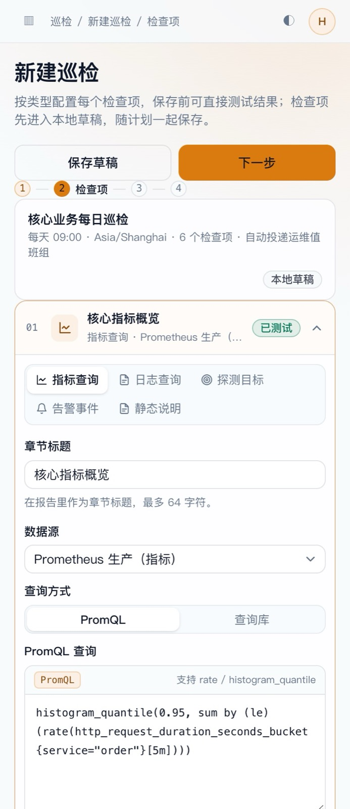

# 巡检检查项编辑器重设计（方案确认稿 v1）

现有实现里，五类检查项共用一个 `query` 文本域和一组通用字段。数据源、查询语言、探测目标组、告警筛选全部靠用户自己写进文本，既没有类型适配，也无法在保存前验证结果。本文重新设计检查项的编辑交互与配置契约。

- 可交互原型：[inspection-item-editor-prototype.html](inspection-item-editor-prototype.html)
- 关联设计：[inspection-design.md](inspection-design.md)
- 基线：`main` @ `db7c2a50`
- 状态：已实现（`feat/inspection-item-editor`，后端 `TestInspectionItem` + 前端 `InspectionItemEditor`）

## 界面预览

| 指标查询 | 探测目标 |
| --- | --- |
|  |  |

| 告警事件 | 390 宽 |
| --- | --- |
|  |  |

---

## 0. 一页结论

**保留「检查项列表 + 卡片内展开」的结构，但展开后不再是通用表单，而是按类型切换的专用编辑器：左侧配置、右侧实时预览，底部保存/还原。类型切换只重置不兼容字段，公共字段（标题、时间窗、展示、启用）保留。预览统一走一个新的只读接口 `POST /v1/inspection/test-item`，与正式执行共用同一套 `Section` 结果结构。**

| 结论 | 依据 |
| --- | --- |
| 保留折叠卡片，不改成独立页面 | 检查项是计划的一部分，用户需要同时看到顺序与其它项；独立页面会丢失上下文 |
| 每类检查项独立编辑器 | 指标要 PromQL/查询库，日志要方言与样本，探测要目标组，告警要状态/级别，说明要 Markdown；一个 textarea 无法表达 |
| 配置与预览左右分栏 | 查询类必须「边写边看」，否则保存后才发现空结果/语法错误 |
| 预览走后端统一接口 | 前端直接调数据源/探测/告警接口会绕过执行器语义（窗口、阈值、解析），预览与正式报告不一致 |
| 类型切换保留公共字段 | 减少重复输入；不兼容字段清空并有确认提示 |
| 检查项先「保存到草稿」，再随计划保存 | 与现有整体 PUT 一致；避免半配置状态被定时器读到 |

---

## 1. 现在的问题

| 问题 | 影响 |
| --- | --- |
| 所有类型共用一个 `query` 文本域 | 指标用户不知道要写 PromQL，日志用户不知道要写 LogQL/LogsQL/DSL；探测/告警用户根本不需要查询语句 |
| 数据源下拉不区分指标/日志 | 选错类型到执行时才失败；切换类型后残留无用数据源 |
| 没有目标组/告警筛选项 | 探测、告警检查项目前只能手写 `params` JSON，普通用户无法完成 |
| 没有预览/试运行 | 保存后第一次执行才发现语法错误、空数据或阈值写错 |
| 没有逐项校验 | 错误在保存整个计划时集中报出，用户要来回找 |
| 折叠卡内字段平铺 | 复杂类型的编辑区过长，保存按钮离字段很远 |

---

## 2. 交互模型

### 2.1 列表 + 单开折叠卡

步骤 2 仍是一列检查项卡片，同一时刻只展开一项：

```
┌ 01  核心指标概览        指标查询 · Prometheus 生产      ✓ 已测试   ⌄ ┐
├────────────────────────────────────────────────────────────────────┤
│  [指标查询] [日志查询] [探测目标] [告警事件] [静态说明]              │
│  ┌ 配置 ─────────────────────────────┐  ┌ 预览 ─────────────────┐  │
│  │ 数据源  [Prometheus 生产 ▾]        │  │ 测试成功 · 182ms      │  │
│  │ 查询方式 [PromQL] [查询库]         │  │ P95 1.82s  ↑24%      │  │
│  │ ┌ PromQL 编辑器 ────────────────┐ │  │ ▁▂▃▅▇ 趋势          │  │
│  │ │ histogram_quantile(...)        │ │  │ 序列表               │  │
│  │ └───────────────────────────────┘ │  │                      │  │
│  │ 时间窗 [24h] 步长 [60s]           │  └──────────────────────┘  │
│  │ 展示 [指标卡+表格 ▾] 单位 [s]      │                            │
│  │ 阈值 [> 0.8s 警告] [+ 添加]        │                            │
│  └───────────────────────────────────┘                            │
│  未保存修改                            [还原] [保存检查项]          │
└────────────────────────────────────────────────────────────────────┘
```

- 折叠态卡片只显示摘要：序号、类型图标、标题、类型 + 数据源/目标组摘要、最近测试状态、展开箭头。
- 点击标题栏展开；再次点击收起。展开另一项时，若当前项有未保存修改，先确认「放弃修改并切换」。
- 展开区滚动由步骤内容承担，不和页面抢滚动。

### 2.2 类型切换

展开区顶部是五类分段控件，不是下拉：

- 切换类型保留：标题、时间窗、启用状态。
- 清空不兼容字段：数据源、查询、目标组、告警筛选、阈值。
- 若当前项已有未保存修改，切换类型先确认；确认后重新渲染配置与空预览。
- 类型切换不改变检查项在列表中的顺序。

### 2.3 保存与校验

- 「保存检查项」把当前编辑写回计划的本地草稿，并校验当前项；通过后折叠卡片、摘要更新。
- 「还原」丢弃当前项未保存修改，恢复到上次保存到草稿的状态。
- 整个计划仍由底部「下一步 / 保存」统一提交；检查项不单独落库。
- 校验失败时：
  - 字段就地显示错误并带 `aria-invalid`；
  - 自动展开出错字段所在分组；
  - 不弹只有一条汇总错误的 toast。

### 2.4 测试预览

- 预览区右上角「运行测试」；测试中显示 spinner 与已用时。
- 测试成功：显示与正式报告一致的 `Section` 结果；标题下方标注「测试成功 · 182ms」。
- 测试失败：预览区显示错误原因，字段不自动标红（可能是上游暂时不可用），但保留「重试」。
- 测试不写入历史、不产生告警、不投递通知。
- 查询类在停止输入 800ms 后可自动测试（可关闭）；探测/告警默认手动测试，避免频繁请求。

---

## 3. 五类编辑器

### 3.1 指标查询 `METRICS_QUERY`

| 字段 | 控件 | 说明 |
| --- | --- | --- |
| 数据源 | Select（仅指标类、启用中） | 切换数据源时按驱动切换查询方言 |
| 查询方式 | 分段：`PromQL` / `查询库` | 查询库复用现有数据源查询历史/模板 |
| 查询 | PromQL 编辑器（Monaco，语法高亮、补全） | 空值校验；只读预览可折叠 |
| 时间窗 | Select：1h / 6h / 24h / 7d / 自定义 | 默认 24h |
| 步长 | Select：15s / 30s / 60s / 5m | 默认 60s |
| 展示 | 指标卡 / 表格 / 趋势图 / 指标卡+表格 | 影响报告章节 |
| 单位 | Input（可空） | 仅展示用 |
| 阈值 | 行编辑器：操作符 + 数值 + 状态（警告/失败） | 可多条；评估 `WARN` / `FAILED` |
| 空数据 | Checkbox：窗口为空标警告 | 默认关 |

预览：摘要指标卡 + 最近值折线（SVG）+ 序列表；解析失败显示原始响应折叠块。

### 3.2 日志查询 `LOGS_QUERY`

| 字段 | 控件 | 说明 |
| --- | --- | --- |
| 数据源 | Select（仅日志类、启用中） | 按驱动决定方言 |
| 方言 | 只读徽标：LogQL / LogsQL / ES DSL | 跟随数据源 |
| 查询 | 对应方言编辑器 | ES 使用 JSON 编辑器 |
| 级别过滤 | 多选 chips：ERROR / WARN / INFO / DEBUG | 可空 |
| 条数 | Select：20 / 50 / 100 / 200 | 影响样本与执行上限 |
| 排序 | 倒序 / 正序 | 默认倒序 |
| 告警条件 | 命中数 > N 标警告 | 可空 |

预览：命中数、最近样本列表（时间、级别、消息，超长截断并可展开）、原始响应折叠。

### 3.3 探测目标 `PROBE_TARGET`

| 字段 | 控件 | 说明 |
| --- | --- | --- |
| 目标组 | 多选（带搜索，展示目标数/类型） | 至少一个 |
| 观测指标 | Select：可用率 / 平均延迟 / P95 / 证书剩余天数 | 默认可用率 |
| 时间窗 | Select：1h / 24h / 7d | 探测结果保留 7 天 |
| 阈值 | 低于/高于数值 + 状态 | 可用率默认 `< 99.5%` 警告 |
| 失败目标 | Checkbox：存在 down 目标即警告 | 默认开 |

预览：按目标组的可用率表（目标数、可用率、平均延迟、P95、失败目标），异常行带状态徽标；无结果时提示「窗口内没有探测数据」。

### 3.4 告警事件 `ALERT_EVENTS`

| 字段 | 控件 | 说明 |
| --- | --- | --- |
| 事件状态 | 分段：未恢复 / 全部 | 默认未恢复 |
| 级别 | 多选（告警级别字典） | 可空表示不限 |
| 标签 | 键值行（`service=order`），支持多个 | 与告警订阅同一套匹配语义 |
| 条数 | Select：20 / 50 / 100 | 默认 50 |
| 告警条件 | 存在指定级别事件即警告 | 默认勾选 CRITICAL |

预览：事件表（摘要、级别、状态、开始时间），数量统计；无事件时显示空态。

### 3.5 静态说明 `NOTE`

| 字段 | 控件 | 说明 |
| --- | --- | --- |
| 内容 | Markdown 编辑器 + 预览切换 | 必填 |
| 展示 | 固定 `TEXT` | 不提供选择 |

预览：渲染后的 Markdown（标题、列表、代码块、链接），不允许内联 HTML/脚本。

---

## 4. 数据契约

继续使用现有 `inspection_items` 字段，类型专属配置写入 `params` JSON，避免为每类加列。

| 字段 | 指标 | 日志 | 探测 | 告警 | 说明 |
| --- | --- | --- | --- | --- | --- |
| `datasource_uid` | 必填 | 必填 | 空 | 空 | 空 |
| `query` | PromQL | LogQL/LogsQL/DSL | 空 | 空 | Markdown |
| `window_seconds` | 1h–7d | 1h–7d | 1h–7d | 1h–7d | 固定 3600 |
| `step_seconds` | 15–300 | 空 | 空 | 空 | 空 |
| `display` | METRIC/TABLE/TREND | LOGS | TABLE | TABLE | TEXT |
| `params` | 见下 | 见下 | 见下 | 见下 | `{}` |

```jsonc
// METRICS_QUERY
{"unit":"s","empty_is_warn":false,"thresholds":[{"op":">","value":0.8,"status":"WARN"}]}

// LOGS_QUERY
{"levels":["ERROR","WARN"],"limit":50,"direction":"backward","warn_above":100}

// PROBE_TARGET
{"group_uids":["g1","g2"],"metric":"availability","availability_below":99.5,"warn_on_down":true}

// ALERT_EVENTS
{"status":"FIRING","level_uids":["lv1"],"labels":"service=order","limit":50,"warn_levels":["CRITICAL"]}

// NOTE
{}
```

`params` 在保存时由服务端按类型校验：未知键拒绝、数值范围检查、目标组归属校验。

> 当前实现已有 `group_uids`、`availability_below`、`status`、`warn_levels`、`limit`；本方案新增的 `metric`、`warn_on_down`、`levels`、`direction`、`level_uids`、`labels` 等字段，需要与 `normalizeItem` 和对应 `executeSection` 一起补齐，否则界面可配但执行不生效。

---

## 5. 预览接口

新增只读接口，与正式执行共用 `executeSection`：

```proto
rpc TestInspectionItem(TestInspectionItemRequest) returns (TestInspectionItemResponse) {
  option (google.api.http) = { post: "/v1/inspection/test-item" body: "*" };
}

message TestInspectionItemRequest {
  InspectionPlanItemInput item = 1;   // 与计划保存同一结构
}
message TestInspectionItemResponse {
  string status = 1;                  // OK / WARN / FAILED
  string error = 2;
  string result_json = 3;             // 与 run.result 的 Section 同构
  int64 elapsed_ms = 4;
}
```

- 权限：`inspection:read`；需要当前租户。
- 不落库、不产生告警、不投递；查询上限 30s、日志样本 200 条、指标序列 50 条。
- 前端只渲染 `result_json` 的 `Section`，不自行解析各数据源响应，保证预览与报告一致。

---

## 6. 校验与错误

| 类型 | 必填/规则 |
| --- | --- |
| 公共 | 标题 1–64；时间窗 60–604800；启用默认 true |
| 指标 | 数据源必填且为 METRICS；查询非空；步长 5–300；阈值数值合法 |
| 日志 | 数据源必填且为 LOGS；查询非空；条数 20–200 |
| 探测 | 目标组 ≥1；阈值 0–100（可用率）；指标合法 |
| 告警 | 状态合法；级别 UID 属于当前租户；标签键值合法 |
| 说明 | Markdown 非空；长度 ≤ 32KB |

错误展示位置：字段下方；跨字段错误（如目标组被删）显示在分组顶部；测试错误只在预览区。

---

## 7. 状态与可访问性

- 卡片状态：正常 / 测试成功 / 测试失败 / 未保存（圆点）。
- 键盘：标题栏 Enter/Space 展开；类型分段支持左右方向键；Esc 收起当前项（有未保存修改时确认）。
- 焦点：展开后焦点进入第一个字段；保存后焦点回到卡片标题。
- 折叠卡使用 `aria-expanded`、`aria-controls`；预览区 `aria-live="polite"` 播报测试结果。
- 深色/390 宽：配置与预览纵向堆叠；编辑器高度 240px；底部操作条固定在卡片内。

---

## 8. 实施拆解

| 步骤 | 内容 | 验收 |
| --- | --- | --- |
| 1 | 后端 `TestInspectionItem` + `params` 按类型校验 | 单测覆盖五类合法/非法配置；预览不落库 |
| 2 | 前端抽出 `InspectionItemEditor`，按类型渲染 | 五类字段完整；类型切换保留公共字段 |
| 3 | 指标/日志查询编辑器复用现有组件 | PromQL/LogQL 高亮与补全可用；预览表/图正确 |
| 4 | 探测/告警选择器接入现有列表接口 | 目标组、级别、标签可选；预览与执行一致 |
| 5 | 保存/还原/未保存保护 | 切换项、切类型、关闭向导都有确认 |
| 6 | e2e 扩展 | 五类各建一项、预览成功、保存后执行报告包含对应章节 |

---

## 9. 待确认

1. 指标查询是否需要「可视化构建器」，还是一期只做 PromQL + 查询库？
2. 日志 ES 查询是否允许直接写 JSON DSL，还是只提供普通检索语句？
3. 预览自动运行是否默认开启（指标/日志），还是全部手动？
4. 探测/告警的级别、标签筛选是否要支持「全部」快捷项？
