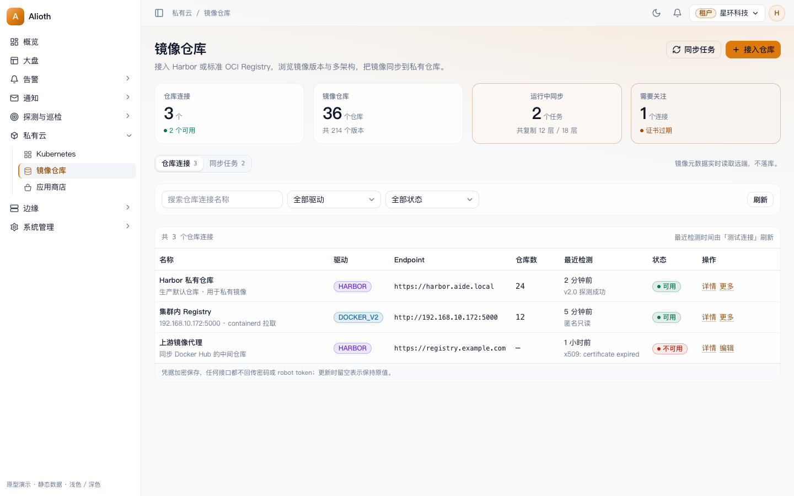
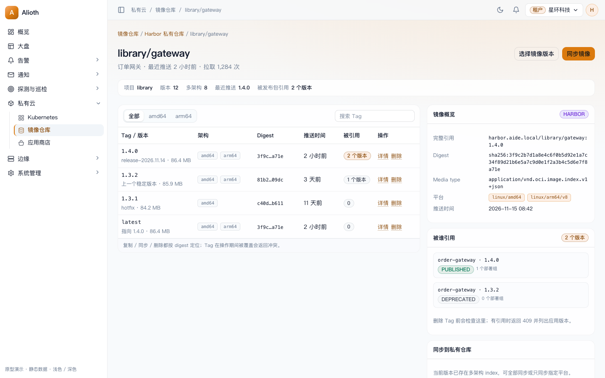
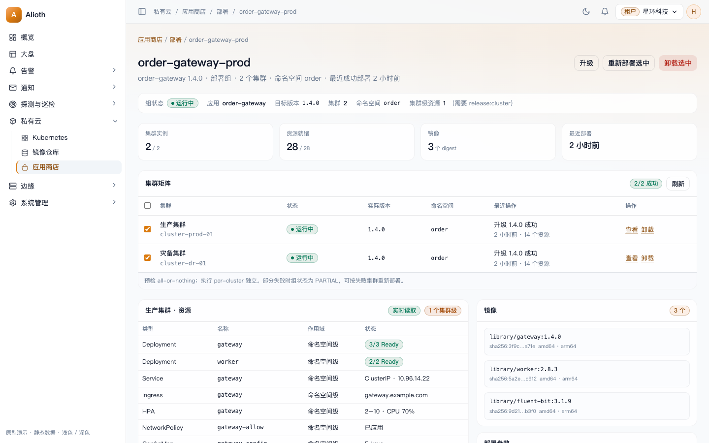
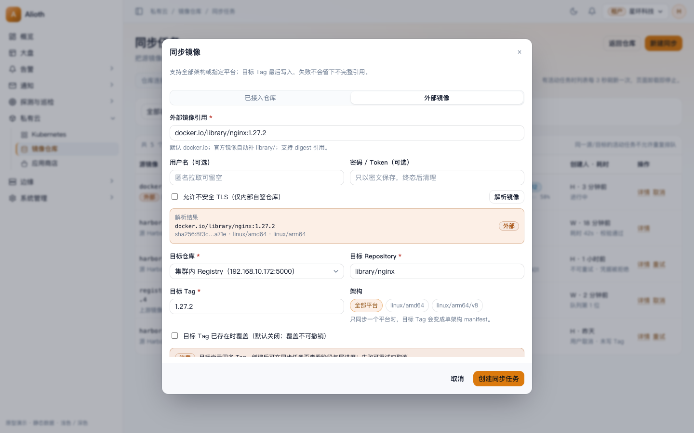
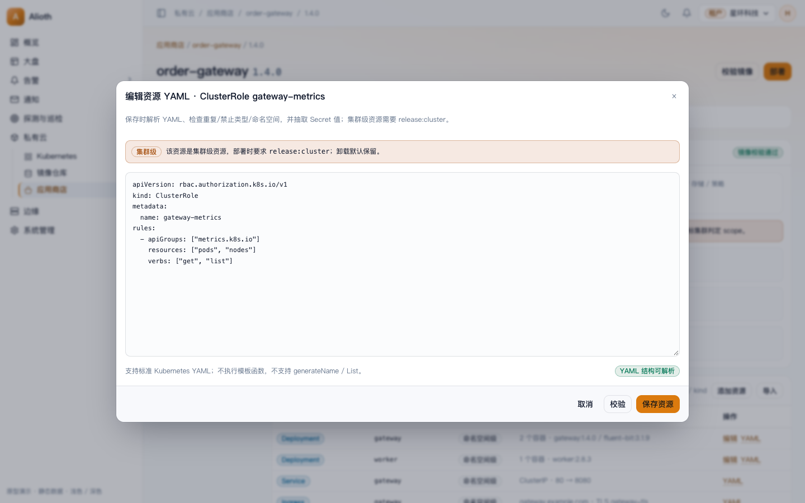
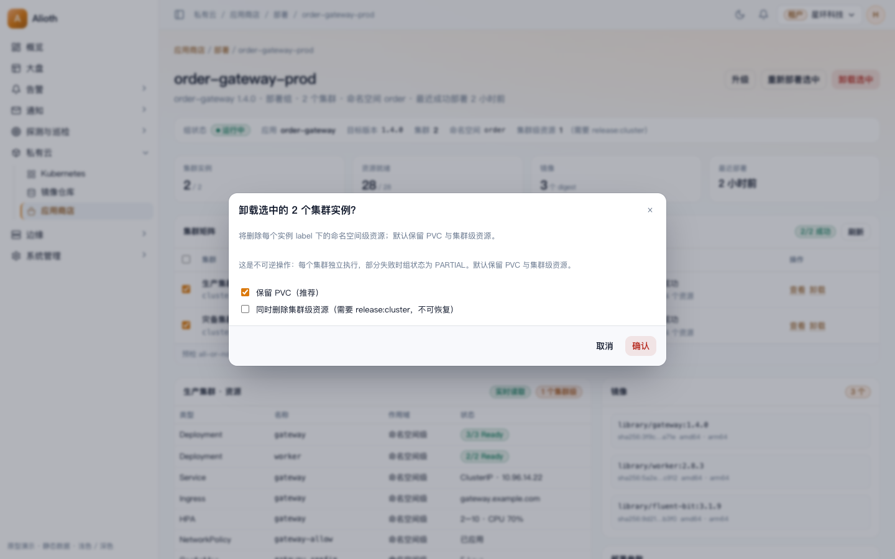
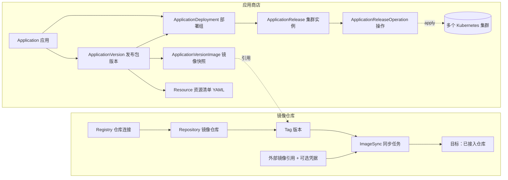
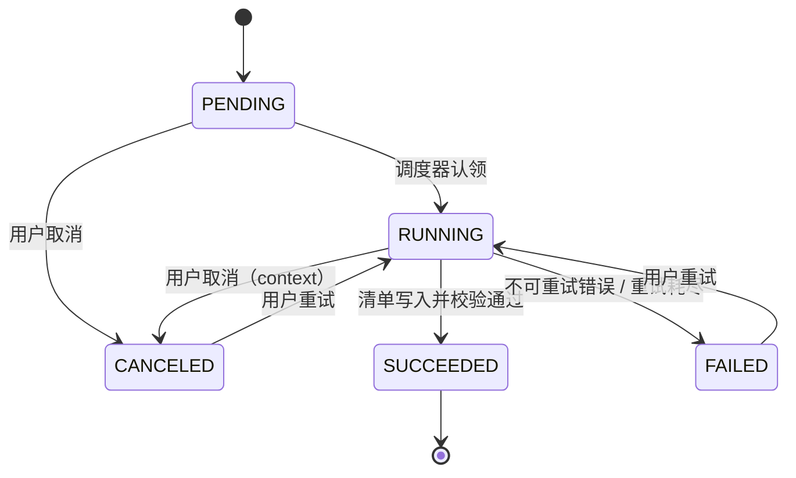
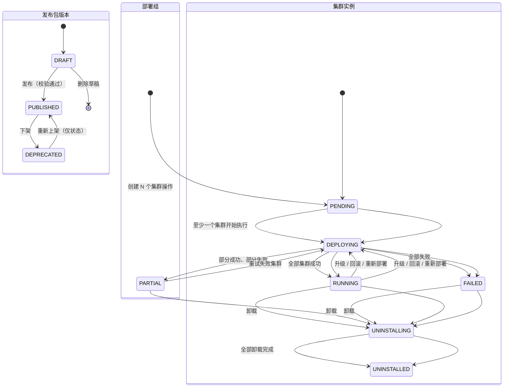
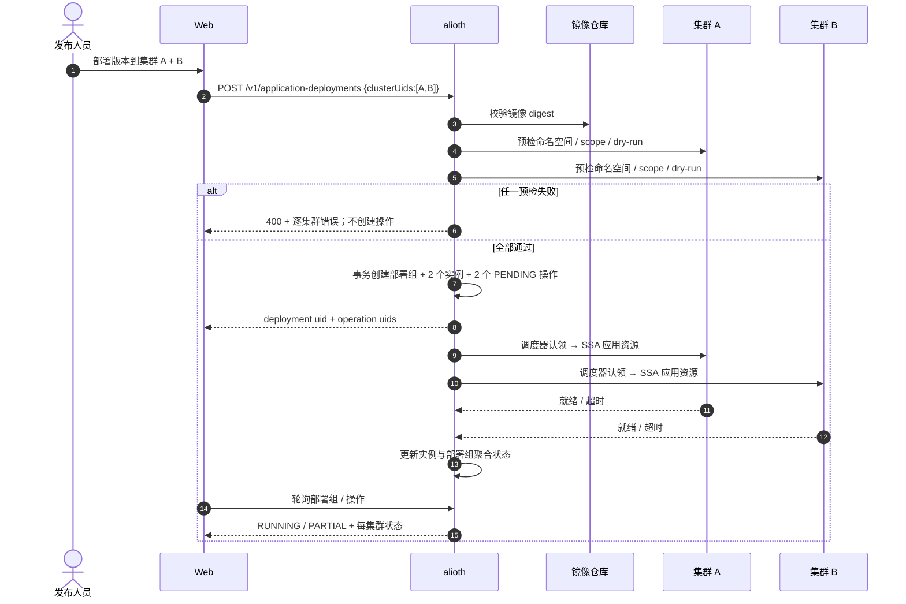

# 私有云：镜像仓库与应用商店设计（方案确认稿 v2）

本文说明「私有云」一级菜单下**镜像仓库**与**应用商店**做什么、数据怎么存、接口怎么分、页面怎么组织，以及两者如何联动。

- 可交互原型：[private-cloud-prototype.html](private-cloud-prototype.html)（浅色 / 深色）
- 原型截图：[images/private-cloud/](images/private-cloud/)
- 基线：`main` @ `d79b615a`（2026-11-15）
- 前置阅读：[design.md](design.md)、[iterations/conventions.md](iterations/conventions.md)、[kubernetes-console-design.md](kubernetes-console-design.md)、[inspection-design.md](inspection-design.md)

| 镜像仓库 | 版本与多架构 | 应用商店 |
| --- | --- | --- |
|  |  |  |

| 发布包版本（全部资源） | 多集群部署 | 部署向导 |
| --- | --- | --- |
|  |  |  |

| 外部镜像同步 | 任意资源 YAML | 卸载确认 |
| --- | --- | --- |
|  |  |  |

> v2 修订（按用户补充）：
> 1. 镜像同步支持**外部任意指定的镜像**：源可以是完整 OCI 引用 + 可选内联凭据，目标仍是已接入的仓库连接。
> 2. 发布包支持**编辑部署服务可能用到的全部 Kubernetes 资源**：结构化表单 + 任意资源 YAML，含 CRD/CR、HPA/PDB/NetworkPolicy、ClusterRole 等；集群级资源单独授权。
> 3. 部署支持**选择单个或多个集群**：一次部署 = 一个部署组 + 每个集群一个实例与一条操作；集群级资源与批量重试/卸载都在部署组上表达。
>
> 本文是**待确认稿**。第 13 节列出需要拍板的决策；确认后再按第 12 节拆里程碑落实现。本文只描述方案与原型，不改生产代码。

---

## 0. 一页结论

**可行。三件事都放在 `alioth` 控制面内，不新增进程、不引入 Redis 队列、不绕过现有分层。**

| 结论 | 做法 | 依据（现有架构） |
| --- | --- | --- |
| 菜单改名 | 侧边栏一级分组 `Kubernetes` 改为「私有云」，下含 Kubernetes / 镜像仓库 / 应用商店 | 菜单是展示层；`web/src/components/app-shell.tsx` 的 `kubeLinks` 当前只有 `/clusters` |
| 镜像仓库 | 新增 `Registry` 连接与 `ImageSync` 同步任务；镜像、Tag、架构**实时读远端**，不落库 | 与数据源、集群凭据同一套加密盒；远端元数据不复制进 PostgreSQL |
| 外部镜像同步 | 源可以是任意 OCI 引用（`docker.io/library/nginx:1.27.2`），可选内联账号/Token；目标必须是已接入的仓库连接 | 复制引擎（go-containerregistry）本身接受任意引用；任务只多存一份加密的临时凭据 |
| 镜像同步执行 | 任务落 PostgreSQL，`alioth` 调度器用 `SKIP LOCKED + lease` 认领执行 | 巡检执行器（`biz/inspection/runner.go`）已经是这个模式 |
| 应用商店对象 | `Application` → `ApplicationVersion`（发布包）→ `ApplicationDeployment`（部署组）→ `ApplicationRelease`（集群实例）→ `ApplicationReleaseOperation`（操作） | 多集群必须有「组」这一层，否则回滚、重试、卸载无法按一次部署聚合 |
| 发布包内容 | **任意 Kubernetes 资源**：每个资源一段 YAML/JSON，服务端解析成结构化清单；常用资源提供表单，任何资源都可切 YAML | 只有通用清单才能覆盖 CRD/CR、HPA、PDB、NetworkPolicy、ClusterRole；表单只是编辑体验，不是能力边界 |
| 部署执行 | `client-go` + RESTMapper + Server-Side Apply；资源打归属 label，支持升级裁剪、回滚、卸载 | 集群客户端缓存、`k8s.io/client-go`、`dynamic` 已在依赖内 |
| 多集群部署 | 一次部署选 1–20 个集群；每个集群一条 `ApplicationRelease` 与一条 `PENDING` 操作；组状态聚合为运行中 / 部分失败 / 失败 | 执行器已按单条操作租约执行；组只做事务创建与状态汇总 |
| 集群级资源 | CRD、ClusterRole、ClusterRoleBinding 等允许编辑与部署，但需要独立能力 `appstore_cluster_scope`（`release:cluster`） | 集群级资源影响整个集群，不能和命名空间级部署共用一个权限 |
| 联动 | 版本里的镜像从镜像仓库选择或从 YAML 扫描；保存时解析 digest 与多架构并快照；发布/部署再校验；删除 Tag/仓库前检查引用 | 一个 `application_version_images` 快照表即可闭环，不复制镜像元数据 |
| 权限 | 沿用「模块 → 能力 → 菜单 / 权限」；`cluster` 模块显示名改为「私有云」，新增 6 个能力、2 个菜单 | 目录在 `app/alioth/pkg/perm` 代码维护；基础套餐不变 |
| 不做 | 镜像构建/扫描、Harbor 用户与项目管理、Helm/GitOps、模板函数、审批流、自动漂移修复、跨集群原子事务 | 避免把「镜像仓库」做成第二个 Harbor，把「应用商店」做成第二个 Rancher |

范围提醒：这是两个新领域，`docs/design.md`、`docs/roadmap.md`、`docs/iterations/conventions.md`、`app/alioth/pkg/perm`、`web/src/lib/feature-catalog.ts` 与 i18n 都要同步登记。

---

## 1. 场景与范围

### 1.1 用户故事

| 角色 | 要做的事 | 落点 |
| --- | --- | --- |
| 仓库管理员 | 接入 Harbor / 标准 Registry，测试连通性，替换凭据，删除连接 | 镜像仓库 / 仓库连接 |
| 仓库管理员 | 按项目浏览镜像仓库，查看 Tag、digest、大小、推送时间、架构与镜像配置 | 镜像仓库 / 镜像详情 |
| 仓库管理员 | 复制 Tag、删除 Tag；删除前看到被哪些发布包版本引用 | 镜像详情 + 引用保护 |
| 运维 | 把已接入仓库里的镜像同步到私有仓库，查看进度、失败原因，重试或取消 | 镜像仓库 / 同步任务 |
| 运维 | **直接填写外部镜像引用**（如 `docker.io/library/nginx:1.27.2`），可选填外部仓库账号/Token，同步到已接入的私有仓库 | 镜像仓库 / 同步任务 / 外部镜像 |
| 应用负责人 | 用表单或 YAML 编辑 Deployment、Service、Ingress、RBAC、ConfigMap、Secret、PVC、HPA、PDB、NetworkPolicy、CRD/CR、ClusterRole 等资源，打包成发布包版本 | 应用商店 / 发布包编辑器 |
| 应用负责人 | 同一应用维护多个版本；已发布版本不可改，改动只能出新版本 | 应用详情 / 版本列表 |
| 发布人员 | 把某个版本部署到**一个或多个集群**，选择目标命名空间，填写域名、副本数、镜像 Tag 等参数 | 应用商店 / 部署 |
| 发布人员 | 查看部署组下每个集群的实例状态、资源与操作记录；按集群重试、升级、回滚、卸载 | 应用商店 / 部署详情 |
| 租户管理员 | 按「仓库连接 / 镜像管理 / 同步 / 发布包 / 部署 / 集群级资源」分别授权 | 角色授权页 |

### 1.2 与现有能力的关系

| 现有能力 | 关系 |
| --- | --- |
| Kubernetes 集群（M14/M16/M25/M31） | 复用 `Cluster` 接入、`clusterClients` 缓存、Namespace 列表与 `cluster:read`。应用商店不绕过集群归属校验，也不把平台角色写进集群 RBAC |
| 功能套餐与菜单（M19/M21/M22/M24） | 新能力挂在 `cluster` 模块下（显示名改为私有云）；基础套餐不变，新能力需超级管理员开通 |
| 数据源/集群凭据加密 | 仓库密码、外部同步凭据、Secret 值都复用 `ALIOTH_ENCRYPT_KEY` 派生密钥的加密盒；接口不回传明文 |
| 调度与后台任务 | 镜像同步、部署执行复用 `alioth` 的 `Scheduler` 与数据库租约；不新增进程 |
| 通知 | 一期不接同步/部署失败通知。失败留在任务/操作记录与页面；通知作为后续增强 |
| 告警 / 巡检 / SSH | 无关。镜像仓库不产生告警事件，应用商店不参与告警评测 |

### 1.3 一期 / 后续

| 维度 | 一期 | 后续 |
| --- | --- | --- |
| 仓库驱动 | Harbor v2.0、标准 OCI Distribution（Docker Registry V2） | Quay、云厂商 CR 的专有元数据 |
| 镜像操作 | 浏览、版本、架构、复制 Tag、删除 Tag、同步 | 漏洞扫描结果、签名/证明（cosign）、镜像保留策略、GC |
| 同步源 | 已接入仓库 / 外部任意 OCI 引用（可选内联凭据） | 定时策略、Webhook 触发、跨仓库批量迁移、镜像保留规则 |
| 发布包资源 | 任意 Kubernetes 资源：内置资源、CRD、CR、HPA、PDB、NetworkPolicy、ClusterRole/Binding 等 | 由用户自行扩展，不需要平台逐类适配 |
| 编辑方式 | 常用资源表单 + 任意资源 YAML（Monaco）；导入/导出多文档 YAML | JSON Schema 校验、可视化 CRD Schema、策略校验 |
| 部署 | 单集群 / 多集群（1–20），安装、升级、回滚、重新部署、卸载、按集群重试 | 灰度发布、分批、跨集群依赖编排、自动漂移修复、审批流 |
| 参数 | 实例名、命名空间、副本数、镜像 Tag、Ingress Host、Secret 值覆盖（对所有集群一致） | 按集群覆盖、Values 模板、环境继承 |
| 集群级资源 | 允许，需 `release:cluster`；卸载默认保留，显式删除需二次确认 | 平台级资源白名单/审批 |

---

## 2. 概念与对象关系



术语：

| 术语 | 含义 | 代码名 |
| --- | --- | --- |
| 仓库连接 | 一个可访问的镜像仓库端点与凭据，例如 Harbor | `Registry` |
| 镜像仓库 | 远端仓库里的 repository（`library/nginx`） | 无表，远端读取 |
| 版本 / Tag | 镜像的一个可拉取版本，可能对应单 manifest 或多架构 index | 无表，远端读取 |
| 平台 | `os/architecture/variant`，例如 `linux/amd64`、`linux/arm64/v8` | 无表 |
| 同步任务 | 把源镜像（全部/指定平台）复制到已接入仓库的一次异步任务 | `ImageSync` |
| 外部镜像 | 没有预先接入为 `Registry` 的完整 OCI 引用，可在任务里带临时凭据 | `source_kind=EXTERNAL` |
| 应用 | 发布包的身份与说明，不含可部署内容 | `Application` |
| 发布包版本 | 一组任意 Kubernetes 资源 YAML + 镜像快照；发布后不可变 | `ApplicationVersion` |
| 部署组 | 一次「部署到 N 个集群」的聚合：同一版本、同一命名空间、同一实例名 | `ApplicationDeployment` |
| 集群实例 | 部署组在某一个集群中的实际安装 | `ApplicationRelease` |
| 操作记录 | 某个集群实例的一次安装/升级/回滚/卸载/重新部署 | `ApplicationReleaseOperation` |

**关键语义**

- 发布包版本是**不可变快照**：一旦 `PUBLISHED`，资源清单、镜像 digest、Secret 值都不能再改；要改就出新版本。
- 部署组是**一次部署的聚合**：同一应用版本、同一目标命名空间、同一实例名，在 1–20 个集群各创建一个实例。
- 集群实例是**一个集群里的状态**：目标集群、命名空间、当前版本、资源与操作。
- 部署组不是原子事务：每个集群独立执行、独立失败；组状态是聚合结果（`PARTIAL` 表示部分集群成功、部分失败）。
- 一期没有 watch/controller：实例状态来自「最近一次操作 + 按 label 实时读取资源概况」，不主动纠偏。

---

## 3. 导航与信息架构

### 3.1 侧边栏

```
私有云（原 Kubernetes 分组）
├─ Kubernetes      /clusters        复用现有集群列表与控制台
├─ 镜像仓库         /registries      仓库连接 + 同步任务
└─ 应用商店         /appstore        应用 / 发布包 + 部署
```

- 一级分组 key 改为 `nav.privateCloud`（私有云 / Private cloud），图标沿用 `Boxes`。
- 现有 `/clusters` 菜单文案由「集群」改为「Kubernetes」；新增 `nav.kubernetesCluster`，不复用 `nav.kubernetes`。
- 分组按「当前租户已开通能力 + 角色菜单权限 + 资源权限」过滤；三个入口是 OR 关系，整组没有可见入口时整组隐藏。
- 菜单只控制入口；接口权限仍由各资源的 `read/write/delete` 决定。

### 3.2 路由与 URL 契约

| 路由 | 页面 | 主要查询参数 |
| --- | --- | --- |
| `/registries` | 镜像仓库：仓库连接 / 同步任务 | `tab=connections\|syncs`、`name`、`status`、`page`、`pageSize` |
| `/registries/:uid` | 仓库详情：项目与镜像仓库列表 | `project`、`name`、`page`、`pageSize` |
| `/registries/:uid/repository` | 镜像详情：Tag / 架构 / 引用 | `project`、`repository`、`architecture`、`name`、`page`、`pageSize` |
| `/appstore` | 应用商店：应用 / 部署 | `tab=apps\|deployments`、`name`、`category`、`status`、`page`、`pageSize` |
| `/appstore/apps/:uid` | 应用详情：版本列表与说明 | `status`、`page`、`pageSize` |
| `/appstore/apps/:uid/versions/:versionUid` | 发布包版本详情 / 编辑 | 无（编辑态由页面状态切换） |
| `/appstore/deployments/:uid` | 部署组详情：集群矩阵、资源、操作 | `cluster`、`operationPage` |

**为什么 repository 用 query 而不是路径段**：镜像 repository 名本身含 `/`（`library/nginx`），放进路径段需要 `%2F`，React Router 解码后会改变分段；用 `project` + `repository` 查询参数可以完整保留。

**多集群不再使用独立实例详情页**：一个部署组下 N 个集群实例，实例详情用 `?cluster=<uid>` 在部署组页内切换，避免「一个部署 N 个页面」的导航负担；URL 仍可直接分享到某个集群面板。

### 3.3 页面职责

| 页面 | 做什么 | 不做什么 |
| --- | --- | --- |
| 仓库连接列表 | 接入/编辑/测试/删除连接；统计与状态 | 不在这里浏览镜像 |
| 仓库详情 | 项目筛选、镜像仓库搜索、进入镜像详情 | 不做 Tag 级操作 |
| 镜像详情 | Tag 版本、架构过滤、Tag 详情、复制/同步/删除 | 不构建镜像、不改远端仓库配置 |
| 同步任务 | 已接入源/外部源的创建、重试、取消、查看阶段与结果 | 不做定时策略 |
| 应用列表 | 应用卡片/列表、分类筛选、部署入口 | 不在列表里编辑版本 |
| 应用详情 | 说明、版本列表、镜像使用、部署/新建版本 | 不直接改已发布版本 |
| 版本详情/编辑 | 资源清单（表单 + YAML）、镜像选择、发布校验 | 不导入 Helm chart、不做模板函数 |
| 部署列表 | 部署组列表、集群数、聚合状态、批量操作入口 | 不在列表里改 K8s 资源 |
| 部署详情 | 集群矩阵、按集群资源/操作、按集群重试/卸载 | 不做漂移检测（一期） |

---

## 4. 镜像仓库

### 4.1 驱动与能力矩阵

| 能力 | `HARBOR` | `DOCKER_V2` |
| --- | --- | --- |
| 连接测试 | `GET /api/v2.0/ping` + `GET /api/v2.0/projects?page_size=1` | `GET /v2/`（含 Bearer challenge 处理） |
| 项目列表 | Harbor Project API，含公开/私有、仓库数 | 从 repository 路径首段推导，不保证完整 |
| 仓库列表 | Project 下的 repositories，含 artifact/pull 数、更新时间 | `GET /v2/_catalog`（可能被关闭），只有名称 |
| Tag 列表 | artifacts + tags，含 digest、size、platforms、labels、push time | `GET /v2/<name>/tags/list` + manifest HEAD/GET |
| 多架构 | artifact 的 `references` / `platform` | 读取 index / manifest list 的 `manifests[]` |
| 镜像配置 | config blob 摘要（entrypoint/env/labels） | 同左 |
| 认证 | Basic / Harbor robot account | Bearer token 流程 + Basic 兜底 |
| 搜索/分页 | 服务端搜索、分页 | 目录分页 + 本地过滤，设上限 |

一期只做这两个驱动。**不把 Harbor 的专有 API 泄漏到 biz 之上**：`biz/registry` 只依赖仓库接口，由 `data` 层按驱动实现；页面字段对两种驱动一致，取不到的字段显示 `—`。

### 4.2 数据模型

#### `registries` 仓库连接

| 字段 | 类型 | 说明 |
| --- | --- | --- |
| `uid` | string | 标识，唯一 |
| `namespace_uid` | string | 租户 |
| `name` | string | 租户内未删除唯一，≤64 |
| `driver` | enum | `HARBOR` / `DOCKER_V2` |
| `endpoint` | string | 规范化后的 `http(s)://host[:port][/base]`，≤512 |
| `username` | string | 可空（匿名只读仓库） |
| `password_cipher` | string | 加密后的密码 / robot token；`Sensitive`，任何响应都不返回 |
| `allow_insecure_tls` | bool | 仅内网自签证书时打开，默认 false |
| `remark` | string | ≤512 |
| `last_checked_at` / `last_error` | int64 / string | 最近测试时间与失败原因 |

- `Audit` + `SoftDelete`；`(namespace_uid, name)` 部分唯一（`deleted_at IS NULL`）。
- 更新时密码留空表示保持原值；显式清空用单独的 `clearPassword` 字段。
- 删除前检查：没有运行中的同步任务、没有被任何发布包版本引用；否则 409 并返回引用列表。

#### `image_syncs` 同步任务

| 字段 | 类型 | 说明 |
| --- | --- | --- |
| `uid` / `namespace_uid` | string | 标识与租户 |
| `source_kind` | enum | `CONNECTION`（已接入仓库）/ `EXTERNAL`（外部引用） |
| `source_registry_uid` | string | `CONNECTION` 时必填；`EXTERNAL` 为空 |
| `source_image` | string | 完整规范化引用，例如 `docker.io/library/nginx:1.27.2` |
| `source_repository` / `source_tag` / `source_digest` | string | 解析结果；成功后写 digest |
| `source_platforms` | JSON | 创建时选中的平台列表 |
| `source_credential_cipher` | string | **仅 EXTERNAL**：临时账号/Token 的密文；终态 24 小时后清空 |
| `source_allow_insecure_tls` | bool | **仅 EXTERNAL**：允许源仓库使用自签证书，默认 false |
| `source_endpoint` | string | 源 host 快照（删除连接后历史仍可读） |
| `target_registry_uid` / `target_registry_name` / `target_endpoint` | string | 目标连接与快照 |
| `target_repository` / `target_tag` / `target_digest` | string | 目标镜像；成功后写回 digest |
| `mode` | enum | `ALL_PLATFORMS` / `SELECTED_PLATFORMS` |
| `overwrite` | bool | 目标 Tag 已存在时是否覆盖；默认 false |
| `status` | enum | `PENDING` / `RUNNING` / `SUCCEEDED` / `FAILED` / `CANCELED` |
| `stage` / `copied_blobs` / `total_blobs` | string / int32 | 阶段与层进度 |
| `message` / `attempt` | string / int32 | 失败原因与尝试次数（最多 3） |
| `operator_uid` / `operator_name` | string | 创建人 |
| `lease_owner` / `lease_until` | string / time | 多副本认领 |
| `started_at` / `finished_at` | time | 执行时间 |

- 活动任务部分唯一：`(namespace_uid, source_kind, source_image, target_registry_uid, target_repository, target_tag)`，条件 `status IN ('PENDING','RUNNING')`。
- 索引：`(namespace_uid, created_at DESC)`、`(status)`、`(source_registry_uid)`、`(target_registry_uid)`。
- 历史保留 90 天；临时外部凭据在任务进入终态 24 小时后清空（重试窗口内仍可用）。

### 4.3 接口

#### `RegistryService`

| 方法 | 路径 | 权限 | 说明 |
| --- | --- | --- | --- |
| `POST` | `/v1/registry` | `registry:write` | 接入连接，先测试后入库 |
| `PUT` | `/v1/registry/{uid}` | `registry:write` | 改名/备注/替换凭据；密码留空保持 |
| `DELETE` | `/v1/registry/{uid}` | `registry:delete` | 删除连接；有引用/运行中任务时 409 |
| `GET` | `/v1/registry/{uid}` | `registry:read` | 连接详情，不含密码 |
| `GET` | `/v1/registries` | `registry:read` | 分页；`name`、`driver` 过滤 |
| `POST` | `/v1/registry/{uid}/test` | `registry:read` | 用已保存凭据测试并刷新检测结果 |
| `POST` | `/v1/registry/probe` | `registry:write` | 用未保存凭据测试，供表单预检 |
| `GET` | `/v1/registry/{uid}/projects` | `registry:read` | 项目 / 路径前缀，供筛选 |
| `GET` | `/v1/registry/{uid}/repositories` | `registry:read` | `project`、`name`、分页 |
| `GET` | `/v1/registry/{uid}/tags` | `registry:read` | `project`、`repository`、`architecture`、`name`、分页 |
| `GET` | `/v1/registry/{uid}/tag` | `registry:read` | `project`、`repository`、`tag`；返回 manifest、平台、配置、引用 |
| `GET` | `/v1/registry/{uid}/tag/references` | `registry:read` | 引用该镜像的发布包版本与部署组 |
| `POST` | `/v1/registry/{uid}/tag/copy` | `registry_image:write` | 同仓库复制/改名 Tag；按 digest 定位 |
| `DELETE` | `/v1/registry/{uid}/tag` | `registry_image:delete` | `project`、`repository`、`tag`、`digest`；有引用时 409 |

#### `ImageSyncService`

| 方法 | 路径 | 权限 | 说明 |
| --- | --- | --- | --- |
| `GET` | `/v1/image-syncs` | `registry_sync:read` | `status`、`sourceKind`、`registryUid`、分页 |
| `POST` | `/v1/image-syncs/preview` | `registry_sync:write` | 解析外部/已接入源镜像，返回 digest、平台、目标是否存在；不落库、不保存凭据 |
| `POST` | `/v1/image-syncs` | `registry_sync:write` | 批量创建；一条镜像一条任务，逐条校验、逐条落库 |
| `GET` | `/v1/image-syncs/{uid}` | `registry_sync:read` | 详情 |
| `POST` | `/v1/image-syncs/{uid}/retry` | `registry_sync:write` | 失败/取消后重试 |
| `POST` | `/v1/image-syncs/{uid}/cancel` | `registry_sync:write` | 仅 PENDING/RUNNING；RUNNING 通过 cancel context 停止 |

**外部源语义**：

- `sourceImage` 接受 `host/repository:tag`、`repository:tag`（默认 `docker.io`，官方镜像补 `library/`）和 `host/repository@sha256:...`。不接受 `file://`、`http://` 作为镜像引用。
- `sourceCredential` 与 `sourceAllowInsecureTLS` 只在创建/预览请求里出现，凭据不会被读接口返回；只支持 Basic 用户名/密码或 Token，不执行 `docker login` 之外的命令。
- 目标必须是当前租户的 `Registry` 连接；外部源不能直接作为目标，避免平台变成任意写仓库的代理。
- 批量创建返回 `created[]` 与 `failed[]`；部分失败不回滚已创建任务。

### 4.4 版本与多架构读取

1. 列 Tag 时，按驱动取 Tag 列表；对每个 Tag 读 manifest（Harbor artifact API 直接带 platforms，标准 Registry 需要 N 次 HEAD/GET）。
2. manifest 的 `Content-Type` 决定形态：
   - `application/vnd.oci.image.index.v1+json` 或 `application/vnd.docker.distribution.manifest.list.v2+json`：多架构 index，展开 `manifests[]` 得到 `platform`/`digest`/`size`。
   - 单 manifest：读 config blob 得到 `created`、`architecture`、`os`、`labels`、`entrypoint`、`cmd`、`env` 数量。
3. 页面显示短 digest（前 12 位），详情显示完整 digest；复制/同步/删除都**按 digest 定位**。
4. 架构过滤在服务端完成：`architecture=amd64` 只返回含该平台的 Tag。
5. 读取并发上限 4、单次调用超时 15 秒；远端 401/403 映射为「凭据被拒绝 / 无权限」；超时和 5xx 映射为「仓库暂不可用」。
6. **不缓存镜像元数据**：远端是唯一事实来源。同一请求内对 manifest 去重。

### 4.5 镜像同步

#### 状态机



#### 执行

- `Scheduler` 每 2 秒调用 `imageSync.ExecuteNext`，`UPDATE ... WHERE status='PENDING' ... FOR UPDATE SKIP LOCKED` 认领一条，写 `lease_owner`/`lease_until`（5 分钟）。
- 同一时刻一个副本只跑一条同步，避免占满控制面带宽；多副本由数据库租约限流。
- 源解析：
  - `CONNECTION`：读源 `Registry` 的凭据与驱动配置。
  - `EXTERNAL`：解析 `source_image` 得到 host/仓库/tag，使用任务内临时凭据（若有）；没有凭据时匿名拉取。
- 复制实现使用 `github.com/google/go-containerregistry`（`remote` / `crane`）：认证、Bearer token、blob 上传、跨仓库复制、manifest list 都已有成熟实现。
- 复制顺序：
  1. 读取源 manifest/index，确定平台集合。
  2. 逐层复制 blob 到目标仓库；目标已存在同名 blob 时按 digest 跳过。
  3. 写入平台 manifest；多平台时写入由选中子清单组成的新 index；最后写目标 Tag。**Tag 最后写**。
  4. 按目标 digest 回读校验；成功写 `target_digest`。
- 覆盖策略：
  - `overwrite=false`：创建任务前检查目标 Tag；已存在直接返回 409。执行中目标被其他人写入也失败并提示。
  - `overwrite=true`：直接覆盖目标 Tag；页面在提交前二次确认。
- 重试：网络超时、5xx、blob 上传中断可重试；401/403/404、manifest 非法、平台不存在不重试。最多 3 次，指数退避 2s/8s/30s。
- 进度：阶段 + `copied_blobs/total_blobs`；不承诺字节百分比。
- 取消：`PENDING` 直接置 `CANCELED`；`RUNNING` 取消 context，执行器在写 Tag 之前停止；已上传 blob 允许残留。
- 清理：90 天前的终态任务每天清理；临时外部凭据在终态 24 小时后清空。

### 4.6 页面与交互

#### 仓库连接列表（`/registries?tab=connections`）

- 页头：标题「镜像仓库」、说明；主操作「接入仓库」，次操作「同步任务」。
- 统计卡：连接数、可用连接、镜像仓库数、运行中同步任务。
- 筛选：名称、驱动、状态；进入 URL。
- 表格列：名称（含驱动 badge）、Endpoint（mono）、最近检测（时间 + 状态点）、状态、备注、操作。
- 行操作：「详情」+「更多」（测试连接 / 编辑 / 删除）。删除确认里写明引用数量。
- 空态：说明支持 Harbor 与标准 Registry，并给出「接入第一个仓库」。

#### 仓库详情（`/registries/:uid`）

- 页头：名称、驱动、Endpoint、连接状态、最近检测、备注；操作「测试连接」「同步任务」「刷新」。
- 项目筛选 + 名称搜索；仓库表：仓库名、版本数、大小、最近推送、操作「查看版本」。
- 标准 Registry 的目录被关闭（`_catalog` 404）时，明确说明并提供按名称精确查询，而不是显示空表。

#### 镜像详情（`/registries/:uid/repository`）

- 面包屑：镜像仓库 / 仓库连接 / 项目 / 镜像。
- 头部：镜像全名、拉取次数（Harbor）、最近推送、描述（若有）。
- 架构过滤：全部 / amd64 / arm64 / 其他；Tag 搜索。
- 表格列：Tag（mono）、架构（badge 组）、digest（短）、大小、推送时间、被引用、操作。
- 行操作：「详情」+「更多」（同步到… / 复制 Tag / 删除 Tag）。Tag 详情用右侧 `Sheet`：完整 digest、media type、平台表、镜像配置、引用列表。

#### 同步任务（`/registries?tab=syncs`）

- 筛选：状态、来源类型、源/目标仓库。
- 表格列：源镜像（外部源带「外部」badge）、目标镜像、架构、状态、进度、创建人、耗时、操作。
- 新建同步对话框：
  - 来源分段：「已接入仓库 / 外部镜像」。
  - 外部镜像：完整引用输入 + 「解析镜像」；可选展开账号/Token、允许不安全 TLS（默认关）。
  - 目标：仓库连接、repository、tag、架构（全部/指定）、覆盖开关。
  - 解析结果显示 digest、平台、目标是否存在；解析失败不允许提交。
- 批量：外部镜像支持多行输入，逐条解析；有效行创建任务，失败行在对话框内列出。

### 4.7 安全边界

- 密码 / robot token / 外部临时凭据只以密文入库；任何响应不含明文；错误日志只记任务 UID 与错误类别。
- 外部临时凭据只在任务执行与重试窗口内可用，终态 24 小时后由调度器清空；预览接口不落库。
- 接入允许 `http`（内网仓库常见），但默认校验 TLS；`allow_insecure_tls` 需要显式勾选并标注风险。
- 仓库地址与外部镜像 host 是租户管理员输入的外部 URL，信任模型与数据源、kubeconfig 一致：持有 `registry:write` / `registry_sync:write` 的人可以让 `alioth` 访问任意可达的 HTTP 服务。平台按内网使用设计，不把管理台暴露公网。
- 不使用仓库返回的任意链接作为重定向目标；认证 challenge 只在本仓库 endpoint 内跟随。
- 删除 Tag 需要 `registry_image:delete`，删除连接需要 `registry:delete`；两者都不与「同步」共享权限。

---

## 5. 应用商店

### 5.1 对象模型与状态机



规则：

- 应用名租户内未删除唯一；版本号同一应用内唯一（允许 `v` 前缀但统一去掉后存储/比较）。
- `PUBLISHED` / `DEPRECATED` 版本的资源清单、镜像、Secret 值不可修改；只有 `DRAFT` 可编辑、可删除。
- 一个部署组在同一时刻最多一条活动操作 **per 集群实例**；批量操作会为每个选中集群创建一条 `PENDING` 操作。
- 部署组名在租户内唯一；集群实例名在「同一集群 + 同一命名空间」内唯一。
- 一次部署的所有集群使用同一实例名、同一目标命名空间、同一参数；一期不支持按集群覆盖参数。
- 部署组不是原子事务：允许 `PARTIAL`（部分集群成功、部分失败），通过按集群重试收敛。

### 5.2 发布包内容：任意 Kubernetes 资源

版本内容是一个**资源清单**，每个资源一段 YAML/JSON：

```yaml
# resource 1
apiVersion: apps/v1
kind: Deployment
metadata:
  name: gateway
spec:
  replicas: 3
  ...
---
# resource 2
apiVersion: batch/v1
kind: CronJob
metadata:
  name: report
...
---
# resource 3（任意 CRD 实例）
apiVersion: monitoring.coreos.com/v1
kind: ServiceMonitor
metadata:
  name: gateway
...
```

**能力边界**

- 任意 `apiVersion` / `kind` 都可以编辑和保存；是否能在目标集群 apply 由目标集群的 discovery / CRD 决定。
- 常用资源提供表单（Deployment/StatefulSet/DaemonSet/Job/CronJob、Service、Ingress、ConfigMap、Secret、PVC、SA/Role/RoleBinding、HPA、PDB、NetworkPolicy），表单生成同一份 YAML；任何资源都可以切到 YAML 模式。
- 集群级资源（ClusterRole、ClusterRoleBinding、CRD、PV 等）允许，但需要单独能力 `appstore_cluster_scope`（`release:cluster`）；页面用「集群级」badge 标注。
- 系统级资源不允许由应用商店创建/删除：`Namespace`、`Node`、`Event`、`APIService`、`ComponentStatus`、`TokenReview`、`SubjectAccessReview`。目标命名空间必须预先存在。
- 不支持 Helm chart、模板函数、`generateName`、`List` 类型；资源名必须是确定值，才能做升级裁剪与回滚。

**保存与校验**

- 每个资源必须是一个 YAML/JSON 文档；`apiVersion`、`kind`、`metadata.name` 必填；`metadata.namespace` 为空或等于目标命名空间（保存时允许为空，部署时统一注入目标命名空间）。
- 服务端解析后：
  - 校验重复 `(apiVersion, kind, namespace, name)`；
  - 去掉 `status`、`metadata.uid/resourceVersion/creationTimestamp/managedFields/generation` 等服务器字段；
  - 识别 Secret 资源，把 `data` / `stringData` 的值抽到 `secrets_cipher`，清单里只保留 key；
  - 扫描镜像引用（工作负载的标准路径 + 任意 `image` 键），尝试匹配已接入仓库并解析 digest/平台；匹配不到标记为「外部镜像」；
  - 用静态 kind→scope 映射标记命名空间级/集群级；未知类型标记「部署时判定」；
  - 用户自定义资源（CR）的 scope 在部署时由 discovery 判定。
- 保存草稿允许 YAML 解析失败以外的内容不完整（例如镜像暂不可解析、CRD 尚未安装），但页面标记「未校验」；发布必须通过结构校验与镜像扫描，外部镜像只警告不阻塞。
- 单版本最多 100 个资源，单资源 ≤ 512 KiB，整份 spec ≤ 2 MiB。

**Secret 处理**

- Secret 的 `data` 值按 base64 解码后加密，`stringData` 同样；清单中记录 key 名与空值。
- 接口只返回 key 列表，不返回值；编辑时输入新值表示覆盖，留空表示保持。
- 部署时在内存中还原 `data`（base64）注入；不写日志、不进操作记录。

**镜像与版本联动**

- 表单工作负载通过镜像选择器写入完整引用；YAML 工作负载的 image 字段由服务端扫描。
- 匹配到已接入仓库的镜像解析 digest 与平台，写入 `application_version_images`；匹配不到的外部镜像只保存引用，标记 `external=true`，发布时显示警告且不参与「删除 Tag 引用保护」。
- 部署时对已解析的镜像按 digest 再校验；外部镜像只校验引用格式与目标仓库可达性由 kubelet 决定。

### 5.3 数据模型

#### `applications` 应用

| 字段 | 说明 |
| --- | --- |
| `uid` / `namespace_uid` | 标识与租户 |
| `name` | 租户内未删除唯一 |
| `display_name` | 展示名，默认等于 `name` |
| `category` | `DATABASE` / `MIDDLEWARE` / `OBSERVABILITY` / `TOOLING` / `OTHER` |
| `description` / `readme` | 说明（≤1024）/ Markdown（≤64 KiB） |
| `Audit` + `SoftDelete` | 审计与软删除 |

`(namespace_uid, name)` 部分唯一（`deleted_at IS NULL`）。删除应用要求没有非草稿版本、没有未卸载的部署组；已卸载实例保留名称与版本快照，不阻塞删除。

#### `application_versions` 发布包版本

| 字段 | 说明 |
| --- | --- |
| `uid` / `namespace_uid` / `application_uid` | 标识与归属 |
| `version` | 版本号，≤32；同应用未删除唯一 |
| `status` | `DRAFT` / `PUBLISHED` / `DEPRECATED` |
| `changelog` | 变更说明，≤4 KiB |
| `spec` | 资源清单 JSON：`{"resources":[{"item","manifest":{...}}]}` |
| `secrets_cipher` | Secret 值密文（JSON：`item/key -> value`） |
| `validation` | 最近一次校验结果（资源错误、镜像解析、scope、警告） |
| `published_at` | 发布时间 |
| `Audit` + `SoftDelete` | 审计与软删除 |

索引：`(application_uid, version)` 唯一（未删除）、`(namespace_uid, application_uid, status)`。

#### `application_version_images` 镜像快照

| 字段 | 说明 |
| --- | --- |
| `uid` / `namespace_uid` / `application_uid` / `version_uid` | 归属 |
| `resource_item` / `container` | 资源 item 与容器路径（YAML 扫描得到） |
| `image` | 完整引用 |
| `registry_uid` / `registry_name` / `repository` / `tag` / `digest` | 结构化来源；外部镜像 `registry_uid` 为空 |
| `platforms` | 平台 JSON（os/arch/variant） |
| `external` | 是否未匹配到已接入仓库 |
| `resolved_at` | 解析时间 |

`(version_uid, resource_item, container)` 唯一；`(namespace_uid, repository, tag)` 与 `(registry_uid)` 普通索引，供「被谁引用」反查。

#### `application_deployments` 部署组

| 字段 | 说明 |
| --- | --- |
| `uid` / `namespace_uid` | 标识与租户 |
| `name` | 租户内未删除唯一 |
| `application_uid` / `application_name` | 应用与名称快照 |
| `version_uid` / `version` | 最近一次请求的目标版本 |
| `target_namespace` | 所有集群统一的目标命名空间 |
| `clusters` | 集群快照 JSON：`[{uid, name}]`，用于列表展示 |
| `values` | 非敏感参数覆盖 JSON（副本数、镜像 Tag、Ingress Host 等） |
| `secret_values_cipher` | 本次部署的 Secret 值覆盖密文 |
| `images` | 实际部署的镜像快照 JSON |
| `status` | `PENDING` / `DEPLOYING` / `RUNNING` / `PARTIAL` / `FAILED` / `UNINSTALLING` / `UNINSTALLED` |
| `message` | 聚合失败摘要 |
| `created_by` / `deployed_at` | 创建人与最近成功时间 |
| `Audit` + `SoftDelete` | 审计与软删除 |

`(namespace_uid, name)` 部分唯一（`deleted_at IS NULL`）；索引 `(namespace_uid, created_at DESC)`、`(status)`。

#### `application_releases` 集群实例

| 字段 | 说明 |
| --- | --- |
| `uid` / `namespace_uid` / `deployment_uid` | 归属 |
| `cluster_uid` / `cluster_name` | 目标集群与名称快照 |
| `target_namespace` / `name` | 目标命名空间与实例名 |
| `application_uid` / `application_name` | 应用与名称快照 |
| `version_uid` / `version` | 当前实例版本 |
| `status` | `PENDING` / `DEPLOYING` / `RUNNING` / `FAILED` / `UNINSTALLING` / `UNINSTALLED` |
| `values` / `secret_values_cipher` | 本次实例参数快照 |
| `images` | 实际部署镜像快照 |
| `message` / `last_operation_uid` | 最近失败原因与操作 |
| `deployed_at` | 最近成功部署时间 |
| `Audit` + `SoftDelete` | 审计与软删除 |

- `(deployment_uid, cluster_uid)` 部分唯一（`deleted_at IS NULL`）。
- `(cluster_uid, target_namespace, name)` 部分唯一，条件 `deleted_at IS NULL AND status <> 'UNINSTALLED'`。
- 索引 `(namespace_uid, deployment_uid)`、`(status)`。

#### `application_release_operations` 操作记录

| 字段 | 说明 |
| --- | --- |
| `uid` / `namespace_uid` / `deployment_uid` / `release_uid` | 归属 |
| `batch_uid` | 同一次批量操作共享；单集群操作也生成 |
| `action` | `INSTALL` / `UPGRADE` / `ROLLBACK` / `UNINSTALL` / `REDEPLOY` |
| `status` | `PENDING` / `RUNNING` / `SUCCEEDED` / `FAILED` / `CANCELED` |
| `from_version_uid` / `to_version_uid` | 升级/回滚的来源与目标 |
| `values` / `secret_values_cipher` | 本次操作参数快照（回滚复用） |
| `resources` | 本次应用的资源标识 JSON（apiVersion/kind/namespace/name），用于裁剪 |
| `diff` | `added` / `updated` / `deleted` / `keptPersistentVolumeClaims` / `keptClusterScoped` 计数 |
| `message` | 失败原因 / 超时说明 |
| `operator_uid` / `operator_name` | 操作人 |
| `lease_owner` / `lease_until` | 多副本认领 |
| `started_at` / `finished_at` | 执行时间 |

- 每个集群实例的活动操作部分唯一：`(release_uid)`，条件 `status IN ('PENDING','RUNNING')`。
- 索引 `(deployment_uid, created_at DESC)`、`(batch_uid)`、`(status)`。

### 5.4 接口

#### `ApplicationService`

| 方法 | 路径 | 权限 |
| --- | --- | --- |
| `POST` | `/v1/application` | `application:write` |
| `PUT` | `/v1/application/{uid}` | `application:write` |
| `DELETE` | `/v1/application/{uid}` | `application:delete` |
| `GET` | `/v1/application/{uid}` | `application:read` |
| `GET` | `/v1/applications` | `application:read` |
| `POST` | `/v1/application/{uid}/version` | `application:write` |
| `PUT` | `/v1/application/{uid}/version/{version_uid}` | `application:write` |
| `DELETE` | `/v1/application/{uid}/version/{version_uid}` | `application:write`（仅草稿） |
| `POST` | `/v1/application/{uid}/version/{version_uid}/validate` | `application:write` |
| `POST` | `/v1/application/{uid}/version/{version_uid}/publish` | `application:write` |
| `POST` | `/v1/application/{uid}/version/{version_uid}/deprecate` | `application:write` |
| `GET` | `/v1/application/{uid}/versions` | `application:read` |
| `GET` | `/v1/application/{uid}/version/{version_uid}` | `application:read` |

- 版本写接口接收 `resources: [{item, manifest}]`，`manifest` 为 YAML 字符串；响应返回 YAML + 派生字段（apiVersion/kind/name/scope/images/secretKeys）。
- `validate` 返回资源解析结果、重复/未知类型/scope/镜像解析/Secret key；不改变版本状态。
- `publish` 内部再次校验，不能依赖前端调用过 `validate`；`DRAFT → PUBLISHED` 与 `DEPRECATED → PUBLISHED`（仅状态）共用该接口。

#### `ApplicationDeploymentService`

| 方法 | 路径 | 权限 |
| --- | --- | --- |
| `GET` | `/v1/application-deployments` | `release:read` |
| `POST` | `/v1/application-deployments` | `release:write` + 每个目标集群 `cluster:read` |
| `GET` | `/v1/application-deployments/{uid}` | `release:read` |
| `POST` | `/v1/application-deployments/{uid}/upgrade` | `release:write` + `cluster:read` |
| `POST` | `/v1/application-deployments/{uid}/rollback` | `release:write` + `cluster:read` |
| `POST` | `/v1/application-deployments/{uid}/redeploy` | `release:write` + `cluster:read` |
| `POST` | `/v1/application-deployments/{uid}/uninstall` | `release:delete` + `cluster:read` |
| `GET` | `/v1/application-deployments/{uid}/operations` | `release:read` |

- 创建请求：`applicationUid`、`versionUid`、`name`、`targetNamespace`、`clusterUids[]`、`values`、`secretValues`。
- `clusterUids` 1–20 个；必须属于当前租户且未删除；同一请求内去重。
- 服务端先对**所有集群**做预检：命名空间存在、集群可达、镜像 digest 可解析、集群级资源权限、资源 scope/禁止类型。任何一项失败都不创建操作，返回逐集群错误（用户可取消勾选后重试）。
- 预检通过后，在一个事务里创建部署组、N 个集群实例、N 条 `PENDING` 操作；返回部署组与操作 UID。
- 升级/回滚/重试/卸载可通过 `clusterUids[]` 只作用于选中集群；空数组表示全部活动集群。
- `uninstall` 支持 `keepPersistentVolumeClaims`（默认 true）与 `deleteClusterScopedResources`（默认 false，需 `release:cluster` + 二次确认）。
- 部署组详情返回集群矩阵、每个集群的最近操作与资源概况；资源概况实时读取失败只记 warning。

#### `ApplicationReleaseService`

| 方法 | 路径 | 权限 |
| --- | --- | --- |
| `GET` | `/v1/application-releases/{uid}` | `release:read` |
| `GET` | `/v1/application-releases/{uid}/operations` | `release:read` |
| `GET` | `/v1/application-release-operations/{uid}` | `release:read` |

单集群实例详情主要供部署组页内切换与接口调用；页面不单独设路由。

### 5.5 部署执行

#### 预检（每个集群）

1. 集群归属当前租户、未删除、可达。
2. 目标命名空间存在；所有命名空间级资源的目标命名空间一致。
3. 解析资源清单：YAML 合法、必填字段、重复、禁止类型、`metadata.namespace` 与目标一致。
4. 用 discovery / RESTMapper 解析 GVK：
   - 已有类型：确定 scope；
   - 未知类型：如果同版本包含其 CRD，允许在 CRD 建立后再解析；否则失败「资源类型未安装」。
5. 集群级资源：检查用户是否持有 `release:cluster`；没有则拒绝，并在错误里列出涉及的资源。
6. 镜像：已解析的按 digest 检查仍可拉取；外部镜像只做格式检查。
7. 对可验证资源做 Server-Side Apply 的 dry-run（`DryRun=All`）；依赖同包 CRD 的 CR 跳过预检，在 CRD 建立后执行时再校验。
8. 所有集群预检通过后才创建操作。

#### 应用

- 渲染：读取版本资源清单 + 部署参数，注入目标命名空间、Secret 值、参数覆盖；给每个对象合并归属 labels：
  - `app.kubernetes.io/managed-by: alioth`
  - `alioth.io/deployment-uid: <deployment uid>`
  - `alioth.io/release-uid: <release uid>`
  - `alioth.io/release-name: <name>`
  - `alioth.io/application-uid: <application uid>`
  - `alioth.io/version: <version>`
- 应用顺序：
  1. `CustomResourceDefinition`（等待 `Established`）；
  2. RBAC：ServiceAccount、ClusterRole、Role、ClusterRoleBinding、RoleBinding；
  3. 配置：ConfigMap、Secret；
  4. 存储：PVC；
  5. Service；
  6. 工作负载：Deployment、StatefulSet、DaemonSet、Job、CronJob、Pod；
  7. 策略：HPA、PDB、NetworkPolicy；
  8. Ingress；
  9. 其它命名空间级资源（按 GVK 字典序）；
  10. 未识别/CR（在 CRD 建立后）。
- 使用 `dynamic.Interface` + Server-Side Apply（`types.ApplyPatchType`，field manager `alioth-appstore`）。
- 冲突检测：同名资源不存在则创建；存在且带本实例 `release-uid` 才允许更新；存在但不属于本实例返回 409，列出冲突资源，**绝不 force 抢占**。
- 就绪：Deployment/StatefulSet/DaemonSet 等待 `observedGeneration`、`updatedReplicas`、`readyReplicas`、`availableReplicas`；Job/CronJob/自定义资源不等待；PVC/Service/Ingress 不等待外部就绪。
- 超时：每个集群默认 10 分钟；超时把该集群操作标 `FAILED`，消息写明「部分资源可能已创建，可重新部署或回滚」；其他集群继续执行。
- 裁剪：升级/回滚成功后，按「上一次成功操作资源清单 − 本次资源清单」删除；只删带本实例 label 的对象；system 类型不删。
- 卸载：
  - 命名空间级资源按逆序删除；
  - PVC 默认保留，显式勾选才删除；
  - 集群级资源默认保留，显式勾选 `deleteClusterScopedResources` 且在 `release:cluster` 下才删除；
  - `Namespace`/`Node` 等禁止类型永不删除。

#### 并发与多副本

- 每个集群实例一个活动操作，数据库部分唯一索引兜底；调度器每 2 秒认领 `PENDING` 操作，租约 10 分钟。
- 同一部署组的多个操作可以按调度器并发度执行；一期默认同时 2 条，避免打满控制面。
- 集群客户端复用 `clusterClients`；为 SSA 增加 `dynamic.Interface` 缓存或按操作构建。
- 失败重试由用户发起（按集群重新部署/升级），不自动重放；进程退出留下的 `RUNNING` 操作在租约过期后显示「执行中断」，不自动重跑。

### 5.6 多集群部署语义

- 一次部署 = 一个部署组 + N 个集群实例；N 为 1 时就是单集群部署，不需要另一套接口。
- 同一部署组内：应用版本、实例名、目标命名空间、参数覆盖完全一致；一期不支持按集群覆盖。
- 预检 **all-or-nothing**：任何一个集群预检失败都不创建操作；返回逐集群错误，用户取消勾选后重新提交。
- 执行 **per-cluster 独立**：某集群失败不阻塞其他集群；部署组状态聚合为 `PARTIAL`。
- 升级/回滚/卸载默认作用于全部活动集群，也可以只选部分集群；部分升级后组内版本可能不一致，详情页显示每个集群的实际版本与 `PARTIAL`。
- 重新部署用于失败集群重试或修复人工改动；按集群选择。
- 单集群重试：`POST .../deployments/{uid}/redeploy`，`clusterUids=[失败集群]`；不会重建部署组。
- 集群上限 20；超过时提示分批部署。目标命名空间必须在所有选中集群存在，平台不自动创建。
- 部署组列表按组展示；详情页用集群矩阵展示每个实例的状态、版本、最近操作。

### 5.7 部署参数

一期只开放少量、可校验的覆盖项，对所有选中集群一致：

| 参数 | 作用域 | 校验 |
| --- | --- | --- |
| 部署组名 | 部署 | 租户内唯一，DNS-1123，≤63 |
| 目标集群 | 部署 | 1–20 个，属于当前租户；全部预检通过 |
| 目标命名空间 | 部署 | 在所有选中集群存在 |
| 副本数 | 标准工作负载（按资源 item） | 0–100；DaemonSet 不开放 |
| 镜像 Tag | 标准容器（按资源 item/容器） | 必须与原 repository 相同，且 Tag 在当前仓库可解析；不允许换 repository/registry |
| Ingress Host | 标准 Ingress（按资源 item/规则序号） | 域名格式；为空表示不覆盖 |
| Secret 值 | 按资源 item/key | 覆盖版本默认值；只写不读 |

任意 YAML 资源中的其它字段不提供参数覆盖；需要变化时新建版本。参数快照存在操作记录里，回滚原样复用。

### 5.8 页面与交互

#### 应用列表（`/appstore?tab=apps`）

- 页头：「应用商店」+ 说明；主操作「新建应用」；视图切换「应用 / 部署」与筛选同一行。
- 统计卡：应用数、已发布版本、运行中部署组、待处理。
- 应用用卡片网格（分类 + 名称 + 描述 + 最新版本 + 镜像数 + 部署按钮），窄屏单列。
- 卡片操作：「详情」「部署」；没有已发布版本时「部署」禁用并提示先发布版本。

#### 应用详情（`/appstore/apps/:uid`）

- 页头：名称、分类、说明、创建人；操作「新建版本」「部署」。
- 版本表：版本、状态、镜像（最多 3 个 + 展开）、部署组数、发布时间、操作。行操作「详情」+「更多」（发布/下架/删除草稿/部署）。
- 说明 Markdown 在下方卡片展示，长内容在卡片内滚动或折叠。

#### 版本详情 / 编辑（`/appstore/apps/:uid/versions/:versionUid`）

- 页头：应用名 / 版本号 / 状态；操作「校验」「发布」「编辑」「删除草稿」。
- 左侧锚点导航：概览、资源清单、镜像来源、部署参数。
- 概览：资源计数（命名空间级/集群级）、镜像数量、未解析镜像、校验结果。
- **资源清单**：表格列类型、名称、作用域（命名空间级/集群级/部署时判定）、镜像/密钥、操作。
  - 顶部「添加资源」：常用资源类型菜单 + 「自定义 YAML」；支持「导入 YAML」（多文档）与「导出」。
  - 常用资源打开表单 + YAML 双 Tab；任意资源只开 YAML。Monaco 编辑器（已有依赖）。
  - 每行操作：「编辑」「YAML」「删除」；集群级资源显示警告 badge。
  - 资源列表下方显示校验分组：YAML 错误、重复资源、禁止类型、未解析镜像、集群级资源。
- 镜像来源：已匹配仓库的镜像显示 digest/平台；外部镜像显示「外部」badge 与警告。
- 部署参数：显示可从部署对话框覆盖的字段与默认值。
- 发布前确认：展示校验结果（资源数量、集群级资源、外部镜像、错误），确认后发布。

#### 部署向导（`/appstore` → 部署）

- 步骤 1 目标：
  - 集群多选（卡片或复选列表，显示集群状态、命名空间数量、架构）；
  - 已选数量与上限 20；
  - 目标命名空间（在所有选中集群校验存在）；
  - 部署组名；
  - 集群级资源提示：若版本含集群级资源，显示「需要集群级资源权限」。
- 步骤 2 参数：副本数、镜像 Tag、Ingress Host、Secret 值覆盖；统一作用于所有集群。
- 步骤 3 预览：
  - 逐集群预检结果（命名空间、镜像、scope、禁止类型）；
  - 资源数量、集群级资源、外部镜像警告；
  - 提交按钮；任一集群预检失败时禁止提交并显示原因。
- 提交后跳转部署组详情；每 2 秒轮询活动操作，组状态 `DEPLOYING → RUNNING/PARTIAL/FAILED`。

#### 部署列表（`/appstore?tab=deployments`）

- 筛选：集群、状态、应用、名称。
- 表格列：部署组、应用/版本、集群（chips + 数量）、目标命名空间、状态、最近操作、操作。
- 行操作：「详情」+「更多」（升级 / 重新部署 / 卸载）。有活动操作时禁用并提示。
- 状态：`RUNNING` 绿、`PENDING/DEPLOYING` 琥珀、`PARTIAL` 橙、`FAILED` 红、`UNINSTALLING` 灰、`UNINSTALLED` 中灰。

#### 部署详情（`/appstore/deployments/:uid`）

- 页头：部署组名、聚合状态、应用/版本、命名空间、集群数；操作「升级」「重新部署」「卸载」（可选择集群）。
- 集群矩阵：每行一个集群，列状态、实际版本、命名空间、最近操作、操作（重试/卸载该集群）；行可选中用于批量操作。
- 选中集群面板：
  - 资源表：Kind、名称、scope、状态（实时读取，失败显示 `—` 与 warning）、操作（跳转集群控制台，若权限允许）。
  - 操作时间线：动作、从/到版本、状态、耗时、操作人、失败消息；可展开看资源 diff 计数。
- 批量操作：升级/回滚/重新部署/卸载选中集群；卸载对话框有「保留 PVC」「删除集群级资源」开关，后者需要 `release:cluster` 与二次确认。
- 所有集群都失败时显示总提示；部分失败时在顶部显示「N/M 集群成功，可重试失败集群」。

#### 同步任务（补充）

- 新建同步支持「已接入仓库 / 外部镜像」两种来源；外部镜像来源显示「外部」badge 与临时凭据输入；列表可按来源类型筛选。

### 5.9 安全与权限边界

- `release:write` 是**高权限**：持有者可以让 `alioth` 在目标命名空间创建任意命名空间级资源；`release:cluster` 再扩展到集群级资源。只应授予可信的发布角色。
- 仍然要求 `cluster:read`：看不到目标集群的人不能部署；集群归属与命名空间校验在 biz 层完成。
- 集群级资源默认不删除；`deleteClusterScopedResources` 需要 `release:cluster` + 二次确认，并在消息里列出资源。
- 禁止类型（Namespace/Node/Event/APIService 等）永远不能由应用商店创建或删除；目标命名空间必须预先存在。
- Secret 值只写不读；列表/详情只返回 key；部署记录不存明文。
- 集群凭据的权限边界由 kubeconfig 决定；平台不额外放大。若 kubeconfig 是集群管理员，应用商店也能创建高权限资源，这是运维平台既有的信任模型，页面在部署确认里提示。
- 外部镜像同步的临时凭据只在任务生命周期内保存，终态 24 小时后清空；预览不落库。

---

## 6. 两者联动

### 6.1 镜像选择与扫描

- 表单工作负载通过镜像选择器从 `registries` 读取，不接受自由文本。
- YAML 资源由服务端扫描镜像字段：标准工作负载路径 + 任意 `image` 字符串键；匹配已接入仓库的镜像解析 digest/平台，匹配不到的标记为外部。
- 选择/扫描结果写 `application_version_images`：`resource_item/container/image/registry/repository/tag/digest/platforms/external`。
- 保存草稿时解析失败不阻塞保存，但版本标记「镜像未校验」；发布时对已匹配仓库的镜像必须解析成功，外部镜像只警告。

### 6.2 发布校验

`publish` 在服务端重新执行：

1. 资源结构校验（YAML、必填、重复、禁止类型、scope、大小）；
2. Secret 抽取与加密；
3. 镜像扫描与解析（匹配仓库的写 digest/平台，外部标记）；
4. 写入/刷新 `application_version_images` 与 `validation`；
5. 状态改为 `PUBLISHED`。

任何硬错误返回 400/409，并给出逐项错误，不部分发布。集群级资源与外部镜像只产生警告，不阻塞发布。

### 6.3 部署校验

创建/升级/回滚时：

- 目标版本必须是 `PUBLISHED`；回滚目标可以是 `DEPRECATED`；当前实例版本为 `DEPRECATED` 时仍可运行、回滚或卸载；
- 所有选中集群通过 5.5 的预检；
- 集群级资源需要 `release:cluster`；
- 已解析镜像按 digest 检查仍可解析；外部镜像只检查格式；
- 目标集群属于当前租户；目标命名空间在所有集群存在；
- 同名实例/资源冲突按 5.5 处理。

### 6.4 引用保护

- 删除 Tag：查询 `application_version_images`。被 `PUBLISHED`/`DEPRECATED` 版本或部署组引用时返回 409，列出应用与版本；草稿引用只警告。
- 外部镜像不进入引用保护（没有对应仓库连接）。
- 删除仓库连接：有运行中同步任务，或被任何版本镜像（含草稿）引用时 409。
- 删除应用：有非草稿版本或未卸载部署组时 409；已卸载实例保留快照，不阻塞。
- 删除版本：仅草稿且无部署实例引用。

### 6.5 从版本发起同步

镜像详情「同步到…」和版本镜像行「同步到私有仓库」共用同一个同步对话框：

- 源：当前镜像的完整引用（已接入仓库或外部）；
- 目标：另一个仓库连接 + repository + tag；
- 架构：全部或指定平台；
- 完成后可回到版本页重新校验镜像。

### 6.6 端到端时序（多集群）



---

## 7. 权限、套餐与菜单

### 7.1 模块

`FeatureCluster`（code `cluster`）的显示名从「Kubernetes」改为「私有云」，描述覆盖 Kubernetes、镜像仓库、应用商店；**模块 code 不变**。基础套餐仍不包含该模块。

### 7.2 新增能力（6 个）

| 能力 code | 名称 | 权限 | 依赖 / 说明 |
| --- | --- | --- | --- |
| `registry_access` | 仓库接入 | `registry:read`、`registry:write`、`registry:delete` | 接入、测试、编辑、删除连接；读权限也是镜像浏览的基础 |
| `registry_image` | 镜像版本管理 | `registry:read`、`registry_image:write`、`registry_image:delete` | 复制/改名 Tag、删除 Tag |
| `registry_sync` | 镜像同步 | `registry:read`、`registry_sync:read`、`registry_sync:write` | 已接入源与外部源同步；含仓库读权限 |
| `appstore_package` | 发布包管理 | `application:read`、`application:write`、`application:delete` | 应用与版本、任意资源 YAML |
| `appstore_deploy` | 应用部署 | `application:read`、`release:read`、`release:write`、`release:delete` | 单/多集群部署、升级、回滚、卸载 |
| `appstore_cluster_scope` | 集群级资源部署 | `release:cluster` | 部署/删除 ClusterRole、CRD、PV 等集群级资源 |

能力总数 66 → 72。`registry:read` 同时出现在三个 registry 能力里，是有意的依赖；权限在 `Catalog()` 中按菜单去重。

### 7.3 新增菜单（2 个）

| 菜单 code | 名称 | 能力 | 权限 | 默认读 |
| --- | --- | --- | --- | --- |
| `registry` | 镜像仓库 | `registry_access`、`registry_image`、`registry_sync` | `registry:read/write/delete`、`registry_image:write/delete`、`registry_sync:read/write` | `registry:read`、`registry_sync:read` |
| `appstore` | 应用商店 | `appstore_package`、`appstore_deploy`、`appstore_cluster_scope` | `application:read/write/delete`、`release:read/write/delete/cluster` | `application:read`、`release:read` |

菜单总数 40 → 42。`MENU_CAPABILITIES` 增加 `/registries → registry`、`/appstore → appstore`；`CAPABILITY_MENU_OVERRIDES` 增加 6 个能力到这两个菜单的映射。只有 `application:read` 时不显示「部署」视图；只有 `release:read` 时部署只读。

### 7.4 授权与升级影响

- 超级管理员需要把新能力加进「私有云」套餐，或在租户功能授权里加开，否则租户看不到入口。基础套餐不变。
- 租户负责人隐式拥有全部已开通能力对应的菜单与权限；自定义角色需要管理员在角色授权页勾选 `menu:registry` / `menu:appstore` 及子权限。
- 新权限不自动授予任何存量自定义角色；seed 不写「猜意图」的授权。升级说明里明确这一步。
- 多集群部署不新增权限：要求 `release:write` + 每个目标集群的 `cluster:read`；集群级资源额外要求 `release:cluster`。
- 接口检查顺序不变：角色权限 → 模块已开通 → 菜单权限。

---

## 8. 后端实现映射

| 层 | 新增 / 修改 |
| --- | --- |
| proto | `api/alioth/v1/registry.proto`（`RegistryService`、`ImageSyncService`）、`api/alioth/v1/application.proto`（`ApplicationService`、`ApplicationDeploymentService`、`ApplicationReleaseService`）；`make api` 生成 |
| service | `internal/service/registry.go`、`internal/service/application.go`、`internal/service/application_deployment.go`；只做 proto ↔ bo 转换 |
| biz | `internal/biz/registry`：`Registry`、`Explorer`、`Synchronizer`（已接入 + 外部源）、`Resolver`；`internal/biz/application`：`Catalog`（应用/版本/资源校验）、`Deployer`（部署组预检与创建）、`Executor`（单集群 SSA）、`Inspector`（状态聚合） |
| bo | `pkg/bo/registry.go`、`pkg/bo/application.go`、`pkg/bo/application_resource.go` |
| repository | `internal/data/repository/registry.go`、`application.go`、`application_deployment.go` |
| data | `registry_repo.go`、`registry_catalog.go`（Harbor / Docker V2 驱动）、`image_sync_repo.go`、`image_sync_executor.go`、`application_repo.go`、`application_deployment_repo.go`、`application_release_repo.go`、`application_resource.go`（YAML 解析、scope、Secret 抽取、镜像扫描）、`application_applier.go`（RESTMapper + SSA + dry-run）、`kubernetes_client.go`（补 dynamic） |
| ent | `registry.go`、`image_sync.go`、`application.go`、`application_version.go`、`application_version_image.go`、`application_deployment.go`、`application_release.go`、`application_release_operation.go`；`make migrate` |
| wire | `biz/biz.go`、`data/data.go`、`service/service.go`、`server/server.go` 注入 |
| 调度 | `internal/server/scheduler.go` 增加 `imageSync.ExecuteNext`、`releaseExecutor.ExecuteNext`、`deploymentInspector.Recompute`、90 天清理与临时凭据清理 |
| 权限 | `pkg/perm/perm.go` 权限常量、`capability.go` 能力、`menu.go` 菜单、`feature.go` 模块名 |
| 错误 | 复用 `pkg/merr`：`Invalid`、`NotFound`、`Conflict`、`Forbidden`、`Server`；上游 401/403 映射为客户端错误，不清平台登录态 |

关键实现约束：

- YAML/JSON 解析使用 `sigs.k8s.io/yaml` + `map[string]any`；资源清单存 canonical JSON，返回时转 YAML；不做模板函数。
- scope 判定：内置 kind → scope 静态表；未知 kind 在部署时用 RESTMapper discovery；保存时标记 `UNKNOWN`。
- 禁止类型与集群级资源在 `application_resource.go` 集中维护白名单/黑名单，不散落在 service。
- 每个集群实例一条操作；部署组预检在 biz 里聚合；执行器只处理单条操作，保持现有租约模型。
- 组状态重算按 `deployment_uid` 聚合（事务内 `SELECT ... FOR UPDATE` 或 `UPDATE ... RETURNING`），不引入 watch。
- 外部同步凭据清空由调度器每天执行；预览接口不落库。

新增依赖：

| 依赖 | 用途 | 说明 |
| --- | --- | --- |
| `github.com/google/go-containerregistry` | Registry 认证、manifest、多架构、跨仓库复制、外部引用解析 | 只进 `app/alioth`；封装在 `data` 层，biz 不直接 import |

`dynamic.Interface` 来自已有 `k8s.io/client-go`，不新增依赖。

---

## 9. 前端实现映射

| 路由 / 页面 | 文件 | 主导出 |
| --- | --- | --- |
| `/registries` | `web/src/pages/registry/index.tsx` | `RegistryPage` |
| `/registries/:uid` | `web/src/pages/registry/detail/index.tsx` | `RegistryDetailPage` |
| `/registries/:uid/repository` | `web/src/pages/registry/repository.tsx` | `RegistryRepositoryPage` |
| `/appstore` | `web/src/pages/appstore/index.tsx` | `AppStorePage` |
| `/appstore/apps/:uid` | `web/src/pages/appstore/app-detail.tsx` | `ApplicationDetailPage` |
| `/appstore/apps/:uid/versions/:versionUid` | `web/src/pages/appstore/version.tsx` | `ApplicationVersionPage` |
| `/appstore/deployments/:uid` | `web/src/pages/appstore/deployment.tsx` | `ApplicationDeploymentPage` |

| 组件 / 模块 | 文件 | 说明 |
| --- | --- | --- |
| 镜像选择器 | `web/src/components/image-picker.tsx` → `ImagePicker` | 跨页面复用；只用 `web/src/api` |
| 资源清单编辑器 | `web/src/pages/appstore/resource-list.tsx` → `ApplicationResourceList` | 表格、添加资源、表单/YAML 切换 |
| YAML 编辑器 | `web/src/pages/appstore/resource-yaml.tsx` → `ApplicationResourceYaml` | Monaco，多文档导入/导出 |
| 部署向导 | `web/src/pages/appstore/deploy-dialog.tsx` → `ApplicationDeployDialog` | 集群多选、参数、逐集群预览 |
| 同步对话框 | `web/src/pages/registry/sync-dialog.tsx` → `RegistrySyncDialog` | 已接入/外部源、解析、批量 |
| API | `web/src/api/registry/{index,types}.ts`、`web/src/api/application/{index,types}.ts` | 函数名等于 RPC lowerCamel |
| 路由注册 | `web/src/App.tsx`、`web/src/lib/last-page.ts` | 新增路径与详情模式 |
| 菜单 | `web/src/components/app-shell.tsx`、`web/src/i18n/index.ts` | 私有云分组与三个入口 |
| 能力目录 | `web/src/lib/feature-catalog.ts` | 72 能力、42 菜单、能力→菜单映射、BASE 不变 |
| i18n | `web/src/i18n/index.ts` | `nav.privateCloud`、`nav.registry`、`nav.appStore`、`registry.*`、`appStore.*`、`error.*` 新映射 |

页面约束（必须遵守）：

- 固定高度壳内，每个路由只有一个主滚动容器；表格用自己的 `overflow-auto`；`min-h-0` / `min-w-0` 齐备。
- 新建/编辑对话框三段式，`DialogBody` 唯一滚动；版本编辑器长页面用页面内分区滚动。
- 页面筛选进 URL；Tabs 的 `data-state`、URL、面板内容保持一致。
- 32px 控件；状态用 `StatusBadge`；操作列「详情 + 更多」；颜色只用语义 token。
- 所有文案走 `t()`；`enumLabel` 显示状态与类型，不直接渲染协议常量。
- 失败状态可重试；空态说明下一步；无权限不渲染写操作，服务端仍独立校验。
- 新页面加入 `E2E_SCROLL_ROUTES` 的滚动回归，至少覆盖 `/registries/:uid/repository`、`/appstore/apps/:uid/versions/:versionUid`、`/appstore/deployments/:uid`。

---

## 10. 错误与失败语义

| 场景 | HTTP / 状态 | 页面文案要点 |
| --- | --- | --- |
| 仓库名重复 | 409 | 同一租户内已有同名连接 |
| 仓库认证失败 | 400 | 用户名/密码或 robot 权限不足；不清登录态 |
| 外部镜像引用非法 | 400 | 只接受 OCI 引用；不接受 file/http URL |
| 外部镜像解析失败 | 400 | 检查引用、凭据与网络；预览不落库 |
| 删除被引用的 Tag / 仓库 | 409 | 列出应用版本与部署组 |
| 同步重复排队 | 409 | 同一源/目标已有活动任务 |
| 目标 Tag 已存在且未覆盖 | 409（创建前） | 打开「覆盖」开关或换 Tag |
| YAML 解析失败 | 400 | 指出资源序号与行号 |
| 重复资源 | 400 | 列出 apiVersion/kind/name |
| 禁止类型 | 400 | 列出被禁止的 kind 与原因 |
| 集群级资源无权限 | 403 | 需要 `release:cluster`；列出资源 |
| 目标命名空间不存在 | 400 | 指出集群与命名空间 |
| 预检 dry-run 失败 | 400 | 指出集群、资源与 API Server 原文 |
| 集群不可达 / 凭据无权限 | 400 / 502 | 与集群控制台一致的提示 |
| 一个集群实例已有活动操作 | 409 | 等待当前操作结束 |
| 部分集群失败 | 部署组 `PARTIAL` | 顶部显示 N/M 成功，可重试失败集群 |
| 部署超时 | 实例 `FAILED` | 部分资源可能已创建；可重新部署或回滚 |
| 卸载时 PVC 删除失败 | 实例 `FAILED` | 其余资源已删除；列出残留 PVC |
| 操作被进程中断 | 保持 RUNNING + 租约过期提示 | 不自动重跑；按集群重新部署 |

后端 `merr` 的英文原文通过 `web/src/api/http.ts` 的 `messageKeys` 映射到中英词条；未映射回落到 `error.reason.<REASON>`。

---

## 11. 测试与验收

### 11.1 自动化

| 层 | 覆盖 |
| --- | --- |
| 单元（data） | Harbor / Docker V2 驱动；外部引用解析；token challenge；manifest list；401/403/5xx；平台筛选；YAML 解析/Secret 抽取/镜像扫描/scope 表 |
| 单元（biz） | 同步状态机、外部凭据生命周期、重复任务、覆盖、取消；版本校验、发布不可变；部署组预检 all-or-nothing、按集群操作、组状态聚合、裁剪 diff、禁止类型、集群级权限 |
| 集成（PostgreSQL） | ent 迁移可重复；部分唯一索引；租约认领；组状态重算；引用查询；多副本并发创建只成功一条 |
| 集成（K8s） | 测试集群上安装/升级/回滚/卸载；任意 CRD/CR；集群级资源权限；跨两个集群部署；单集群失败后组 `PARTIAL` 与重试 |
| 前端 | `npm --prefix web run check`、`build`、`E2E_SCROLL_ROUTES` 新页面滚动；`web/e2e/` registry / appstore 用例 |
| 真实浏览器 | 登录 → 接入仓库 → 外部镜像同步 → 创建应用/版本 → YAML/表单资源 → 发布 → 多集群部署 → 部分失败重试 → 卸载 |

### 11.2 验收清单

- [ ] 侧边栏「Kubernetes」分组改为「私有云」，下含 Kubernetes / 镜像仓库 / 应用商店；入口按菜单权限与能力显示。
- [ ] 接入 Harbor 与标准 Registry；错误凭据/不可达返回可读错误；任何响应不含密码/token。
- [ ] 已接入源与外部源都能同步；外部源支持完整引用、可选凭据、解析 digest/平台、批量逐条失败；临时凭据终态后清理。
- [ ] 多架构 Tag 显示平台与 digest；全部/指定平台同步结果正确；覆盖/取消/重试符合状态机。
- [ ] 删除被发布版本引用的 Tag/仓库返回 409 并列出引用；外部镜像不参与引用保护。
- [ ] 发布包可以保存任意 `apiVersion/kind` 的 YAML；常用资源表单生成的 YAML 与服务端规范化结果一致。
- [ ] 禁止类型（Namespace/Node/Event 等）被拒绝；重复资源、缺失字段、非法 YAML 在保存/发布时被拒绝。
- [ ] Secret 值只写不读；YAML 中的 `data`/`stringData` 被抽取加密；部署时还原。
- [ ] 镜像扫描识别标准工作负载与 YAML 中的 image；匹配仓库的写 digest/平台，外部镜像标注警告。
- [ ] 单集群与多集群部署都能创建；每个集群一个实例与一条操作；全部集群预检失败时不创建操作。
- [ ] 多集群部分失败时组状态 `PARTIAL`，可按失败集群重试；全部成功为 `RUNNING`。
- [ ] 集群级资源需要 `release:cluster`；无权限 403；卸载默认保留集群级资源与 PVC，显式删除需二次确认。
- [ ] 升级裁剪只删本实例 label 的对象；不属于实例的同名资源不被抢占（409）。
- [ ] 回滚复用历史版本与参数；卸载后实例 `UNINSTALLED`，组状态正确。
- [ ] 无 `registry:*` / `application:*` / `release:*` / `release:cluster` 的账号被服务端拒绝；菜单权限与能力双重校验。
- [ ] `make migrate` 可重复；`make lint`、`go test ./...`、`npm --prefix web run check` 与 `build` 通过。
- [ ] 1366×768、390×844 下，资源清单、YAML 编辑器、部署向导、集群矩阵、操作记录均可滚动且头尾可达；对话框三段式不破。

---

## 12. 分阶段交付

不估工期；按可独立验收的范围拆成三个里程碑。

### M35 私有云入口与镜像仓库

1. 菜单/路由壳：`私有云` 分组、三个入口、占位路由与权限/能力目录。
2. `Registry` 数据模型、proto、service、biz、data、加密与测试接口；Web 连接列表与接入/编辑/删除。
3. `Explorer`：项目、仓库、Tag、manifest/平台、镜像配置、引用查询；Web 仓库详情与镜像详情。
4. `ImageSync`：任务模型、已接入源 + 外部源、预览、批量创建、调度器认领、go-containerregistry 执行、重试/取消/凭据清理；Web 同步任务与对话框。
5. 验收：第 11 节镜像仓库相关项；新页面滚动与对话框 e2e。

依赖：M1/M14/M19/M22/M25。

### M36 应用商店：发布包与单集群部署

1. `Application` / `ApplicationVersion` / `ApplicationVersionImage` 数据模型与 API；Web 应用列表、详情、版本列表。
2. 通用资源清单：YAML 解析/规范化、Secret 抽取、scope 表、镜像扫描、禁止类型；Web 资源清单/YAML 编辑器、添加资源、导入导出。
3. `ApplicationDeployment` / `ApplicationRelease` / `Operation` 数据模型与 API（先支持单集群）；SSA 执行器、RESTMapper、dry-run、归属 label、冲突检测、就绪等待、裁剪、卸载。
4. Web 单集群部署向导、部署列表与详情、操作时间线、轮询与错误状态。
5. 验收：第 11 节发布包与单集群相关项；`make migrate`、测试与 Web 检查。

依赖：M35、M14/M16/M31、M19/M22/M24。

### M37 多集群部署与集群级资源

1. 部署组 `clusterUids[]`、N 个实例/操作事务创建、组预检 all-or-nothing、组状态聚合、按集群重试。
2. 多集群部署向导、部署组列表/详情、集群矩阵、批量升级/回滚/卸载。
3. 集群级资源能力 `appstore_cluster_scope`、预检与卸载策略、dry-run 完善。
4. 联动收口：外部镜像、扫描镜像、引用保护、从版本发起同步；文档与能力计数。
5. 验收：第 11 节全量；更新 `docs/design.md`、`docs/roadmap.md`、`conventions.md`。

依赖：M36。

### 建议的提交边界

- 每个里程碑内按「proto + 后端 → Web API → 页面 → 测试/文档」提交；不把两个领域的数据库迁移混在一次提交里。
- 分支：`feat/private-cloud-registry`、`feat/private-cloud-appstore`、`feat/private-cloud-multicluster`；不推送、不合并，由用户决定。

---

## 13. 待确认的决策

| # | 决策 | 推荐 | 影响 |
| --- | --- | --- | --- |
| 1 | 外部镜像同步是否允许内联凭据？ | **允许**，只存加密临时凭据，终态后清理；目标必须是已接入连接 | 不允许内联凭据会限制私有外部仓库；允许需要更严格的日志与清理 |
| 2 | 发布包用「通用 YAML + 常用表单」还是只做固定资源？ | **通用 YAML + 表单** | 只有通用 YAML 才能覆盖全部资源；表单只是编辑体验 |
| 3 | 集群级资源是否允许？ | **允许，但需独立能力 `release:cluster`**，卸载默认保留 | 不允许则 CRD/ClusterRole 无法部署；允许需要单独授权与确认 |
| 4 | 禁止类型清单 | **Namespace / Node / Event / APIService / ComponentStatus / TokenReview / SubjectAccessReview** | 这些资源不属于服务发布，误删影响平台 |
| 5 | 多集群是否允许按集群覆盖参数？ | **一期不允许**，同版本同命名空间同参数；后续再扩 | 不支持 canary 差异化；实现与回滚更简单 |
| 6 | 多集群预检与执行语义 | **预检 all-or-nothing，执行 per-cluster 独立，允许 PARTIAL** | 预检失败不创建任何操作；执行失败可按集群重试 |
| 7 | 一次部署的集群上限 | **20** | 上限越高，控制面与用户认知负担越大 |
| 8 | 已发布版本是否允许原地编辑？ | **不允许**，改动出新版本 | 版本号会变多，但回滚与审计可靠 |
| 9 | 卸载默认是否删除 PVC / 集群级资源？ | **都保留**，显式勾选并二次确认才删除 | 删除不可恢复；保守默认 |
| 10 | 新能力挂 `cluster` 模块还是新建模块？ | **挂 `cluster` 模块，显示名改私有云** | 新建模块会改变套餐/能力计数与售卖方式 |

如果以上都按推荐执行，我按第 12 节开始落 M35。

---

## 14. 文档与代码更新清单

实现阶段需要同步：

- [ ] `docs/roadmap.md`：登记 M35/M36/M37、更新里程碑简介与完成标准。
- [ ] `docs/design.md`：页面区域表、租户权限清单、功能模块/能力计数、Kubernetes 段落改为私有云。
- [ ] `docs/iterations/conventions.md`：租户权限资源列表加入 `registry`、`registry_image`、`registry_sync`、`application`、`release`、`release:cluster`。
- [ ] `docs/iterations/m35-private-cloud-registry.md`、`m36-private-cloud-appstore.md`、`m37-private-cloud-multicluster.md`。
- [ ] `app/alioth/pkg/perm`：权限常量、能力目录、菜单目录、模块显示名。
- [ ] `web/src/lib/feature-catalog.ts`：能力/菜单/路径映射与计数。
- [ ] `web/src/components/app-shell.tsx`、`web/src/i18n/index.ts`、`web/src/App.tsx`、`web/src/lib/last-page.ts`：菜单、文案、路由。
- [ ] `docs/images/private-cloud/`：原型截图已随本方案提交；实现页面后按最终样式更新。
- [ ] `docs/private-cloud-prototype.html`：保留为方案原型，不改生产页面。

---

## 附：原型

打开 [private-cloud-prototype.html](private-cloud-prototype.html) 可交互查看：

1. 私有云 → 镜像仓库：仓库连接、仓库详情、镜像 Tag 与多架构、同步任务（含外部镜像源）、接入/同步对话框；
2. 私有云 → 应用商店：应用列表、应用详情/多版本、版本详情与全部资源清单、YAML 资源编辑器、部署向导（多集群）、部署列表与集群矩阵；
3. 深浅色切换与静态交互；数据为演示数据，不代表真实接口。
