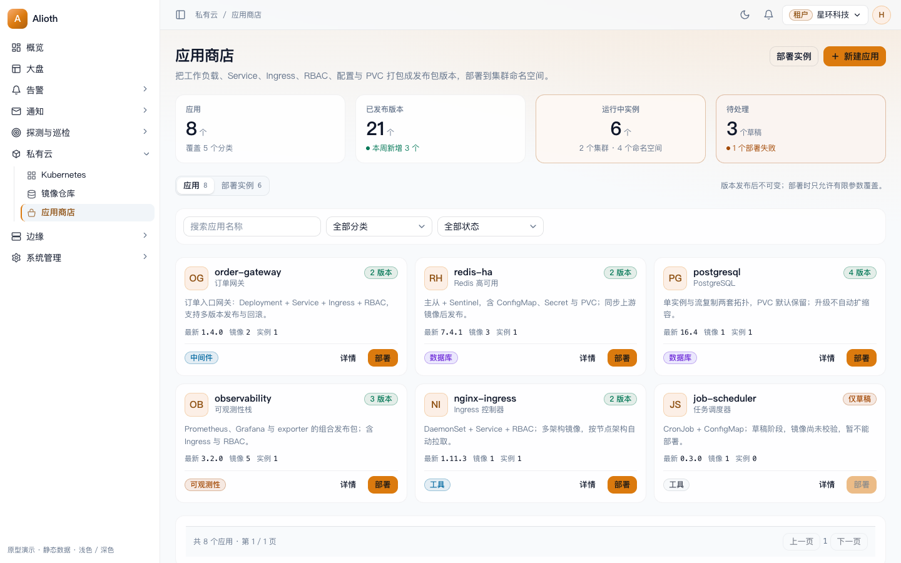
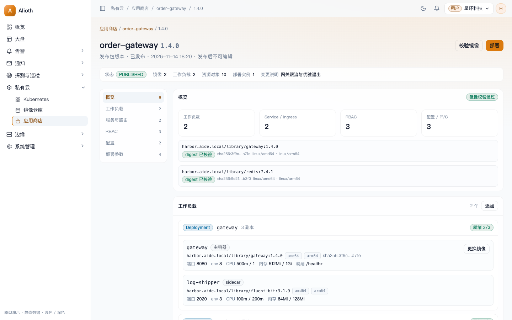
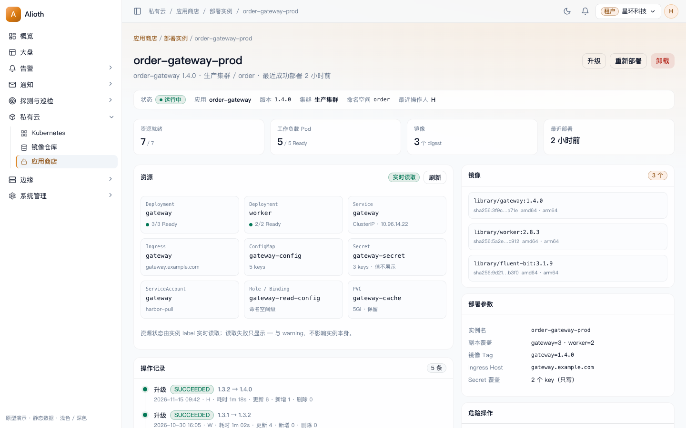
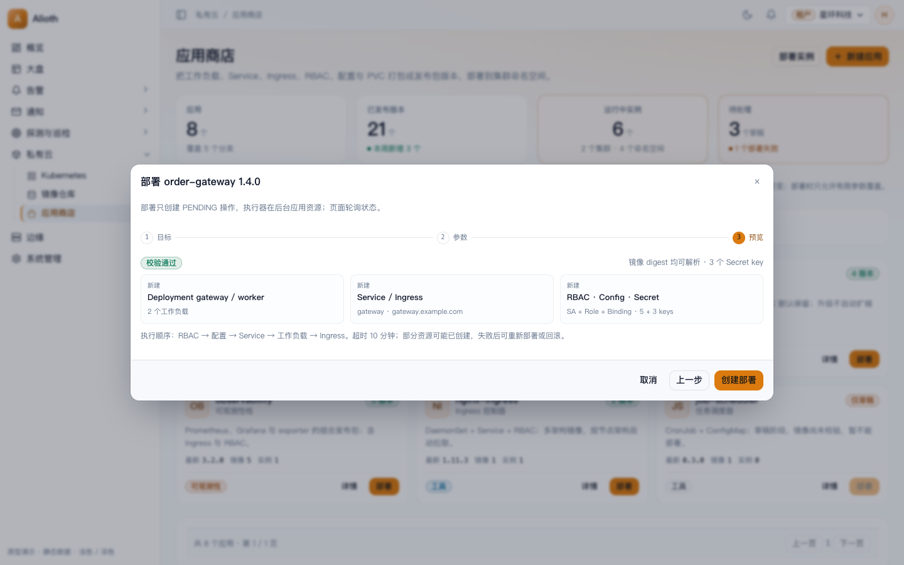
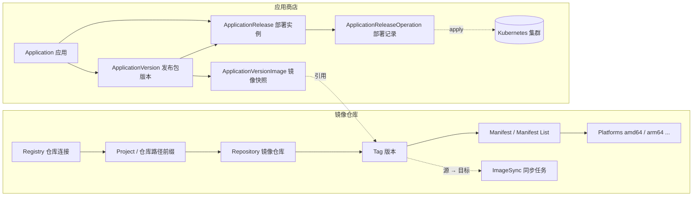
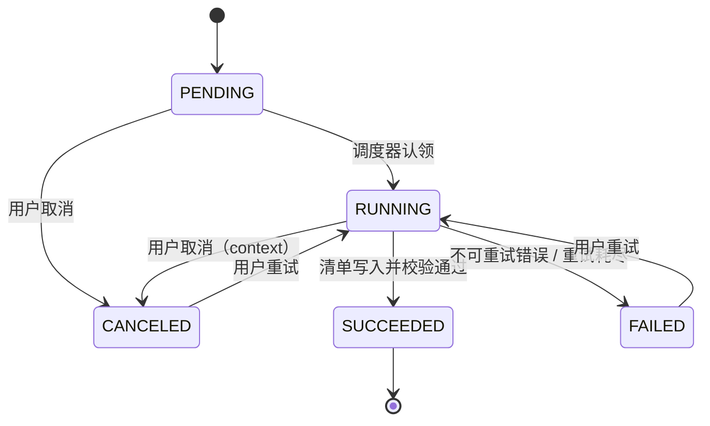
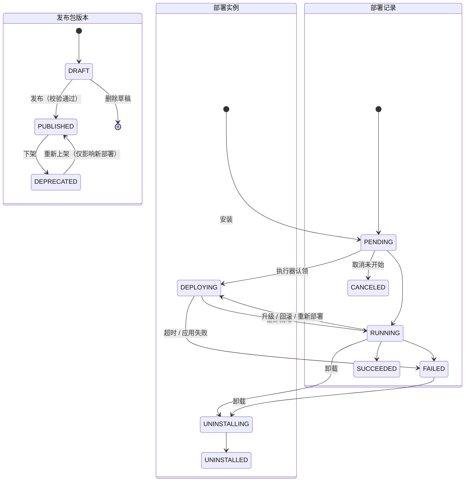
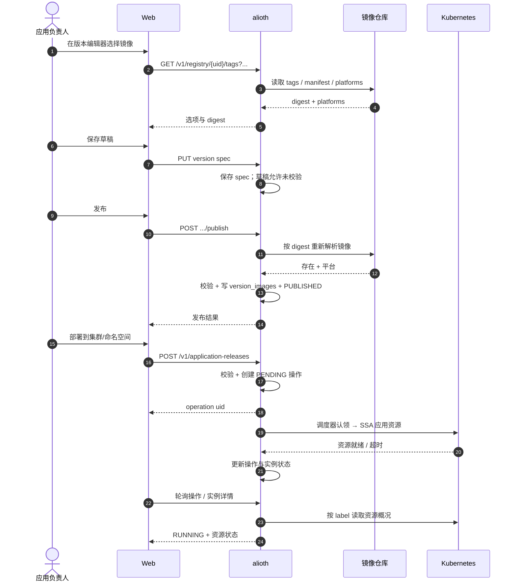

# 私有云：镜像仓库与应用商店设计（方案确认稿 v1）

本文说明「私有云」一级菜单下新增的**镜像仓库**与**应用商店**做什么、数据怎么存、接口怎么分、页面怎么组织，以及两者如何联动。

- 可交互原型：[private-cloud-prototype.html](private-cloud-prototype.html)（浅色 / 深色）
- 原型截图：[images/private-cloud/](images/private-cloud/)
- 基线：`main` @ `d79b615a`（2026-11-15）
- 前置阅读：[design.md](design.md)、[iterations/conventions.md](iterations/conventions.md)、[kubernetes-console-design.md](kubernetes-console-design.md)、[inspection-design.md](inspection-design.md)

| 镜像仓库 | 版本与多架构 | 应用商店 |
| --- | --- | --- |
|  |  |  |

| 发布包版本 | 部署实例 | 部署向导 |
| --- | --- | --- |
|  |  |  |

> 本文是**待确认稿**。第 13 节列出需要拍板的决策；确认后再按第 12 节拆里程碑落实现。本文只描述方案与原型，不改生产代码。

---

## 0. 一页结论

**可行。两件事都放在 `alioth` 控制面内，不新增进程、不引入 Redis 队列、不绕过现有分层。**

| 结论 | 做法 | 依据（现有架构） |
| --- | --- | --- |
| 菜单改名 | 侧边栏一级分组 `Kubernetes` 改为「私有云」，下含 Kubernetes / 镜像仓库 / 应用商店 | 菜单是展示层；`web/src/components/app-shell.tsx` 的 `kubeLinks` 当前只有 `/clusters` |
| 镜像仓库 | 新增 `Registry` 连接与 `ImageSync` 同步任务；镜像、Tag、架构**实时读远端**，不落库 | 与数据源、集群凭据同一套加密盒；远端元数据不复制进 PostgreSQL |
| 镜像同步 | 任务落 PostgreSQL，`alioth` 调度器用 `SKIP LOCKED + lease` 认领执行 | 巡检执行器（`biz/inspection/runner.go`）已经是这个模式 |
| 应用商店 | `Application` → `ApplicationVersion`（发布包）→ `ApplicationRelease`（部署实例）；版本是**结构化白名单 spec**，不是 Helm / 任意 YAML | 平台不引入 Helm/GitOps；结构化 spec 才能做 RBAC、校验、diff、回滚 |
| 部署执行 | `client-go` + Server-Side Apply，资源打归属 label，支持升级裁剪、回滚、卸载 | 集群客户端缓存、`k8s.io/client-go`、`dynamic` 已在依赖内 |
| 联动 | 版本里的镜像只能从「镜像仓库」选；保存时解析 digest 与多架构并快照；发布/部署再校验；删除 Tag/仓库前检查引用 | 一个 `application_version_images` 快照表即可闭环，不复制镜像元数据 |
| 权限 | 沿用「模块 → 能力 → 菜单 / 权限」；`cluster` 模块显示名改为「私有云」，新增 5 个能力、2 个菜单 | 目录在 `app/alioth/pkg/perm` 代码维护；基础套餐不变 |
| 不做 | 镜像构建/扫描、Harbor 用户与项目管理、Helm/GitOps/CRD、任意 YAML、审批流、跨集群编排、定时自动同步 | 避免把「镜像仓库」做成第二个 Harbor，把「应用商店」做成第二个 Rancher |

范围提醒：这是两个新领域，`docs/design.md`、`docs/roadmap.md`、`docs/iterations/conventions.md`、`app/alioth/pkg/perm`、`web/src/lib/feature-catalog.ts` 与 i18n 都要同步登记。

---

## 1. 场景与范围

### 1.1 用户故事

| 角色 | 要做的事 | 落点 |
| --- | --- | --- |
| 仓库管理员 | 接入 Harbor / 标准 Registry，测试连通性，替换凭据，删除连接 | 镜像仓库 / 仓库连接 |
| 仓库管理员 | 按项目浏览镜像仓库，查看 Tag、digest、大小、推送时间、架构与镜像配置 | 镜像仓库 / 镜像详情 |
| 仓库管理员 | 复制 Tag、删除 Tag；删除前看到被哪些发布包版本引用 | 镜像详情 + 引用保护 |
| 运维 | 把外部镜像（全部架构或指定架构）同步到私有仓库，查看进度、失败原因，重试或取消 | 镜像仓库 / 同步任务 |
| 应用负责人 | 把一个服务的 Deployment、Service、Ingress、RBAC、ConfigMap、Secret、PVC 打包成一个发布包版本 | 应用商店 / 发布包编辑器 |
| 应用负责人 | 同一应用维护多个版本；已发布版本不可改，改动只能出新版本 | 应用详情 / 版本列表 |
| 发布人员 | 把某个版本部署到指定集群与命名空间，填写域名、副本数、镜像 Tag 等参数 | 应用商店 / 部署 |
| 发布人员 | 查看部署实例的资源与实时状态，升级、回滚、卸载 | 应用商店 / 部署实例 |
| 租户管理员 | 按「仓库连接 / 镜像管理 / 同步 / 发布包 / 部署」分别授权 | 角色授权页 |

### 1.2 与现有能力的关系

| 现有能力 | 关系 |
| --- | --- |
| Kubernetes 集群（M14/M16/M25/M31） | 复用 `Cluster` 接入、`clusterClients` 缓存、Namespace 列表与 `cluster:read`。应用商店不绕过集群归属校验，也不把平台角色写进集群 RBAC |
| 功能套餐与菜单（M19/M21/M22/M24） | 新能力挂在 `cluster` 模块下（显示名改为私有云）；基础套餐不变，新能力需超级管理员开通 |
| 数据源凭据加密 | 仓库密码复用 `ALIOTH_ENCRYPT_KEY` 派生密钥的加密盒；接口不回传明文 |
| 调度与后台任务 | 镜像同步、部署执行复用 `alioth` 的 `Scheduler` 与数据库租约；不新增进程 |
| 通知 | 一期不接同步/部署失败通知。失败留在任务/操作记录与页面；通知作为后续增强 |
| 告警 / 巡检 / SSH | 无关。镜像仓库不产生告警事件，应用商店不参与告警评测 |

### 1.3 一期 / 后续

| 维度 | 一期 | 后续 |
| --- | --- | --- |
| 仓库驱动 | Harbor v2.0、标准 OCI Distribution（Docker Registry V2） | Quay、云厂商 CR 的专有元数据 |
| 镜像操作 | 浏览、版本、架构、复制 Tag、删除 Tag、同步 | 漏洞扫描结果、签名/证明（cosign）、镜像保留策略、GC |
| 同步 | 手动单条/批量，全部或指定架构，覆盖开关，失败重试，运行中取消 | 定时策略、Webhook 触发、跨仓库批量迁移 |
| 发布包资源 | Deployment / StatefulSet / DaemonSet / CronJob、Service、Ingress、SA/Role/RoleBinding、ConfigMap/Secret、PVC | Job、HPA、NetworkPolicy、PDB、CRD、ClusterRole |
| 部署 | 安装、升级、回滚、卸载、重新部署 | 审批流、灰度/分批、跨集群编排、漂移检测与自动修复、通知 |
| 参数 | 实例名、命名空间、副本数、镜像 Tag、Ingress Host、Secret 值覆盖 | 通用 Values 模板、环境分组、配置继承 |

---

## 2. 概念与对象关系



术语：

| 术语 | 含义 | 代码名 |
| --- | --- | --- |
| 仓库连接 | 一个可访问的镜像仓库端点与凭据，例如 Harbor | `Registry` |
| 镜像仓库 | 远端仓库里的 repository（`library/nginx`） | 无表，远端读取 |
| 版本 / Tag | 镜像的一个可拉取版本，可能对应单 manifest 或多架构 index | 无表，远端读取 |
| 平台 | `os/architecture/variant`，例如 `linux/amd64`、`linux/arm64/v8` | 无表 |
| 同步任务 | 把源 Tag（全部/指定平台）复制到目标仓库的一次异步任务 | `ImageSync` |
| 应用 | 发布包的身份与说明，不含可部署内容 | `Application` |
| 发布包版本 | 一组受支持 Kubernetes 资源 + 镜像快照 + 参数定义；发布后不可变 | `ApplicationVersion` |
| 部署实例 | 某应用版本在「集群 + 命名空间」中的一次安装 | `ApplicationRelease` |
| 部署记录 | 安装/升级/回滚/卸载的一次操作与结果 | `ApplicationReleaseOperation` |

**关键语义**

- 发布包版本是**不可变快照**：一旦 `PUBLISHED`，spec、镜像 digest、Secret 值都不能再改；要改就出新版本。
- 部署实例是**配置与状态**：名称、目标集群/命名空间、参数覆盖、当前版本；实际资源在 Kubernetes 里。
- 部署记录是**不可变账本**：每次操作记录动作、来源版本、目标版本、资源清单与结果；回滚复用历史记录的版本与参数。
- 一期没有 watch/controller：实例状态来自「最近一次操作 + 按 label 实时读取资源概况」，不主动纠偏。

---

## 3. 导航与信息架构

### 3.1 侧边栏

```
私有云（原 Kubernetes 分组）
├─ Kubernetes      /clusters        复用现有集群列表与控制台
├─ 镜像仓库         /registries      仓库连接 + 同步任务
└─ 应用商店         /appstore        应用 / 发布包 + 部署实例
```

- 一级分组 key 改为 `nav.privateCloud`（私有云 / Private cloud），图标沿用 `Boxes`。
- 现有 `/clusters` 菜单文案由「集群」改为「Kubernetes」，与分组名区分；实现时新增 `nav.kubernetesCluster`，不复用 `nav.kubernetes`。
- 分组按「当前租户已开通能力 + 角色菜单权限 + 资源权限」过滤；三个入口是 OR 关系，整组没有可见入口时整组隐藏（沿用 `NavGroup` 现有行为）。
- 菜单只控制入口；接口权限仍由各资源的 `read/write/delete` 决定。

### 3.2 路由与 URL 契约

| 路由 | 页面 | 主要查询参数 |
| --- | --- | --- |
| `/registries` | 镜像仓库：仓库连接 / 同步任务 | `tab=connections\|syncs`、`name`、`status`、`page`、`pageSize` |
| `/registries/:uid` | 仓库详情：项目与镜像仓库列表 | `project`、`name`、`page`、`pageSize` |
| `/registries/:uid/repository` | 镜像详情：Tag / 架构 / 引用 | `project`、`repository`、`architecture`、`name`、`page`、`pageSize` |
| `/appstore` | 应用商店：应用 / 部署实例 | `tab=apps\|releases`、`name`、`category`、`status`、`page`、`pageSize` |
| `/appstore/apps/:uid` | 应用详情：版本列表与说明 | `status`、`page`、`pageSize` |
| `/appstore/apps/:uid/versions/:versionUid` | 发布包版本详情 / 编辑 | 无（编辑态由页面状态切换，不写 URL） |
| `/appstore/releases/:uid` | 部署实例详情与操作记录 | `operationPage` |

**为什么 repository 用 query 而不是路径段**：镜像 repository 名本身含 `/`（`library/nginx`），放进路径段需要 `%2F`，React Router 解码后会改变分段；用 `project` + `repository` 查询参数可以完整保留，并和现有集群详情「筛选条件进 URL」的做法一致。Tag 也不进路径，避免大小写与特殊字符问题。

### 3.3 页面职责

| 页面 | 做什么 | 不做什么 |
| --- | --- | --- |
| 仓库连接列表 | 接入/编辑/测试/删除连接；统计与状态 | 不在这里浏览镜像 |
| 仓库详情 | 项目筛选、镜像仓库搜索、进入镜像详情 | 不做 Tag 级操作 |
| 镜像详情 | Tag 版本、架构过滤、Tag 详情、复制/同步/删除 | 不构建镜像、不改远端仓库配置 |
| 同步任务 | 创建/重试/取消/查看阶段与结果 | 不做定时策略 |
| 应用列表 | 应用卡片/列表、分类筛选、部署入口 | 不在列表里编辑版本 |
| 应用详情 | 说明、版本列表、镜像使用、部署/新建版本 | 不直接改已发布版本 |
| 版本详情/编辑 | 结构化编辑 12 类资源、镜像选择、发布校验 | 不导入 Helm chart 或任意 YAML |
| 部署实例列表 | 跨集群查看实例、状态与入口 | 不直接改 K8s 资源 |
| 部署实例详情 | 资源概况、镜像、操作记录、升级/回滚/卸载 | 不做漂移检测（一期） |

---

## 4. 镜像仓库

### 4.1 驱动与能力矩阵

| 能力 | `HARBOR` | `DOCKER_V2` |
| --- | --- | --- |
| 连接测试 | `GET /api/v2.0/ping` + `GET /api/v2.0/projects?page_size=1` | `GET /v2/`（含 Bearer challenge 处理） |
| 项目列表 | Harbor Project API，含公开/私有、仓库数 | 从 repository 路径首段推导，不保证完整 |
| 仓库列表 | Project 下的 repositories，含 artifact/pull 数、更新时间 | `GET /v2/_catalog`（可能被关闭），只有名称 |
| Tag 列表 | artifacts + tags，含 digest、size、platforms、labels、push time | `GET /v2/<name>/tags/list` + manifest HEAD/GET |
| 多架构 | artifact 的 `references` / `platform` | 读取 index / manifest list 的 `manifests[]` |
| 镜像配置 | config blob 摘要（entrypoint/env/labels） | 同左 |
| 认证 | Basic / Harbor robot account | Bearer token 流程 + Basic 兜底 |
| 搜索/分页 | 服务端搜索、分页 | 目录分页 + 本地过滤，设上限 |

一期只做这两个驱动。**不把 Harbor 的专有 API 泄漏到 biz 之上**：`biz/registry` 只依赖仓库接口（`RegistryRepo`、`ImageCatalog`），由 `data` 层按驱动实现；页面看到的字段对两种驱动一致，取不到的字段显示 `—`，不用 0 或空串冒充。

### 4.2 数据模型

#### `registries` 仓库连接

| 字段 | 类型 | 说明 |
| --- | --- | --- |
| `uid` | string | 标识，唯一 |
| `namespace_uid` | string | 租户 |
| `name` | string | 租户内未删除唯一，≤64 |
| `driver` | enum | `HARBOR` / `DOCKER_V2` |
| `endpoint` | string | 规范化后的 `http(s)://host[:port][/base]`，≤512 |
| `username` | string | 可空（匿名只读仓库） |
| `password_cipher` | string | 加密后的密码 / robot token；`Sensitive`，任何响应都不返回 |
| `allow_insecure_tls` | bool | 仅内网自签证书时打开，默认 false |
| `remark` | string | ≤512 |
| `last_checked_at` | int64 | 最近一次测试时间，Unix 秒 |
| `last_error` | string | 最近一次失败原因；空表示成功 |

- `Audit` + `SoftDelete`；`(namespace_uid, name)` 部分唯一（`deleted_at IS NULL`）。
- 更新时密码留空表示保持原值；显式清空用单独的 `clearPassword` 字段，避免误清。
- 删除前检查：没有运行中的同步任务、没有被任何发布包版本引用；否则 409 并返回引用列表。

#### `image_syncs` 同步任务

| 字段 | 类型 | 说明 |
| --- | --- | --- |
| `uid` / `namespace_uid` | string | 标识与租户 |
| `source_registry_uid` / `source_registry_name` / `source_endpoint` | string | 源连接与快照（删除连接后历史仍可读） |
| `source_repository` / `source_tag` / `source_digest` | string | 源镜像 |
| `source_platforms` | JSON | 创建时选中的平台列表 |
| `target_registry_uid` / `target_registry_name` / `target_endpoint` | string | 目标连接与快照 |
| `target_repository` / `target_tag` / `target_digest` | string | 目标镜像；成功后写回 digest |
| `mode` | enum | `ALL_PLATFORMS` / `SELECTED_PLATFORMS` |
| `overwrite` | bool | 目标 Tag 已存在时是否覆盖；默认 false |
| `status` | enum | `PENDING` / `RUNNING` / `SUCCEEDED` / `FAILED` / `CANCELED` |
| `stage` | string | 阶段文案：`PULL_MANIFEST`、`COPY_BLOBS`、`PUSH_MANIFEST`、`VERIFY` |
| `copied_blobs` / `total_blobs` | int32 | 层进度（能数清时） |
| `message` | string | 失败原因 / 取消原因 |
| `attempt` | int32 | 已尝试次数，最多 3 |
| `operator_uid` / `operator_name` | string | 创建人 |
| `lease_owner` / `lease_until` | string / time | 多副本认领 |
| `started_at` / `finished_at` | time | 执行时间 |

- 活动任务部分唯一：`(namespace_uid, source_registry_uid, source_repository, source_tag, target_registry_uid, target_repository, target_tag)`，条件 `status IN ('PENDING','RUNNING')`，防止同一镜像重复排队。
- 索引：`(namespace_uid, created_at DESC)`、`(status)`、`(source_registry_uid)`。
- 历史保留 90 天，由 `Scheduler` 每天清理一次；运行中的任务不清理。

### 4.3 接口

#### `RegistryService`

| 方法 | 路径 | 权限 | 说明 |
| --- | --- | --- | --- |
| `POST` | `/v1/registry` | `registry:write` | 接入连接，先测试后入库 |
| `PUT` | `/v1/registry/{uid}` | `registry:write` | 改名/备注/替换凭据；密码留空保持 |
| `DELETE` | `/v1/registry/{uid}` | `registry:delete` | 删除连接；有引用/运行中任务时 409 |
| `GET` | `/v1/registry/{uid}` | `registry:read` | 连接详情，不含密码 |
| `GET` | `/v1/registries` | `registry:read` | 分页；`name`、`driver` 过滤 |
| `POST` | `/v1/registry/{uid}/test` | `registry:read` | 用已保存凭据测试并刷新检测结果 |
| `POST` | `/v1/registry/probe` | `registry:write` | 用未保存凭据测试，供表单预检 |
| `GET` | `/v1/registry/{uid}/projects` | `registry:read` | 项目 / 路径前缀，供筛选 |
| `GET` | `/v1/registry/{uid}/repositories` | `registry:read` | `project`、`name`、分页 |
| `GET` | `/v1/registry/{uid}/tags` | `registry:read` | `project`、`repository`、`architecture`、`name`、分页 |
| `GET` | `/v1/registry/{uid}/tag` | `registry:read` | `project`、`repository`、`tag`；返回 manifest、平台、配置、引用 |
| `GET` | `/v1/registry/{uid}/tag/references` | `registry:read` | 引用该镜像的发布包版本与部署实例 |
| `POST` | `/v1/registry/{uid}/tag/copy` | `registry_image:write` | 同仓库复制/改名 Tag；按 digest 定位 |
| `DELETE` | `/v1/registry/{uid}/tag` | `registry_image:delete` | `project`、`repository`、`tag`、`digest`；有引用时 409 |

#### `ImageSyncService`

| 方法 | 路径 | 权限 | 说明 |
| --- | --- | --- | --- |
| `GET` | `/v1/image-syncs` | `registry_sync:read` | `status`、`registryUid`、分页 |
| `POST` | `/v1/image-syncs` | `registry_sync:write` | 批量创建；一条镜像一条任务，返回创建结果与逐条错误 |
| `GET` | `/v1/image-syncs/{uid}` | `registry_sync:read` | 详情 |
| `POST` | `/v1/image-syncs/{uid}/retry` | `registry_sync:write` | 失败/取消后重试，新建 attempt 或重置同一条 |
| `POST` | `/v1/image-syncs/{uid}/cancel` | `registry_sync:write` | 仅 PENDING/RUNNING；RUNNING 通过 cancel context 停止 |

批量创建语义：请求是数组，服务端**逐条校验并逐条落库**；部分失败不回滚已创建的任务，响应返回 `created[]` 与 `failed[]`，页面直接展示失败原因。这样一次 20 个镜像的同步不会因为其中 1 个已存在就全部失败。

### 4.4 版本与多架构读取

1. 列 Tag 时，按驱动取 Tag 列表；对每个 Tag 读 manifest（Harbor 的 artifact API 直接带 platforms，标准 Registry 需要 N 次 HEAD/GET）。
2. manifest 的 `Content-Type` 决定形态：
   - `application/vnd.oci.image.index.v1+json` 或 `application/vnd.docker.distribution.manifest.list.v2+json`：多架构 index，展开 `manifests[]` 得到 `platform`/`digest`/`size`。
   - 单 manifest：读 config blob 得到 `created`、`architecture`、`os`、`labels`、`entrypoint`、`cmd`、`env` 数量。
3. 页面显示短 digest（前 12 位），详情显示完整 digest；复制/同步/删除都**按 digest 定位**，避免同名 Tag 在操作期间被覆盖。
4. 架构过滤在服务端完成：`architecture=amd64` 只返回含该平台的 Tag；不把不匹配的 Tag 混进结果。
5. 读取并发上限 4、单次调用超时 15 秒（与集群调用一致）；远端 401/403 映射为「凭据被拒绝 / 无权限」，不清平台登录态；超时和 5xx 映射为「仓库暂不可用」。
6. **不缓存镜像元数据**：远端是唯一事实来源，避免过期数据误导删除/同步。列表页不做跨请求缓存；同一请求内对 manifest 去重，避免重复 HEAD。

### 4.5 镜像同步

#### 状态机



#### 执行

- `Scheduler` 每 2 秒调用 `imageSync.ExecuteNext`，`UPDATE ... WHERE status='PENDING' ... FOR UPDATE SKIP LOCKED` 认领一条，写 `lease_owner`/`lease_until`（5 分钟）。
- 同一时刻一个副本只跑一条同步，避免占满控制面带宽；多副本时由数据库租约天然限流。
- 复制实现使用 `github.com/google/go-containerregistry`（`remote` / `crane`）：认证、Bearer token、blob 上传、跨仓库复制、manifest list 都已有成熟实现。选择它而不是手写 Registry 协议，是为了把风险放在「编排与状态」而不是「协议细节」。
- 复制顺序：
  1. 读取源 manifest/index，确定平台集合。
  2. 逐层复制 blob 到目标仓库；目标已存在同名 blob 时跳过（按 digest）。
  3. 写入平台 manifest；多平台时写入由选中子清单组成的新 index；最后写目标 Tag。**Tag 最后写**，失败不会留下一个指向不完整内容的 Tag。
  4. 按目标 digest 回读校验；成功写 `target_digest`。
- 覆盖策略：
  - `overwrite=false`：创建任务前检查目标 Tag；已存在直接返回 409，不落任务。执行中目标被其他人写入也失败并提示。
  - `overwrite=true`：直接覆盖目标 Tag；页面在提交前二次确认。
- 重试：网络超时、5xx、blob 上传中断可重试；401/403/404、manifest 非法、平台不存在不重试。最多 3 次，指数退避 2s/8s/30s，仍失败则 `FAILED`。
- 进度：阶段 + `copied_blobs/total_blobs`；不承诺字节百分比（库不暴露稳定的字节进度，页面不要伪造）。
- 取消：`PENDING` 直接置 `CANCELED`；`RUNNING` 取消 context，执行器在写 Tag 之前停止，已上传的 blob 允许残留（后续 GC 处理）。
- 清理：90 天前的终态任务每天清理；活动任务不清理。

### 4.6 页面与交互

#### 仓库连接列表（`/registries?tab=connections`）

- 页头：标题「镜像仓库」、说明；主操作「接入仓库」，次操作「同步任务」。
- 统计卡：连接数、可用连接、镜像仓库数（可选，按最近一次仓库列表汇总）、运行中同步任务。
- 筛选：名称、驱动、状态；进入 URL。
- 表格列：名称（含驱动 badge）、Endpoint（mono）、最近检测（时间 + 状态点）、状态（可用/不可用/未检测）、备注、操作。
- 行操作：「详情」+「更多」（测试连接 / 编辑 / 删除）。删除确认里写明引用数量；有引用时链接到引用列表而不是只报错。
- 空态：没有连接时说明支持 Harbor 与标准 Registry，并给出「接入第一个仓库」。

#### 仓库详情（`/registries/:uid`）

- 页头：名称、驱动、Endpoint、连接状态、最近检测、备注；操作「测试连接」「同步任务」「刷新」。
- 项目筛选（Harbor 有项目；标准 Registry 显示路径前缀推导结果）+ 名称搜索。
- 仓库表：仓库名、版本数、大小、最近推送、操作「查看版本」。
- 加载/错误/空态独立；一个项目读取失败不拖垮整页（显示该项目的错误行 + 重试）。
- 标准 Registry 的目录被关闭（`_catalog` 404）时，页面明确说明「该仓库未开放目录接口，请直接输入镜像名进入」并提供按名称精确查询的入口，而不是显示空表。

#### 镜像详情（`/registries/:uid/repository`）

- 面包屑：镜像仓库 / 仓库连接 / 项目 / 镜像。
- 头部：镜像全名、拉取次数（Harbor）、最近推送、描述（若有）。
- 架构过滤：全部 / amd64 / arm64 / 其他；Tag 搜索。
- 表格列：Tag（mono）、架构（badge 组）、digest（短）、大小、推送时间、被引用（数量）、操作。
- 行操作：「详情」+「更多」（同步到… / 复制 Tag / 删除 Tag）。删除前展示引用列表；删除按钮为 destructive。
- Tag 详情用右侧 `Sheet`：完整 digest、media type、平台表（os/arch/variant/digest/size）、镜像配置（entrypoint/cmd/env 数量/labels）、引用列表（应用版本、部署实例）。不做 YAML 原文大段展示，避免把镜像配置当 K8s 清单。

#### 同步任务（`/registries?tab=syncs`）

- 筛选：状态、源/目标仓库。
- 表格列：源镜像、目标镜像、架构、状态、进度、创建人、耗时、操作。
- 运行中：阶段 + 层进度条；列表在存在活动任务时每 3 秒刷新一次，组件卸载即停止。
- 操作：详情、失败/取消后「重试」、PENDING/RUNNING「取消」。
- 新建同步：从镜像详情预填源；选择目标连接、目标 repository、目标 Tag、架构（全部/指定）、覆盖开关；提交前展示「目标已存在，将覆盖」警告。

### 4.7 安全边界

- 密码 / robot token 只以密文入库，任何响应不含明文；错误日志只记连接 UID 与错误类别，不打印凭据或上游响应体。
- 更新密码留空表示保持原值；显式清空需要单独开关，避免编辑备注时误清空凭据。
- 接入允许 `http`（内网仓库常见），但默认校验 TLS；`allow_insecure_tls` 需要用户显式勾选，页面标注风险。
- 仓库地址是租户管理员输入的外部 URL，信任模型与数据源、kubeconfig 一致：持有 `registry:write` 的人可以让 `alioth` 访问任意可达的 HTTP 服务。平台按内网使用设计，不把管理台暴露公网；文档在接入表单旁提示。
- 不使用仓库返回的任意链接作为重定向目标；认证 challenge 只在本仓库 endpoint 内跟随。标准 Registry 的跨域 blob 重定向由 go-containerregistry 处理，仍限定在配置的仓库域。
- 删除 Tag 需要 `registry_image:delete`，删除连接需要 `registry:delete`；两者都不与「同步」共享权限。

---

## 5. 应用商店

### 5.1 对象模型与状态机



规则：

- 应用名租户内未删除唯一；版本号同一应用内唯一（`1.4.0`，允许 `v` 前缀但统一去掉后存储/比较）。
- `PUBLISHED` / `DEPRECATED` 版本的 spec、镜像、Secret 值不可修改；只有 `DRAFT` 可编辑、可删除。
- 一个部署实例同一时刻最多一条 `PENDING` / `RUNNING` 操作；重复提交返回 409。
- 实例名在「同一集群 + 同一命名空间」内唯一；卸载后可以重新安装同名实例（旧记录保留为 `UNINSTALLED`）。
- 一期不允许把实例移动到另一个集群/命名空间；要迁移就新建实例。

命名冲突提醒：`/packages` 与 `FeaturePackage` 已经是平台「套餐」，本模块的「发布包」使用 `Application` / `ApplicationRelease`，不复用 `package` 命名，也不复用 `/v1/packages` 路径。

### 5.2 发布包版本 spec

版本内容用结构化 protobuf 定义、以 JSON 存库，**只允许白名单资源**：

| 资源 | 一期字段 | 说明 |
| --- | --- | --- |
| Deployment / StatefulSet / DaemonSet / CronJob | 名称、标签、注解、副本数（CronJob 用 cron + 时区）、ServiceAccount、nodeSelector、容器/初始化容器、卷 | 容器含镜像、命令/参数、端口、环境变量、资源 requests/limits、HTTP/TCP 探针 |
| Service | 名称、类型（ClusterIP/NodePort/LoadBalancer）、selector、端口（名称/端口/目标端口/协议） | Headless 用 `clusterIP: None` |
| Ingress | 名称、IngressClass、TLS Secret、规则（host/path/pathType/backend service+port） | 一期只支持 networking.k8s.io/v1 |
| RBAC | ServiceAccount、Role、RoleBinding | 只允许命名空间级；不创建 ClusterRole / ClusterRoleBinding |
| ConfigMap | 名称、data（key → 文本） | 明文 |
| Secret | 名称、type（Opaque）、data（key → 值） | 值单独加密，接口只返回 key |
| PVC | 名称、storageClassName、accessModes、容量 | 升级不自动缩容/扩容；卸载默认保留 |

**不做**：Job、HPA、NetworkPolicy、PDB、CRD、ClusterRole、任意 YAML/Helm chart、模板函数。需要这些能力时再扩协议，而不是先开一个 YAML 后门。

约束：

- 名称必须符合 DNS-1123（≤63）；同一 kind 内名称唯一；Service 名称被 Ingress 引用、ServiceAccount 被工作负载引用时必须在 spec 内存在。
- 一个版本最多 20 个工作负载、20 个 Service、10 个 Ingress、10 个 RBAC 对象、20 个 ConfigMap/Secret、20 个 PVC；单容器环境变量 ≤100，单文件大小 cap（spec ≤ 1 MiB，Secret 值 ≤ 256 KiB）。
- 镜像不是自由文本：从镜像仓库模块选择，保存时写入 `registry_uid / repository / tag / digest / platforms` 快照。
- 发布校验：所有镜像 digest 可解析；引用完整；名称合法；没有未支持的资源。草稿保存允许镜像暂不可解析，但会在页面标记「镜像未校验」，发布必须全部通过。
- Secret 值用 `ALIOTH_ENCRYPT_KEY` 派生的密钥加密后存在独立的 `secrets_cipher`，`spec` JSON 里只有 key 名。接口响应、日志、部署记录都不出现明文。

### 5.3 数据模型

#### `applications` 应用

| 字段 | 说明 |
| --- | --- |
| `uid` / `namespace_uid` | 标识与租户 |
| `name` | 租户内未删除唯一 |
| `display_name` | 展示名，默认等于 `name` |
| `category` | `DATABASE` / `MIDDLEWARE` / `OBSERVABILITY` / `TOOLING` / `OTHER` |
| `description` / `readme` | 说明（≤1024）/ Markdown（≤64 KiB） |
| `Audit` + `SoftDelete` | 审计与软删除 |

`(namespace_uid, name)` 部分唯一（`deleted_at IS NULL`）。删除应用要求没有任何非草稿版本、没有未卸载的部署实例；已卸载实例保留名称与版本快照，不阻塞删除。

#### `application_versions` 发布包版本

| 字段 | 说明 |
| --- | --- |
| `uid` / `namespace_uid` / `application_uid` | 标识与归属 |
| `version` | 版本号，≤32；同应用未删除唯一 |
| `status` | `DRAFT` / `PUBLISHED` / `DEPRECATED` |
| `changelog` | 变更说明，≤4 KiB |
| `spec` | 结构化资源 JSON（不含 Secret 值） |
| `secrets_cipher` | Secret 值密文（JSON） |
| `validation` | 最近一次镜像校验结果（JSON：状态、消息、逐镜像结果） |
| `published_at` | 发布时间 |
| `Audit` + `SoftDelete` | 审计与软删除 |

索引：`(application_uid, version)` 唯一（未删除）、`(namespace_uid, application_uid, status)`。

#### `application_version_images` 镜像快照

| 字段 | 说明 |
| --- | --- |
| `uid` / `namespace_uid` / `application_uid` / `version_uid` | 归属 |
| `item` | 容器路径，例如 `workload:web/container:app` |
| `image` | 完整引用，便于展示与排查 |
| `registry_uid` / `registry_name` / `repository` / `tag` / `digest` | 结构化来源 |
| `platforms` | 平台 JSON（os/arch/variant） |
| `resolved_at` | 解析时间 |

`(version_uid, item)` 唯一；`(namespace_uid, repository, tag)` 与 `(registry_uid)` 建普通索引，供「被谁引用」反查。草稿保存时按 item 覆盖；发布时全量重建并写 `resolved_at`。

#### `application_releases` 部署实例

| 字段 | 说明 |
| --- | --- |
| `uid` / `namespace_uid` | 标识与租户 |
| `cluster_uid` / `cluster_name` | 目标集群与名称快照 |
| `target_namespace` / `name` | 目标命名空间与实例名 |
| `application_uid` / `application_name` | 应用与名称快照 |
| `version_uid` / `version` | 当前版本 |
| `status` | `PENDING` / `DEPLOYING` / `RUNNING` / `FAILED` / `UNINSTALLING` / `UNINSTALLED` |
| `values` | 非敏感参数覆盖 JSON（副本数、镜像 Tag、Ingress Host 等） |
| `secret_values_cipher` | 本次实例的 Secret 值覆盖密文 |
| `images` | 实际部署的镜像快照 JSON |
| `message` | 最近失败原因 |
| `last_operation_uid` | 最近一次操作 |
| `deployed_at` | 最近一次成功部署时间 |

`(cluster_uid, target_namespace, name)` 部分唯一，条件 `deleted_at IS NULL AND status <> 'UNINSTALLED'`；索引 `(namespace_uid, created_at DESC)`。

#### `application_release_operations` 部署记录

| 字段 | 说明 |
| --- | --- |
| `uid` / `namespace_uid` / `release_uid` | 归属 |
| `action` | `INSTALL` / `UPGRADE` / `ROLLBACK` / `UNINSTALL` / `REDEPLOY` |
| `status` | `PENDING` / `RUNNING` / `SUCCEEDED` / `FAILED` / `CANCELED` |
| `from_version_uid` / `to_version_uid` | 升级/回滚的来源与目标 |
| `values` / `secret_values_cipher` | 本次操作的参数快照（回滚复用） |
| `resources` | 本次应用的资源标识 JSON（apiVersion/kind/namespace/name），用于升级裁剪与卸载 |
| `diff` | `added` / `updated` / `deleted` / `keptPersistentVolumeClaims` 计数 |
| `message` | 失败原因 / 超时说明 |
| `operator_uid` / `operator_name` | 操作人 |
| `lease_owner` / `lease_until` | 多副本认领 |
| `started_at` / `finished_at` | 执行时间 |

活动操作部分唯一：`(release_uid)`，条件 `status IN ('PENDING','RUNNING')`；索引 `(release_uid, created_at DESC)`、`(status)`。

### 5.4 接口

#### `ApplicationService`

| 方法 | 路径 | 权限 |
| --- | --- | --- |
| `POST` | `/v1/application` | `application:write` |
| `PUT` | `/v1/application/{uid}` | `application:write` |
| `DELETE` | `/v1/application/{uid}` | `application:delete` |
| `GET` | `/v1/application/{uid}` | `application:read` |
| `GET` | `/v1/applications` | `application:read` |
| `POST` | `/v1/application/{uid}/version` | `application:write` |
| `PUT` | `/v1/application/{uid}/version/{version_uid}` | `application:write` |
| `DELETE` | `/v1/application/{uid}/version/{version_uid}` | `application:write`（仅草稿） |
| `POST` | `/v1/application/{uid}/version/{version_uid}/validate` | `application:write` |
| `POST` | `/v1/application/{uid}/version/{version_uid}/publish` | `application:write` |
| `POST` | `/v1/application/{uid}/version/{version_uid}/deprecate` | `application:write` |
| `GET` | `/v1/application/{uid}/versions` | `application:read` |
| `GET` | `/v1/application/{uid}/version/{version_uid}` | `application:read` |

`validate` 返回逐镜像结果（是否能解析、digest、平台）与 spec 校验错误；不改变版本状态，成功时刷新 `validation` 缓存供列表展示。`publish` 内部再次校验，不能依赖前端调用过 `validate`；`DRAFT → PUBLISHED` 与 `DEPRECATED → PUBLISHED`（仅状态，不改内容）共用该接口。

#### `ApplicationReleaseService`

| 方法 | 路径 | 权限 |
| --- | --- | --- |
| `GET` | `/v1/application-releases` | `release:read` |
| `POST` | `/v1/application-releases` | `release:write` + `cluster:read` |
| `GET` | `/v1/application-releases/{uid}` | `release:read` |
| `POST` | `/v1/application-releases/{uid}/upgrade` | `release:write` + `cluster:read` |
| `POST` | `/v1/application-releases/{uid}/rollback` | `release:write` + `cluster:read` |
| `POST` | `/v1/application-releases/{uid}/redeploy` | `release:write` + `cluster:read` |
| `POST` | `/v1/application-releases/{uid}/uninstall` | `release:delete` + `cluster:read` |
| `GET` | `/v1/application-releases/{uid}/operations` | `release:read` |
| `GET` | `/v1/application-release-operations/{uid}` | `release:read` |

- 部署目标选项复用 `GET /v1/clusters` 与 `GET /v1/cluster/{uid}/namespaces`（要求 `cluster:read`）。
- 创建/升级/回滚只落 `PENDING` 操作并立即返回；页面轮询操作状态。不把 SSA 放在 HTTP 请求里同步执行。
- `GET release` 在读取数据库后，按归属 labels 实时读取集群资源概况（Deployment/Service/Ingress 等的就绪与存在性），读取失败只记 `warning`，不影响实例本身返回。
- `redeploy` 用于同一版本重试失败/修复漂移；创建 `REDEPLOY` 记录。

### 5.5 部署执行

#### 渲染与归属

- 版本 spec + 实例参数 → 渲染成具体对象；所有对象合并以下 labels（值固定、覆盖用户同名 label）：
  - `app.kubernetes.io/managed-by: alioth`
  - `alioth.io/release-uid: <release uid>`
  - `alioth.io/release-name: <name>`
  - `alioth.io/application-uid: <application uid>`
  - `alioth.io/version: <version>`
- 对象名使用 spec 名称；不自动加前缀。目标命名空间必须已存在，由页面从集群 Namespace 列表选择；一期不自动创建命名空间。
- 应用顺序：ServiceAccount/Role/RoleBinding → ConfigMap/Secret → PVC → Service → Workload → Ingress。
- 删除/裁剪顺序相反：Ingress → Workload → Service → PVC（默认保留）→ ConfigMap/Secret → RBAC。

#### 冲突与安全

- Apply 前检查同名资源是否已存在：
  - 不存在：创建。
  - 存在且带本实例 `alioth.io/release-uid`：允许更新。
  - 存在但不属于本实例：**失败并返回 409**，列出冲突资源。绝不用 `force` 抢占别人的资源。
- 同类资源名冲突（例如版本里两个 Deployment 同名）在保存时拒绝，不等到部署。
- RBAC 仅命名空间级；禁止 ClusterRole/ClusterRoleBinding。
- Secret 明文只在执行器内存中出现；不写日志、不进部署记录；记录只存 key 与引用。

#### 应用与就绪

- 使用 `dynamic.Interface` + Server-Side Apply（`types.ApplyPatchType`，field manager `alioth-appstore`），不覆盖 `kubectl` 等其他管理者拥有的字段之外的内容。
- 工作负载就绪判定：`observedGeneration >= generation` 且 `updatedReplicas`、`readyReplicas`、`availableReplicas` 达到期望；CronJob 不等待 Job；PVC/Service/Ingress 不等待外部就绪。
- 默认超时 10 分钟（可后续做成配置）；超时把操作标为 `FAILED`，消息写明「部分资源可能已创建，可重新部署或回滚」。页面必须显示这一事实，不能只说「失败」。
- Secret/ConfigMap 更新后不自动重启工作负载；需要滚动重启时由用户在版本里改 pod template（例如加 annotation）或后续增加「重启」动作。

#### 升级、回滚、卸载

- 升级：目标版本必须 `PUBLISHED`（或当前实例正在使用且已 `DEPRECATED`）；应用新对象后，按「上一次成功操作的资源清单 − 本次资源清单」裁剪。只删带本实例 label 的对象。
- 回滚：从历史成功操作中选择目标（版本 + 参数），创建 `ROLLBACK`；用不可变版本重新渲染，不依赖历史 YAML 快照。回滚也执行裁剪。
- 卸载：删除本实例 label 下的全部对象；默认**保留 PVC**，页面提供「同时删除 PVC」复选框，勾选后二次确认（输入实例名）。卸载完成后实例状态 `UNINSTALLED`，记录保留。
- 重新部署：同一版本 + 当前参数再 apply 一次，用于失败恢复或人工改动后的纠偏；不做自动漂移检测。

#### 并发与多副本

- 创建操作时用部分唯一索引兜底「一个实例一个活动操作」；`Scheduler` 每 2 秒认领 `PENDING` 操作，租约 10 分钟。
- 执行器只处理 `PENDING`；HTTP 请求创建操作后立即返回，不等待。
- 集群客户端复用 `clusterClients`；为 SSA 增加 `dynamic.Interface` 缓存或按操作构建，二者都只缓存 REST 配置 / 客户端，不缓存对象。
- 失败重试由用户发起（重新部署/升级），不自动重放，避免把部分失败变成不可控的重复 apply。
- 若进程在执行中退出，租约到期后操作仍是 `RUNNING`，不会自动重跑；页面显示「执行中断」并提供重新部署。**一期不做自动恢复**，避免重复创建资源。

### 5.6 部署参数

一期只开放少量、可校验的覆盖项：

| 参数 | 作用域 | 校验 |
| --- | --- | --- |
| 实例名 | 部署 | DNS-1123，≤63；同集群同命名空间唯一 |
| 目标集群 / 命名空间 | 部署 | 集群属于当前租户；命名空间存在（`cluster:read`） |
| 副本数 | 每个工作负载 | 0–100；DaemonSet 不开放 |
| 镜像 Tag | 每个容器 | 必须与原 repository 相同，且 Tag 在当前仓库可解析；不允许换 repository/registry |
| Ingress Host | 每条规则 | 域名格式；最多 253；为空表示不覆盖 |
| Secret 值 | 每个 key | 覆盖版本默认值；只写不读；长度限制 |

不开放任意环境变量、任意 YAML patch、任意资源覆盖。参数快照存在操作记录里，回滚原样复用。

### 5.7 页面与交互

#### 应用列表（`/appstore?tab=apps`）

- 页头：「应用商店」+ 说明；主操作「新建应用」；视图切换「应用 / 部署实例」与筛选同一行。
- 统计卡：应用数、已发布版本、运行中实例、草稿。
- 应用用卡片网格（分类 + 名称 + 描述 + 最新版本 + 镜像数 + 部署按钮），窄屏单列。卡片不是表格的替代品：列表筛选、分页、空态仍按列表页规范。
- 卡片操作：「详情」「部署」；没有已发布版本时「部署」禁用并提示先发布版本。

#### 应用详情（`/appstore/apps/:uid`）

- 页头：名称、分类、说明、创建人；操作「新建版本」「部署」。
- 版本表：版本、状态、镜像（最多 3 个 + 展开）、部署实例数、发布时间、操作。行操作「详情」+「更多」（发布/下架/删除草稿/部署）。
- 说明 Markdown 在下方卡片展示，长内容在卡片内滚动或折叠。
- 已发布/已下架版本不显示编辑入口；草稿显示「编辑」。

#### 版本详情 / 编辑（`/appstore/apps/:uid/versions/:versionUid`）

- 页头：应用名 / 版本号 / 状态；操作「校验镜像」「发布」「编辑」「删除草稿」。
- 左侧锚点导航：概览、工作负载、服务与路由、RBAC、配置、部署参数、镜像来源。
- 概览：资源计数、镜像列表（registry/repository/tag/digest/platforms）、最近校验结果。
- 工作负载：按类型分组的卡片；展开显示容器与镜像（含 digest、架构）、端口、环境变量、资源、探针；镜像行有「更换镜像」打开镜像选择器。
- 服务与路由：Service 表 + Ingress 规则表（host/path/backend/TLS）。
- RBAC：SA/Role/Rule/RoleBinding 的只读分组（编辑用对话框）。
- 配置：ConfigMap 键值；Secret 只显示 key 与「已加密」，不显示值；编辑时输入新值。
- 部署参数：显示可从部署对话框覆盖的字段与默认值。
- 编辑使用 `Dialog`/分区卡片，遵循 `web/AGENTS.md` 的三段式对话框与滚动约束；版本编辑是长页面，滚动只在内容区。
- 发布前弹出确认：展示校验结果（镜像是否可解析、资源数量、警告），确认后发布。

#### 部署实例列表（`/appstore?tab=releases`）

- 筛选：集群、状态、应用、名称。
- 表格列：实例、应用/版本、集群/命名空间、状态、最近操作、更新时间、操作。
- 行操作：「详情」+「更多」（升级 / 重新部署 / 卸载）。运行中操作时这些入口禁用并提示「有操作进行中」。
- 状态渲染用 `StatusBadge`：`RUNNING` 绿、`DEPLOYING/PENDING` 琥珀、`FAILED` 红、`UNINSTALLING` 灰、`UNINSTALLED` 中灰。

#### 部署实例详情（`/appstore/releases/:uid`）

- 页头：实例名、状态、应用/版本、集群/命名空间；操作「升级」「重新部署」「卸载」。
- 概况卡：镜像（含 digest/平台）、资源计数（就绪/总数）、最近部署时间、操作人。
- 资源表：Kind、名称、状态（实时读取，失败显示 `—` 与 warning）、操作（跳转集群控制台对应资源，若权限允许）。
- 操作记录时间线：动作、从/到版本、状态、耗时、操作人、失败消息；可展开看资源 diff 计数。回滚入口从成功记录选择目标。
- 部署对话框：三步（目标 → 参数 → 预览）；预览列出将创建/更新/删除的资源与镜像 digest，卸载单独确认。

#### 镜像选择器（跨页面组件）

- 目录：仓库连接 → 项目/仓库 → Tag → 平台。
- 搜索与分页调用 `registry` API；选中后展示完整引用、digest、platforms。
- 只允许选择「已解析 digest」的 Tag；远端读取失败时禁用确认并给出重试。
- 同一个组件在版本编辑器和「镜像详情 → 同步」中复用；后续可复用到 K8s 工作负载「设置镜像」对话框，但一期不强制改那个入口。

### 5.8 安全与权限边界

- `release:write` 是**高权限**：持有者可以让 `alioth` 在目标命名空间创建 Deployment/Service/Ingress/RBAC/Secret。它比 `k8s:*` 的单资源操作更宽，只应授予可信的发布角色。文档和角色授权页都要标注。
- 仍然要求 `cluster:read`：看不到目标集群的人不能部署；集群归属与命名空间校验在 biz 层完成，不能只靠前端下拉框。
- 命名空间级 RBAC 限制降低提权面；但版本仍可创建 ServiceAccount 与 Role，需在文档中说明。
- Secret 值只写不读；列表/详情只返回 key。部署记录不存明文。
- 集群凭据的权限边界由 kubeconfig 决定；平台不额外放大。若 kubeconfig 是集群管理员，应用商店也能创建高权限资源，这是运维平台既有的信任模型，页面在部署确认里提示。
- 卸载 PVC 默认保留；只有显式勾选并二次确认才删除。

---

## 6. 两者联动

### 6.1 镜像选择

- 发布包版本里的每个容器镜像都通过镜像选择器从 `registries` 读取，不接受自由文本。
- 选择结果写 `application_version_images`：`registry_uid/name/repository/tag/digest/platforms`，同时把完整引用写入容器 spec。
- 保存草稿时解析失败不阻塞保存，但版本标记「镜像未校验」；发布必须全部解析成功。

### 6.2 发布校验

`publish` 在服务端重新执行：

1. 结构校验（名称、引用、数量、Secret 值）；
2. 解析每个镜像（按 digest，若版本存的是 Tag 则先解析成 digest）；
3. 检查镜像来源仓库仍属于当前租户；
4. 写入/刷新 `application_version_images` 与 `validation`；
5. 状态改为 `PUBLISHED`。

任何一步失败返回 400/409，并给出逐项错误，不部分发布。

### 6.3 部署校验

创建/升级/回滚时：

- 新部署与升级的目标版本必须是 `PUBLISHED`；回滚目标可以是 `DEPRECATED`；当前实例版本为 `DEPRECATED` 时仍可继续运行、回滚或卸载；
- 按 digest 检查镜像仍可解析；镜像被删除时 409，提示先重新同步或选择其他版本；
- 目标集群属于当前租户；命名空间存在；
- 同名实例/资源冲突按 5.5 处理。

### 6.4 引用保护

- 删除 Tag：查询 `application_version_images`。被 `PUBLISHED`/`DEPRECATED` 版本或活动部署实例引用时返回 409，列出应用与版本；草稿引用只警告不阻塞（草稿发布时会再次校验）。
- 删除仓库连接：有运行中同步任务，或被任何版本镜像（含草稿）引用时 409；页面给出引用清单与处理建议。
- 删除应用：有非草稿版本或未卸载实例时 409；已卸载实例保留快照，不阻塞。
- 删除版本：仅草稿且无部署实例引用。

### 6.5 从版本发起同步

镜像详情「同步到…」和应用版本镜像行「同步到私有仓库」共用同一个同步对话框：

- 源：当前镜像的 registry/repository/tag/digest；
- 目标：另一个仓库连接 + repository + tag；
- 架构：全部或指定平台；
- 完成后可回到版本页重新校验镜像。

### 6.6 端到端时序



---

## 7. 权限、套餐与菜单

### 7.1 模块

`FeatureCluster`（code `cluster`）的显示名从「Kubernetes」改为「私有云」，描述覆盖 Kubernetes、镜像仓库、应用商店；**模块 code 不变**，已有套餐、能力、权限、种子数据都不需要重命名。基础套餐仍不包含该模块。

### 7.2 新增能力（5 个）

| 能力 code | 名称 | 权限 | 依赖 / 说明 |
| --- | --- | --- | --- |
| `registry_access` | 仓库接入 | `registry:read`、`registry:write`、`registry:delete` | 接入、测试、编辑、删除连接；读权限也是镜像浏览的基础 |
| `registry_image` | 镜像版本管理 | `registry:read`、`registry_image:write`、`registry_image:delete` | 复制/改名 Tag、删除 Tag；含仓库读权限，否则页面不可用 |
| `registry_sync` | 镜像同步 | `registry:read`、`registry_sync:read`、`registry_sync:write` | 创建/取消/重试同步；含仓库读权限 |
| `appstore_package` | 发布包管理 | `application:read`、`application:write`、`application:delete` | 应用与版本管理 |
| `appstore_deploy` | 应用部署 | `application:read`、`release:read`、`release:write`、`release:delete` | 部署/升级/回滚/卸载；接口另要求 `cluster:read` |

能力总数 66 → 71。`registry:read` 同时出现在三个 registry 能力里，是**有意的依赖**：只买同步能力的角色也要能读取仓库与镜像，否则同步页面无从选择。权限在 `Catalog()` 中按菜单去重，不重复出现。

### 7.3 新增菜单（2 个）

| 菜单 code | 名称 | 能力 | 权限 | 默认读 |
| --- | --- | --- | --- | --- |
| `registry` | 镜像仓库 | `registry_access`、`registry_image`、`registry_sync` | `registry:read/write/delete`、`registry_image:write/delete`、`registry_sync:read/write` | `registry:read`、`registry_sync:read` |
| `appstore` | 应用商店 | `appstore_package`、`appstore_deploy` | `application:read/write/delete`、`release:read/write/delete` | `application:read`、`release:read` |

菜单总数 40 → 42。`MENU_CAPABILITIES` 增加 `/registries → registry`、`/appstore → appstore`；`CAPABILITY_MENU_OVERRIDES` 增加 5 个能力到这两个菜单的映射（因为能力 code 与菜单 code 不同）。

### 7.4 授权与升级影响

- 超级管理员需要把新能力加进「私有云」套餐，或在租户功能授权里加开，否则租户看不到入口。基础套餐不变。
- 租户负责人隐式拥有全部已开通能力对应的菜单与权限；自定义角色需要管理员在角色授权页勾选 `menu:registry` / `menu:appstore` 及子权限。
- 新权限不自动授予任何存量自定义角色；seed 不写「猜意图」的授权。升级说明里明确这一步。
- 接口检查顺序不变：角色权限 → 模块已开通 → 菜单权限。`FeatureOf("registry:read")` 通过菜单声明落到 `cluster` 模块。

---

## 8. 后端实现映射

| 层 | 新增 / 修改 |
| --- | --- |
| proto | `api/alioth/v1/registry.proto`（`RegistryService`、`ImageSyncService`）、`api/alioth/v1/application.proto`（`ApplicationService`、`ApplicationReleaseService`）；`make api` 生成 |
| service | `internal/service/registry.go`、`internal/service/application.go`；只做 proto ↔ bo 转换 |
| biz | `internal/biz/registry`：`Registry`（连接）、`Explorer`（项目/仓库/Tag/架构）、`Synchronizer`（同步任务）、`Resolver`（给应用商店解析镜像）；`internal/biz/application`：`Catalog`（应用/版本）、`Operator`（部署/升级/回滚/卸载）、`Executor`（SSA 执行） |
| bo | `pkg/bo/registry.go`、`pkg/bo/application.go` |
| repository | `internal/data/repository/registry.go`、`application.go`（接口，按聚合拆） |
| data | `internal/data/registry_repo.go`、`registry_catalog.go`（Harbor / Docker V2 驱动）、`image_sync_repo.go`、`image_sync_executor.go`、`application_repo.go`、`application_release_repo.go`、`application_applier.go`（SSA）、`kubernetes_client.go`（补 dynamic） |
| ent | `internal/data/ent/schema/registry.go`、`image_sync.go`、`application.go`、`application_version.go`、`application_version_image.go`、`application_release.go`、`application_release_operation.go`；`make migrate` |
| wire | `biz/biz.go`、`data/data.go`、`service/service.go`、`server/server.go` 注入 |
| 调度 | `internal/server/scheduler.go` 增加 `imageSync.ExecuteNext`、`releaseExecutor.ExecuteNext`、90 天清理；沿用 `Start/Stop` 的 goroutine 生命周期 |
| 权限 | `pkg/perm/perm.go` 权限常量、`capability.go` 能力、`menu.go` 菜单、`feature.go` 模块名 |
| 错误 | 复用 `pkg/merr`：`Invalid`、`NotFound`、`Conflict`、`Server`；上游 401/403 映射为客户端错误，不清平台登录态 |

命名注意：

- `cluster` 包已有 `Registry`（集群接入）。新包是 `biz/registry`，包名限定后不冲突；跨包调用写 `registry.Registry`。
- `application` 包的 `Operator` 与集群 `Operator` 同名但不同包，符合现有命名习惯；不要造 `AppStore`、`AppManager` 这类新概念。
- 加密盒、actor、access、page 等复用现有工具，不新建第二套。

新增依赖：

| 依赖 | 用途 | 说明 |
| --- | --- | --- |
| `github.com/google/go-containerregistry` | Registry 认证、manifest、多架构、跨仓库复制 | 只进 `app/alioth`；封装在 `data` 层，biz 不直接 import。`go.mod` 固定版本并跑 `go mod tidy` |

`dynamic.Interface` 来自已有 `k8s.io/client-go`，不新增依赖。

Scheduler 约束：

- 两个执行器各自 `Start` 一个 goroutine，`Stop` 时用 `select` 兼顾 `ctx.Done()`，不无限阻塞（见 conventions 进程退出）。
- 同一时刻每个执行器各跑一条，避免同步/部署把控制面拖垮；后续要并发再按配置放开。
- 任务认领与状态更新用 SQL `UPDATE ... RETURNING`，不引入 Redis 队列（Redis 只做锁）。

---

## 9. 前端实现映射

| 路由 / 页面 | 文件 | 主导出 |
| --- | --- | --- |
| `/registries` | `web/src/pages/registry/index.tsx` | `RegistryPage` |
| `/registries/:uid` | `web/src/pages/registry/detail/index.tsx` | `RegistryDetailPage` |
| `/registries/:uid/repository` | `web/src/pages/registry/repository.tsx` | `RegistryRepositoryPage` |
| `/appstore` | `web/src/pages/appstore/index.tsx` | `AppStorePage` |
| `/appstore/apps/:uid` | `web/src/pages/appstore/app-detail.tsx` | `ApplicationDetailPage` |
| `/appstore/apps/:uid/versions/:versionUid` | `web/src/pages/appstore/version.tsx` | `ApplicationVersionPage` |
| `/appstore/releases/:uid` | `web/src/pages/appstore/release.tsx` | `ApplicationReleasePage` |

| 组件 / 模块 | 文件 | 说明 |
| --- | --- | --- |
| 镜像选择器 | `web/src/components/image-picker.tsx` → `ImagePicker` | 跨页面复用；只用 `web/src/api` |
| 应用版本编辑分区 | `web/src/pages/appstore/version-*` 下的页面私有组件 | 工作负载、Service/Ingress、RBAC、配置、参数 |
| 部署对话框 | `web/src/pages/appstore/deploy-dialog.tsx` → `ApplicationDeployDialog` | 三步向导；预览与确认 |
| 同步对话框 | `web/src/pages/registry/sync-dialog.tsx` → `RegistrySyncDialog` | 单条/批量 |
| API | `web/src/api/registry/{index,types}.ts`、`web/src/api/application/{index,types}.ts` | 函数名等于 RPC lowerCamel；类型按 conventions |
| 路由注册 | `web/src/App.tsx`、`web/src/lib/last-page.ts` | 新增路径与详情模式 |
| 菜单 | `web/src/components/app-shell.tsx`、`web/src/i18n/index.ts` | 私有云分组与三个入口 |
| 能力目录 | `web/src/lib/feature-catalog.ts` | 71 能力、42 菜单、能力→菜单映射、BASE 不变 |
| i18n | `web/src/i18n/index.ts` | `nav.privateCloud`、`nav.registry`、`nav.appStore`、`registry.*`、`appStore.*`、`error.*` 新映射 |

页面约束（必须遵守）：

- 固定高度壳内，每个路由只有一个主滚动容器；表格用自己的 `overflow-auto`；`min-h-0` / `min-w-0` 齐备。
- 新建/编辑对话框三段式，`DialogBody` 唯一滚动；版本编辑器这种长页面用页面内分区滚动，不塞进对话框。
- 页面筛选进 URL；Tabs 的 `data-state`、URL、面板内容保持一致。
- 32px 控件；状态用 `StatusBadge`；操作列「详情 + 更多」；颜色只用语义 token。
- 所有文案走 `t()`；`enumLabel` 显示状态与类型，不直接渲染协议常量。
- 失败状态可重试；空态说明下一步；无权限不渲染写操作，服务端仍独立校验。
- 新页面加入 `E2E_SCROLL_ROUTES` 的滚动回归，至少覆盖 `/registries/:uid/repository` 与 `/appstore/apps/:uid/versions/:versionUid`。

---

## 10. 错误与失败语义

| 场景 | HTTP / 状态 | 页面文案要点 |
| --- | --- | --- |
| 仓库名重复 | 409 | 同一租户内已有同名连接 |
| 仓库认证失败 | 400 | 用户名/密码或 robot 权限不足；不清登录态 |
| 仓库不可达 / TLS 失败 | 400 / 502 | 检查地址、证书与网络；可重试 |
| Tag 不存在 | 404 | 可能已被删除或 Tag 被覆盖 |
| 删除被引用的 Tag / 仓库 | 409 | 列出应用版本与实例，给出处理路径 |
| 同步重复排队 | 409 | 同一源/目标已有活动任务 |
| 目标 Tag 已存在且未覆盖 | 409（创建前） | 打开「覆盖」开关或换 Tag |
| 同步认证/清单错误 | FAILED（不可重试） | 保留失败阶段与原因为宜 |
| 版本号重复 | 409 | 同应用已存在该版本 |
| 发布时镜像不可解析 | 400 | 逐镜像列出仓库/仓库名/Tag 与原因 |
| 已发布版本被编辑 | 409 | 已发布版本不可改，请新建版本 |
| 应用/版本有引用时删除 | 409 | 列出实例/版本 |
| 目标资源被别人占用 | 409 | 列出冲突 Kind/名称，未做任何 apply |
| 部署超时 | FAILED | 部分资源可能已创建；可重新部署或回滚 |
| 一个实例已有活动操作 | 409 | 等待当前操作结束 |
| 集群不可达 / 凭据无权限 | 400 / 502 | 与集群控制台一致的错误提示 |
| 卸载时 PVC 删除失败 | FAILED | 其余资源已删除；列出残留 PVC |
| 操作被进程中断 | 保持 RUNNING + 租约过期提示 | 不自动重跑；提供重新部署 |

后端 `merr` 的英文原文通过 `web/src/api/http.ts` 的 `messageKeys` 映射到中英词条；未映射的错误回落到 `error.reason.<REASON>`，不把英文句子直接当中文主文案。

---

## 11. 测试与验收

### 11.1 自动化

| 层 | 覆盖 |
| --- | --- |
| 单元（data） | Harbor / Docker V2 驱动用 `httptest` 假仓库：token challenge、分页、manifest list、单 manifest、401/403/5xx；平台筛选；digest 解析 |
| 单元（biz） | 同步状态机、重复任务冲突、覆盖策略、取消；spec 校验、镜像解析失败、发布不可变；渲染与裁剪 diff、冲突检测、卸载保留 PVC |
| 集成（PostgreSQL） | ent 迁移可重复；部分唯一索引；租约认领（`SKIP LOCKED`）；引用查询；多副本并发创建只成功一条 |
| 集成（K8s） | 测试集群上安装/升级/回滚/卸载；资源 label、裁剪、超时；冲突资源不被抢占 |
| 前端 | `npm --prefix web run check`（typecheck / eslint / i18n / UI conventions）、`build`；`E2E_SCROLL_ROUTES` 跑新页面滚动；`web/e2e/` 新增 registry / appstore 用例 |
| 真实浏览器 | 登录 → 接入仓库 → 浏览版本/架构 → 创建同步 → 看到进度；创建应用/版本 → 选镜像 → 发布 → 部署 → 升级/回滚/卸载 |

### 11.2 验收清单

- [ ] 侧边栏「Kubernetes」分组改为「私有云」，下含 Kubernetes / 镜像仓库 / 应用商店；三个入口按菜单权限与能力显示，整组无入口时隐藏。
- [ ] 接入 Harbor 与标准 Registry 各一个；错误凭据/不可达返回可读错误，列表不新增记录；任何响应不含密码/token。
- [ ] 多架构镜像的 Tag 显示 amd64/arm64（及 variant），digest 与远端一致；架构过滤只返回匹配 Tag。
- [ ] 同步全部架构后目标 Tag 的 index 与平台集合正确；只同步 amd64 后目标 Tag 为单平台；覆盖开关、重复任务冲突、取消、重试都符合 4.5。
- [ ] 删除被发布版本引用的 Tag/仓库返回 409 并列出引用；解除引用后可删除。
- [ ] 应用的多个版本可共存；已发布版本不可编辑；草稿可删；版本号重复被拒绝。
- [ ] 版本 spec 支持 12 类资源；名称冲突、引用缺失、未支持资源在保存/发布时被拒绝。
- [ ] 版本里的镜像只能从镜像仓库选择；保存快照 digest/平台；镜像被删除后发布/部署失败并提示。
- [ ] 部署到测试集群后资源全部存在且带归属 label；实例状态 `RUNNING`；资源概况实时读取。
- [ ] 升级到新版本后旧版本独有资源被裁剪，共享资源更新；不属于实例的同名资源不被抢占（409）。
- [ ] 回滚复用历史版本与参数；卸载默认保留 PVC，勾选后删除；`UNINSTALLED` 记录保留。
- [ ] 无 `registry:*` / `application:*` / `release:*` 的角色被服务端拒绝；有菜单权限但未开通能力时入口不显示。
- [ ] `make migrate` 可重复；`make lint`、`go test ./...`、`npm --prefix web run check` 与 `build` 通过。
- [ ] 1366×768 与 390×844 下，镜像 Tag 表、版本编辑器、部署向导、操作记录均可滚动且头尾可达；对话框三段式不破。

---

## 12. 分阶段交付

不估工期；按可独立验收的范围拆成两个里程碑。

### M35 私有云入口与镜像仓库

1. 菜单/路由壳：`私有云` 分组、三个入口、占位路由与权限/能力目录（应用商店入口在 M36 前不显示空页面）。
2. `Registry` 数据模型、proto、service、biz、data、加密与测试接口；Web 连接列表与接入/编辑/删除。
3. `Explorer`：项目、仓库、Tag、manifest/平台、镜像配置、引用查询；Web 仓库详情与镜像详情。
4. `ImageSync`：任务模型、批量创建、调度器认领、go-containerregistry 执行、重试/取消/清理；Web 同步任务与对话框。
5. 验收：第 11 节中镜像仓库相关项；新页面滚动与对话框 e2e。

依赖：M1/M14/M19/M22/M25（租户、集群、能力、加密、K8s 客户端）。

### M36 应用商店与联动

1. `Application` / `ApplicationVersion` / `ApplicationVersionImage` 数据模型与 API；Web 应用列表、详情、版本列表。
2. 版本 spec 的 proto/bo/校验/JSON 存储、Secret 值加密；版本编辑器与镜像选择器（与 M35 联动）。
3. `ApplicationRelease` / `ApplicationReleaseOperation` 数据模型与 API；SSA 执行器、归属 label、冲突检测、就绪等待、裁剪。
4. 部署/升级/回滚/卸载/重新部署的 Web 流程、操作时间线、轮询与错误状态。
5. 引用保护、从版本发起同步、发布/部署校验；权限、套餐、菜单与 i18n 收口。
6. 验收：第 11 节全量；更新 `docs/design.md`、`docs/roadmap.md`、`conventions.md` 与能力计数。

依赖：M35、M14/M16/M31（集群与资源读）、M19/M22/M24（能力与菜单）。

### 建议的提交边界

- 每个里程碑内按「proto + 后端 → Web API → 页面 → 测试/文档」提交；不把两个领域的数据库迁移混在一次提交里。
- 分支：`feat/private-cloud-registry`、`feat/private-cloud-appstore`；不推送、不合并，由用户决定。

---

## 13. 待确认的决策

| # | 决策 | 推荐 | 影响 |
| --- | --- | --- | --- |
| 1 | 仓库驱动是否一期同时做 Harbor + 标准 Registry？ | **同时做**：Harbor 给完整元数据，标准 Registry 保证通用性；驱动封装在 data 层 | 只做 Harbor 可省一部分字段映射，但客户常用其他仓库时会被卡住 |
| 2 | 同步是否引入 `go-containerregistry`？ | **引入**：认证、多架构、blob 复制成熟；手写协议风险高 | 新增一个直接依赖；需固定版本并做供应链检查 |
| 3 | 发布包一期支持的资源范围 | **Deployment/StatefulSet/DaemonSet/CronJob + Service/Ingress + SA/Role/RoleBinding + ConfigMap/Secret/PVC**；Job/HPA/NetworkPolicy/CRD 后续 | 少了 Job 会缺一类初始化任务；可以后续按 spec 扩展 |
| 4 | 已发布版本是否允许原地编辑？ | **不允许**，发布后不可变，改动出新版本 | 版本号会变多，但回滚与审计可靠 |
| 5 | 部署参数覆盖范围 | **副本数、镜像 Tag（同仓库）、Ingress Host、Secret 值** | 覆盖越多越灵活，也越容易绕过版本治理 |
| 6 | 卸载默认是否删除 PVC？ | **默认保留**，需显式勾选并二次确认才删除 | 删除 PVC 不可恢复，默认保守 |
| 7 | 新能力挂 `cluster` 模块还是新建模块？ | **挂 `cluster` 模块，显示名改私有云**；基础套餐不变 | 新建模块会改变套餐/能力计数与售卖方式；挂现有模块更贴近「私有云套件」 |

如果以上都按推荐执行，我按第 12 节开始落 M35。

---

## 14. 文档与代码更新清单

实现阶段需要同步：

- [ ] `docs/roadmap.md`：登记 M35/M36、更新里程碑简介与完成标准。
- [ ] `docs/design.md`：页面区域表、租户权限清单、功能模块/能力计数、Kubernetes 段落改为私有云。
- [ ] `docs/iterations/conventions.md`：租户权限资源列表加入 `registry`、`registry_image`、`registry_sync`、`application`、`release`。
- [ ] `docs/iterations/m35-private-cloud-registry.md`、`m36-private-cloud-appstore.md`：按 M14/M34 的格式写交付范围、接口、验收。
- [ ] `app/alioth/pkg/perm`：权限常量、能力目录、菜单目录、模块显示名。
- [ ] `web/src/lib/feature-catalog.ts`：能力/菜单/路径映射与计数。
- [ ] `web/src/components/app-shell.tsx`、`web/src/i18n/index.ts`、`web/src/App.tsx`、`web/src/lib/last-page.ts`：菜单、文案、路由。
- [ ] `docs/images/private-cloud/`：原型截图已随本方案提交；实现页面后按最终样式更新。
- [ ] `docs/private-cloud-prototype.html`：保留为方案原型，不改生产页面。

---

## 附：原型

打开 [private-cloud-prototype.html](private-cloud-prototype.html) 可交互查看：

1. 私有云 → 镜像仓库：仓库连接、仓库详情、镜像 Tag 与多架构、同步任务、接入/同步对话框；
2. 私有云 → 应用商店：应用列表、应用详情/多版本、版本详情与镜像来源、部署实例、操作记录、部署向导、镜像选择器；
3. 深浅色切换与静态交互；数据为演示数据，不代表真实接口。
