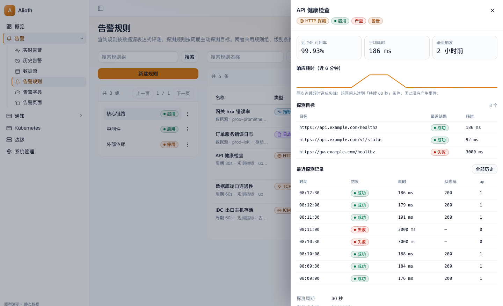
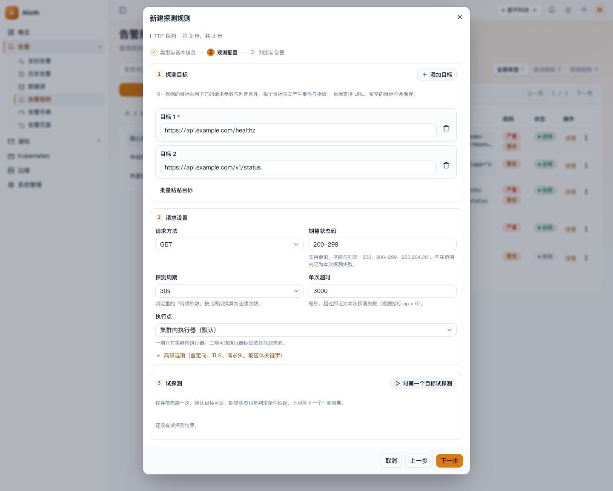
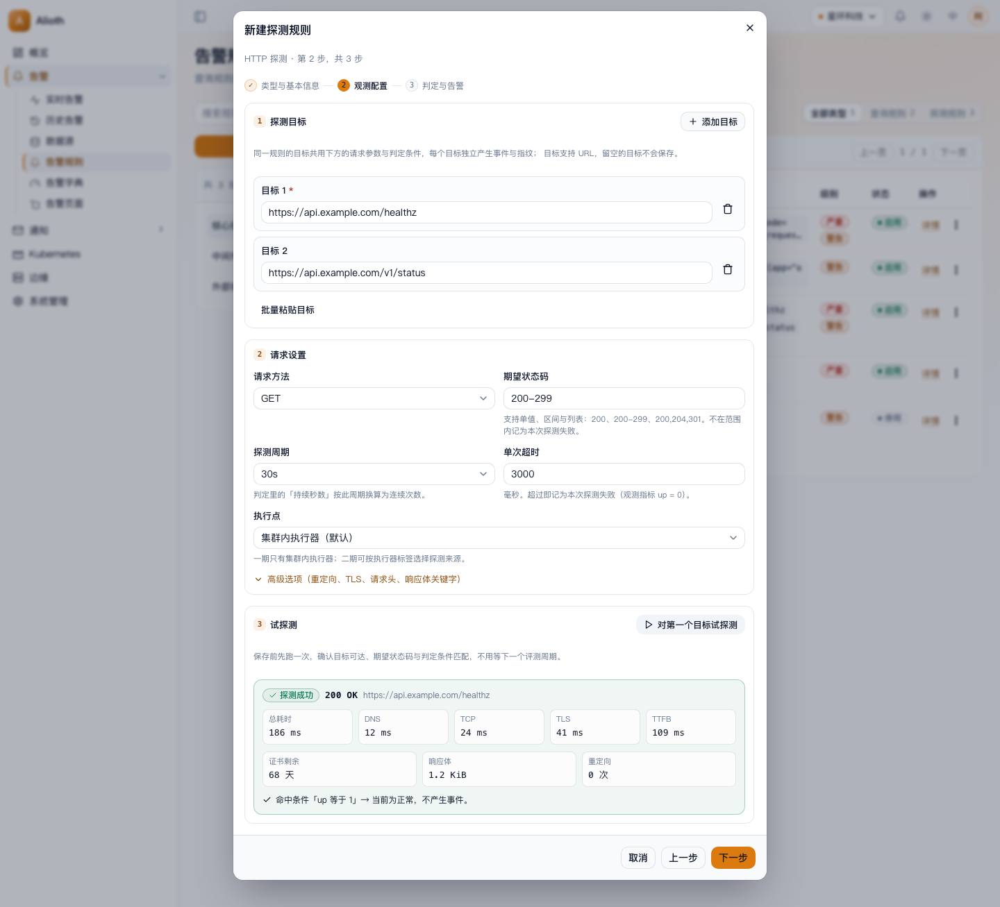
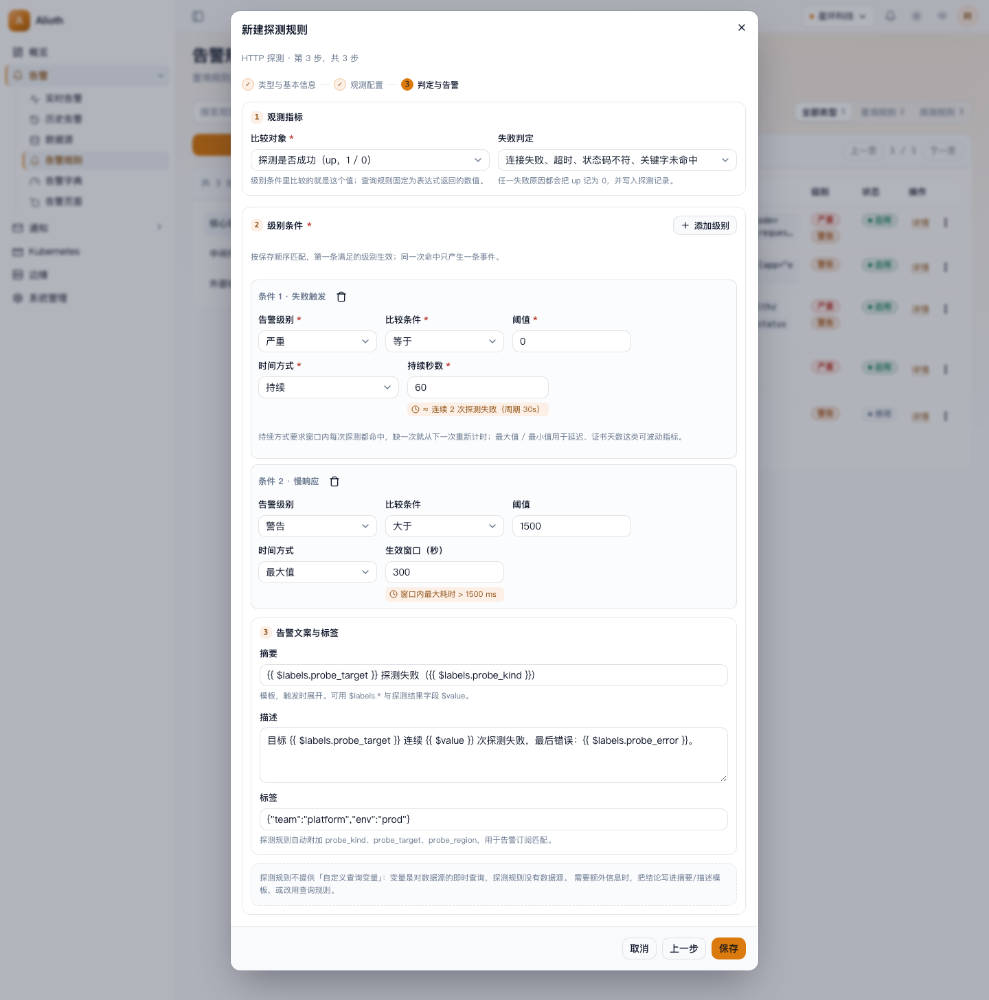
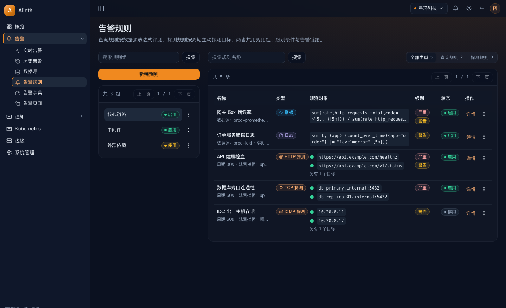
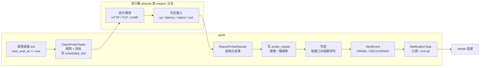

# 探测规则设计与工作方式（方案确认稿）

本文回答两件事：**探测规则怎么工作**、**为什么这样改现有规则与表单**，并附可点击原型与截图，用于确认可行性后再开工。

- 原型（可交互，支持浅色/深色）：[probe-rule-prototype.html](probe-rule-prototype.html)
- 截图目录：[images/probe-rule/](images/probe-rule/)
- 基线：`main` @ `0b3f1d3d`，分支 `docs/probe-rule-prototype`

---

## 0. 一页结论

**可行性：可行，但必须新增一条「探测」评测链路，不能塞进现有 `megrez` 的查询评测路径。**

| 判断 | 依据 |
| --- | --- |
| 规则、规则组、列表、权限、告警事件、通知、归档可原样复用 | 探测规则共用 `AlertRule` 表与事件模型；数据源可用性告警（M17）已经证明「非查询来源的事件」可以复用 `AlertEvent` 与通知链路 |
| 表单必须重新设计 | 现有表单以「驱动 + 表达式 + 数据源标签匹配」为主语（`web/src/pages/alert-rule/index.tsx`），探测规则没有数据源、没有表达式；语义先变，表单必须跟着变 |
| 评测链路必须新增 | `ClaimRules` 只按「规则 × 数据源」展开，无匹配数据源即不领取；`megrez` 的 `numericDriver` 不含探测驱动，会一律标 `Skipped`（`app/megrez/internal/biz/eval/worker.go:259`） |
| 调度不能直接复用 15s 扫描 | 现有定时任务每 15s（`EvalInterval`，`app/alioth/internal/biz/alertevent/alertevent.go:25`）在 `Schedule` 里把所有到期规则推到 `now+15s`（同文件 `:83`），和「探测周期可配」冲突 |
| 一期需要接受 3 个取舍 | 只从集群内执行探测、判定放在 `alioth`、`ICMP` 依赖 `NET_RAW`（见第 8 节） |

范围提醒：`docs/design.md:30` 与 `docs/roadmap.md:37` 目前写明「本期不做探测任务（probe_task）」。落地前需要把这条边界改成「不做玉树那种独立探测任务，改为探测规则」，否则实现与文档冲突。

---

## 1. 探测规则是什么

一条探测规则 = **一组目标 + 一套请求参数 + 一组判定条件**。按周期主动发起探测，把结果变成与查询规则完全一致的告警事件。

| 探测类型 | 目标形态 | 成功语义 | 可比较的观测值 |
| --- | --- | --- | --- |
| HTTP(S) | `https://api.example.com/healthz` | 连接成功、状态码在期望范围内、可选响应体关键字命中 | `up`、`latency_ms`、`status_code`、`cert_days` |
| TCP | `db.internal:5432` | TCP 三次握手在超时内完成 | `up`、`connect_ms` |
| ICMP | `10.20.8.11`、`host.internal` | 收到回包 | `up`、`loss_percent`、`rtt_ms` |

「观测值」是判定条件比较的对象。规则上选一个（默认 `up`），级别条件沿用现有的「比较条件 + 阈值 + 时间方式 + 持续秒数」：

- **失败告警**：`up` `等于` `0`，时间方式 `持续`，持续秒数 `60`
- **慢响应告警**：`latency_ms` `大于` `1500`，时间方式 `最大值`，窗口 `300`
- **证书将过期**：`cert_days` `小于` `14`（仅 HTTPS）

这样**告警级别、级别字典、模板、事件、通知一行代码都不用改语义**。

---

## 2. 规则模型

### 2.1 不新增 `type` 列，用驱动表达类型

`alert.proto` 里 `type` 字段已被 `reserved`（`api/alioth/v1/alert.proto:688`），历史设计是「类型由驱动推导」。探测继续沿用这条规则：

| 驱动（新增 3 个） | 类别（由驱动推导，不落库） | 用什么评测 |
| --- | --- | --- |
| `PROBE_HTTP` | `PROBE` | HTTP 主动探测 |
| `PROBE_TCP` | `PROBE` | TCP 连接探测 |
| `PROBE_ICMP` | `PROBE` | ICMP 回包探测 |

后端提供一个 `CategoryOfDriver(driver)` 帮助函数（`QUERY` / `PROBE`），列表、领取、调度、表单全部用它分流，不再各处 `switch` 三个字符串。驱动枚举出现在 4 处，必须同步：proto 白名单、`AlertRule` ent schema、`Datasource` ent schema（探测驱动不进数据源枚举，这里只确认不冲突）、`web/src/pages/alert-rule/index.tsx` 的 `drivers` 常量与 i18n。

### 2.2 `alert_rules` 新增字段

| 字段 | 类型 | 查询规则 | 探测规则 |
| --- | --- | --- | --- |
| `driver` | 枚举 +3 值 | 现有 6 值 | `PROBE_*` |
| `probe_interval_seconds` | int，默认 30 | 空 | 15 / 30 / 60 / 300（调度要用，必须是列，不能放 JSON） |
| `probe_metric` | 枚举 | 空 | `UP` / `LATENCY_MS` / `STATUS_CODE` / `CERT_DAYS` / `LOSS_PERCENT` |
| `probe_config` | JSON 文本 | 空 | 方法、期望状态码、超时、重定向、TLS、关键字、请求头、执行点 |
| `expr` / `datasource_labels` | 现有列 | 沿用 | 留空（保存时归一为 `""` / `{}`，不参与匹配） |
| `next_eval_at` | 现有列 | 沿用 | 复用为「下次探测时刻」 |
| `variables` | 现有列 | 沿用 | 为空：探测规则不提供自定义查询变量 |

`scheduled_slot` 不用于探测：它以 15s 为粒度被全局刷新，用来做探测批次会互相覆盖。探测批次幂等靠结果表唯一键（见 2.4）。

### 2.3 `probe_targets` 新表

目标单独建表，不塞进 `probe_config` 的 JSON 里。理由：目标要能单独启停、单独产生事件、单独看最近结果、要能批量导入，JSON 里做不到按目标去重与恢复。

```
uid, namespace_uid, rule_uid,
spec        -- 归一化目标串：URL 去掉默认端口与末尾 #、TCP 统一 host:port、ICMP 只留 host
kind        -- HTTP / TCP / ICMP（与规则 driver 一致，冗余存一份便于查询）
labels      -- 目标级标签 JSON，可为空
status      -- ACTIVE / DISABLED
排序字段      -- 保持表单里的顺序
唯一索引 (rule_uid, spec) WHERE deleted_at IS NULL
```

### 2.4 `probe_results` 新表（探测记录）

```
uid, namespace_uid, rule_uid, target_uid,
slot              -- 该轮计划时刻（unix 秒，按 interval 对齐）
probed_at         -- 实际执行时刻
ok                -- bool
value             -- 与 probe_metric 对应的数值（up=0/1、latency_ms、status_code、cert_days、loss_percent）
duration_ms, status_code, error_kind, error_message,
dns_ms, tcp_ms, tls_ms, ttfb_ms, cert_days, resolved_ip,
executor          -- 执行点标识（实例名）
唯一索引 (target_uid, slot)   -- 回写幂等
索引 (rule_uid, target_uid, probed_at)
```

保留策略：每个目标保留最近 200 条且不超过 7 天，`alioth` 每小时清理一次。详情页的「最近探测记录」和判定窗口都读这张表，不读数据源。

### 2.5 字段与现有系统的对应关系

| 现有能力 | 探测规则怎么用 |
| --- | --- |
| 规则组、规则名唯一、软删除 | 原样复用 |
| 告警级别（`AlertRuleLevel`） | 原样复用，比较的数值来自 `probe_metric` |
| 级别字典 `AlertDictionary` | 原样复用 |
| 摘要 / 描述模板 | 原样复用，模板里额外可用 `probe_target`、`probe_kind`、`probe_error`、`value` |
| 规则标签 | 原样复用，并入事件 labels |
| 数据源标签匹配 | 不适用（保存时清空并提示） |
| 自定义查询变量 | 不提供（没有数据源） |
| 事件、实时/历史告警、介入、抑制、手工恢复、归档 | 原样复用 |
| 通知订阅 / OnCall | 复用，但订阅里的「数据源」过滤条件对探测事件永不命中，见 5.6 |

---

## 3. 统一入口：列表页怎么变


沿用现有 `/alert-rules` 的两栏结构（左规则组、右规则列表），只做三处改动：

1. **右栏工具栏加「类型」分段筛选**：`全部类型 / 查询规则 / 探测规则`（带条数）。用的是历史告警页同款分段控件，不是新组件。
2. **表格列改为 6 列**：名称（含类型副行）、类型、观测对象、级别、状态、操作。
   - 查询规则的「观测对象」= 表达式（等宽字体，两行截断）
   - 探测规则的「观测对象」= 前两个目标 + 「另有 N 个目标」，每行前面带最近一次探测的圆点（`●` 成功 / `▲` 失败）
3. **行操作**：`详情` + `更多`。探测规则的「更多」里多两项：`立即探测`（执行一次、写探测记录、不按级别判定）、`复制为…`（可选，二期）。

筛选条件进 URL（沿用现有 `ruleName / rulePage / groupUid` 的写法，新增 `ruleType`），刷新和前进后退保持。

### 3.1 详情抽屉



探测规则的详情用现有 `DetailSheet`：

- 顶部：类型徽标、状态、级别徽标
- 三个统计卡：近 24h 可用率、平均耗时、最近触发时间
- 耗时曲线（近 6 分钟，取 `probe_results`）
- 目标表：目标、最近结果、耗时
- 最近探测记录表：时间、结果、耗时、状态码、`up`，底部「全部历史」进历史列表
- 基本信息：周期、期望状态码、超时、观测指标、规则组、执行点、判定条件、指纹

查询规则的详情保持现状，不在本次改动范围内。

---

## 4. 重新设计规则表单

### 4.1 为什么必须重做

现状（`web/src/pages/alert-rule/index.tsx`，1829 行）三步向导的第一步就压着「名称 + 驱动 + 可变长数据源标签匹配 + 表达式 + 标签」5 类内容，第二步是文案与变量，第三步才是级别条件。问题：

1. **驱动是隐藏主语**：表达式语言、占位、补全、匹配预览、能否评测全由驱动派生，但界面上它只是第一个下拉框；切换驱动会静默清空匹配标签（只弹 toast）。
2. **步骤没有标题**：只有「1 / 3」，用户不知道这一步在干什么、还差几步。
3. **级别行挤**：`sm:grid-cols-4` 在 672px 对话框里每列约 140px，还要塞「秒」后缀。
4. **提示重复**：同一段提示既是 `?` tooltip 又是正文。
5. **探测规则放不进去**：没有数据源、没有表达式，硬塞会让每一步都出现「不适用」字段。

### 4.2 新表单：类型先行 + 步骤有标题


- 对话框宽度从 `sm:max-w-2xl`（672px）提到 44rem（704px），仍是三段式外框（`DialogHeader` / `DialogBody` / `DialogFooter`），不自己造滚动。
- 步骤条显示标题与完成态：`① 类型与基本信息 → ② 观测配置 → ③ 判定与告警`。已完成步骤打勾，可点击回退。
- 第 1 步把**类型变成第一等公民**：两组卡片
  - 查询规则：`指标查询`、`日志查询`
  - 探测规则：`HTTP 探测`、`TCP 探测`、`ICMP 探测`
  - 卡片上是图标 + 名称 + 一句能力说明；选中态用品牌色描边 + 底色 + 勾选角标。选完下面直接给出「本规则将创建」的说明，告诉用户后面会出现什么字段。
- 第 1 步只放「名称 + 规则组」两个字段，和类型卡片一起，一屏够用。

### 4.3 第 2 步：观测配置（按类型切换）

**探测（HTTP）**：



分三个区，每个区有编号与标题，不再是无标题的字段堆叠：

1. **探测目标**：目标 1..N 的列表，每行一个输入框 + 删除；`添加目标`、`批量粘贴目标`。同一规则的目标共用下面的参数与判定条件。
2. **请求设置**：请求方法、期望状态码（支持 `200`、`200-299`、`200,204,301`）、探测周期、单次超时、执行点；折叠的「高级选项」放跟随重定向、跳过 TLS 校验、校验证书有效期、响应体关键字、请求头。
3. **试探测**：保存前先对第一个目标跑一次，返回状态码、总耗时与 DNS/TCP/TLS/TTFB 分解、证书剩余天数、响应体大小，并直接给出「命中哪条条件、会不会产生事件」的判定结论。



TCP / ICMP 是同一套骨架，字段更少：

| 类型 | 目标输入 | 参数 |
| --- | --- | --- |
| TCP | `host:port` | 周期、超时、执行点（[截图](images/probe-rule/08-tcp-target.png)） |
| ICMP | `host` 或 `IP` | 周期、超时、发包数、执行点（[截图](images/probe-rule/09-icmp-target.png)） |

**查询**：保持现有「驱动 + 数据源标签匹配 + 表达式」三件套，但收进「观测配置」这一个标题下，并把驱动改成卡片式下拉（带产品图标），切换驱动时把受影响的字段高亮提示，而不是只弹 toast。

### 4.4 第 3 步：判定与告警



1. **观测指标**：`比较对象` 下拉（探测：`up` / 响应耗时 / 状态码 / 证书剩余天数；查询规则固定为表达式返回值）+ `失败判定`（哪些失败原因算 `up=0`）。
2. **级别条件**：每条条件一张卡，卡头是「条件 1 · 失败触发」+ 删除按钮，卡内两行：
   - 行 1：告警级别、比较条件、阈值
   - 行 2：时间方式（持续 / 最大值 / 最小值）、持续秒数，**下面直接给出换算**：`按当前周期 30s 换算 ≈ 连续 2 次探测都失败`
   - 这一改动同时解决现有表单「4 列挤」和「持续秒数看不懂」两个问题
3. **告警文案与标签**：摘要、描述、标签。探测规则这里多一行说明：自动附加 `probe_kind`、`probe_target`、`probe_region`，用于订阅匹配。
4. **不支持的自定义变量**：用一条虚线框说明「探测规则不提供自定义查询变量」，而不是隐藏一块让人怀疑漏了字段。

### 4.5 校验与交互约定

| 项 | 规则 |
| --- | --- |
| 目标 | 至少 1 个；每规则 ≤ 50 个；按 `kind` 校验格式（URL 必须 http/https 且带 host；TCP 端口 1–65535；ICMP 只允许 host/IP 字面量）；同规则内去重（归一化后比较） |
| 周期 | 15 / 30 / 60 / 300 秒；持续秒数不足一个周期时提示「至少 1 个周期」 |
| 超时 | `100–interval*1000`，超过周期说明会串轮，直接拦下 |
| 期望状态码 | 解析成区间集合；非法写法当场报错 |
| 请求头 | 只允许自定义普通头，`Host`、`Content-Length`、`Transfer-Encoding` 等受控头拒绝 |
| 试探测 | 需要 `alert:write`；结果不写库、不判定、不产生事件 |
| 错误呈现 | 字段错误留在字段下；跨步骤的保存错误在 footer 上方汇总并给出「去第 N 步」的跳转 |

### 4.6 复用的现有组件（不新造轮子）

`PageHeader`、`ListFrame`、`Table` + `TableActionsHead`、`StatusBadge`、`DetailSheet`、`Dialog` 三段式、`FormField`、`StepForm`、`SearchableSelect`、`FilterChips` / `FilterToggle`、`CodeBlock`、`Switch`、`Select`、`toast`。颜色只用语义令牌（`primary` / `success` / `danger` / `muted` …），不写调色板类，暗色由语义层自动跟。



---

## 5. 工作方式（端到端）



### 5.1 调度

- 新增独立 tick（建议 5s），在 `alioth:lock:schedule:probe` 下扫描 `status=ACTIVE AND driver IN (PROBE_*) AND next_eval_at <= now`。
- 对每条规则：`slot = 按 probe_interval_seconds 对齐的当前时刻`，写 `scheduled_slot = slot`、`next_eval_at = slot + interval`。
- 现有 15s 的 `ScheduleDue` 只处理 6 个查询驱动，**不改它的语义**，避免影响指标/日志规则的评测节奏。

### 5.2 领取

新增 `ProbeService.ClaimProbeTasks`（单独的 service key，比如 `phecda`），返回：

```
task = { rule: 快照(uid, driver, probe_config, probe_metric, interval,
                   levels, labels, summary, description),
         targets: [{ uid, spec, labels, status }],
         slot: unix 秒 }
```

执行器不访问数据库，也不解析告警条件——它只负责「测」，把数值带回来。这样执行器永远和告警语义解耦，二期换执行点（边缘机器）时只需要搬执行器。

### 5.3 执行

- 单目标一次探测，总超时 `min(超时配置, interval * 0.8)`，到点立刻记为失败（`error_kind=timeout`）。
- 并发闸门沿用 `pkgworker.Gate`，默认 8 并发，单轮 30s 上限；没跑完的目标留到下一轮（槽位不同，不会重复）。
- 执行器自身故障（进程重启、上游网络不可达、DNS 解析器挂了）记 `executor_error`，**不回写结果**：既不算目标失败，也不会误恢复。这与 `megrez` 的 `failed=true` 语义一致（`app/megrez/internal/biz/eval/worker.go:285`）。

### 5.4 回写与判定

- `ReportProbeResults` 落 `probe_results`，唯一键 `(target_uid, slot)` 保证重复回写幂等。
- 判定在 `alioth` 侧完成（数据源可用性 M17 的先例）：从 `probe_results` 取该目标 `(now - window, now]` 的结果序列，构造成现有 `[]bo.Point`，直接复用 `megrez` 的 `matchLevel` 语义：
  - `持续`：窗口内每个点都命中，且相邻点间隔 ≤ `interval * 1.5`（缺一次就从下一次重新计时）
  - `最大值` / `最小值`：窗口内极值比较
  - 窗口点数不足 `for_seconds/interval` 时**不判定**，避免刚建规则就误报
- 判定函数放在 `pkg`，`megrez` 与 `alioth` 共用，防止两处语义漂移。

### 5.5 事件与指纹

| 项 | 取值 |
| --- | --- |
| fingerprint | `fingerprint.Of(rule_uid, target_uid, labels)` —— 复用现有函数，第二个参数在探测规则下承载目标标识（函数签名不变，注释写清语义） |
| labels | 规则标签 + `probe_kind` + `probe_target`（归一化目标串） |
| **不进 labels** | 错误原因、耗时、状态码、解析到的 IP —— 这些一变就会换指纹，导致「失败变成功必新事件」的抖动 |
| summary / description | 由模板渲染；`probe_error` 只进描述 |
| sample_value | 观测指标数值 |
| 恢复 | 本次成功且新条件不命中 → `RECOVERED`；`executor_error` 不参与恢复 |

### 5.6 通知

探测事件 `rule_uid` 非空、`datasource_uid` 为空，会走现有的订阅 / OnCall 匹配。但 `matchSubscription` 里「数据源过滤」是按 UID 精确比较的（`app/alioth/internal/data/notification_dispatch.go:646`），**订阅一旦勾了数据源，就永远收不到探测事件**。三条路，见第 10 节待决策。

---

## 6. 安全与限制（探测特有的问题，必须在一期定死）

| 风险 | 处理 |
| --- | --- |
| SSRF / 打到云元数据 | 默认拒绝 `169.254.169.254`、链路本地与组播网段，可用配置追加黑名单；私网默认允许（内网探活是核心需求），但要显式写进部署文档 |
| 重定向绕过 | 最多 5 跳，每一跳重新校验目标与协议，禁止跳到 `file://`、`gopher://` |
| 响应体打爆内存 | 只读前 64 KiB，声明长度超限直接判失败 |
| TLS | 默认校验；「跳过校验」是显式开关，列表页给风险标记 |
| 请求头注入 | 拒绝受控头；请求头值做换行符过滤 |
| 探测放大 | 每规则 ≤ 50 目标，每租户 ≤ 200 条探测规则，同租户总目标数配上限 |
| ICMP 权限 | 容器需要 `NET_RAW` 或 `net.ipv4.ping_group_range`；没有权限时执行器返回明确的 `executor_error`，不产出失败事件（见第 8 节取舍） |
| 并发挤占 | 探测与查询评测分开进程/分开闸门，探测慢不拖住指标评测 |

---

## 7. 接口与迁移

### 7.1 proto（新增，不动 reserved 字段号）

```proto
// api/probe/v1/probe.proto
service ProbeService {
  rpc ClaimProbeTasks(ClaimProbeTasksRequest) returns (ClaimProbeTasksResponse);
  rpc ReportProbeResults(ReportProbeResultsRequest) returns (ReportProbeResultsResponse);
}

message ProbeTask {
  ProbeRuleSnapshot rule = 1;
  int64 slot = 2;                       // 计划时刻（unix 秒）
  repeated ProbeTarget targets = 3;
}

message ProbeResult {
  string target_uid = 1;
  bool ok = 2;
  double value = 3;                     // 与 probe_metric 对应
  int64 duration_ms = 4;
  int32 status_code = 5;
  string error_kind = 6;                // timeout / dns / connect / tls / status / keyword
  string error_message = 7;
  int64 dns_ms = 8;
  int64 tcp_ms = 9;
  int64 tls_ms = 10;
  int64 ttfb_ms = 11;
  int64 cert_days = 12;
  string resolved_ip = 13;
  string executor = 14;
}
```

规则 CRUD：`CreateAlertRuleRequest` / `UpdateAlertRuleRequest` 追加 `ProbeConfig probe_config = 15;`、`repeated ProbeTargetInput targets = 16;`，driver 白名单加 3 个值（`api/alioth/v1/alert.proto:724`）。旧客户端提交旧值行为不变。

### 7.2 REST（经 web 反代）

| 方法 | 路径 | 说明 |
| --- | --- | --- |
| `GET` | `/v1/alert-rules` | 增加 `type` 过滤；返回每个规则的探测摘要（目标数、最近结果、近 24h 可用率） |
| `GET` | `/v1/alert-rules/{uid}` | 返回 `probeConfig` 与 `targets` |
| `GET` | `/v1/alert-rules/{uid}/probe-results` | 探测历史，按目标与时间过滤、分页 |
| `POST` | `/v1/alert-rules/probe-trial` | 试探测：不写库、不判定，直接返回上面 `ProbeResult` 结构 |
| `POST` | `/v1/alert-rules/{uid}/probe-now` | 立即探测一次：写 `probe_results`，走判定 |

### 7.3 迁移顺序

1. proto + ent（driver 枚举、`probe_targets`、`probe_results`）→ `make conf` / `buf generate` / ent 重生成
2. `alioth` 侧校验与存储（目标规范化、唯一索引、`RecoverSource` 扩展到目标变更）
3. 调度 + claim + 回写 + 判定（先用 curl 建规则跑通）
4. 执行器进程（或 `megrez` 的探测分支）
5. `web` 列表 + 表单 + 详情 + i18n + 权限
6. （可选）订阅的「规则类别」筛选

---

## 8. 一期取舍（决定可行性边界）

| 取舍 | 一期做法 | 为什么 | 二期 |
| --- | --- | --- | --- |
| 谁执行探测 | 集群内新进程 `phecda`（复用 megrez 的领取/锁/闸门骨架）；若不想加进程，先在 `megrez` 加探测分支 | 加进程的成本是部署多一个 pod，收益是探测出站、ICMP 权限、并发闸门与评测隔离；挤进 `megrez` 更快但会互相拖慢 | 边缘 `alkaid` 也能当执行点，按执行点标签路由 |
| 判定位置 | `alioth` 侧判定 | 与 M17 数据源可用性同构；判定要读历史结果，本来就在 `alioth` 库里 | 不变 |
| ICMP | 支持，但要求部署侧给权限；无权限时明确报错不误报 | 内网存活探测常见，但容器默认没 `NET_RAW` | 无 |
| 目标粒度 | 一条规则多目标（同类型） | 运维上是「一组接口探活」，逐条建规则不现实；评测模型天然是「规则 × 目标」，与现有「规则 × 数据源」同构 | 目标级独立周期与执行点 |
| 令牌 / 内容 | 一期不做，只支持 GET / HEAD | 减少表单复杂度，也不引入「我们会替你发任意请求体」的风险 | POST + 请求体 + 校验脚本 |

---

## 9. 复用 / 新增 / 冲突清单

**可原样复用（不改语义）**
规则组、规则名唯一与软删除、级别字典、级别条件语义（EQ/NE/GT/GTE/LT/LTE/IN/NOT_IN × FOR/MAX/MIN）、摘要/描述模板、`AlertEvent` + firing 占位、实时/历史告警、介入/抑制/手工恢复、归档分片、通知任务与 `merak` 投递、RBAC（`alert:read` / `alert:write`）、列表分页与表格样式。

**必须新增**
探测驱动 3 个（4 处同步）、`probe_*` 三个字段、`probe_targets` / `probe_results` 两张表、探测调度 tick、`ClaimProbeTasks` / `ReportProbeResults`、执行器（或 megrez 分支）、目标变更的 `RecoverSource`、列表摘要与探测历史接口、试探测接口、表单与列表改造、i18n、`docs/design.md` 与 `docs/roadmap.md` 的范围修改。

**有冲突，需要改现有逻辑（列出是因为它们才是真正的成本）**

| 冲突 | 处理 |
| --- | --- |
| `ClaimRules` 按数据源展开，无匹配不领取 | 探测走独立 RPC；同时在 `megrez` 的 claim 里过滤探测驱动，避免空转领取后标 `Skipped` |
| 15s 全局调度覆盖 `next_eval_at` / `scheduled_slot` | 探测走独立调度函数与独立锁，不复用 `ScheduleDue` |
| `eval_slot` 语义是 15s 批次 | 探测用「按 interval 对齐的 slot」，只存在于 `probe_results` 与 `scheduled_slot`，不进 `alert_eval_batches` |
| `driver` 同时承担「评测路径」与「数据源匹配」 | 用 `CategoryOfDriver` 分流，数据源匹配只对 `QUERY` 生效 |
| 改驱动/表达式/级别会让 `recoverChangedRule` 收口旧事件（`app/alioth/internal/biz/alertrule/alertrule.go:309`），目标变更目前不会 | 目标增删改、规则停用/删除都要触发对应指纹的恢复，否则旧 FIRING 永久残留 |
| 订阅的数据源过滤挡住探测事件 | 见第 10 节决策 5 |
| 设计文档声明「本期不做探测任务」 | 需要先改范围文档，否则实现即违约 |

---

## 10. 需要你确认的决策

1. **目标粒度**：一条规则多目标（推荐，已按此做原型）还是严格一条规则一个目标？
2. **执行点**：一期只从集群内探测（推荐），还是必须支持从指定边缘机器发起（会牵扯 `alkaid` 协议与权限模型，工作量翻倍）？
3. **探测类型范围**：一期 `HTTP + TCP + ICMP` 全上（推荐，但 ICMP 受部署权限限制），还是先做 `HTTP + TCP`，ICMP 二期？
4. **判定位置**：`alioth` 侧判定（推荐），还是执行器判定后只回写命中结果（回写更轻，但历史结果与判定会分家）？
5. **通知路由**：给「告警订阅」加一个「规则类别」筛选（推荐，改动小且语义清楚），还是要求探测事件只靠标签匹配（零改动，但配置容易踩空）？
6. **范围文档**：是否确认把 `docs/design.md:30` / `docs/roadmap.md:37` 的「本期不做探测任务」改成「不做独立探测任务，改为探测规则」？
7. **一期是否允许新增一个进程**（`phecda`），还是必须塞进 `megrez`？

确认后我会按第 7.3 的迁移顺序拆成可验收的提交，在 `feat/` 分支上落地，每步都能独立跑通；本次只交付设计与原型，未改动任何业务代码。

---

## 附：原型使用说明

直接用浏览器打开 [probe-rule-prototype.html](probe-rule-prototype.html)：

- 底部控制条切换 7 个场景：统一规则页、新建规则·类型、HTTP/TCP/ICMP 目标、判定与告警、试探测结果、探测详情
- 可切换浅色 / 深色，验证语义令牌在暗色下的一致性
- 交互是真的：点类型卡片换表单、步骤可前进后退、点「对第一个目标试探测」会走一次加载态再出结果、类型筛选会重排表格
- 原型是单文件、无构建、无后端依赖，只用于评审布局与字段，不代表最终组件实现
