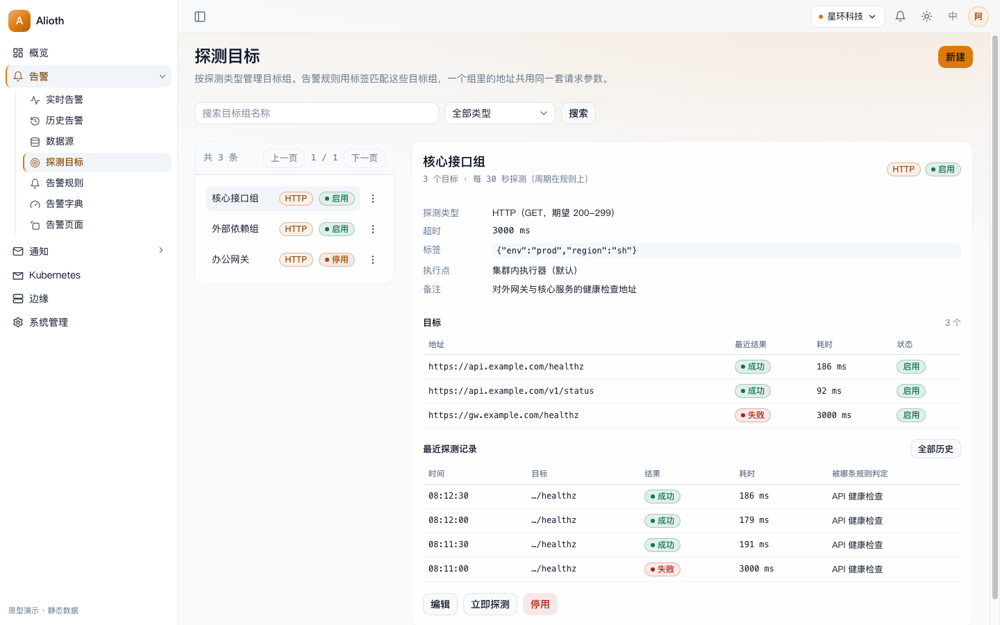
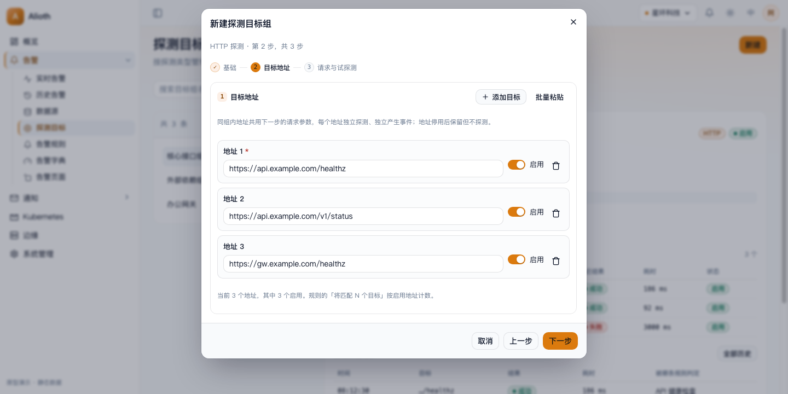
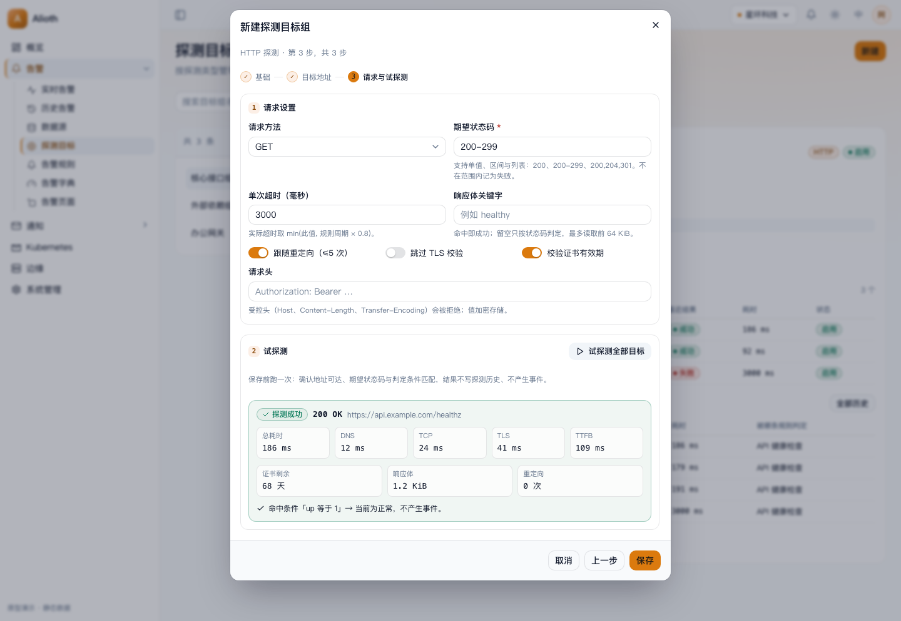
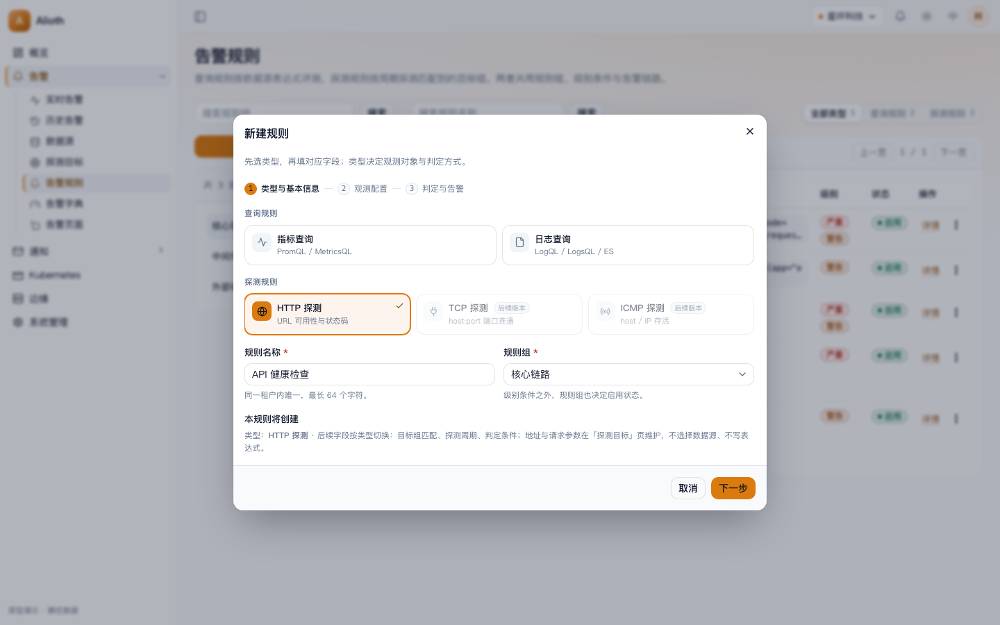
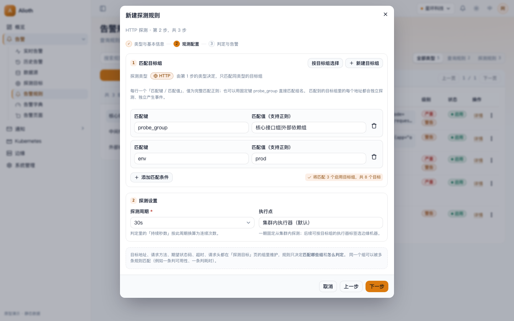
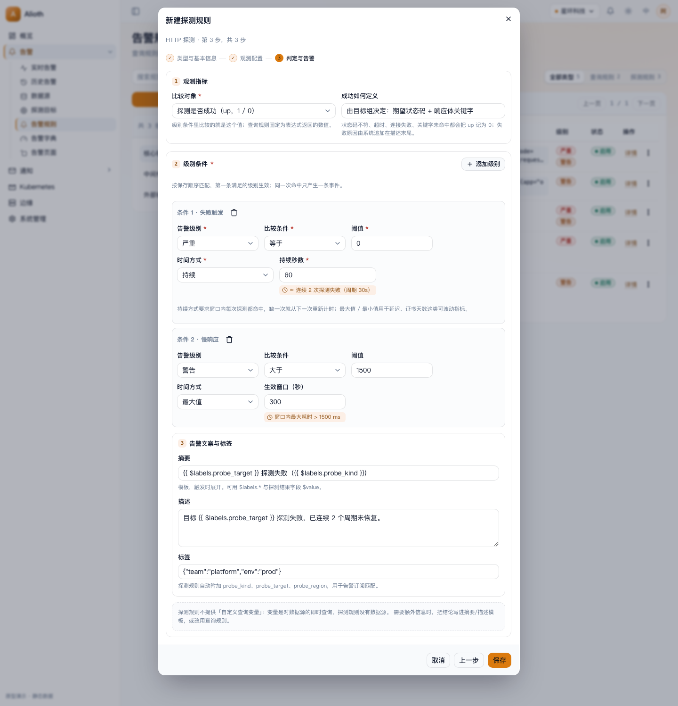
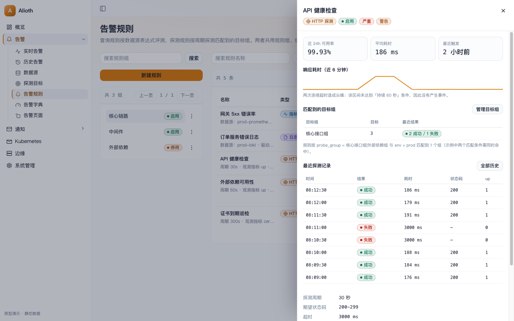
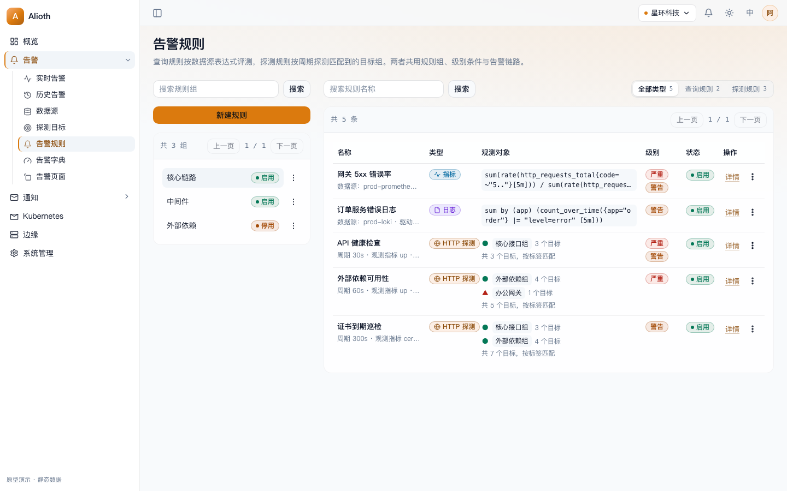
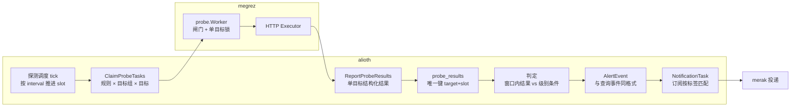

# 探测规则设计与工作方式（方案确认稿 v2）

本文说明「探测规则」**怎么工作**、**改哪些现有规则与表单**、**事件如何与现有告警链路闭环**。

- 原型（可交互，浅色/深色）：[probe-rule-prototype.html](probe-rule-prototype.html)
- 截图：[images/probe-rule/](images/probe-rule/)
- 基线：`main` @ `0b3f1d3d`，分支 `docs/probe-rule-prototype`
- v2 依据的 6 条决策见第 10 节（已确认）

---

## 0. 一页结论

**可行。一期只做 HTTP；探测在 megrez 内新增一个 worker 执行；探测目标组独立建表、用新菜单「探测目标」管理；规则按「探测类型 + 目标组标签」匹配多个目标组；事件字段、状态机、指纹、通知链路与查询事件完全一致，只新增一处「无数据源事件」的展示兜底。**

| 结论 | 依据 |
| --- | --- |
| 目标组独立建模，不做成数据源 | 数据源是「查询源」（endpoint / 索引模式 / 密钥 / 查询代理），探测组是「一组 URL + 请求参数」，共用一张表会让两个表单与校验互相污染 |
| 规则与目标组用标签匹配 | 与现有「规则 × 数据源」同一机制：新增组自动覆盖、改标签立即生效、不用逐条维护；表单提供「按组勾选」快捷填充 |
| megrez 新增探测 worker | 复用 service key 校验、redis 锁、并发闸门、实例上报；与查询评测并行、互不阻塞 |
| 事件格式不变 | 逐字段对齐 `applyHits`（第 5.5 节）；新增事件走同一套写库辅助，`AlertEvent` 表结构不变 |
| 订阅只用标签 | 事件注入 `datasource`（组名）/`probe_kind`/`probe_target`，订阅协议不改 |
| 边缘探测留口子 | 领取协议带执行器身份、目标组带 `executor_labels`、执行逻辑抽成 `Executor` 接口；一期只接受集群内执行器 |

范围提醒：`docs/design.md`、`docs/roadmap.md`、`docs/iterations/conventions.md` 里「本期不做探测任务」的表述按第 9 节一并更新。

---

## 1. 一期做什么

**HTTP 探测规则**：按周期对匹配到的目标组里的每个 URL 发 HTTP 请求，把结果变成与查询规则完全一致的告警事件。

| 维度 | 一期 | 后续 |
| --- | --- | --- |
| 探测类型 | `HTTP`（GET / HEAD） | `TCP`（host:port）、`ICMP`（host/IP） |
| 执行位置 | 集群内（megrez 的探测 worker） | 边缘机器（alkaid 作为执行器） |
| 目标粒度 | 目标组（1 组 N 个 URL），一条规则匹配多个组 | 目标级独立周期、目标级执行点 |
| 判定指标 | `up`、`latency_ms`、`status_code`、`cert_days` | 追加 `dns_ms` / `ttfb_ms` 细分指标 |

---

## 2. 领域模型

### 2.1 探测目标组 `probe_target_groups`（新表，新菜单管理）

管理范式与 `datasources` 一致（租户内唯一名称、标签、启停、软删除、备注），字段按探测定义：

| 字段 | 说明 |
| --- | --- |
| `uid` / `namespace_uid` / `name` | 名称租户内唯一，≤64 字符 |
| `driver` | 一期只有 `PROBE_HTTP` |
| `status` | `ACTIVE` / `DISABLED` |
| `labels` | JSON 对象，规则按它匹配，例如 `{"env":"prod","region":"sh"}` |
| `executor_labels` | JSON 对象，默认 `{}` = 集群内执行；边缘探测写 `{"executor":"edge","region":"sh"}`（一期只存不调度，见 5.7） |
| `request` | JSON：`method`、`expect_status`、`timeout_ms`、`follow_redirects`、`skip_tls_verify`、`verify_cert`、`headers`、`body_keyword` |
| `remark` | 备注 |

### 2.2 探测目标 `probe_targets`（新表）

| 字段 | 说明 |
| --- | --- |
| `uid` / `namespace_uid` / `group_uid` | 归属目标组 |
| `spec` | 归一化目标：URL 去掉默认端口、末尾 `#`、userinfo，保留路径与查询串 |
| `labels` / `status` / `sort` | 目标级标签、单独启停、排序 |

唯一索引 `(group_uid, spec) WHERE deleted_at IS NULL`。

### 2.3 规则新增字段 `alert_rules`

| 字段 | 查询规则 | 探测规则 |
| --- | --- | --- |
| `driver` | 现有 6 值 | 新增 `PROBE_HTTP` |
| `probe_group_labels` | 空 | 目标组标签匹配器 JSON；键包含固定键 `probe_group`（组名）与目标组自定义标签键，值为完整匹配正则 |
| `probe_interval_seconds` | 空 | 15 / 30 / 60 / 300，默认 30 |
| `probe_metric` | 空 | `UP` / `LATENCY_MS` / `STATUS_CODE` / `CERT_DAYS` |
| `expr` / `datasource_labels` / `variables` | 现有 | 留空：无查询表达式、不匹配数据源、不支持自定义查询变量 |

匹配范围就是规则的 `driver`（`PROBE_HTTP` 只匹配 HTTP 目标组），不需要额外的 `probeType` 字段。

> 为什么不复用 `datasource_labels`：两列分别表示「数据源」和「目标组」，共用会让驱动切换残留错误条件，claim 端过滤条件也会歧义。多一列换互不污染。

### 2.4 为什么不把目标组做成数据源

| 需求 | 数据源表 | 探测目标组 |
| --- | --- | --- |
| 观测对象 | 单个查询 endpoint | 一组 URL，逐个探测、逐个产生事件 |
| 请求语义 | 查询语言（PromQL / LogQL…） | HTTP 方法、期望状态码、请求头、关键字 |
| 现有字段 | 索引模式、时间字段、用户名密码、可用性告警、查询代理 | 只需要其中 3~4 个 |
| 页面 | 数据源页有「元数据 / 查询」两个 tab、同驱动唯一约束 | 需要「目标列表 / 最近探测记录」 |

做成数据源要付出：数据源页与三个接口都要为探测类型加分支、多目标无法表达、`type` 枚举被污染。独立建表只多一个 CRUD 模块。

### 2.5 结果表 `probe_results`（新表）

```
uid, namespace_uid, rule_uid, group_uid, target_uid,
slot               -- 计划时刻，按 interval 对齐的 unix 秒
probed_at,
ok, value, duration_ms, status_code, error_kind, error_message,
dns_ms, tcp_ms, tls_ms, ttfb_ms, cert_days, resolved_ip,
executor
唯一索引 (target_uid, slot)         -- 回写幂等
索引 (rule_uid, group_uid, target_uid, probed_at)
```

保留策略：每目标最近 200 条且 ≤7 天，`alioth` 每小时清理。判定窗口、目标组详情、规则详情都读这张表。

> 同一目标组被多条规则匹配时会各自探测（结果按 `rule_uid` 分开），这是有意为之：不同规则的周期和判定互不影响。代价是重复 HTTP 请求，建议同类判定用一条规则覆盖多组。

---

## 3. 新菜单：探测目标

侧边栏「告警」分组、`数据源` 之后新增 **探测目标**（`app-shell.tsx` 的 `alertLinks` 加一项，权限点 `probe:read`，图标 `Target`）。页面**照数据源页的「左列表 + 右详情卡」结构**，不是规则页的两栏表格。



- 页头：`探测目标` + 说明 + 右侧「新建」主按钮
- 筛选：名称 Input + 类型 Select（`全部类型 / HTTP`）+「搜索」outline（与数据源页同一版式，不额外加状态筛选）
- 左列表：`ListFrame`，每行 = 名称（truncate）+ 类型徽标 + 状态徽标 + ghost 更多菜单（编辑 / 启用 / 停用 / 删除）；选中行 `variant=secondary`
- 右详情卡：名称 + 目标数徽标 + 类型/状态徽标 → `dl`（探测类型、目标数、标签、执行点、备注）→ **目标表**（URL、最近结果、耗时、状态）→ **最近探测记录** → 底部启停按钮

### 3.1 新建 / 编辑目标组

沿用数据源对话框的**三步 `StepForm`**（`sm:max-w-2xl`，底部由 `StepForm` 渲染上一步/下一步/保存）：



| 步骤 | 字段 |
| --- | --- |
| ① 基础 | 名称、探测类型（HTTP；TCP/ICMP 灰态标「后续版本」）、标签（键值行 + 添加标签）、备注 |
| ② 目标 | 目标列表：一行一个 URL，添加 / 批量粘贴 / 删除 / 单条启停；每行校验 URL；至少 1 个 |
| ③ 请求与试探测 | 方法（GET/HEAD）、期望状态码（`200`、`200-299`、`200,204,301`）、超时、跟随重定向、跳过 TLS 校验、校验证书有效期、响应体关键字、请求头；底部「试探测全部目标」结果面板 |

试探测结果（保存前验证可达性与期望值，不写探测历史、不产生事件）：



校验：名称唯一、URL 合法且组内不重复、期望状态码可解析、超时 100–60000ms、请求头拒绝 `Host` / `Content-Length` / `Transfer-Encoding` 等受控头；跨步错误在保存时汇总并跳回对应步骤（沿用数据源的 `readFormError` 模式）。

---

## 4. 规则表单：把「数据源匹配」换成「目标组匹配」

### 4.1 类型选择：一期只开 HTTP



类型卡片分两组：`查询规则`（指标、日志）与 `探测规则`（HTTP 可用；TCP、ICMP 灰态标「后续版本」）。

### 4.2 第 2 步：目标组匹配



交互**照现有「数据源标签匹配」重写一份**（同一套 `SearchableSelect`、同一套完整匹配正则、同一处「将匹配 N 个」预览），代码上新增 `probeTargetMatchKeys` / `probeTargetMatchValues`（照 `alert-rule/matching.ts` 的 `datasourceMatchKeys/Values` 写），**不要复用 `datasource-label-keys.ts`**——那个是给摘要/描述模板补全 `$labels.` 用的。

- 探测类型：HTTP（跟随第 1 步，只读）
- 目标组标签匹配：可添加多行「匹配键 / 匹配值（支持正则）」，可选键 = 固定键 `probe_group`（组名）+ 当前租户 HTTP 目标组的自定义标签键
- 预览：`将匹配 3 个启用目标组，共 12 个目标`
- 快捷方式：`按目标组选择` 打开多选列表，勾选后自动写成 `probe_group` 的正则匹配器（覆盖「我就想指定这几个组」的场景）
- 探测周期：15 / 30 / 60 / 300 秒，旁边给出换算 `持续 60 秒 ≈ 连续 2 次探测`
- 执行点：一期固定「集群内执行器」只读，并注明「后续支持边缘执行点」

原来 v1 设计里的「目标列表 + 请求参数」全部搬到目标组表单，规则里不再出现 URL、方法、期望状态码。

### 4.3 第 3 步：判定与告警



- **观测指标**：`up`（默认）、响应耗时、状态码、证书剩余天数
- **级别条件**：一卡两行（级别/条件/阈值 + 时间方式/持续秒数 + 换算提示），语义与查询规则一致
- **摘要 / 描述 / 标签**：模板可用 `{{ $labels.datasource }}`（目标组名）、`{{ $labels.probe_target }}`、`{{ $labels.probe_kind }}`、`{{ $value }}`
- **成功语义由目标组定义**（期望状态码 + 关键字），规则只选「比较什么」；失败原因（`connection refused`、`status 502`、`timeout 3000ms`）由系统在事件描述末尾追加，**不进标签、不做模板变量**——否则每次失败原因变化都会换指纹，事件会抖动
- 探测规则不提供自定义查询变量，用虚线框说明原因

### 4.4 列表页与详情


`/alert-rules` 加类型分段筛选（全部 / 查询规则 / 探测规则）；「观测对象」列对探测规则显示「匹配目标组 + 目标数」；「更多」里多 `立即探测`、`查看目标组`。

探测规则详情用 `DetailSheet`：匹配到的目标组列表（含每组目标数）、最近探测记录、近 24h 可用率与平均耗时。



暗色模式下的同一页（令牌全部走语义层，不写死颜色）：



---

## 5. 工作方式（端到端）



### 5.1 调度（alioth）

- 新增 tick（5s）：`alioth:lock:schedule:probe` 内扫描 `status=ACTIVE AND driver='PROBE_HTTP' AND next_eval_at <= now`。
- 每条规则：`slot = floor(now / interval) * interval`，写 `scheduled_slot = slot`、`next_eval_at = slot + interval`。
- 现有 15s 的 `ScheduleDue`（`app/alioth/internal/biz/alertevent/alertevent.go:83`）只处理查询驱动，语义不动。
- 领取时按 `probe_group_labels` 展开目标组，再展开 `ACTIVE` 目标；无匹配组则不产生任务（与查询规则「无匹配数据源不领取」一致）。

### 5.2 领取（megrez 探测 worker）

在现有 `api/megrez/v1/eval.proto` 的 `EvalService` 里**追加两个 RPC**（最省改，service key 校验沿用 `requireMegrez`，`app/alioth/internal/biz/alertevent/alertevent.go:531`）：

```
ClaimProbeTasks(executor{kind, labels}) → tasks[]
task = {
  rule:  {uid, driver, probe_metric, interval, levels, labels, summary, description},
  group: {uid, name, labels, request{...}},
  targets: [{uid, spec, labels}],
  slot
}
ReportProbeResults(rule_uid, slot, results[])
```

执行器身份参与过滤：一期只返回 `executor_labels` 为空的目标组（5.7）。

### 5.3 megrez 新增的 worker

新增包 `app/megrez/internal/biz/probe`，与 `eval.Worker` 同构，作为 kratos 里并列的第二个 server：

```
probe/
  worker.go    // 轮询、领取、单目标锁、闸门、回写、上报
  executor.go  // Executor 接口 + HTTP 实现 + driver 注册表（TCP/ICMP 后续）
  bo.go        // 任务/结果快照
```

装配点（全部已核对）：

| 文件 | 改动 |
| --- | --- |
| `app/megrez/internal/biz/biz.go:12` | ProviderSet 聚合加 `probe.ProviderSet` |
| `app/megrez/cmd/megrez/wire.go` / `wire_gen.go` | 重生成，多一个 `probe.NewWorker` |
| `app/megrez/cmd/megrez/main.go:70` | `newApp` 加参数，`kratos.Server(httpServer, evalWorker, probeWorker)` |
| `app/megrez/internal/conf/conf.proto` + `configs/config.yaml` | 新增 `probe: { enabled, poll_interval, concurrency, max_timeout_ms }` |
| `app/megrez/internal/data/repository/` + `data/gateway.go` | 新增 `ProbeGateway` 接口与实现（同一个 gRPC client） |

worker 行为：

| 项 | 取值 | 与现有实现的关系 |
| --- | --- | --- |
| 轮询 | 5s | 与 `eval.Worker` 的 `*/2 * * * * *` 同机制，独立批次 |
| 单目标锁 | `alioth:lock:probe:{target_uid}:{slot}` | 与 `alioth:lock:eval:{rule}:{datasource}` 同类；复用 `pkg/lock` 与 `data/lock.go` 封装 |
| 并发 | `pkg/worker.Gate`，默认 8 | 与评测 worker 各自独立闸门 |
| 单轮超时 | 30s | 与现有 `roundTimeout` 一致 |
| 失败退避 | 上限 30s | 与现有 `backoffMax` 一致 |
| 回写 | 单目标一条，逐条回写 | 一个目标超时不拖累同批其他目标 |
| 自身故障 | 不回写，只记日志 | 与「查询失败不回写」一致：执行器故障 ≠ 目标故障 |
| 实例上报 | 复用 `ReportStatus`，**身份仍是 `MEGREZ`**，task 名写探测任务 | roster 只接受 `MEGREZ`/`MERAK`（`app/alioth/internal/service/eval.go:85`），换身份会被当成新进程 |

> 若后台工作进程页需要区分「指标评测组合」与「探测组合」，给 `WorkerStatus` 增加一个 `kind` 维度即可；一期可以先共用身份、只靠 task 名区分。

### 5.4 HTTP 探测语义

| 项 | 规则 |
| --- | --- |
| 成功 | 连接成功 + TLS 校验通过（未跳过）+ 状态码在期望范围 + 关键字命中（若配置） |
| 观测值 | `up`=1/0、`latency_ms`=整请求耗时、`status_code`、`cert_days`=证书剩余天数 |
| `error_kind` | `dns` / `connect` / `tls` / `timeout` / `status` / `keyword` / `redirect` / `protocol` |
| 重定向 | ≤5 跳，逐跳校验协议与目标，禁止跳到非 http(s) |
| 响应体 | 只读前 64 KiB 用于关键字判定，不落库 |
| 请求头 | 允许自定义普通头，拒绝受控头；值过滤换行 |
| 超时 | `min(配置 timeout_ms, interval × 0.8)`，到点记 `timeout` |
| 客户端 | 现有没有通用 HTTP 封装（`megrez` 只有固定 10s 的查询 client），需自建支持 per-target 超时的 `http.Client` 池 |

### 5.5 事件：与现有格式逐字段一致

探测事件与查询事件**走同一套写库辅助**（`applyHits` 的兄弟函数，同一事务语义），字段映射：

| `AlertEvent` 字段 | 查询事件（现状） | 探测事件（本期） |
| --- | --- | --- |
| `rule_uid` | 规则 UID（`alert_event_repo.go:430`） | 同 |
| `datasource_uid` | 数据源 UID（`:431`） | **空**（同 M17 数据源可用性事件先例） |
| `expr` | PromQL / LogQL（`:434`） | 归一化后的目标 URL |
| `fingerprint` | `Of(rule_uid, datasource_uid, labels)` | `Of(rule_uid, target_uid, labels)` |
| `labels` | 采样标签 + 数据源 labels + 注入键（`:404`、`:1190`） | 规则标签 + 目标组 labels + 目标级 labels + 注入键 |
| 注入键 `datasource` | 数据源名 | **目标组名** |
| 注入键 `alert_level` / `datasource_level` | 级别名 / 数据源级别名 | 级别名 / 空（删键） |
| 额外键 | —— | `probe_kind`、`probe_target` |
| `summary` / `description` | 模板渲染（`:436-437`） | 同 |
| `sample_value` | 命中数值（`:438`） | 观测指标数值 |
| `level_uid` | 级别字典（`:439`） | 同 |
| `starts_at` / `eval_slot` | `now` / 批次（`:440-441`） | 同（槽位 = 探测 slot） |
| `status` / `suppressed` / `intervened_*` / 归档 | FIRING → RECOVERED / 手工恢复 | 完全一致 |
| 通知 `externalURL` | 数据源 endpoint（`:232`、`:459`） | **目标 URL**（点开通知就能打开被探测地址） |

一个探测事件实例：

```json
{
  "ruleUid": "rule_api_health",
  "datasourceUid": "",
  "fingerprint": "9c1f…",
  "status": "FIRING",
  "expr": "https://api.example.com/healthz",
  "labels": {
    "datasource": "核心接口组",
    "alert_level": "严重",
    "probe_kind": "HTTP",
    "probe_target": "https://api.example.com/healthz",
    "env": "prod",
    "team": "platform"
  },
  "summary": "https://api.example.com/healthz 探测失败（HTTP）",
  "description": "连续 2 次探测失败，最后错误：connect: connection refused",
  "sampleValue": "0",
  "levelUid": "lvl_critical",
  "startsAt": "2026-10-29T08:12:00Z",
  "evalSlot": "2026-10-29T08:12:00Z"
}
```

**唯一需要改的读取逻辑**：告警列表/详情/筛选的「数据源」列是按 `datasource_uid` 回查数据源表的（`alert_event_repo.go:1038`、`:1054`、`:1547`），`datasource_uid` 为空就显示空。因此在这些回填处补一条**标签兜底**：uid 为空时取 labels 里的 `datasource` 作为 `DatasourceName`。这样列、按数据源名筛选、前端兜底显示三处一起生效，且不新增事件字段。

> 备选方案是「目标组直接落 `datasources` 表，用新 driver 表示」，那样列与筛选原生可用；代价是数据源页、元数据/查询 tab、可用性告警、同驱动唯一约束都要为探测类型加分支。本方案选择独立表 + 一处读取兜底。

**闭环验收（不改任何接口协议）**

- 实时/历史告警：可查、可按摘要/级别/规则名/「数据源（=目标组）」筛选
- 介入（单条/批量）、抑制、手工恢复、自动恢复：同一套接口
- 恢复后进租户历史库周表，历史分析页的统计口径不变
- 通知任务生成：订阅按标签命中、OnCall 按时段路由、`merak` 投递、消息日志可查
- 模板占位符：`{{ $labels.datasource }}`、`{{ $labels.probe_target }}`、`{{ $value }}`、`{{ .externalURL }}` 都有值
- 告警页面：能按 `probe_kind` / `datasource` 标签聚合

### 5.6 判定（alioth 侧）

- 回写落 `probe_results`（唯一键幂等）后，取该目标 `(now - 窗口, now]` 的结果序列，构造成现有 `[]bo.Point`，复用 `matchLevel` 语义：

| 时间方式 | 判定 | 注意 |
| --- | --- | --- |
| 持续 | 窗口内每个点都命中，相邻点间隔 ≤ `interval × 1.5` | 缺一次就从下一次重新计时 |
| 最大值 / 最小值 | 窗口内极值比较 | 适合延迟、证书天数 |

- 点数不足 `持续秒数 / 周期` 时不判定，避免刚建规则就误报。
- 判定函数移到 `pkg`，megrez 与 alioth 共用，防止语义漂移。
- `executor_error` 不参与判定，也不触发恢复。

### 5.7 边缘探测的预留口（一期不实现）

| 预留点 | 形态 | 一期行为 |
| --- | --- | --- |
| 领取协议 | `ClaimProbeTasks(executor{kind, labels})` | 只接受 `kind=CLUSTER`；`EDGE` 返回空 |
| 目标组字段 | `executor_labels` | 保存、校验、展示；不参与调度（空 = 集群内） |
| 执行逻辑 | `probe.Executor` 接口 + driver 注册表 | 只有 `http`；alkaid 后续 import 同一包 |
| 结果表 | `probe_results.executor` | 记集群内实例名 |
| 事件标签 | 预留 `probe_executor` 键，**一期不写** | 多执行点上线后再加，避免指纹抖动 |

最后一条是刻意的：写进事件标签就会改变指纹，后加比留字段贵得多。

---

## 6. 安全与限制

| 风险 | 处理 |
| --- | --- |
| SSRF / 云元数据 | 默认拒绝 `169.254.169.254`、链路本地与组播网段；私网默认允许（内网探活是主用途），写进部署文档 |
| 重定向绕过 | ≤5 跳，逐跳校验协议与目标 |
| 响应体打爆内存 | 只读前 64 KiB |
| TLS | 默认校验；「跳过校验」是显式开关，列表页给风险标记 |
| 请求头注入 | 拒绝受控头，值过滤换行 |
| 凭据 | 目标组请求头可能带 token，与数据源密钥一样走 `ALIOTH_ENCRYPT_KEY` 加密存储 |
| 探测放大 | 每规则 ≤50 个匹配组、每租户 ≤200 条探测规则，目标总数配上限 |
| 并发挤占 | 探测与评测是两个 kratos server、两个闸门 |

---

## 7. 接口与迁移

### 7.1 接口清单

| 类型 | 接口 |
| --- | --- |
| 目标组 CRUD | `GET/POST/PUT/DELETE /v1/probe-target-groups`、`GET /v1/probe-target-groups/{uid}` |
| 目标组动作 | `PATCH .../{uid}/status`、`POST .../{uid}/probe-now`（立即探测，写结果不判定）、`GET .../{uid}/probe-results` |
| 试探测 | `POST /v1/probe-trial`（目标 + 请求参数，不落库） |
| 匹配候选 | `GET /v1/probe-target-groups/match-keys`、`.../match-values`（规则表单的键/值候选） |
| 内部评测 | `EvalService.ClaimProbeTasks` / `ReportProbeResults`（megrez） |
| 规则 | `driver` 白名单加 `PROBE_HTTP`；`Create/UpdateAlertRuleRequest` 追加 `probe_group_labels`、`probe_interval_seconds`、`probe_metric`（新 tag，避开已 reserved 的 4/11/12/13） |

### 7.2 迁移顺序（每步可独立验证）

1. proto + ent（`PROBE_HTTP`、三张新表、规则三个字段、`perm.go` 加 `probe` 资源）→ `make conf` / `buf generate` / ent 重生成
2. `alioth` 目标组模块：CRUD、URL 归一化、标签键汇总、试探测
3. `alioth` 调度 + 领取 + 回写 + 判定 + 事件写入与读取兜底
4. `megrez` 探测 worker + 配置 + 装配 + 上报
5. `web`：`App.tsx` 路由、`app-shell.tsx` 菜单、`last-page.ts` knownPaths、`permission-catalog.ts`、i18n（zh/en）、目标组页、规则表单第 2 步、列表与详情、`api/probe-target/`
6. 文档：`design.md`、`roadmap.md`、`iterations/m18-probe-rules.md`

---

## 8. 复用 / 新增 / 冲突

**可原样复用**：规则组、名称唯一与软删除、级别字典、级别条件语义、摘要/描述模板、`AlertEvent` 全字段与状态机、实时/历史告警、介入/抑制/手工恢复、归档分片、通知任务与 `merak`、RBAC 派生、`pkg/labels` 匹配器（`CompileMatchers`）、`pkg/lock`、`pkg/worker.Gate`、`ListFrame` / `Dialog` / `DetailSheet` / `StepForm` / `SearchableSelect` / `StatusBadge`。

**新增**：`PROBE_HTTP`；目标组/目标/结果三张表；规则三个字段；探测调度 tick；两个 RPC；megrez 探测 worker；HTTP executor；目标组菜单与页面；规则表单第 2 步；列表筛选与详情区块；i18n；权限点 `probe`。

**要改现有逻辑（真实成本）**

| 冲突 | 处理 |
| --- | --- |
| `ClaimRules` 只按「规则 × 数据源」展开 | 探测独立 RPC；`Claim` 对探测驱动直接跳过，避免空转领取标 `Skipped` |
| 15s 全局调度覆盖 `next_eval_at` | 探测独立 tick + 独立锁 |
| 「数据源」列/筛选只认 `datasource_uid` | 补一处 labels 兜底（第 5.5 节） |
| 只有驱动/表达式/级别变更才恢复旧事件 | 目标增删改、目标组停用/删除、匹配器变更也要触发恢复，否则旧 FIRING 残留 |
| megrez 单 worker 装配 | `main.go` / `wire` / 配置三处改，且锁键不能与评测共用 |
| 实例身份只认 `MEGREZ`/`MERAK` | 探测 worker 复用 `MEGREZ` 身份、task 名区分；需要区分组合类型时再加 `kind` 维度 |

---

## 9. 文档要同步改的地方

| 文件 | 改动 |
| --- | --- |
| `docs/design.md` | 第 1 节「本期不做」去掉探测任务；「4. 告警」新增 4.4 探测规则 |
| `docs/roadmap.md` | 依赖图与里程碑列表加 `M18 探测规则（HTTP）`，改「本期不做」那句 |
| `docs/iterations/m18-probe-rules.md` | 新增：开发细则 + 可勾选验收 |
| `docs/iterations/conventions.md` | 「不做」清单删掉探测任务 |

---

## 10. 已确认的决策（v2）

1. **一条规则对应多个目标组**，目标组在新菜单「探测目标」里像数据源一样管理 —— 已按此设计
2. **一期只从集群内探测**，预留边缘执行口子 —— 见 5.7
3. **一期只上 HTTP** —— TCP/ICMP 灰态预告
4. **订阅只靠标签匹配** —— 事件注入 `datasource` / `probe_kind` / `probe_target`
5. **文档跟着更新** —— 见第 9 节
6. **探测 worker 放在 megrez 内新增** —— 见 5.3

## 11. 剩余风险

| 风险 | 影响 | 应对 |
| --- | --- | --- |
| `PROBE_HTTP` 加进 proto 白名单后，旧前端提交新值会被拒 | 灰度期版本错配 | 后端先接受、前端随菜单一起发；用 feature flag 控制类型卡片可见 |
| 标签匹配是动态的：新增组会让老规则突然多出目标 | 告警面扩大 | 表单给「将匹配 N 组 / M 目标」预览；保存时匹配数变化给 toast |
| 目标 URL 里的 userinfo/查询串进 `expr` 与标签 | 敏感信息进事件与通知 | `spec` 归一化去掉 userinfo；查询串可配置脱敏 |
| 探测 goroutine 泄漏 | megrez 内存增长 | 每请求 `WithTimeout`，闸门限并发，轮次结束统一 cancel |
| 多副本 megrez 同时探测 | 重复探测 | 单目标 + slot 锁；回写唯一键兜底 |
| 同一目标组被多条规则匹配 | 重复 HTTP 请求 | 文档建议同类判定合并为一条规则 |

---

## 附：原型使用说明

打开 [probe-rule-prototype.html](probe-rule-prototype.html)，底部控制条切换场景：统一规则页、探测目标组（列表+详情）、新建目标组（三步）、新建规则（类型）、规则匹配目标组、判定与告警、试探测结果、探测详情、深色模式。单文件、无构建、无后端，只用于评审布局与字段。
