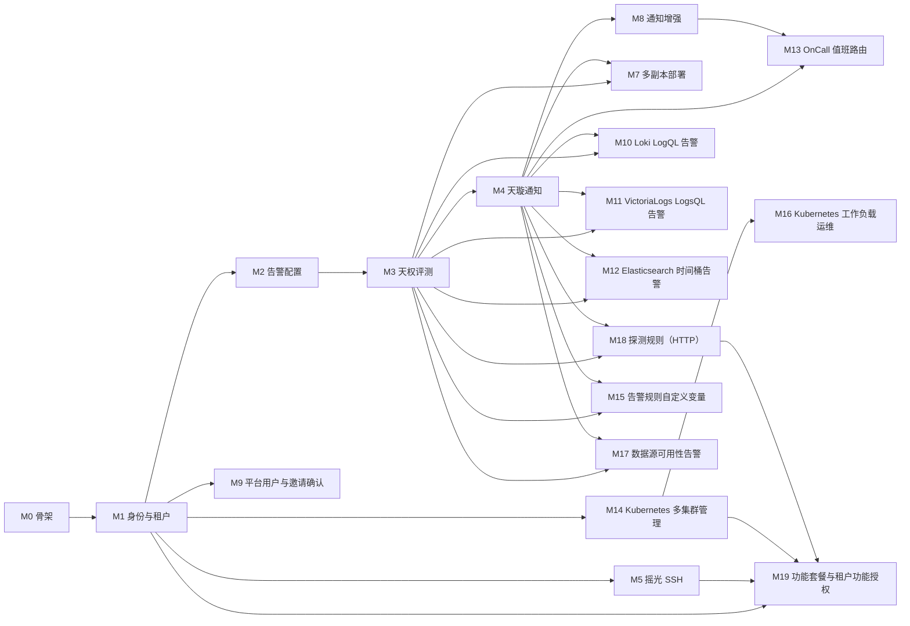

# Alioth 迭代与验收

本文把 [设计文档](design.md) 拆成十九个可独立验收的里程碑。M9 是在 M1 身份模型上的平台化调整；M10 在现有指标告警基础上补齐 Loki LogQL 数值型告警闭环；M11 为 VictoriaLogs 增加 LogsQL 数值型告警、专属查询编辑器和同样的通知闭环；M12 为 Elasticsearch 增加时间桶数值型告警闭环；M13 在通知订阅之上增加按通知组时段投递的 OnCall；M14 增加多集群 Kubernetes 接入，以及节点、工作负载、Pod 与 Ingress 的基础管理；M15 让告警规则在摘要、描述这一步声明自定义查询变量，用主查询标签补出关联不上的数据（例如磁盘剩余容量）；M16 在 Kubernetes 控制台补工作负载镜像版本管理、Job/CronJob 管理和版本回滚；M17 为数据源增加可用性告警，规则评测向上游数据源的请求失败在窗口内达到阈值时生成数据源级别的告警事件，直接通知数据源绑定的通知组；M18 增加探测规则（一期 HTTP），目标组单独管理、规则按标签匹配目标组，探测由 `megrez` 内新增的探测 worker 执行，事件与查询规则同格式并进入同一条告警与通知链路；M19 把菜单模块化成「功能」，超级管理员用「套餐」给租户开通功能，租户只能基于已开通功能给角色授权，新租户默认使用不含 Kubernetes、机器与 SSH 的基础套餐。后一步只叠加能力，不把业务数据从玉衡挪走，也不把 Redis 改成缓存或队列。不估工期。

通用规范见 [iterations/conventions.md](iterations/conventions.md)。每步的开发细则和可勾选验收：

- [M0 骨架](iterations/m0.md)
- [M1 身份与租户](iterations/m1.md)
- [M2 告警配置](iterations/m2.md)
- [M3 天权评测](iterations/m3.md)
- [M4 天璇通知](iterations/m4.md)
- [M5 摇光 SSH](iterations/m5.md)
- [M7 多副本部署](iterations/m7.md)
- [M8 通知增强](iterations/m8.md)
- [M9 平台用户与邀请确认](iterations/m9.md)
- [M10 Loki LogQL 告警闭环](iterations/m10-loki-alerts.md)
- [M11 VictoriaLogs LogsQL 告警闭环](iterations/m11-vlogs-alerts.md)
- [M12 Elasticsearch 时间桶告警闭环](iterations/m12-es-alerts.md)
- [M13 OnCall 值班路由](iterations/m13-oncall.md)
- [M14 Kubernetes 多集群管理](iterations/m14-k8s.md)
- [M15 告警规则自定义变量](iterations/m15-alert-rule-variables.md)
- [M16 Kubernetes 工作负载运维](iterations/m16-k8s-workload-ops.md)
- [M17 数据源可用性告警](iterations/m17-datasource-availability.md)
- [M18 探测规则（HTTP）](iterations/m18-probe-rules.md)
- [M19 功能套餐与租户功能授权](iterations/m19-feature-packages.md)

端口以设计文档第 2.1 节为准：

| 进程 | 监听 | 谁可以访问 |
| --- | --- | --- |
| `web` | HTTP 8080 | 集群外唯一入口。`/v1` 只反代到 `alioth:8000` |
| `alioth` | HTTP 8000，gRPC 9000 | 集群内。浏览器只经过 Web |
| `megrez` | HTTP 8001，仅健康检查（`/health`、`/livez`、`/readyz`） | 集群内探针 |
| `merak` | HTTP 8002，仅健康检查（`/health`、`/livez`、`/readyz`） | 集群内探针 |
| `alkaid` | HTTP 8022，gRPC 9022 | 所在机器或集群内。业务会话出站连接 `alioth:9000` |

8022 与 9022 不对集群外发布。`alkaid` 不在公网提供管理入口。

设计文档标明本期不做的内容，不进入任何一步：玉树那种独立于告警的探测任务（探测只做告警规则的一种类型，见 M18）、微前端、每个服务一块业务库、把 Redis 当缓存或消息队列、短信发送、除 Loki LogQL、VictoriaLogs LogsQL 与 Elasticsearch 时间桶数值型规则外的日志与链路规则评测。

验收一律可重复。检查进程端口、HTTP/gRPC、数据库结果、Redis 锁，以及浏览器经 `http://<web>:8080` 走出的路径。页面验收在浏览器里完成登录、提交和跳转，不只看静态渲染。

## 依赖

M5 依赖 M1 的身份与权限，不依赖告警评测。M9 补齐 M1 的平台用户和邀请确认模型。M7 在 M3、M4、M5 都通过之后做整平台的多副本验收。M10 在 M3 的评测事件和 M4 的通知投递基础上补齐 Loki 专属求值与告警处置闭环。M11 用同一套事件与通知机制补齐 VictoriaLogs 的 LogsQL 数值型评测、专属编辑器和接收闭环。M12 复用 M3 的评测回写与 M4 的投递链路，把 Elasticsearch 的命中数按时间桶变成采样值，再走同一套事件与通知。M13 在 M4 的任务投递和 M8 的订阅路由之上增加按通知组时段投递的 OnCall。M14 只依赖 M1 的租户与 RBAC：集群凭据由控制面加密保存，资源读取和操作直接走各集群的 API Server，不经过告警评测与通知链路。M15 复用 M3 的评测模板链路和 M4 的通知内容：变量在评测期展开并写入摘要、描述，通知投递只读取渲染后的文案。M16 在 M14 的集群控制台之上补工作负载镜像、Job/CronJob 与版本回滚，只依赖 M14。M17 复用 M3 的评测回写与失败批次记录、M4 的任务投递与消息日志：失败批次先落库计数，窗口内达到阈值后在 `AlertEvent` 里生成数据源级别事件，按数据源绑定的通知组投递。M19 复用 M1 的租户与 RBAC，只在权限检查上叠加「功能是否开通」：功能目录在代码里维护，套餐只决定租户能看到和能授权的范围，不改变权限名的含义；被套餐管理的功能来自 M5、M14、M18 已有的菜单与权限。

## M0 骨架

目标：仓库、进程和基础设施按设计文档就位，尚无业务功能。

依赖：无。

交付：

- 单仓目录与设计文档第 2.1 节一致：`api/`、`pkg/`、`app/alioth`、`app/megrez`、`app/merak`、`app/alkaid`、`web/`
- 四个后端应用各自 `go.mod`，共享库经 `replace` 指向 `pkg/`。分层为 Kratos 的 `cmd`、`internal/server`、`internal/service`、`internal/biz`、`internal/data`、`internal/conf`
- `pkg` 提供错误码和 Redis 锁。锁协议为 `SET key token NX PX`，续期与释放用 Lua 核对 token
- `alioth` 使用 ent，空 schema 可以迁移到 PostgreSQL。`megrez`、`merak`、`alkaid` 不建业务表
- `web` 是一个 Vite 应用，开发代理把 `/v1` 转到 `alioth:8000`
- 各进程按本文端口表监听

验收：

1. `alioth` 的 HTTP 在 8000、gRPC 在 9000。`GET /health` 返回成功。
2. `megrez` 只在 8001 提供健康检查（`/health`、`/livez`、`/readyz`）。8001 上访问业务路径得到拒绝或未实现，而不是一组管理接口。
3. `merak` 只在 8002 提供健康检查（`/health`、`/livez`、`/readyz`），约束与上一条相同。
4. `alkaid` 同时监听 HTTP 8022 与 gRPC 9022。
5. `web` 在 8080 提供页面。浏览器请求 `http://<web>:8080/v1/...` 到达 `alioth:8000`，不会转到 8001、8002、8022 或 9022。
6. 锁测试覆盖：首次加锁成功、第二进程加同一键失败、持有者续期成功、错误 token 不能释放、Redis 不可用时调用方拒绝执行。
7. 执行一次 ent 迁移后，PostgreSQL 中只有 `alioth` 的 schema 对象。

## M1 身份与租户

目标：浏览器可以注册、登录，并在 Namespace 内按 RBAC 访问管理台。

依赖：M0。

交付：

- 实体：`User`（含 `password_hash`）、`UserOAuth`、`Namespace`、`Member`、`Role`、`Permission`、`RolePermission`、`MemberRole`
- 注册（邮箱、密码、图形验证码）、密码登录、邮箱验证码登录、OAuth2（GitHub、Gitee、飞书）、JWT 与刷新
- 预置角色 `owner`、`admin`、`member`、`viewer`。菜单按当前用户在当前 Namespace 的权限生成
- 请求头 `X-Namespace`。业务行带 `namespace_uid`
- 服务间 service key，形态 `Authorization: Bearer sk-...`，与用户 JWT 互斥
- Web 页面：登录、注册、个人资料、Namespace、用户、成员、角色与权限。壳包含 Namespace 切换、主题和中英文

验收：

1. 未带用户 JWT 调用业务接口，返回未认证。带着 service key 不能当作普通用户访问管理页面所用的接口。
2. 经 `http://<web>:8080` 完成注册和密码登录，随后能看到个人资料。邮箱验证码登录与已配置的 OAuth2 各走通一次。
3. 创建两个 Namespace。在 A 中创建的成员与角色，用 B 的 `X-Namespace` 查询不到。
4. `viewer` 调用写接口被拒绝。`admin` 不能删除 Namespace，也不能移交 owner。`owner` 可以。
5. 切换 Namespace 之后，下一次请求带上新的 `X-Namespace`。没有 Namespace 时，页面引导创建。
6. 封禁用户后，该用户的令牌不能再访问业务接口。解封后可以。
7. 浏览器地址栏里的 API 主机只有 Web 的 8080。

## M2 告警配置

目标：租户可以维护数据源、级别和规则。这一步不评测。

依赖：M1。

交付：

- 实体：`Datasource`、`AlertDictionary`、`AlertRuleGroup`、`AlertRule`、`AlertRuleLevel`
- 数据源类型与驱动：Metrics（Prometheus、VictoriaMetrics）、Logs（Elasticsearch、Loki）、Trace（Jaeger）
- 指标数据源的状态、指标列表、指标详情、即时查询、区间查询、代理查询
- 规则组、规则、比较条件（EQ、NE、GT、GTE、LT、LTE、IN、NOT_IN）和采样（FOR、MAX、MIN）
- 密钥字段加密后入库
- Web 页面：数据源（左侧列表、右侧查询）、规则组与规则（左侧分组、右侧明细）、告警字典

验收：

1. 以具备 `datasource:write` 的用户，经 Web 保存三种数据源。数据库中的密码、密钥不是明文。
2. `viewer` 可以查看数据源和规则，不能创建或启停。
3. 对 Prometheus 或 VictoriaMetrics 执行即时查询和区间查询，结果回到页面。Logs、Trace 可以保存并做查询代理。
4. 保存一条 Logs 或 Trace 规则后，库里没有评测批次，也没有 `AlertEvent`。
5. 停用的规则不出现在到期扫描的候选集合里。启用后才会出现。
6. 同一 Namespace 内规则组名称重复时被拒绝。另一个 Namespace 可以使用同名。

## M3 天权评测

目标：`megrez` 按指标规则产生实时告警和恢复，多副本不重复评测。

依赖：M2。

交付：

- 实体：`AlertEvent`。PostgreSQL 按时间做声明式分区
- `alioth` 在 `alioth:lock:schedule:eval` 下扫描到期的已启用指标规则，并写下一次评测时间
- `api/megrez/v1`：领取规则快照、回写 FIRING、恢复，以及未实现驱动的跳过结果。实现者是 `alioth`，调用者是 `megrez`，凭证是 service key
- `megrez` 对 `alioth:lock:eval:{rule_uid}:{datasource_uid}` 加锁后评测，结束释放。续期失败则不回写成功
- 规则按类型 + 数据源标签匹配多数据源并逐源评测；fingerprint 含 datasource_uid
- 事件状态：`FIRING`、`RECOVERED`、`RECOVERED_BY_MANUAL`
- 实时列表、历史列表、介入、批量介入、抑制、恢复、批量恢复、统计
- Web 页面：实时告警、历史告警

验收：

1. 准备一条会命中的指标规则。一个评测周期后出现一条 FIRING，fingerprint 相同的再次评测不新增第二条当前 FIRING。
2. 条件不再命中后，该事件变为恢复，并且只有一条恢复记录。
3. 同时启动两个 `megrez`。同一 `rule_uid` 只有一个副本完成评测和回写。另一个因没拿到锁而跳过。
4. 评测过程中停掉 Redis。持锁副本续期失败后不把这次评测报成成功。恢复 Redis 后下一轮可以继续。
5. 保存 Logs 或 Trace 规则并等到调度。回写标明未评测，不产生 FIRING。
6. 在实时告警页面对一条 FIRING 执行抑制、介入和手工恢复。状态与历史列表一致。`viewer` 不能执行这些写操作。
7. 用户 JWT 调用领取和回写接口被拒绝。`megrez` 的 8001 仍然只有健康检查。

## M4 天璇通知

目标：告警和试发都变成任务，由 `merak` 投递邮件或 Webhook。

依赖：M3。

交付：

- 实体：`NotificationChannel`、`NotificationTemplate`、`NotificationGroup`、`NotificationTask`、`MessageLog`
- 渠道为 SMTP，以及 Webhook 应用 OTHER、DINGTALK、WECHAT、FEISHU。`SMS_ALICLOUD` 只出现在枚举里，没有发送实现
- 规则绑定一个或多个通知组。FIRING 与恢复各生成一次等效任务
- `api/merak/v1`：领取 PENDING 任务、回写 SENT、FAILED、CANCELLED。实现者是 `alioth`
- `merak` 先对 `alioth:lock:notify:{task_uid}` 加锁，再把任务改为 SENDING 并投递。消息日志按时间分区
- Web 页面：通知渠道、模板、通知组、消息日志

验收：

1. 一条 FIRING 只生成一条等效 `NotificationTask`。恢复另有一条，不与 FIRING 任务重复。
2. 同时启动两个 `merak`。同一任务只有一个副本发送成功，消息日志只有一次成功投递。
3. 邮件与四种 Webhook 各成功投递一次。选择短信类型时没有发送实现，任务不会被报成 SENT。
4. 让渠道地址不可达。任务变为 FAILED，并按剩余次数回到 PENDING。耗尽次数后停在 FAILED。页面上可以手工重试和取消。
5. 在页面上试发。产生的是 `NotificationTask`，由 `merak` 投递。`merak` 进程内没有同步等待 SMTP 的管理接口。
6. 渠道密码和 Webhook 签名在库里是密文。
7. `merak` 的 8002 仍然只有健康检查。用户 JWT 不能领取通知任务。

## M5 摇光 SSH

目标：Agent 出站上线，审核通过的 SSH 命令在指定机器上执行。

依赖：M1。

交付：

- 实体：`Agent`、`SSHCommand`、`SSHCommandAudit`
- 签发与吊销 Agent 令牌。令牌只用于出站流
- `alkaid` 主动连接 `alioth:9000`，注册 Namespace、令牌、主机名和机器标识，并周期心跳、上报机器信息
- SSH 提交、通过、拒绝、单条执行、批量执行。未通过的命令不能执行
- Web 页面：机器、SSH 命令与审计

验收：

1. `alkaid` 进程监听 8022 和 9022，并向 `alioth:9000` 建立流。从集群外访问这两个端口失败。Web 的 nginx 不反代到 8022 或 9022。
2. 流建立后，机器页显示在线。断开进程后，下一次查看变为离线。对离线 Agent 执行命令，接口立即失败，不在 `alioth` 内存里排队。
3. 吊销令牌后，已建立的流在下一次心跳被关闭。旧令牌不能再次注册。
4. 未审核或已拒绝的命令执行被拒绝。通过后的命令在目标主机执行，审计含操作者、命令、退出码和输出。
5. 没有 `ssh:exec` 的用户不能执行。`viewer` 只能查看命令和审计。
6. 用户 JWT 不能打开 Agent 流。Agent 令牌不能调用 Namespace、用户或规则接口。

## M7 多副本部署

目标：控制面和两个工作进程可以多副本运行，集群外仍然只有 Web。

依赖：M3、M4、M5。

交付：

- `web`、`alioth`、`megrez`、`merak` 的 Deployment，副本数至少为 2
- PostgreSQL 与 Redis 独立部署。Redis 不承担业务持久化
- `alkaid` 的 systemd 单元，以及 Kubernetes Deployment 或 DaemonSet 说明。配置包含 `alioth` 的 gRPC 地址和 Agent 令牌。多副本时 Agent 对每个 `alioth` 副本各建一条流；Kubernetes 使用无头 Service，集群外使用逗号分隔的地址列表
- 只有 `web` 的 Service 对集群外开放

验收：

1. 四个 Deployment 的就绪副本都不少于 2。停掉其中一个 `alioth` 副本后，经 Web 的登录和个人资料仍然成功。
2. 停掉其中一个 `megrez` 副本后，到期指标规则仍能产生或恢复告警。停掉其中一个 `merak` 副本后，PENDING 任务仍能发出。
3. 从集群外只能访问 `web` 的 8080。8000、8001、8002、8022、9000、9022 都不可达。
4. 集群内探针可以访问 `megrez:8001/readyz` 和 `merak:8002/readyz`。
5. 按 systemd 说明安装一台 `alkaid`，以及按 Kubernetes 说明安装一个 `alkaid`。两者都出站注册到 `alioth:9000`，并在机器页显示在线。
6. 抽查一条数据源密钥、一条渠道密钥和一条用户记录：库里没有明文密码。SSH 审计不能被 `member` 或 `viewer` 删除。

## M8 通知增强

目标：补齐试发结果提示、通知组的成员与 Webhook 选择，并把规则直接绑定通知组改为告警事件订阅。

依赖：M4。

交付与验收细则见 [iterations/m8.md](iterations/m8.md)。

## M9 平台用户与邀请确认

目标：用户独立于租户；第一个注册用户是超级管理员；系统权限与租户权限分开；租户邀请必须由被邀请人在平台确认。

依赖：M1。

交付：

- `User.system_role`（`SUPER_ADMIN` / `SYSTEM_ADMIN` / `USER`）与唯一超级管理员约束
- 系统权限目录和 `access.RequireSystem`。用户列表只对 `system:user:read` 开放
- `MemberInvite` 邀请消息、7 天有效期、令牌摘要、邀请收件箱和邮件快捷链接
- `SystemMessage` 系统消息、未读角标，以及邀请同意/拒绝、成员被移除后的结果通知
- 平台用户页、邀请收件箱 `/invitations`、邀请函 `/invite/:token`，登录/注册支持 `next`
- 系统管理员授权、租户邀请同意/拒绝/撤销的完整接口

验收：

1. 新库第一个注册用户是超级管理员，第二个是普通用户；普通用户看不到用户列表，系统管理员可以。
2. 租户邀请后成员列表不出现被邀请人；平台邀请列表出现 `PENDING`，同意后才出现 `JOINED` 成员。
3. 邀请邮件链接可以打开邀请函，未注册邮箱注册后自动登录并完成确认；邀请创建和邀请结果都会产生系统消息。
4. 非受邀账号不能同意邀请；过期、拒绝和撤销的邀请都不能创建成员。
5. 系统管理员不能授权其他系统管理员，超级管理员可以；租户角色拿不到任何 `system:*` 权限。

## M10 Loki LogQL 告警闭环

目标：Loki 有独立于 Prometheus 的 LogQL 告警配置与数值评测路径；从规则配置、触发、通知收件到实时/历史告警处理完整闭环。

依赖：M3、M4。

交付与验收细则见 [iterations/m10-loki-alerts.md](iterations/m10-loki-alerts.md)。

## M11 VictoriaLogs LogsQL 告警闭环

目标：VictoriaLogs 有独立的 LogsQL 数值评测路径和专属查询编辑器；从规则配置、触发、通知收件到实时/历史告警处理完整闭环。

依赖：M3、M4。

交付与验收细则见 [iterations/m11-vlogs-alerts.md](iterations/m11-vlogs-alerts.md)。

## M12 Elasticsearch 时间桶告警闭环

目标：Elasticsearch 有独立的时间桶数值评测路径；命中数按时间桶变成采样值，从规则配置、触发、通知收件到实时/历史告警处理完整闭环。

依赖：M3、M4。

交付与验收细则见 [iterations/m12-es-alerts.md](iterations/m12-es-alerts.md)。

## M13 OnCall 值班路由

目标：通知下新增 OnCall，按标签、告警级别和数据源订阅事件，绑定多个通知组，并让每个组只在星期与时刻窗口内接收；管理台可以维护 OnCall 和时段。

依赖：M4、M8。

交付与验收细则见 [iterations/m13-oncall.md](iterations/m13-oncall.md)。

## M14 Kubernetes 多集群管理

目标：租户可以粘贴 kubeconfig 一键接入多个 Kubernetes 集群，在集群列表看到接入状态，并管理节点、工作负载、Pod 与 Ingress。

依赖：M1。

交付与验收细则见 [iterations/m14-k8s.md](iterations/m14-k8s.md)。

## M15 告警规则自定义变量

目标：规则在摘要、描述这一步可以声明自定义查询变量；触发时用主查询命中的标签展开变量查询语句，把查到的值填进摘要和描述，补出主查询关联不上的数据（例如磁盘剩余容量）。

依赖：M3、M4。

交付与验收细则见 [iterations/m15-alert-rule-variables.md](iterations/m15-alert-rule-variables.md)。

## M16 Kubernetes 工作负载运维

目标：在 M14 的控制台上补三类运维能力——按容器查看与设置工作负载镜像版本、管理 Job 与 CronJob、把工作负载回滚到历史版本。

依赖：M14。

交付与验收细则见 [iterations/m16-k8s-workload-ops.md](iterations/m16-k8s-workload-ops.md)。

## M17 数据源可用性告警

目标：数据源可开启可用性告警；规则评测对数据源的上游请求在窗口内失败达到阈值时，生成一条数据源级别的 FIRING 事件，直接通知数据源绑定的通知组，并在下一次成功评测后恢复、归档到历史分片。

依赖：M3、M4。

交付与验收细则见 [iterations/m17-datasource-availability.md](iterations/m17-datasource-availability.md)。

## M19 功能套餐与租户功能授权

目标：菜单模块化成为「功能」，超级管理员用「套餐」给租户开通功能；租户只能基于已开通功能给角色授权；新租户默认使用不含 Kubernetes、机器与 SSH 的基础套餐，存量租户保持升级前能力。

依赖：M1、M5、M14、M18。

交付与验收细则见 [iterations/m19-feature-packages.md](iterations/m19-feature-packages.md)。

## 完成标准

各里程碑的验收全部通过，并且没有把本期不做的能力做进主干。此时平台满足设计文档：浏览器只访问 Web，业务数据在玉衡，天权评测，天璇按告警订阅和 OnCall 路由并投递，摇光出站执行 SSH 与 Web Shell，多副本互斥用 Redis 锁；租户在玉衡内接入多个 Kubernetes 集群并管理基础资源。
